# 01. System Architecture & Detailed Design Document (CDR Deliverable)
## Modern Modular Restructuring of ITB-SCREEN-RECORDER.Core

- **Target Baseline:** .NET 8.0 LTS | C# 12.0 | Air-Gapped Mission-Critical Command & Control Node
- **Subsystem Focus:** `ITB-SCREEN-RECORDER.Core` Restructuring & Contract Consolidation
- **Lead System Architect:** `@SystemArchitect`
- **Domain Invariants Ref:** `RULES.md` / `SYSTEM_BOOK.md` / `.agent-kit/tracking/BASELINE_AS_IS.md`
- **Milestone:** Critical Design Review (CDR)

---

## 1. Executive Summary & Traceability Matrix

### 1.1 Context and Operational Motivation
The `ITB-SCREEN-RECORDER.Core` assembly is the foundational, shared bedrock of the entire enterprise recording platform. It provides domain entities, contracts, IPC communication protocols, native media probe and encoder bindings, hardware probes, SQLite connection management, and PKI security facilities across all solution components:
- **`ITB-SCREEN-RECORDER.Server`** (Central C2, MediaMTX supervisor, and SignalR hub)
- **`ITB-SCREEN-RECORDER.AgentService`** (Windows Session 0 SYSTEM watchdog service)
- **`ITB-SCREEN-RECORDER.AgentWorker`** (Interactive Session 1+ screen/audio capture & RTMP worker)
- **`Features/Extractor`** & **`Features/ExtractorAdvanced`** (Forensic track cutting, multicam replay, and live-tail engines)
- **`Installers/Linux/*`** & **`Tools/ITB-SCREEN-RECORDER.Diagnostics`** (Deployment & RCA tooling)

Prior to this restructuring, contracts and interfaces were dispersed unpredictably across disparate folders (`Abstractions/`, `Contracts/`, `Ipc/`, `Media/Contracts/`, `Plugins/`), with legacy namespaces leaking from old monolithic prototypes (e.g. `ITBRecorderAgent.Providers.Audio`). Cross-cutting infrastructure concerns were intermixed in generic directories (`Common/`).

The objective of this design is to:
1. **Consolidate 100% of contracts and interfaces** under a unified hierarchy `Contracts/<Domain>/`.
2. **Organize domain engines, services, and infrastructure** into coherent, single-responsibility topic directories with subdirectories for systems.
3. **Establish a zero-breakage backward compatibility bridge** that allows legacy namespaces and consumers to function seamlessly while enabling downstream projects to transition to canonical namespaces with 0 build errors.

### 1.2 Requirements Traceability Matrix

| Req ID | Target Area | CDR Design Pattern / Architectural Mechanism | Affected Projects | Verification Method |
| :--- | :--- | :--- | :--- | :--- |
| **REQ-CORE-001** | Unified Contracts Root | Consolidate all interfaces, DTOs, and event records into `Contracts/<Domain>/` | All projects | Solution-wide clean build & static code analysis |
| **REQ-CORE-002** | Capture Contracts Isolation | Move `IAudioCaptureProvider` & `IScreenCaptureProvider` from `Abstractions/` to `Contracts/Capture/` | Core, AgentWorker | Automated Unit & Integration Tests |
| **REQ-CORE-003** | Media Contracts Unification | Move `IMediaStreamEncoder`, `IMediaProbeService`, `IAudioDecoderService`, and `MediaProbeResult` to `Contracts/Media/` | Core, Server, Extractor, AgentWorker | Automated Media & Pipeline Tests |
| **REQ-CORE-004** | IPC Contracts Boundary | Relocate IPC DTOs to `Contracts/Ipc/`; move pipe server factory to `Infrastructure/Ipc/` | Core, AgentService, AgentWorker | Session 0/1+ IPC integration tests |
| **REQ-CORE-005** | Infrastructure Subsystems | Decompose `Common/` into `Infrastructure/Logging/` and `Infrastructure/System/` | All projects | Performance Profiler & Concurrency Tests |
| **REQ-CORE-006** | Data Persistence Layer | Consolidate SQLite base classes & Dapper handlers into `Data/Sqlite/` and `Data/Handlers/` | Core, Server, Extractor | SQLite WAL Database Tests |
| **REQ-CORE-007** | Zero-Breakage Compatibility | Implement `Compatibility/LegacyCompatShims.cs` using type forwarding & namespace aliases | Server, Worker, Service, Features | 100% Solution compilation & test pass |

---

## 2. As-Is Architecture Baseline & Structural Deficiencies

### 2.1 Current File Distribution (55 files total)
Currently, `ITB-SCREEN-RECORDER.Core` contains 47 C# source files, 5 branding assets, 2 configuration files, and the project file:

```text
ITB-SCREEN-RECORDER.Core/
├── Abstractions/
│   ├── BaseSqliteConnectionFactory.cs      [NS: ITB_SCREEN_RECORDER.Core.Abstractions]
│   ├── IAudioCaptureProvider.cs            [NS: ITBRecorderAgent.Providers.Audio]  <-- Legacy alien namespace!
│   ├── IFeatureDbInitializer.cs            [NS: ITB_SCREEN_RECORDER.Core.Abstractions]
│   ├── IScreenCaptureProvider.cs           [NS: ITBRecorderAgent.Providers.Video]  <-- Legacy alien namespace!
│   └── SqliteMigrationExtensions.cs        [NS: ITB_SCREEN_RECORDER.Core.Abstractions]
├── Assets/
│   └── Branding/ (app.ico, favicon.ico, Logo.png, LogoDark.png, LogoDark2.png)
├── Common/
│   ├── BufferLimits.cs                     [NS: ITB_SCREEN_RECORDER.Core.Common]
│   ├── CoreLoggerProvider.cs               [NS: ITB_SCREEN_RECORDER.Core.Common]
│   ├── Logger.cs                           [NS: ITB_SCREEN_RECORDER.Core.Common]
│   └── SingleInstanceLock.cs               [NS: ITB_SCREEN_RECORDER.Core.Common]
├── Configuration/
│   ├── AppConfig.cs                        [NS: ITB_SCREEN_RECORDER.Core.Configuration]
│   ├── ConfigLoader.cs                     [NS: ITB_SCREEN_RECORDER.Core.Configuration]
│   ├── ConfigValidationRules.cs            [NS: ITB_SCREEN_RECORDER.Core.Configuration]
│   ├── DatabaseOptions.cs                  [NS: ITB_SCREEN_RECORDER.Core.Configuration]
│   └── SystemConfig.cs                     [NS: ITB_SCREEN_RECORDER.Core.Configuration]
├── Contracts/
│   ├── Jobs/ (IClusterJobRunner.cs, IClusterWorkerSelector.cs)
│   ├── Keystroke/ (KeystrokeContracts.cs)
│   ├── Network/ (AuthDto.cs, CommunicationModels.cs, ServerDiscoveryContracts.cs, StationRoleContracts.cs)
│   ├── Storage/ (ChunkFinalizedEvent.cs, RecordingChunkDto.cs)
│   └── Topology/ (StationDirectorPlanDto.cs, StationDisplayTopologyDto.cs)
├── Data/
│   └── JsonTypeHandler.cs                  [NS: ITB_SCREEN_RECORDER.Core.Data]
├── Diagnostics/
│   ├── DebugHelper.cs                      [NS: ITB_SCREEN_RECORDER.Core.Diagnostics]
│   ├── HardwareProbe.cs                    [NS: ITB_SCREEN_RECORDER.Core.Diagnostics]
│   ├── HardwareTelemetry.cs                [NS: ITB_SCREEN_RECORDER.Core.Diagnostics]
│   ├── NetworkTelemetry.cs                 [NS: ITB_SCREEN_RECORDER.Core.Diagnostics]
│   └── SystemMetricsProfiler.cs            [NS: ITB_SCREEN_RECORDER.Core.Diagnostics]
├── Ipc/
│   ├── IpcContracts.cs                     [NS: ITB_SCREEN_RECORDER.Core.Ipc]      <-- Contract in implementation dir!
│   └── IpcServerFactory.cs                 [NS: ITB_SCREEN_RECORDER.Core.Ipc]      <-- OS pipe factory co-located with contract!
├── Media/
│   ├── Contracts/ (IAudioDecoderService.cs, IMediaProbeService.cs, IMediaStreamEncoder.cs) <-- Contracts inside Media!
│   ├── Engine/ (FfmpegInProcessAudioDecoder.cs, FfmpegInProcessEncoder.cs, FfmpegInProcessProbe.cs, FfmpegNativeResolver.cs, ManagedMp4Probe.cs)
│   └── Models/ (MediaProbeResult.cs)
├── Network/
│   └── Discovery/ (ServerDiscoveryClient.cs)
├── Plugins/
│   ├── FeatureModuleBase.cs                [NS: ITB_SCREEN_RECORDER.Core.Plugins]
│   ├── IFeatureModule.cs                   [NS: ITB_SCREEN_RECORDER.Core.Plugins]  <-- Contract inside Plugins!
│   ├── IRetentionShieldProvider.cs         [NS: ITB_SCREEN_RECORDER.Core.Plugins]  <-- Contract inside Plugins!
│   └── PluginApplicationBuilderExtensions.cs [NS: ITB_SCREEN_RECORDER.Core.Plugins]
├── Security/
│   ├── PayloadEncryptionManager.cs         [NS: ITB_SCREEN_RECORDER.Core.Security]
│   └── Pki/ (AgentCertificateValidator.cs, CertificateAuthorityManager.cs)
├── appsettings.Linux.json
├── appsettings.Windows.json
└── ITB-SCREEN-RECORDER.Core.csproj
```

### 2.2 Critical Deficiencies Identified
1. **Contract Inconsistency**: 5 separate directories hold contracts (`Abstractions/`, `Contracts/`, `Ipc/`, `Media/Contracts/`, and `Plugins/`). A developer searching for the system's contract surface cannot rely on a single source of truth.
2. **Abstractions Directory Anti-pattern**: `Abstractions/` was used as a grab-bag holding SQLite base classes alongside video and audio capture interfaces.
3. **Leaked Namespaces**: `IAudioCaptureProvider` and `IScreenCaptureProvider` used `ITBRecorderAgent.Providers.*`, coupling Core to old agent worker namespace conventions.
4. **Co-mingled Infrastructure and Domain**: `Common/` combined thread-synchronization primitives (`SingleInstanceLock`), logging facilities (`Logger`, `CoreLoggerProvider`), and payload limits (`BufferLimits`).
5. **IPC Boundary Violation**: IPC data transfer objects (`WorkerIpcStatusMessage`, `WorkerControlCommand`) were bundled in the same folder as native Windows Named Pipe security configuration (`IpcServerFactory`).

---

## 3. Target To-Be Architecture (Clean & Modular Domain Separation)

The target architecture enforces a strict two-pillar topology:
1. **`Contracts/`**: Pure contract boundaries (interfaces, immutable DTOs, record structs, event payloads). No heavy implementations, no unmanaged native bindings.
2. **Subsystem Domains & Infrastructure**: High-performance implementations, hardware-accelerated engines, data persistence, network discovery, and security primitives categorized by domain and system.

```mermaid
flowchart TD
    subgraph CoreAssembly ["ITB-SCREEN-RECORDER.Core"]
        subgraph ContractsPillar ["1. Contracts (Pure Domain Boundaries)"]
            CC_Cap["Contracts/Capture<br/>(IScreenCaptureProvider, IAudioCaptureProvider)"]
            CC_Med["Contracts/Media<br/>(IMediaStreamEncoder, IMediaProbeService, IAudioDecoderService, MediaProbeResult)"]
            CC_Ipc["Contracts/Ipc<br/>(WorkerIpcStatusMessage, WorkerControlCommand, InternalSessionState)"]
            CC_Plg["Contracts/Plugins<br/>(IFeatureModule, IRetentionShieldProvider)"]
            CC_Dat["Contracts/Data<br/>(IFeatureDbInitializer)"]
            CC_Net["Contracts/Network<br/>(AuthDto, CommunicationModels, DiscoveryContracts, RoleContracts)"]
            CC_Job["Contracts/Jobs<br/>(IClusterJobRunner, IClusterWorkerSelector)"]
            CC_Key["Contracts/Keystroke<br/>(KeystrokeContracts)"]
            CC_Sto["Contracts/Storage<br/>(ChunkFinalizedEvent, RecordingChunkDto)"]
            CC_Top["Contracts/Topology<br/>(StationDirectorPlanDto, StationDisplayTopologyDto)"]
        end

        subgraph SystemsPillar ["2. Subsystem Domains & Infrastructure"]
            SYS_Cfg["Configuration<br/>(AppConfig, ConfigLoader, ValidationRules, SystemConfig)"]
            SYS_Dat["Data<br/>├── Sqlite/ (BaseSqliteConnectionFactory, SqliteMigrationExtensions)<br/>└── Handlers/ (JsonTypeHandler)"]
            SYS_Dia["Diagnostics<br/>├── Hardware/ (HardwareProbe, HardwareTelemetry)<br/>├── Network/ (NetworkTelemetry)<br/>├── Profiling/ (SystemMetricsProfiler)<br/>└── Debug/ (DebugHelper)"]
            SYS_Inf["Infrastructure<br/>├── Logging/ (Logger, CoreLoggerProvider)<br/>├── System/ (BufferLimits, SingleInstanceLock)<br/>└── Ipc/ (IpcServerFactory)"]
            SYS_Med["Media<br/>└── Engine/ (FfmpegEncoder, FfmpegProbe, FfmpegDecoder, NativeResolver, ManagedMp4Probe)"]
            SYS_Net["Network<br/>└── Discovery/ (ServerDiscoveryClient)"]
            SYS_Plg["Plugins<br/>└── Engine/ (FeatureModuleBase, PluginApplicationBuilderExtensions)"]
            SYS_Sec["Security<br/>├── Cryptography/ (PayloadEncryptionManager)<br/>└── Pki/ (AgentCertificateValidator, CertificateAuthorityManager)"]
        end

        subgraph CompatPillar ["3. Compatibility Shim"]
            COMP["Compatibility/LegacyCompatShims.cs<br/>(Type aliases & backward-compatibility re-exports)"]
        end
    end

    SystemsPillar -.->|Implements / Employs| ContractsPillar
    COMP -.->|Forwards Legacy Types| ContractsPillar
    COMP -.->|Forwards Legacy Types| SystemsPillar
```



---

## 4. Target Directory Tree & File Inventory

```text
ITB-SCREEN-RECORDER.Core/
│
├── Assets/
│   └── Branding/
│       ├── app.ico
│       ├── favicon.ico
│       ├── Logo.png
│       ├── LogoDark.png
│       └── LogoDark2.png
│
├── Compatibility/
│   └── LegacyCompatShims.cs                 <-- Zero-breakage bridge for legacy consumers
│
├── Configuration/
│   ├── AppConfig.cs
│   ├── ConfigLoader.cs
│   ├── ConfigValidationRules.cs
│   ├── DatabaseOptions.cs
│   └── SystemConfig.cs
│
├── Contracts/
│   ├── Capture/
│   │   ├── IAudioCaptureProvider.cs         <-- From Abstractions/
│   │   └── IScreenCaptureProvider.cs        <-- From Abstractions/
│   ├── Data/
│   │   └── IFeatureDbInitializer.cs         <-- From Abstractions/
│   ├── Ipc/
│   │   └── IpcContracts.cs                  <-- From Ipc/
│   ├── Jobs/
│   │   ├── IClusterJobRunner.cs
│   │   └── IClusterWorkerSelector.cs
│   ├── Keystroke/
│   │   └── KeystrokeContracts.cs
│   ├── Media/
│   │   ├── IAudioDecoderService.cs          <-- From Media/Contracts/
│   │   ├── IMediaProbeService.cs            <-- From Media/Contracts/
│   │   ├── IMediaStreamEncoder.cs           <-- From Media/Contracts/
│   │   └── MediaProbeResult.cs              <-- From Media/Models/
│   ├── Network/
│   │   ├── AuthDto.cs
│   │   ├── CommunicationModels.cs
│   │   ├── ServerDiscoveryContracts.cs
│   │   └── StationRoleContracts.cs
│   ├── Plugins/
│   │   ├── IFeatureModule.cs                <-- From Plugins/
│   │   └── IRetentionShieldProvider.cs      <-- From Plugins/
│   ├── Storage/
│   │   ├── ChunkFinalizedEvent.cs
│   │   └── RecordingChunkDto.cs
│   └── Topology/
│       ├── StationDirectorPlanDto.cs
│       └── StationDisplayTopologyDto.cs
│
├── Data/
│   ├── Handlers/
│   │   └── JsonTypeHandler.cs               <-- From Data/
│   └── Sqlite/
│       ├── BaseSqliteConnectionFactory.cs   <-- From Abstractions/
│       └── SqliteMigrationExtensions.cs     <-- From Abstractions/
│
├── Diagnostics/
│   ├── Debug/
│   │   └── DebugHelper.cs                   <-- From Diagnostics/
│   ├── Hardware/
│   │   ├── HardwareProbe.cs                 <-- From Diagnostics/
│   │   └── HardwareTelemetry.cs             <-- From Diagnostics/
│   ├── Network/
│   │   └── NetworkTelemetry.cs              <-- From Diagnostics/
│   └── Profiling/
│       └── SystemMetricsProfiler.cs         <-- From Diagnostics/
│
├── Infrastructure/
│   ├── Ipc/
│   │   └── IpcServerFactory.cs              <-- From Ipc/
│   ├── Logging/
│   │   ├── CoreLoggerProvider.cs            <-- From Common/
│   │   └── Logger.cs                        <-- From Common/
│   └── System/
│       ├── BufferLimits.cs                  <-- From Common/
│       └── SingleInstanceLock.cs            <-- From Common/
│
├── Media/
│   └── Engine/
│       ├── FfmpegInProcessAudioDecoder.cs
│       ├── FfmpegInProcessEncoder.cs
│       ├── FfmpegInProcessProbe.cs
│       ├── FfmpegNativeResolver.cs
│       └── ManagedMp4Probe.cs
│
├── Network/
│   └── Discovery/
│       └── ServerDiscoveryClient.cs
│
├── Plugins/
│   ├── FeatureModuleBase.cs
│   └── PluginApplicationBuilderExtensions.cs
│
├── Security/
│   ├── Cryptography/
│   │   └── PayloadEncryptionManager.cs      <-- From Security/
│   └── Pki/
│       ├── AgentCertificateValidator.cs
│       └── CertificateAuthorityManager.cs
│
├── appsettings.Linux.json
├── appsettings.Windows.json
└── ITB-SCREEN-RECORDER.Core.csproj
```

---

## 5. Concrete 1-to-1 File Relocation Map

| # | Original File Location | Target File Location | Primary Type(s) Enclosed | Target Canonical Namespace |
|---|:---|:---|:---|:---|
| 1 | `Abstractions/BaseSqliteConnectionFactory.cs` | `Data/Sqlite/BaseSqliteConnectionFactory.cs` | `BaseSqliteConnectionFactory` | `ITB_SCREEN_RECORDER.Core.Data.Sqlite` |
| 2 | `Abstractions/IAudioCaptureProvider.cs` | `Contracts/Capture/IAudioCaptureProvider.cs` | `IAudioCaptureProvider` | `ITB_SCREEN_RECORDER.Core.Contracts.Capture` |
| 3 | `Abstractions/IFeatureDbInitializer.cs` | `Contracts/Data/IFeatureDbInitializer.cs` | `IFeatureDbInitializer` | `ITB_SCREEN_RECORDER.Core.Contracts.Data` |
| 4 | `Abstractions/IScreenCaptureProvider.cs` | `Contracts/Capture/IScreenCaptureProvider.cs` | `IScreenCaptureProvider` | `ITB_SCREEN_RECORDER.Core.Contracts.Capture` |
| 5 | `Abstractions/SqliteMigrationExtensions.cs` | `Data/Sqlite/SqliteMigrationExtensions.cs` | `SqliteMigrationExtensions` | `ITB_SCREEN_RECORDER.Core.Data.Sqlite` |
| 6 | `Common/BufferLimits.cs` | `Infrastructure/System/BufferLimits.cs` | `BufferLimits` | `ITB_SCREEN_RECORDER.Core.Infrastructure.System` |
| 7 | `Common/CoreLoggerProvider.cs` | `Infrastructure/Logging/CoreLoggerProvider.cs` | `CoreLoggerProvider`, `CoreLogger` | `ITB_SCREEN_RECORDER.Core.Infrastructure.Logging` |
| 8 | `Common/Logger.cs` | `Infrastructure/Logging/Logger.cs` | `Logger` | `ITB_SCREEN_RECORDER.Core.Infrastructure.Logging` |
| 9 | `Common/SingleInstanceLock.cs` | `Infrastructure/System/SingleInstanceLock.cs` | `SingleInstanceLock` | `ITB_SCREEN_RECORDER.Core.Infrastructure.System` |
| 10 | `Configuration/AppConfig.cs` | `Configuration/AppConfig.cs` | `AppConfig` | `ITB_SCREEN_RECORDER.Core.Configuration` |
| 11 | `Configuration/ConfigLoader.cs` | `Configuration/ConfigLoader.cs` | `ConfigLoader` | `ITB_SCREEN_RECORDER.Core.Configuration` |
| 12 | `Configuration/ConfigValidationRules.cs` | `Configuration/ConfigValidationRules.cs` | `ConfigValidationRules` | `ITB_SCREEN_RECORDER.Core.Configuration` |
| 13 | `Configuration/DatabaseOptions.cs` | `Configuration/DatabaseOptions.cs` | `DatabaseOptions` | `ITB_SCREEN_RECORDER.Core.Configuration` |
| 14 | `Configuration/SystemConfig.cs` | `Configuration/SystemConfig.cs` | `SystemConfig`, sub-options | `ITB_SCREEN_RECORDER.Core.Configuration` |
| 15 | `Contracts/Jobs/IClusterJobRunner.cs` | `Contracts/Jobs/IClusterJobRunner.cs` | `IClusterJobRunner` | `ITB_SCREEN_RECORDER.Core.Contracts.Jobs` |
| 16 | `Contracts/Jobs/IClusterWorkerSelector.cs` | `Contracts/Jobs/IClusterWorkerSelector.cs` | `IClusterWorkerSelector` | `ITB_SCREEN_RECORDER.Core.Contracts.Jobs` |
| 17 | `Contracts/Keystroke/KeystrokeContracts.cs` | `Contracts/Keystroke/KeystrokeContracts.cs` | Keystroke DTOs/Enums | `ITB_SCREEN_RECORDER.Core.Contracts.Keystroke` |
| 18 | `Contracts/Network/AuthDto.cs` | `Contracts/Network/AuthDto.cs` | `LoginRequestDto`, `AuthResponseDto` | `ITB_SCREEN_RECORDER.Core.Contracts.Network` |
| 19 | `Contracts/Network/CommunicationModels.cs` | `Contracts/Network/CommunicationModels.cs` | `AgentStatus`, `HeartbeatPayload`, etc. | `ITB_SCREEN_RECORDER.Core.Contracts.Network` |
| 20 | `Contracts/Network/ServerDiscoveryContracts.cs` | `Contracts/Network/ServerDiscoveryContracts.cs` | Discovery DTOs/Constants | `ITB_SCREEN_RECORDER.Core.Contracts.Network` |
| 21 | `Contracts/Network/StationRoleContracts.cs` | `Contracts/Network/StationRoleContracts.cs` | Station Role DTOs | `ITB_SCREEN_RECORDER.Core.Contracts.Network` |
| 22 | `Contracts/Storage/ChunkFinalizedEvent.cs` | `Contracts/Storage/ChunkFinalizedEvent.cs` | `ChunkFinalizedEvent` (record struct) | `ITB_SCREEN_RECORDER.Core.Contracts.Storage` |
| 23 | `Contracts/Storage/RecordingChunkDto.cs` | `Contracts/Storage/RecordingChunkDto.cs` | `RecordingChunkDto` | `ITB_SCREEN_RECORDER.Core.Contracts.Storage` |
| 24 | `Contracts/Topology/StationDirectorPlanDto.cs` | `Contracts/Topology/StationDirectorPlanDto.cs` | Topology Director DTOs | `ITB_SCREEN_RECORDER.Core.Contracts.Topology` |
| 25 | `Contracts/Topology/StationDisplayTopologyDto.cs` | `Contracts/Topology/StationDisplayTopologyDto.cs` | Topology DTOs | `ITB_SCREEN_RECORDER.Core.Contracts.Topology` |
| 26 | `Data/JsonTypeHandler.cs` | `Data/Handlers/JsonTypeHandler.cs` | `JsonTypeHandler<T>` | `ITB_SCREEN_RECORDER.Core.Data.Handlers` |
| 27 | `Diagnostics/DebugHelper.cs` | `Diagnostics/Debug/DebugHelper.cs` | `DebugHelper` | `ITB_SCREEN_RECORDER.Core.Diagnostics.Debug` |
| 28 | `Diagnostics/HardwareProbe.cs` | `Diagnostics/Hardware/HardwareProbe.cs` | `HardwareProbe`, Probe structs | `ITB_SCREEN_RECORDER.Core.Diagnostics.Hardware` |
| 29 | `Diagnostics/HardwareTelemetry.cs` | `Diagnostics/Hardware/HardwareTelemetry.cs` | Telemetry Win32/Linux structs | `ITB_SCREEN_RECORDER.Core.Diagnostics.Hardware` |
| 30 | `Diagnostics/NetworkTelemetry.cs` | `Diagnostics/Network/NetworkTelemetry.cs` | `NicMetric`, `NetworkMetricSnapshot` | `ITB_SCREEN_RECORDER.Core.Diagnostics.Network` |
| 31 | `Diagnostics/SystemMetricsProfiler.cs` | `Diagnostics/Profiling/SystemMetricsProfiler.cs` | `SystemMetricsProfiler`, CPU/Mem probes | `ITB_SCREEN_RECORDER.Core.Diagnostics.Profiling` |
| 32 | `Ipc/IpcContracts.cs` | `Contracts/Ipc/IpcContracts.cs` | `WorkerIpcStatusMessage`, `WorkerControlCommand`, `InternalSessionState` | `ITB_SCREEN_RECORDER.Core.Contracts.Ipc` |
| 33 | `Ipc/IpcServerFactory.cs` | `Infrastructure/Ipc/IpcServerFactory.cs` | `IpcServerFactory` | `ITB_SCREEN_RECORDER.Core.Infrastructure.Ipc` |
| 34 | `Media/Contracts/IAudioDecoderService.cs` | `Contracts/Media/IAudioDecoderService.cs` | `IAudioDecoderService` | `ITB_SCREEN_RECORDER.Core.Contracts.Media` |
| 35 | `Media/Contracts/IMediaProbeService.cs` | `Contracts/Media/IMediaProbeService.cs` | `IMediaProbeService` | `ITB_SCREEN_RECORDER.Core.Contracts.Media` |
| 36 | `Media/Contracts/IMediaStreamEncoder.cs` | `Contracts/Media/IMediaStreamEncoder.cs` | `IMediaStreamEncoder` | `ITB_SCREEN_RECORDER.Core.Contracts.Media` |
| 37 | `Media/Models/MediaProbeResult.cs` | `Contracts/Media/MediaProbeResult.cs` | `MediaProbeResult` | `ITB_SCREEN_RECORDER.Core.Contracts.Media` |
| 38 | `Media/Engine/FfmpegInProcessAudioDecoder.cs` | `Media/Engine/FfmpegInProcessAudioDecoder.cs` | `FfmpegInProcessAudioDecoder` | `ITB_SCREEN_RECORDER.Core.Media.Engine` |
| 39 | `Media/Engine/FfmpegInProcessEncoder.cs` | `Media/Engine/FfmpegInProcessEncoder.cs` | `FfmpegInProcessEncoder` | `ITB_SCREEN_RECORDER.Core.Media.Engine` |
| 40 | `Media/Engine/FfmpegInProcessProbe.cs` | `Media/Engine/FfmpegInProcessProbe.cs` | `FfmpegInProcessProbe` | `ITB_SCREEN_RECORDER.Core.Media.Engine` |
| 41 | `Media/Engine/FfmpegNativeResolver.cs` | `Media/Engine/FfmpegNativeResolver.cs` | `FfmpegNativeResolver` | `ITB_SCREEN_RECORDER.Core.Media.Engine` |
| 42 | `Media/Engine/ManagedMp4Probe.cs` | `Media/Engine/ManagedMp4Probe.cs` | `ManagedMp4Probe` | `ITB_SCREEN_RECORDER.Core.Media.Engine` |
| 43 | `Network/Discovery/ServerDiscoveryClient.cs` | `Network/Discovery/ServerDiscoveryClient.cs` | `ServerDiscoveryClient` | `ITB_SCREEN_RECORDER.Core.Network.Discovery` |
| 44 | `Plugins/FeatureModuleBase.cs` | `Plugins/FeatureModuleBase.cs` | `FeatureModuleBase` | `ITB_SCREEN_RECORDER.Core.Plugins` |
| 45 | `Plugins/IFeatureModule.cs` | `Contracts/Plugins/IFeatureModule.cs` | `IFeatureModule` | `ITB_SCREEN_RECORDER.Core.Contracts.Plugins` |
| 46 | `Plugins/IRetentionShieldProvider.cs` | `Contracts/Plugins/IRetentionShieldProvider.cs` | `IRetentionShieldProvider` | `ITB_SCREEN_RECORDER.Core.Contracts.Plugins` |
| 47 | `Plugins/PluginApplicationBuilderExtensions.cs` | `Plugins/PluginApplicationBuilderExtensions.cs` | `PluginApplicationBuilderExtensions` | `ITB_SCREEN_RECORDER.Core.Plugins` |
| 48 | `Security/PayloadEncryptionManager.cs` | `Security/Cryptography/PayloadEncryptionManager.cs` | `PayloadEncryptionManager` | `ITB_SCREEN_RECORDER.Core.Security.Cryptography` |
| 49 | `Security/Pki/AgentCertificateValidator.cs` | `Security/Pki/AgentCertificateValidator.cs` | `AgentCertificateValidator` | `ITB_SCREEN_RECORDER.Core.Security.Pki` |
| 50 | `Security/Pki/CertificateAuthorityManager.cs` | `Security/Pki/CertificateAuthorityManager.cs` | `CertificateAuthorityManager`, `CertificateBundle` | `ITB_SCREEN_RECORDER.Core.Security.Pki` |
| 51-55 | `Assets/Branding/*` | `Assets/Branding/*` (Unchanged) | App Icons & Logo Assets | N/A |

---

## 6. Namespace Migration and Compatibility Strategy

### 6.1 Architecture of `LegacyCompatShims.cs`
To guarantee 100% build compatibility and zero regression across the existing solution without forcing a simultaneous high-risk rewrite of every call site across 10 projects, `ITB-SCREEN-RECORDER.Core` introduces a designated backward-compatibility shim: `Compatibility/LegacyCompatShims.cs`.

This file uses C# 12 type-forwarding, type aliases, and inheriting shims for legacy namespaces:

```csharp
// =========================================================================
// File: ITB-SCREEN-RECORDER.Core/Compatibility/LegacyCompatShims.cs
// Purpose: Backward compatibility shims for relocated Core types.
// =========================================================================

#pragma warning disable CS0618 // Type or member is obsolete

// -------------------------------------------------------------------------
// Legacy Namespace: ITB_SCREEN_RECORDER.Core.Common
// -------------------------------------------------------------------------
namespace ITB_SCREEN_RECORDER.Core.Common
{
    public static class Logger
    {
        public static void LogDebug(string msg) => ITB_SCREEN_RECORDER.Core.Infrastructure.Logging.Logger.LogDebug(msg);
        public static void LogInfo(string msg) => ITB_SCREEN_RECORDER.Core.Infrastructure.Logging.Logger.LogInfo(msg);
        public static void LogWarning(string msg) => ITB_SCREEN_RECORDER.Core.Infrastructure.Logging.Logger.LogWarning(msg);
        public static void LogError(string msg, Exception? ex = null) => ITB_SCREEN_RECORDER.Core.Infrastructure.Logging.Logger.LogError(msg, ex);
    }

    public class CoreLoggerProvider : ITB_SCREEN_RECORDER.Core.Infrastructure.Logging.CoreLoggerProvider { }
    public class SingleInstanceLock : ITB_SCREEN_RECORDER.Core.Infrastructure.System.SingleInstanceLock
    {
        public SingleInstanceLock(string mutexName) : base(mutexName) { }
    }
    public static class BufferLimits
    {
        public const long MaxBufferFileSizeMb = ITB_SCREEN_RECORDER.Core.Infrastructure.System.BufferLimits.MaxBufferFileSizeMb;
        public const long RequestOverheadMb = ITB_SCREEN_RECORDER.Core.Infrastructure.System.BufferLimits.RequestOverheadMb;
        public const long MaxFileSizeBytes = ITB_SCREEN_RECORDER.Core.Infrastructure.System.BufferLimits.MaxFileSizeBytes;
        public const long MaxRequestSizeBytes = ITB_SCREEN_RECORDER.Core.Infrastructure.System.BufferLimits.MaxRequestSizeBytes;
    }
}

// -------------------------------------------------------------------------
// Legacy Namespace: ITB_SCREEN_RECORDER.Core.Abstractions
// -------------------------------------------------------------------------
namespace ITB_SCREEN_RECORDER.Core.Abstractions
{
    public abstract class BaseSqliteConnectionFactory : ITB_SCREEN_RECORDER.Core.Data.Sqlite.BaseSqliteConnectionFactory
    {
        protected BaseSqliteConnectionFactory(Microsoft.Extensions.Configuration.IConfiguration configuration, string dbFileName)
            : base(configuration, dbFileName) { }
        protected BaseSqliteConnectionFactory(string dbFileName, string? customDirectory = null, int busyTimeoutSeconds = 5)
            : base(dbFileName, customDirectory, busyTimeoutSeconds) { }
    }

    public interface IFeatureDbInitializer : ITB_SCREEN_RECORDER.Core.Contracts.Data.IFeatureDbInitializer { }
    
    public static class SqliteMigrationExtensions
    {
        public static void EnsureColumn(this System.Data.IDbConnection db, string tableName, string columnName, string columnDefinition)
            => ITB_SCREEN_RECORDER.Core.Data.Sqlite.SqliteMigrationExtensions.EnsureColumn(db, tableName, columnName, columnDefinition);
    }
}

// -------------------------------------------------------------------------
// Legacy Alien Namespaces: ITBRecorderAgent.Providers.Audio & Video
// -------------------------------------------------------------------------
namespace ITBRecorderAgent.Providers.Audio
{
    public interface IAudioCaptureProvider : ITB_SCREEN_RECORDER.Core.Contracts.Capture.IAudioCaptureProvider { }
}

namespace ITBRecorderAgent.Providers.Video
{
    public interface IScreenCaptureProvider : ITB_SCREEN_RECORDER.Core.Contracts.Capture.IScreenCaptureProvider { }
}

// -------------------------------------------------------------------------
// Legacy Namespace: ITB_SCREEN_RECORDER.Core.Media.Contracts & Models
// -------------------------------------------------------------------------
namespace ITB_SCREEN_RECORDER.Core.Media.Contracts
{
    public interface IMediaStreamEncoder : ITB_SCREEN_RECORDER.Core.Contracts.Media.IMediaStreamEncoder { }
    public interface IMediaProbeService : ITB_SCREEN_RECORDER.Core.Contracts.Media.IMediaProbeService { }
    public interface IAudioDecoderService : ITB_SCREEN_RECORDER.Core.Contracts.Media.IAudioDecoderService { }
}

namespace ITB_SCREEN_RECORDER.Core.Media.Models
{
    public class MediaProbeResult : ITB_SCREEN_RECORDER.Core.Contracts.Media.MediaProbeResult { }
}

// -------------------------------------------------------------------------
// Legacy Namespace: ITB_SCREEN_RECORDER.Core.Ipc
// -------------------------------------------------------------------------
namespace ITB_SCREEN_RECORDER.Core.Ipc
{
    public static class IpcServerFactory
    {
        public static System.IO.Pipes.NamedPipeServerStream CreateSecureServerPipe(string pipeName)
            => ITB_SCREEN_RECORDER.Core.Infrastructure.Ipc.IpcServerFactory.CreateSecureServerPipe(pipeName);
    }
}

// -------------------------------------------------------------------------
// Legacy Namespace: ITB_SCREEN_RECORDER.Core.Plugins
// -------------------------------------------------------------------------
namespace ITB_SCREEN_RECORDER.Core.Plugins
{
    public interface IFeatureModule : ITB_SCREEN_RECORDER.Core.Contracts.Plugins.IFeatureModule { }
    public interface IRetentionShieldProvider : ITB_SCREEN_RECORDER.Core.Contracts.Plugins.IRetentionShieldProvider { }
}

// -------------------------------------------------------------------------
// Legacy Namespace: ITB_SCREEN_RECORDER.Core.Security
// -------------------------------------------------------------------------
namespace ITB_SCREEN_RECORDER.Core.Security
{
    public static class PayloadEncryptionManager
    {
        public static byte[] GenerateKey() => ITB_SCREEN_RECORDER.Core.Security.Cryptography.PayloadEncryptionManager.GenerateKey();
        public static string Encrypt(string plaintext, byte[] key, string keyId) => ITB_SCREEN_RECORDER.Core.Security.Cryptography.PayloadEncryptionManager.Encrypt(plaintext, key, keyId);
        public static bool TryDecrypt(string payload, Func<string, byte[]?> keyResolver, out string? decryptedText) => ITB_SCREEN_RECORDER.Core.Security.Cryptography.PayloadEncryptionManager.TryDecrypt(payload, keyResolver, out decryptedText);
    }
}
```

### 6.2 Phased Rollout Plan
1. **Phase 1: File Relocation & Canonical Refactoring in Core**
   - Execute file relocations into `Contracts/`, `Infrastructure/`, `Data/`, `Diagnostics/`, `Security/`.
   - Update namespaces inside relocated Core files to match target canonical namespaces.
   - Deploy `LegacyCompatShims.cs` to prevent any external compilation failures.
   - Run `dotnet build ITB-SCREEN-RECORDER.Core` to guarantee zero internal errors.
2. **Phase 2: Progressive Downstream Namespace Modernization**
   - In `ITB-SCREEN-RECORDER.Server`, replace legacy usings (`Core.Common`, `Core.Abstractions`, `Core.Media.Contracts`) with target canonical namespaces (`Core.Infrastructure.Logging`, `Core.Data.Sqlite`, `Core.Contracts.Media`).
   - In `ITB-SCREEN-RECORDER.AgentWorker`, update capture provider references to `Core.Contracts.Capture`.
   - In `ITB-SCREEN-RECORDER.AgentService`, update IPC usings to `Core.Contracts.Ipc` and `Core.Infrastructure.Ipc`.
   - In `Features/Extractor` & `ExtractorAdvanced`, update media probe and decoder usings to `Core.Contracts.Media`.
3. **Phase 3: Automated V&V Gate**
   - Run solution-wide compilation (`dotnet build ITB-SCREEN-RECORDER.sln`).
   - Run full unit and integration test suite (`dotnet test`).
   - Verify zero compiler warnings introduced and 100% test pass rate.

---

## 7. Architectural Invariants Preservation

This restructuring strictly preserves all foundational architectural invariants:
1. **Windows Session 0 vs. Session 1 Isolation (Rule 4):**
   - `Infrastructure/Ipc/IpcServerFactory.cs` retains the exact Win32 `PipeSecurity` ACL configuration allowing `NT AUTHORITY\SYSTEM` (Session 0) to communicate with interactive workers (Session 1+).
2. **Multi-Monitor Per-Adapter Capture & Dynamic Hot-Plug (Rule 11):**
   - `Contracts/Capture/IScreenCaptureProvider.cs` and `Contracts/Topology/StationDisplayTopologyDto.cs` remain untouched in method signature and memory alignment, preserving per-adapter zero-PCIe transfer invariants.
3. **Discrete Microsecond Synchronized Audio (Rule 3 & 9):**
   - `Contracts/Capture/IAudioCaptureProvider.cs` and `Contracts/Media/IMediaStreamEncoder.cs` maintain raw uncompressed PCM delivery signatures for microsecond audio pacer synchronization.
4. **Wall-Clock Chunk Rotation (Rule 1):**
   - `Contracts/Storage/ChunkFinalizedEvent.cs` and `RecordingChunkDto.cs` preserve exact timestamp schema (`itb_start_epoch_ms`).
5. **Air-Gap Invariant (Rule 14):**
   - Zero outbound dependencies, remote fonts, or network telemetry introduced.
6. **Pre-flight Socket.dev Vetting (Rule 15):**
   - Zero new NuGet packages added. Restructuring utilizes native .NET 8 language and framework capabilities exclusively.
