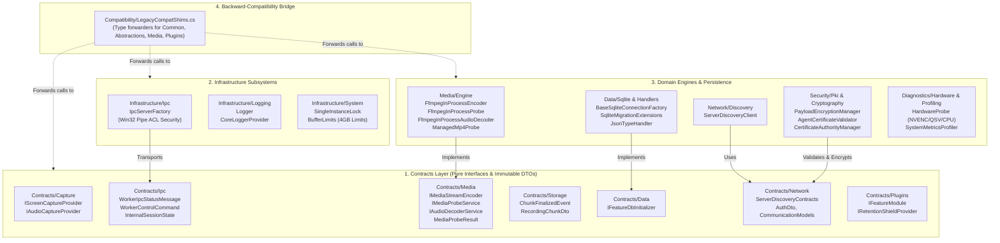
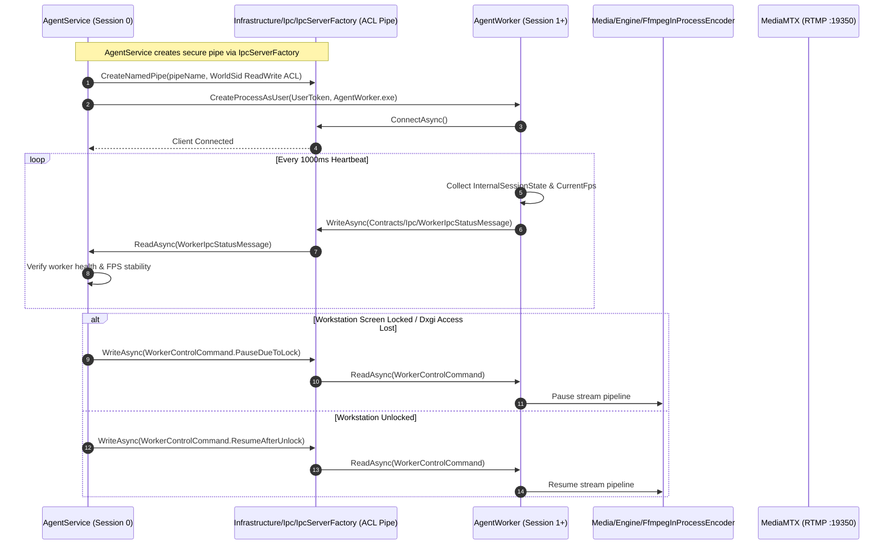
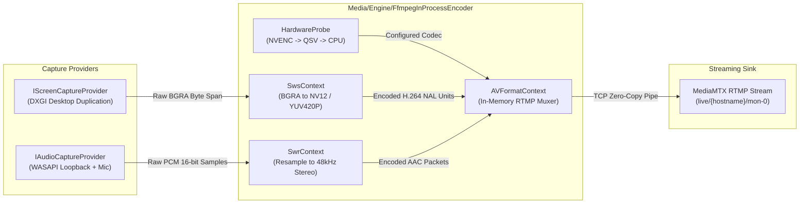

# 02. Data Flow Diagrams (DFD) & Threat Boundary Specification
## Modular Restructuring of ITB-SCREEN-RECORDER.Core

- **Target Baseline:** .NET 8.0 LTS | C# 12.0 | Air-Gapped Mission-Critical Command & Control Node
- **Component:** `ITB-SCREEN-RECORDER.Core` Restructuring & Contract Isolation
- **Lead System Architect:** `@SystemArchitect`
- **Milestone:** Critical Design Review (CDR)

---

## 1. DFD Level 0: System Context Diagram

The following diagram illustrates the interaction between external workstations, the interactive user session, the central C2 server, and the restructured `ITB-SCREEN-RECORDER.Core` boundary.

```mermaid
flowchart TB
    subgraph StationEndpoints ["Workstation Workloads (70-100+ Endpoints)"]
        UserDesk["Interactive Desktop Surfaces (Session 1+)<br/>DXGI DDA Screen & WASAPI Audio"]
    end

    subgraph CoreBoundary ["ITB-SCREEN-RECORDER.Core (Modular Foundation)"]
        ContractsBus["Consolidated Contracts Layer<br/>(Contracts/<Domain>/)"]
        SubsystemEngines["Subsystem Engines & Infrastructure<br/>(Media/Engine, Infrastructure/*, Data/*, Security/*)"]
    end

    subgraph LocalDaemons ["Endpoint Services"]
        AgentSvc["AgentService (Session 0 SYSTEM)<br/>Watchdog & Session Supervisor"]
        AgentWrk["AgentWorker (Session 1+ User)<br/>In-Process Capture & RTMP Ingest"]
    end

    subgraph CentralServer ["Central C2 & Archive Server"]
        MediaMTX["MediaMTX v1.15.4 (Pinned)<br/>RTMP Port 19350 / WHEP Port 8889"]
        ServerAPI["ASP.NET Core Server (Port 5090)<br/>SignalR Hub, Retention, Catalog"]
        CatalogDB[("SQLite Catalog DB<br/>(system_catalog.db WAL)")]
        StorageUNC[("NetApp UNC Storage<br/>(Primary / Local Fallback)")]
    end

    UserDesk -->|Raw BGRA Frames & PCM Audio| AgentWrk
    AgentSvc -->|Protected Named Pipe IPC| AgentWrk
    AgentWrk -->|RTMP Ingest Stream| MediaMTX
    MediaMTX -->|Rotated Chunks (.mp4)| StorageUNC
    StorageUNC -->|Chunk Finalized Event| ServerAPI
    ServerAPI -->|WAL Indexing & Queries| CatalogDB

    AgentWrk -.->|Implements Contracts & Uses Media/Engine| CoreBoundary
    AgentSvc -.->|Uses Ipc & Security Contracts| CoreBoundary
    ServerAPI -.->|Uses Storage, Network & Data Contracts| CoreBoundary
```

---

## 2. DFD Level 1: Core Subsystem Decomposition & Boundary Isolation

This diagram illustrates how data flows internally between the consolidated `Contracts/` layer and the domain subsystem implementations within `ITB-SCREEN-RECORDER.Core`.



---

## 3. DFD Level 2: Real-Time Media & IPC Pipelines

### 3.1 Session 0 / Session 1 IPC & Status Telemetry Pipeline
Under Windows security architecture, the background service runs in Session 0 (`NT AUTHORITY\SYSTEM`), whereas screen and audio capture must run in Session 1+ inside the user's interactive desktop surface.



### 3.2 In-Process Hardware-Accelerated Media Pipeline
The unified media engine eliminates subprocess execution by executing encoding and probing entirely in-memory using native bindings (`FFmpeg.AutoGen` / `FFMpegCore`):



---

## 4. Threat Boundaries & Security Invariants

### 4.1 Air-Gapped Security Zone (Rule 14)
- **Zero Internet Egress**: No Core class initiates or allows external internet traffic. All UDP discovery (`ServerDiscoveryClient`) targets local multicast (`239.210.1.5:5098`) or subnet broadcast.
- **Internal LAN Subnets**: All HTTP/RTMP traffic targets internal subnets (`128.x.x.x`, `10.x.x.x`, `172.x.x.x`, `192.168.x.x`) or local host loops (`127.0.0.1`).

### 4.2 Win32 Named Pipe Security (Session Isolation)
- **Explicit Access Control Lists**: `Infrastructure/Ipc/IpcServerFactory.cs` explicitly scopes pipe access to `WellKnownSidType.WorldSid` with `PipeAccessRights.ReadWrite`.
- **Single Connection Enforcement**: Limits concurrent connections to `1` per pipe instance to prevent eavesdropping or session hijacking by untrusted local processes.

### 4.3 Cryptographic Integrity (AES-256-GCM)
- **Authenticated Encryption**: `Security/Cryptography/PayloadEncryptionManager.cs` utilizes AES-256-GCM with a 96-bit unique nonce and 128-bit authentication tag. Keystroke payloads and sensitive operational tokens are encrypted before IPC or network transmission.

### 4.4 SQLite WAL Concurrency & Non-Locking Storage (Rule 10)
- **WAL Pragma**: `Data/Sqlite/BaseSqliteConnectionFactory.cs` mandates `PRAGMA journal_mode = WAL;` and `PRAGMA synchronous = NORMAL;`, preventing reader-writer deadlocks.
- **Near-Live Non-Locking Streams**: Hot media chunk inspection opens streams using `FileShare.ReadWrite | FileShare.Delete` with `-analyzeduration 1M -probesize 1M -threads 2`.
