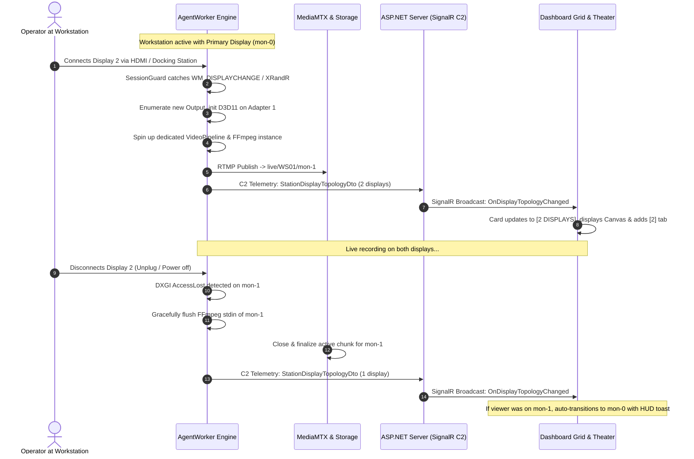

# 🖥️ Multi-Monitor & Multi-GPU Topology Capture, Streaming & Tactical NOC Architecture (RFC & Implementation Plan)

> **Document Status**: Approved Master Blueprint & Implementation Plan  
> **Target Branch**: `Ai/multi-monitor-support`  
> **Target Scope**: Cross-Platform (`ITB-SCREEN-RECORDER.Core`, `AgentWorker`, `Server`, `ClientApp`, `Features/Extractor`)  
> **Governing Rules**: [RULES.md](file:///c:/Devlopers/ITB-SCREEN-RECORDER/RULES.md) (Rule 11 & Rule 12), [AGENTS.md](file:///c:/Devlopers/ITB-SCREEN-RECORDER/AGENTS.md)

---

## 📋 Executive Summary & Mission Scope

This document provides the complete, self-contained architecture, data contracts, component design, and parallel task breakdown for adding full **Multi-Monitor and Multi-GPU capture, streaming, storage, forensic extraction, and tactical NOC visualization** to the ITB-SCREEN-RECORDER platform.

Workstations in mission-critical environments routinely operate with 2, 3, or more displays attached across hybrid GPUs (e.g. NVIDIA dGPU + Intel iGPU, multiple discrete GPUs, or USB DisplayLink adapters) with mixed resolutions, orientations, and DPI scalings.

### Key Capabilities Introduced
1. **Per-Adapter Native Zero-Copy Capture (Multi-GPU)**: Monitors are enumerated across all graphics adapters via DXGI on Windows and XRandR/PipeWire on Linux. Each monitor binds directly to a D3D11 device on the GPU driving that display. Zero cross-GPU PCIe surface transfers.
2. **Dynamic Hot-Plug & Unplug Resilience**: Connecting or disconnecting a monitor at runtime starts or gracefully flushes discrete pipelines without interrupting the surviving streams.
3. **Discrete MediaMTX Streaming**: Primary monitor streams to `live/{hostname}/mon-0` (video + audio); secondary monitors stream to `live/{hostname}/mon-1`, `mon-2` (video-only).
4. **Default Virtual Desktop Canvas in Dashboard**: Station cards in the grid display the full virtual desktop topology by default, arranged according to the real physical OS coordinates.
5. **Per-Card Display Switcher**: Quick toggle on every card (`[ ⊞ Canvas | 🖥 1 | 🖥 2 ]`) to shed client decoder load on demand.
6. **Exclusive Audio Solo (Radio Intercom Sink)**: Only one station plays live audio at any given time in the grid, managed via an animated floating Master Audio Dock with zero-CPU audio DSP for muted feeds.
7. **Fullscreen Theater with Minimap Radar Navigator**: Navigating away from Canvas to Solo/Spotlight spawns a clickable Picture-in-Picture Minimap highlighting the active display and enabling instant display hopping.
8. **Multicam Forensics & Synthetic Gap Bridging**: `SynchronizedTrackCutter` cuts multiple display tracks synchronously, injecting "No Signal / Disconnected" slates across asymmetric connection timelines.

---

## 🏗️ High-Level System Architecture Diagram

```mermaid
graph TD
    subgraph Workstation ["Managed Workstation (AgentWorker - Session 1+)"]
        GPU0[GPU 0: NVIDIA RTX] -->|DXGI Output 0| D0[Display 0: Primary 4K (0,0)]
        GPU1[GPU 1: Intel UHD] -->|DXGI Output 0| D1[Display 1: Secondary 1080p (3840,0)]
        
        D0 -->|D3D11 Staging| Pipe0[VideoPipeline 0 (NVENC 25-30 FPS)]
        D1 -->|D3D11 Staging| Pipe1[VideoPipeline 1 (QSV/NVENC 15-20 FPS)]
        
        Audio[WASAPI Audio Loopback + Mic] -.->|Muxed Audio| Pipe0
        HotPlug[SessionGuard: WM_DISPLAYCHANGE] -->|Dynamic Spawn / Flush| Pipe1
        
        Pipe0 -->|RTMP: live/WS01/mon-0| MTX[MediaMTX v1.15.4 (:19350)]
        Pipe1 -->|RTMP: live/WS01/mon-1| MTX
        
        Meta[Display Topology Tracker] -->|SignalR C2 Telemetry| ServerApi[ASP.NET Core Server]
    end

    subgraph ServerInfra ["Server & Storage Infrastructure"]
        MTX -->|Epoch Wall-Clock Chunks| Storage[NetApp UNC / Local Fallback]
        MTX -->|WHEP Proxy| Whep[/api/v1/whep/live/{host}/{displayId}]
        ServerApi --> SQLiteCatalog[(Catalog DB: recording_chunks)]
    end

    subgraph DashboardClient ["Tactical C2 NOC Dashboard (ClientApp)"]
        Whep --> PlayerEngine[WebRTC Multi-Stream Engine]
        ServerApi --> LayoutEngine[Virtual Desktop Layout Engine]
        
        PlayerEngine & LayoutEngine --> Grid["1. Dashboard Grid (Virtual Canvas Default + Card Switcher)"]
        PlayerEngine & LayoutEngine --> Theater["2. Fullscreen Theater (Pan/Zoom Canvas + HUD Minimap)"]
        PlayerEngine & LayoutEngine --> Intercom["3. Master Audio Dock (Exclusive Solo Sink)"]
        PlayerEngine & LayoutEngine --> Studio["4. Extractor Studio (Multi-Track Synchronized Player)"]
    end
```

---

## 🔄 Dynamic Hot-Plug / Unplug Sequence Diagram



---

## 📦 Data Contracts & Schema Specification

### 1. C# Domain DTOs (`ITB-SCREEN-RECORDER.Core`)

```csharp
namespace ITB_SCREEN_RECORDER.Core.Contracts.Topology
{
    public class StationDisplayTopologyDto
    {
        public string Hostname { get; set; } = string.Empty;
        public List<DisplayMetadataDto> Displays { get; set; } = new();
        public DesktopBoundsDto VirtualDesktopBounds { get; set; } = new();
        public long TimestampEpochMs { get; set; }
    }

    public class DisplayMetadataDto
    {
        public string DisplayId { get; set; } = "mon-0";          // "mon-0", "mon-1", "mon-2"
        public string DisplayName { get; set; } = string.Empty;     // @"\\.\DISPLAY1"
        public string AdapterName { get; set; } = string.Empty;     // "NVIDIA GeForce RTX 4070"
        public string AdapterLuid { get; set; } = string.Empty;     // "0x0001004A"
        public bool IsPrimary { get; set; }
        public int X { get; set; }                                 // Virtual desktop coordinate
        public int Y { get; set; }
        public int Width { get; set; }                             // e.g. 3840
        public int Height { get; set; }                            // e.g. 2160
        public double ScaleFactor { get; set; } = 1.0;             // DPI scale: 1.0, 1.25, 1.5
        public int RefreshRateHz { get; set; } = 60;
        public int TargetFps { get; set; } = 30;
    }

    public class DesktopBoundsDto
    {
        public int X { get; set; }
        public int Y { get; set; }
        public int Width { get; set; }
        public int Height { get; set; }
    }
}
```

### 2. SQLite Catalog Schema Update (`recording_chunks`)

Extend the SQLite table schema in `StorageScannerService` and `ICatalogRepository`:

```sql
ALTER TABLE recording_chunks ADD COLUMN display_id TEXT DEFAULT 'mon-0';
ALTER TABLE recording_chunks ADD COLUMN is_primary INTEGER DEFAULT 1;
ALTER TABLE recording_chunks ADD COLUMN display_bounds TEXT; -- JSON: {"x":0,"y":0,"w":1920,"h":1080}

CREATE INDEX IF NOT EXISTS idx_chunks_station_display 
ON recording_chunks(station_id, display_id, start_epoch_ms);
```

### 3. SignalR C2 Protocol Messages

The `AgentC2Hub` broadcasts the following typed events to `ClientApp`:
- `OnDisplayTopologyChanged(StationDisplayTopologyDto topology)`: Fired whenever monitors are added, removed, or resized.
- `OnAudioMonitoringChanged(string stationId, string? activeListenerUserId)`: Synchronizes the active audio solo sink across NOC operator stations.

---

## 💻 Component Architecture: Endpoint AgentWorker

### 1. Multi-Adapter DXGI Capture Manager (`DxgiMultiScreenCapture.cs`)

```
IDXGIFactory1 (Vortice.DXGI)
  │
  ├── Adapter 0 (e.g. NVIDIA RTX 4070)
  │     ├── D3D11Device 0
  │     └── Output 0 (DISPLAY1: 3840x2160) ──► IDXGIOutputDuplication 0 ──► StagingTexture 0
  │
  └── Adapter 1 (e.g. Intel UHD Graphics 770)
        ├── D3D11Device 1
        └── Output 0 (DISPLAY2: 1920x1080) ──► IDXGIOutputDuplication 1 ──► StagingTexture 1
```

- **Zero Cross-GPU Copy**: When displays reside on different GPUs, DXGI allocates a separate `ID3D11Device` on each adapter. Each output duplicates frames on its own adapter VRAM, maps to system staging, and feeds its own pipeline.
- **Resource Footprint**:
  - Primary Display: Full framerate (25–30 FPS), full bitrate.
  - Secondary Displays: Adaptive framerate (15–20 FPS default, motion-adaptive downscale during static views).
- **Session Protection**: All captures attach to the active input desktop using `DesktopSecurityManager.TryAttachToInputDesktop()`.

### 2. Dynamic Pipeline Supervisor (`MultiDisplayPipelineManager.cs`)

Manages the dictionary of active display pipelines:
```csharp
private readonly ConcurrentDictionary<string, DisplaySessionPipeline> _pipelines = new();
```
- Each `DisplaySessionPipeline` encapsulates:
  - `IScreenCaptureProvider` (`DxgiScreenCapture` or `LinuxX11ScreenCapture`)
  - `VideoPipeline` (Bounded channel pool)
  - `FfmpegProcessManager` (Dedicated native FFmpeg process)
- **Primary vs. Secondary Audio Routing**:
  - Only `mon-0` attaches to the `AudioCaptureFactory` (WASAPI loopback + mic mix).
  - Secondary streams (`mon-1`, `mon-2`) are video-only (`-map 0:v -an`), saving network bandwidth and encoder threads.

---

## 🌐 Server, MediaMTX & WHEP Proxy

### 1. Path Hierarchy Conventions
- Single-display backward compatibility: `live/{hostname}` acts as alias to `live/{hostname}/mon-0`.
- Multi-display paths:
  - `live/{hostname}/mon-0` (Primary Display + Audio)
  - `live/{hostname}/mon-1` (Secondary Display)
  - `live/{hostname}/mon-2` (Tertiary Display)

### 2. Storage Directory Structure
MediaMTX records according to the clean root pattern configured by `RecordingChunkScheduler`:
```
{StorageRoot}/
└── {hostname}/
    ├── mon-0/
    │   ├── 1718870400_000000.mp4
    │   └── 1718870700_000000.mp4
    └── mon-1/
        ├── 1718870400_000000.mp4
        └── 1718870700_000000.mp4
```

### 3. WHEP Proxy Multi-Segment Routing (`WhepProxyController.cs`)
Supports wildcard multi-segment stream paths:
- Request: `POST /api/v1/whep/live/{hostname}/{displayId}`
- Proxies to: `http://127.0.0.1:8889/live/{hostname}/{displayId}/whep`
- Preserves headers, SDP exchange, and session IDs (`PATCH`, `DELETE`).

---

## 🎨 Frontend Architecture: ClientApp Tactical NOC

### 1. UI Components Hierarchy

```
StationThumbnail (Grid Card)
  ├── Card Header (Status, Title, Override tags)
  ├── Card Display Switcher Pill: [ ⊞ Canvas | 🖥 1 | 🖥 2 ]
  ├── Viewport
  │     ├── VirtualTopologyCanvas (Default)
  │     │     ├── Sub-Display 0 (WebRTCPlayer: live/{host}/mon-0)
  │     │     └── Sub-Display 1 (WebRTCPlayer: live/{host}/mon-1)
  │     └── SingleDisplaySoloView (When 1 or 2 is selected)
  ├── Tactical Audio Intercom Button: [ 🎧 Listen / 🟢 LISTENING ]
  └── Card Footer (Telemetry micro-bars, Actions)

FullscreenModal (Theater View)
  ├── Top Floating Tactical Bar ([ ⊞ CANVAS ] [ 🖥 1 ] [ 🖥 2 ] [ 👁 SPOTLIGHT ])
  ├── Theater Body:
  │     ├── Interactive Virtual Desktop Canvas (Pan & Zoom, Double-Click Zoom)
  │     └── Solo Display Viewport
  └── FullscreenMinimapNavigator (Appears in Solo/Spotlight)
        ├── Proportional Miniature Canvas Box
        ├── Glowing Active Display Highlight (● LIVE FOCUS)
        └── Clickable Display Switcher

MasterAudioDock (Floating Bottom Intercom Bar)
  ├── Active Station Label ([ 🎧 WS-OPERATOR-02 ])
  ├── Real-time Spectral VU Meter (5-bar animation)
  ├── Volume Slider (0% - 100%)
  └── Global Mute All Button (Hotkey: M)
```

### 2. High-Density Stream Governance (Pillars of Zero-Crash)
1. **Intersection Observer Virtualization**: Cards off-screen in the dashboard grid tear down WebRTC connections, bounding active browser decoders to 16–24 streams maximum.
2. **Local Card Switcher**: Clicking `[ 🖥 1 ]` immediately disconnects `mon-1` WHEP session, halving that card's bandwidth and decoding overhead.
3. **Exclusive Audio Solo**: All grid cards remain `muted = true` and `audioTrack.enabled = false` until the operator clicks `[ 🎧 Listen ]`. Exactly one station consumes audio decoding.

---

## 🎬 Forensic Extractor & Multi-Track Studio

### 1. Synchronized Multi-Display Cutting (`SynchronizedTrackCutter.cs`)
- When exporting a time range for a station with multiple monitors:
  - Timecode synchronization is keyed to UTC epoch start times.
  - If Monitor 2 was disconnected during part of the requested window, `AppendDummyGapAsync` automatically inserts a synthetic "No Signal" slate:
    ```
    ┌──────────────────────────────┐
    │          MONITOR 2           │
    │        [ DISCONNECTED ]      │
    │     Standby / Off-line       │
    └──────────────────────────────┘
    ```
- All tracks maintain frame-accurate time synchronization.

### 2. Export Modes
1. **Canvas Composite MP4**: Single high-definition video stitching all displays according to their spatial geometry.
2. **Multi-Track MKV**: Single file containing separate, selectable video tracks (Track 1: Main, Track 2: Secondary) with unified audio.
3. **Individual Synchronized MP4s**: Archive containing `WS01_mon0.mp4`, `WS01_mon1.mp4`, and synchronized `.srt` subtitles.

---

## 🛠️ Step-by-Step Task Breakdown for Parallel AI Agents

This section is organized into independent, decoupled phases that multiple AI coding agents can execute in parallel without merge conflicts:

### 🟢 Agent Task 1: `ITB-SCREEN-RECORDER.Core` Contracts & Database Layer
- **Files**:
  - `ITB-SCREEN-RECORDER.Core/Contracts/Topology/StationDisplayTopologyDto.cs` (Create)
  - `ITB-SCREEN-RECORDER.Core/Contracts/Storage/ChunkFinalizedEvent.cs` (Add `DisplayId`)
  - `ITB-SCREEN-RECORDER.Server/Data/Repositories/CatalogRepository.cs` (Add `display_id` column to SQLite)
  - `ITB-SCREEN-RECORDER.Features.Extractor/Services/Scanning/StorageScannerService.cs` (Update SQL queries to index `mon-N` subdirectories)
- **Goal**: Establish the domain contracts and database schema to store and query multi-display chunks.

### 🔵 Agent Task 2: `AgentWorker` Multi-GPU DXGI & Hot-Plug Engine
- **Files**:
  - `ITB-SCREEN-RECORDER.AgentWorker/Providers/Video/DxgiMultiScreenCapture.cs` (Create)
  - `ITB-SCREEN-RECORDER.AgentWorker/Engine/MultiDisplayPipelineManager.cs` (Create)
  - `ITB-SCREEN-RECORDER.AgentWorker/Providers/Video/ISessionGuard.cs` (Add `WM_DISPLAYCHANGE` listener)
  - `ITB-SCREEN-RECORDER.AgentWorker/Engine/WorkerEngine.cs` (Refactor to use `MultiDisplayPipelineManager`)
- **Goal**: Capture all connected displays across single/multiple GPUs, manage separate FFmpeg streams per display, and auto-heal on hot-plug/unplug.

### 🟡 Agent Task 3: `Server` WHEP Routing, Telemetry & C2
- **Files**:
  - `ITB-SCREEN-RECORDER.Server/Controllers/WhepProxyController.cs` (Ensure multi-segment wildcard works for `live/{host}/{displayId}`)
  - `ITB-SCREEN-RECORDER.Server/Controllers/DashboardController.cs` (Include `Displays` array in stations summary)
  - `ITB-SCREEN-RECORDER.Server/Services/MediaMtxSupervisorWorker.cs` & `RecordingChunkScheduler.cs` (Ensure rotation affects all sub-paths)
- **Goal**: Accept multi-stream RTMP, rotate chunks for each display path, and serve WHEP streams cleanly.

### 🟣 Agent Task 4: `ClientApp` Dashboard Canvas, Switcher & Audio Intercom
- **Files**:
  - `ITB-SCREEN-RECORDER.Server/ClientApp/src/components/Station/VirtualTopologyCanvas.jsx` & `.scss` (Create)
  - `ITB-SCREEN-RECORDER.Server/ClientApp/src/components/Station/StationThumbnail.jsx` (Integrate Canvas as default, add `[ Canvas | 1 | 2 ]` pill)
  - `ITB-SCREEN-RECORDER.Server/ClientApp/src/components/Station/MasterAudioDock.jsx` & `.scss` (Create floating intercom bar)
  - `ITB-SCREEN-RECORDER.Server/ClientApp/src/context/AudioSoloContext.jsx` (Create exclusive audio provider)
- **Goal**: Make Canvas default in grid, add card switchers, and implement exclusive single-station audio listening.

### 🟠 Agent Task 5: `ClientApp` Fullscreen Theater & Minimap Radar Navigator
- **Files**:
  - `ITB-SCREEN-RECORDER.Server/ClientApp/src/components/Station/FullscreenMinimapNavigator.jsx` & `.scss` (Create)
  - `ITB-SCREEN-RECORDER.Server/ClientApp/src/components/Station/FullscreenModal.jsx` (Embed Minimap in Solo/Spotlight, implement pan & zoom in Canvas)
- **Goal**: Enable pan & zoom in Canvas mode, and show the interactive clickable HUD minimap when viewing Solo or Spotlight modes.

### 🔴 Agent Task 6: `Features/Extractor` Multi-Display Synchronization
- **Files**:
  - `Features/Extractor/ITB-SCREEN-RECORDER.Features.Extractor/Services/Engine/SynchronizedTrackCutter.cs`
  - `Features/Extractor/ITB-SCREEN-RECORDER.Features.Extractor/Services/Engine/SynchronizationPlanBuilder.cs`
  - `Features/ExtractorAdvanced/Client/...` (Studio video player Canvas view)
- **Goal**: Synchronize extraction across multi-display tracks, inject synthetic slates for asymmetrical gaps, and provide Canvas view in studio.

---

## 🎯 Verification & Acceptance Checklist

1. [ ] **Multi-GPU Enumeration**: Successfully captures displays on both dedicated and integrated GPUs without crashing or exceeding 1% CPU.
2. [ ] **Dynamic Hot-Plug**: Plugging in an HDMI cable starts `mon-1` streaming within 2 seconds without dropping frames on `mon-0`.
3. [ ] **Dynamic Unplug**: Unplugging a secondary monitor flushes its file chunk cleanly; `mon-0` continues uninterrupted.
4. [ ] **Grid Canvas Default**: Multi-monitor station cards render all displays proportionally arranged according to the OS geometry.
5. [ ] **Card Switcher Pill**: Clicking `[ 🖥 1 ]` on a card drops `mon-1` WebRTC stream and expands Monitor 1.
6. [ ] **Exclusive Audio Solo**: Clicking 🎧 on Station A plays audio; clicking 🎧 on Station B mutes Station A and unmutes Station B immediately.
7. [ ] **Fullscreen Minimap Radar**: When switching from Canvas to Solo in Fullscreen, the bottom-right HUD minimap renders, highlights the active display, and switches screens on click.
8. [ ] **Asymmetric Forensic Export**: Extracting a 1-hour window where a monitor was connected for only 30 minutes produces a synchronized file with a "No Signal" slate for the disconnected period.
