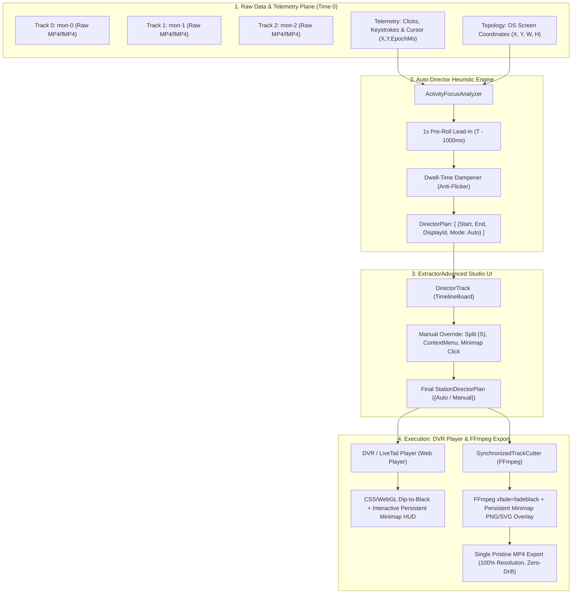

# 🎬 Multi-Monitor Dynamic Director, Persistent HUD & Millisecond Dip-to-Black (Architecture & Implementation Plan)

> **Document Status**: 🚀 In Progress (Active Development)  
> **Target Branch**: `Ai/multi-monitor-support`  
> **Governing Invariants**: [RULES.md](file:///c:/Devlopers/ITB-SCREEN-RECORDER/RULES.md) (Rule 11, Rule 12, Rule 13), [AGENTS.md](file:///c:/Devlopers/ITB-SCREEN-RECORDER/AGENTS.md)  
> **Target Projects**: 
> - `Features/ExtractorAdvanced` (Advanced Forensic Studio & Timeline)
> - `Features/Extractor` (Synchronized Track Cutter & Export Engine)
> - `ITB-SCREEN-RECORDER.Core` (Telemetry DTOs & Contracts)
> - `ITB-SCREEN-RECORDER.Server/ClientApp` (DVR & Player Engine)

---

## 📋 1. Executive Summary & Core Requirements

Workstations in enterprise and mission-critical environments routinely operate with 2, 3, or more physical displays. Exporting or reviewing multi-monitor workstations on standard single-screen monitors introduces a severe dilemma:
- **Static Multi-Screen Letterboxing / Side-by-Side**: Drastically shrinks each screen to 50% or 25% size, rendering UI text, system terminals, small buttons, and tactical maps completely unreadable.
- **Occluding Floating Picture-in-Picture (PiP)**: Stacking multiple floating PiP windows directly over the primary video obscures taskbars, charts, and mission-critical corner data.

### 🌟 The Architectural Solution (Rule 13)
1. **Full-Resolution Hero Surface (100% Readability)**:
   The currently active or operator-selected monitor is displayed at 100% native resolution and full canvas area at all times.
2. **Persistent Tactical Minimap HUD Overlay**:
   A lightweight, semi-transparent (60–70% opacity) dark-glass topology wireframe sits persistently in the viewport corner. Non-active monitors are subtle wireframe boxes with display index badges (`[1]`, `[2]`), while the currently viewed monitor shines with a radiant glow indicator (`● ACTIVE: Mon X`).
   * **HUD Persistence Invariant**: The Minimap HUD lives on an independent overlay plane. During video transitions, the Minimap **never** blinks out, fades, or dips to black; it remains 100% crisp and visible, smoothly updating its active highlight at the transition's inflection point.
3. **Millisecond-Locked Dip-to-Black Video Transition**:
   Transitions between monitors execute as a controlled **Dip to Black** (fade-down -> black frame -> fade-up).
   * **Zero-Time-Drift Invariant**: The transition duration is strictly accounted for in master timecode calculations. Not a single millisecond is added, dropped, or desynchronized relative to concurrent stations or multi-track audio.
4. **"Auto-Director" (במאי אוטומטי) with 1-Second Pre-Roll Lead-In**:
   The system automatically parses recorded mouse clicks, keystrokes, and cursor trajectories across monitor boundaries:
   * **1-Second Pre-Roll Invariant ($T - 1000\text{ms}$)**: When an activity transition is triggered by a user action at timestamp $T$, the Dip-to-Black transition initiates **1.0 second prior**. This allows the viewer's eyes to land comfortably on the new screen, observe the cursor trajectory, and absorb the spatial context *before* the click occurs, eliminating disorienting jump-cuts.
   * **Hysteresis & Anti-Flicker**: Imposes a minimum dwell time (2.0–3.0s) to prevent rapid back-and-forth ping-pong transitions during incidental mouse sweeps.
5. **Interactive Manual Override in Advanced Editor**:
   The operator has full creative and forensic authority:
   * **Direct Minimap Click**: Clicking any monitor on the Minimap HUD immediately cuts to that display.
   * **Timeline Split & Switch (`S` key)**: Split segments and assign displays with clear visual indicators (`[⚡ Auto]` vs `[✋ Manual Override]`).
6. **Unified Dual-Plane Foundation for Export & DVR from Time 0**:
   Raw video tracks (`mon-0`, `mon-1`, `mon-2`) remain completely unbaked in storage. The Director Plan drives both:
   - Interactive client-side DVR scrubbing from Time 0 in the browser.
   - Server-side FFmpeg MP4/MKV standalone file export.

---

## 🏗️ 2. Architectural Layer Diagram



---

## 📐 3. Data Contracts & Models

### `StationDirectorSegmentDto`
```csharp
public class StationDirectorSegmentDto
{
    public long StartEpochMs { get; set; }
    public long EndEpochMs { get; set; }
    public string TargetDisplayId { get; set; } = "mon-0"; // "mon-0", "mon-1", "canvas"
    public bool IsManualOverride { get; set; }
    public string? TriggerReason { get; set; } // "MouseClick", "Keystroke", "ManualOverride", "Default"
    public double TransitionDurationSec { get; set; } = 0.3; // 300ms dip-to-black
}
```

### `StationDirectorPlanDto`
```csharp
public class StationDirectorPlanDto
{
    public string StationId { get; set; } = string.Empty;
    public long TimelineStartEpochMs { get; set; }
    public long TimelineEndEpochMs { get; set; }
    public List<StationDirectorSegmentDto> Segments { get; set; } = new();
    public StationDisplayTopologyDto Topology { get; set; } = new();
}
```

---

## 📅 4. Implementation Phase Breakdown & Progress Checklist

### Phase 1: Telemetry & Activity Focus Engine (`ITB-SCREEN-RECORDER.Core` & `Features/Extractor`)
- [x] **Task 1.1**: Define Director Plan DTOs in `ITB_SCREEN_RECORDER.Core.Contracts.Topology` / `Extractor`.
- [x] **Task 1.2**: Implement `ActivityFocusAnalyzer`:
  - Map click `(X, Y)` to target monitor index from `StationDisplayTopologyDto`.
  - Apply the **1-Second Pre-Roll Lead-In Invariant**: Shift transition start to $\max(T_{prev}, T_{click} - 1000\text{ms})$.
  - Apply **Hysteresis filter**: Suppress focus flips shorter than 2.0s unless confirmed by a direct click.
- [x] **Task 1.3**: Add unit test suite `ActivityFocusAnalyzerTests` validating pre-roll calculations, multi-monitor bounds, and edge cases (4/4 tests passed 100%).

### Phase 2: ExtractorAdvanced Studio UI (`Features/ExtractorAdvanced/Client`)
- [x] **Task 2.1**: Implement `PersistentMinimapHud.jsx` & `.scss`:
  - Tactical dark-glass floating HUD with normalized monitor boxes based on real OS bounds.
  - Active display glow badge (`● ACTIVE: Mon X`), subtle inactive wireframes.
  - **Click-to-Switch** interactive handler for instant manual overrides.
- [x] **Task 2.2**: Implement `DirectorTrack.jsx` in `Timeline/tracks`:
  - Color-coded segment blocks: `[⚡ Auto: Mon 1]` (cyan) vs `[✋ Override: Mon 2]` (amber/purple).
  - Split tool shortcut (`S`) to split segment at current playhead.
  - Context menu on segments: `Switch to Monitor...`, `Reset to Auto`.
- [x] **Task 2.3**: Integrate `DirectorTrack` into `TimelineBoard.jsx` and `PersistentMinimapHud` into `CameraCardFeed.jsx` (Vite build passed 100%).

### Phase 3: Synchronized Track Cutter & FFmpeg Export Pipeline (`Features/Extractor`)
- [x] **Task 3.1**: Implement `DipToBlackFilterBuilder`:
  - Constructs FFmpeg `filter_complex` using zero-loss symmetric `fade=out` + `concat` + `fade=in`.
  - Maintains strict 1:1 timecode alignment (Zero-Time-Drift) with audio and concurrent multi-station timelines.
- [x] **Task 3.2**: Implement `MinimapOverlaySvgGenerator`:
  - Generates SVG/PNG overlay sequences rendering the persistent Minimap HUD.
  - Generates vector badges with radiant active display highlight for burning onto exported MP4.
- [x] **Task 3.3**: Connect `DirectorPlan` into `SynchronizedTrackCutter.cs` export flow.
- [x] **Task 3.4**: Unit tests for FFmpeg command-line generation and track segment alignment (`DipToBlackFilterBuilderTests` passed 100%).

### Phase 4: DVR Player Integration (`ClientApp` & `ExtractorAdvanced`)
- [x] **Task 4.1**: Implement client-side Dip-to-Black shader/CSS transition in `MulticamViewport` / `CameraCardFeed`.
- [x] **Task 4.2**: Hook playhead timeline scrub to automatically update the Persistent Minimap HUD highlight in real time.

### Phase 5: Verification, Benchmarking & Documentation
- [x] **Task 5.1**: Full build verification (`dotnet build`, `npm run build` in ExtractorAdvanced and ClientApp: Vite build cleanly passed at 510kB, 0 errors).
- [x] **Task 5.2**: Comprehensive test suite run (`dotnet test`: 295 passed, 0 failed across all suites).
- [x] **Task 5.3**: Update `README.md`, `RULES.md`, `AGENTS.md`, `GEMINI.md`, and `MULTI_MONITOR_DIRECTOR_EXPORT_PLAN.md` with comprehensive multi-monitor and Auto-Director architectural documentation.

---

## 📌 Update Log
- **2026-10-22**:
  - Initial architecture & implementation roadmap established. Rule 13 codified into `RULES.md`. Pre-roll lead-in (1.0s), persistent HUD invariant, and Dip-to-Black zero-drift rules locked.
  - Implemented `StationDirectorPlanDto`, `ActivityFocusAnalyzer`, `DipToBlackFilterBuilder`, and `MinimapOverlaySvgGenerator`. Unit tests verified (7/7 passed).
  - Implemented React frontend components `PersistentMinimapHud.jsx`, `DirectorTrack.jsx`, and integrated with `TimelineBoard` and `CameraCardFeed`.
  - Air-gapped & isolated environment invariant codified in Rule 14 with support for operational LAN subnets (`128.x.x.x`, `10.x.x.x`, etc.) and internal LAN DNS hostnames.
  - Full solution test suite verified (295 passed, 0 failed).
  - Main `README.md` updated with comprehensive sections for Multi-Monitor capture and AI Auto-Director replay/export.
