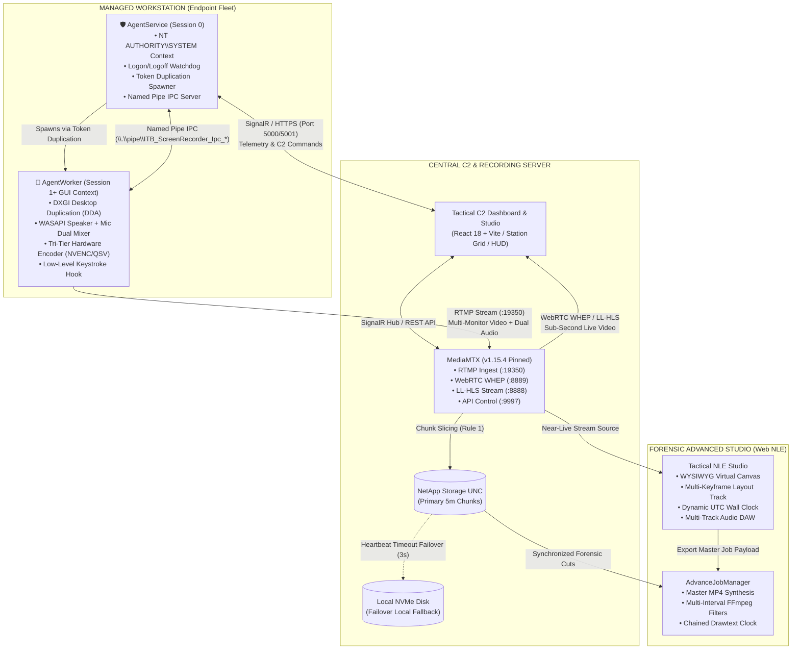
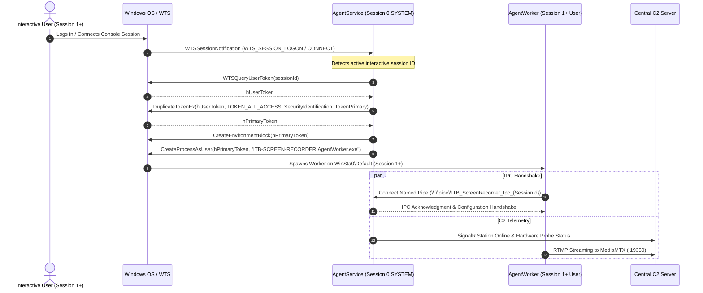
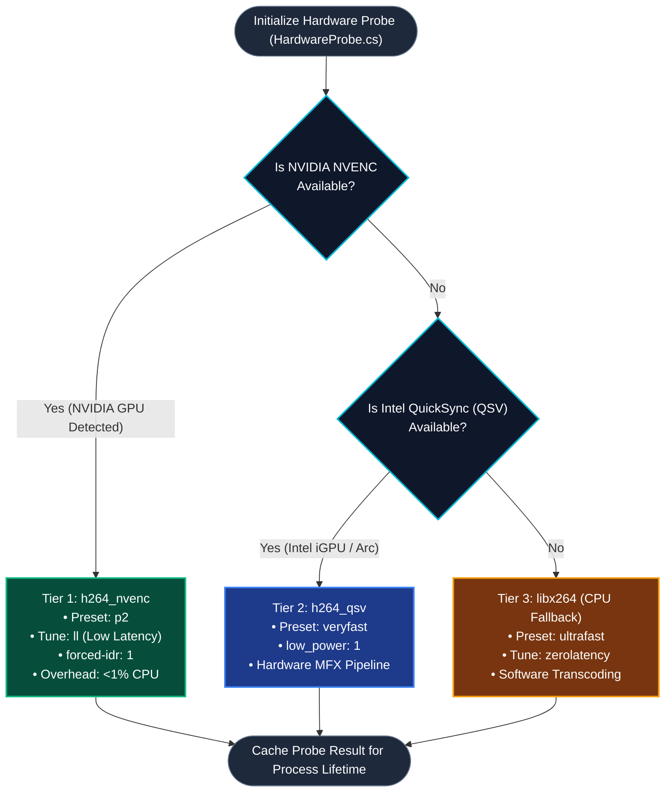
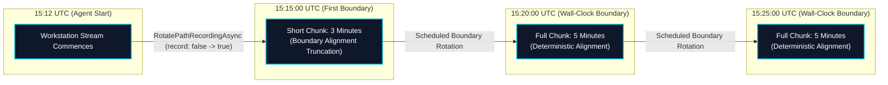
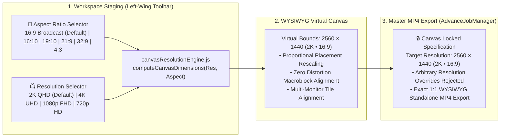
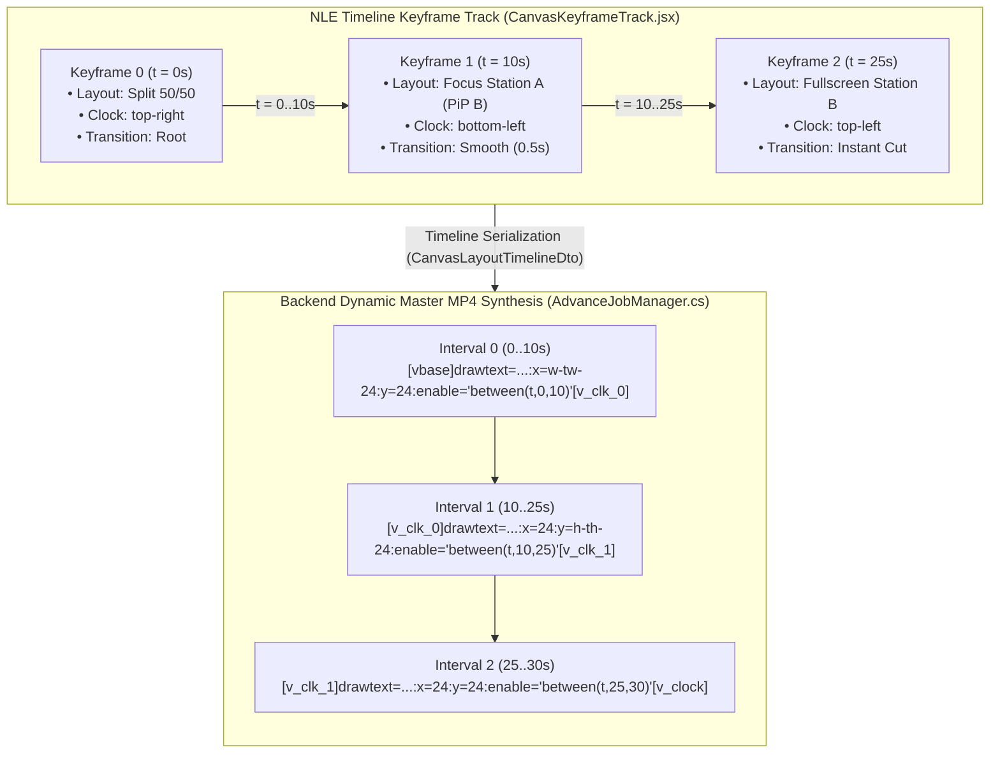
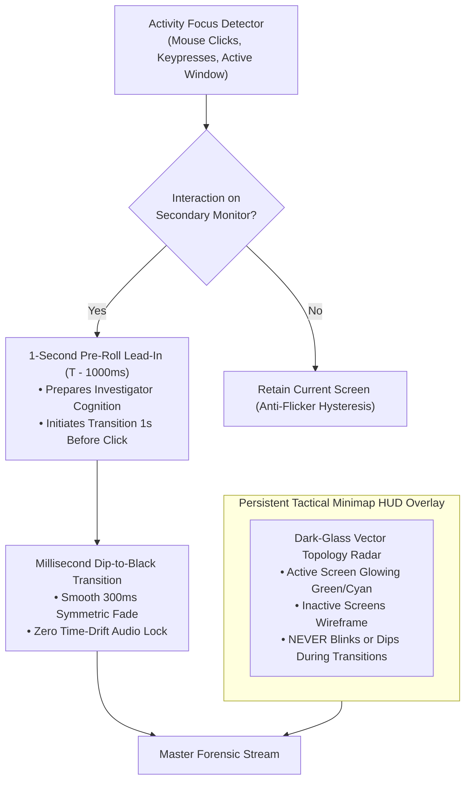

# 🛡️ ITB-SCREEN-RECORDER

[](https://dotnet.microsoft.com/)
[](https://react.dev/)
[](#)
[](https://github.com/bluenviron/mediamtx)
[](#)
[](#)

**ITB-SCREEN-RECORDER** is a mission-critical, enterprise command-and-control (C2), screen capture, continuous recording, and real-time telemetry streaming platform engineered for **fully isolated, air-gapped enterprise environments**.

The platform is architected to continuously monitor and record high-density workstation fleets (70–100+ endpoints running Windows 11 and Linux) with sub-second latency, 24/7 recording resilience, and **<1% CPU overhead** on endpoints through dedicated GPU hardware acceleration (NVIDIA NVENC / Intel QuickSync QSV). Built on .NET 8 and React 18, the system provides cross-platform client and server execution, an interactive web-based **ExtractorAdvanced Tactical Studio** with Premiere-style NLE multi-camera keyframing, and an automated standalone master MP4 video synthesis engine.

> 📘 **Developer System Book & Architecture Guide**: Consult [SYSTEM_BOOK.md](file:///f:/Ohad%20Shalev/C%23%20Build/ScreenRecorder/SYSTEM_BOOK.md) for complete end-to-end operational architecture, database schemas, and developer playbooks across all 67 architectural sections.

---

## ⚙️ Operational Architecture & End-to-End Topology

The system uses a distributed client-server topology separating low-level endpoint capture from centralized streaming, indexing, and storage:



### Protocol & Port Matrix

| Protocol | Port | Direction | Source | Destination | Purpose |
| :--- | :--- | :--- | :--- | :--- | :--- |
| **RTMP** | `19350` | Inbound | `AgentWorker` | `MediaMTX` | Video and audio streaming ingest. (Pinned in [`mediamtx.yml`](file:///f:/Ohad%20Shalev/C%23%20Build/ScreenRecorder/ITB-SCREEN-RECORDER.Server/MediaMTX/mediamtx.yml)). |
| **WHEP / WebRTC** | `8889` / UDP | Inbound | Operator Browser | `MediaMTX` / Server | Sub-second real-time video playback via WebRTC. |
| **LL-HLS** | `8888` | Inbound | Operator Browser | `MediaMTX` | Fallback Low-Latency HTTP Live Streaming. |
| **MediaMTX API** | `9997` | Localhost | Server | `MediaMTX` | Control API for wall-clock chunk rotation (`record: false -> true`). |
| **SignalR / HTTP** | `5000` / `5001` | Bi-directional | `AgentService` / UI | Server | Real-time C2 telemetry, status reports, remote controls. |
| **SMB / CIFS** | `445` | Outbound | Server | NetApp NAS | Primary recording chunk storage over UNC paths. |
| **Named Pipe** | Dynamic | IPC Local | `AgentService` | `AgentWorker` | Session 0 to Session 1 IPC (`\\.\pipe\ITB_ScreenRecorder_Ipc_*`). |

---

## 🧩 Solution Projects & Component Breakdown

The codebase is structured into modular .NET 8 solution layers and a modern React 18 frontend:

| Project | Target | Description | Key Source Locations |
| :--- | :--- | :--- | :--- |
| [**`ITB-SCREEN-RECORDER.Core`**](file:///f:/Ohad%20Shalev/C%23%20Build/ScreenRecorder/ITB-SCREEN-RECORDER.Core) | Class Library (.NET 8) | Shared domain models, DTOs, IPC contracts, configuration schemas, SQLite logging, and hardware probe diagnostics ([`HardwareProbe.cs`](file:///f:/Ohad%20Shalev/C%23%20Build/ScreenRecorder/ITB-SCREEN-RECORDER.Core/Diagnostics/HardwareProbe.cs)). | [Core](file:///f:/Ohad%20Shalev/C%23%20Build/ScreenRecorder/ITB-SCREEN-RECORDER.Core) |
| [**`ITB-SCREEN-RECORDER.Server`**](file:///f:/Ohad%20Shalev/C%23%20Build/ScreenRecorder/ITB-SCREEN-RECORDER.Server) | ASP.NET Core 8 Web API | Central C2 server managing fleet telemetry, SignalR command hubs, MediaMTX process supervision, wall-clock chunk scheduling, storage failover, and WebRTC proxy. | [Server](file:///f:/Ohad%20Shalev/C%23%20Build/ScreenRecorder/ITB-SCREEN-RECORDER.Server) |
| [**`ITB-SCREEN-RECORDER.Server/ClientApp`**](file:///f:/Ohad%20Shalev/C%23%20Build/ScreenRecorder/ITB-SCREEN-RECORDER.Server/ClientApp) | React 18 + Vite + SCSS | Tactical NOC command dashboard providing live fleet grids, WebRTC / HLS players, real-time telemetry micro-bars, Virtual Desktop Canvas, and exclusive audio solo sink. | [ClientApp](file:///f:/Ohad%20Shalev/C%23%20Build/ScreenRecorder/ITB-SCREEN-RECORDER.Server/ClientApp) |
| [**`ITB-SCREEN-RECORDER.AgentService`**](file:///f:/Ohad%20Shalev/C%23%20Build/ScreenRecorder/ITB-SCREEN-RECORDER.AgentService) | Windows Service / Daemon | Session 0 background supervisor (`NT AUTHORITY\SYSTEM`). Monitors C2, manages watchdogs, and uses Win32 token duplication to spawn the worker into active user sessions. | [AgentService](file:///f:/Ohad%20Shalev/C%23%20Build/ScreenRecorder/ITB-SCREEN-RECORDER.AgentService) |
| [**`ITB-SCREEN-RECORDER.AgentWorker`**](file:///f:/Ohad%20Shalev/C%23%20Build/ScreenRecorder/ITB-SCREEN-RECORDER.AgentWorker) | Console Application (.NET 8) | Interactive Session 1+ capture worker. Captures screen via DXGI DDA (Windows) or X11/XSHM (Linux), mixes WASAPI audio, hooks keystrokes, and streams hardware-encoded RTMP to MediaMTX. | [AgentWorker](file:///f:/Ohad%20Shalev/C%23%20Build/ScreenRecorder/ITB-SCREEN-RECORDER.AgentWorker) |
| [**`Features/Extractor`**](file:///f:/Ohad%20Shalev/C%23%20Build/ScreenRecorder/Features/Extractor/ITB-SCREEN-RECORDER.Features.Extractor) | Feature Plugin (.NET 8) | Video export and multicam synchronized track cutting engine ([`SynchronizedTrackCutter.cs`](file:///f:/Ohad%20Shalev/C%23%20Build/ScreenRecorder/Features/Extractor/ITB-SCREEN-RECORDER.Features.Extractor/Services/Engine/SynchronizedTrackCutter.cs)). Aligns timecodes, trims global gaps equally, and injects synthetic "No Signal" gap filler clips. | [Extractor](file:///f:/Ohad%20Shalev/C%23%20Build/ScreenRecorder/Features/Extractor/ITB-SCREEN-RECORDER.Features.Extractor) |
| [**`Features/ExtractorAdvanced`**](file:///f:/Ohad%20Shalev/C%23%20Build/ScreenRecorder/Features/ExtractorAdvanced/ITB-SCREEN-RECORDER.Features.ExtractorAdvanced) | Feature Plugin + Web Studio | Advanced forensic investigation suite with Near-Live LiveTail DVR scanner, multi-station timeline, WYSIWYG virtual canvas composer, multi-keyframe sequencer, and master MP4 synthesis. | [ExtractorAdvanced](file:///f:/Ohad%20Shalev/C%23%20Build/ScreenRecorder/Features/ExtractorAdvanced/ITB-SCREEN-RECORDER.Features.ExtractorAdvanced) |
| [**`Tools/ITB-SCREEN-RECORDER.Diagnostics`**](file:///f:/Ohad%20Shalev/C%23%20Build/ScreenRecorder/Tools/ITB-SCREEN-RECORDER.Diagnostics) | CLI Diagnostic Tool | Enterprise forensic log diagnostic and root-cause analysis (RCA) utility for offline log auditing and telemetry health verification. | [Diagnostics](file:///f:/Ohad%20Shalev/C%23%20Build/ScreenRecorder/Tools/ITB-SCREEN-RECORDER.Diagnostics) |
| [**`Installers`**](file:///f:/Ohad%20Shalev/C%23%20Build/ScreenRecorder/Installers) | WiX Toolset v4 & Linux Packaging | Enterprise MSI installers with automated Service/Worker packaging and systemd `.run` / tarball scripts for Linux. | [Installers](file:///f:/Ohad%20Shalev/C%23%20Build/ScreenRecorder/Installers) |
| [**`ITB-SCREEN-RECORDER.Tests`**](file:///f:/Ohad%20Shalev/C%23%20Build/ScreenRecorder/ITB-SCREEN-RECORDER.Tests) | xUnit & Node.js Test Suites | Enterprise test suite covering IPC, service communication, storage failover, CFR quality, NLE timeline keyframes, and canvas invariants. | [Tests](file:///f:/Ohad%20Shalev/C%23%20Build/ScreenRecorder/ITB-SCREEN-RECORDER.Tests) |

---

## 🔒 Windows Session 0 vs. Session 1 Architecture & IPC

Windows security isolates background Windows Services in **Session 0** without access to interactive desktop surfaces, window messages, or audio endpoints. `ITB-SCREEN-RECORDER` implements Win32 token duplication and secure named-pipe IPC to bridge this boundary:



---

## ⚡ Tri-Tier Hardware Encoder Selection

Implemented in [`HardwareProbe.cs`](file:///f:/Ohad%20Shalev/C%23%20Build/ScreenRecorder/ITB-SCREEN-RECORDER.Core/Diagnostics/HardwareProbe.cs). Workstation capture evaluates hardware acceleration in strict priority to guarantee **<1% CPU overhead**:



---

## ⏱️ Deterministic Wall-Clock Recording & Storage Failover

### 1. Wall-Clock Aligned Chunking (Rule 1)
Recordings are sliced into deterministic intervals aligned to the wall clock (multiples of `Storage.ChunkIntervalMinutes`, default 5 minutes):



- **Scheduler**: [`RecordingChunkScheduler.cs`](file:///f:/Ohad%20Shalev/C%23%20Build/ScreenRecorder/ITB-SCREEN-RECORDER.Server/Services/RecordingChunkScheduler.cs) computes boundaries using pure UTC division, eliminating drift.
- **Trigger**: Slicing is executed by toggling MediaMTX Control API (`record: false -> true`), finalizing the MP4 chunk cleanly without dropping frames.
- **Critical Version Pin (Rule 1a)**: **MediaMTX is strictly pinned to v1.15.4** ([`mediamtx.exe`](file:///f:/Ohad%20Shalev/C%23%20Build/ScreenRecorder/ITB-SCREEN-RECORDER.Server/MediaMTX/mediamtx.exe)). Newer versions (v1.15.5+) introduce an internal `ntpDriftTolerance` check that fragments chunks during CPU jitter. **Do not upgrade MediaMTX.**
- **Near-Live Non-Locking Streams (Rule 10)**: All video files are accessed with `FileShare.ReadWrite | FileShare.Delete` to prevent locking actively recording streams.

---

## 🎛️ Advanced Forensic Studio & Master Video Synthesis

The forensic investigation and video export capabilities are 100% unified inside the web-based **ExtractorAdvanced Tactical Studio** (`Features/ExtractorAdvanced`):

### 1. Decoupled Canvas Resolution & WYSIWYG Export Lock
Resolution and aspect ratio are established during canvas staging, guaranteeing pixel-perfect WYSIWYG export:



### 2. Multi-Keyframe Layout Timeline & Dynamic UTC Clock Chaining
The NLE timeline engine ([`nleTimelineEngine.js`](file:///f:/Ohad%20Shalev/C%23%20Build/ScreenRecorder/Features/ExtractorAdvanced/ITB-SCREEN-RECORDER.Features.ExtractorAdvanced/Client/src/utils/nleTimelineEngine.js)) supports Adobe Premiere-style keyframing. The burned-in Canvas UTC Wall Clock overlay is bound per-keyframe and dynamically chained during backend MP4 export:



- **Interactive Keyframing**: Adding or modifying layout placements or moving the clock at playhead time creates or updates keyframes with smooth cubic easing (`smooth`), linear interpolation (`linear`), or instant step cut (`cut`).
- **Dynamic Clock Interval Chaining (`BuildMultiKeyframeClockDrawtextFilters`)**: In [`AdvanceJobManager.cs`](file:///f:/Ohad%20Shalev/C%23%20Build/ScreenRecorder/Features/ExtractorAdvanced/ITB-SCREEN-RECORDER.Features.ExtractorAdvanced/Services/AdvanceJobManager.cs), keyframe clock positions compile into intervals. When positions change, FFmpeg renders chained `drawtext` filters with `:enable='between(t, start, end)'`, relocating the clock dynamically in the exported MP4 without dropping frames.
- **Lossless Intermediate Quality (CRF 17)**: Intermediate cuts use CRF 17 to prevent double-compression macroblocking.
- **Real-Time Export Telemetry**: Smooth progress updates (88% &rarr; 99%) eliminate progress stalls during final MP4 atom serialization.

---

## 🖥️ Multi-Monitor Dynamic Focus & Persistent Tactical Minimap HUD



- **Per-Adapter DXGI Capture (Rule 11)**: Displays are enumerated and captured directly on their owning GPU adapters without cross-GPU PCIe bus bottlenecks.
- **1-Second Pre-Roll Lead-In ($T - 1000\text{ms}$)**: When user interaction occurs on monitor $B$, camera transition initiates 1.0s prior to preserve cognitive continuity.
- **Persistent Tactical Minimap HUD Overlay**: Semi-transparent dark-glass topology radar indicating the active monitor. **The Minimap HUD never dips to black, fades, or blinks during video transitions.**
- **Zero-Time-Drift Dip-to-Black Transitions**: Symmetric fade transitions preserving millisecond audio and multicam synchronization.

---

## ⌨️ Keystroke Intelligence & Subtitles Architecture

- **Low-Level Keyboard Hook**: [`WindowsKeyboardCaptureProvider.cs`](file:///f:/Ohad%20Shalev/C%23%20Build/ScreenRecorder/ITB-SCREEN-RECORDER.AgentWorker/Providers/Keyboard/WindowsKeyboardCaptureProvider.cs) captures keypresses and window focus telemetry.
- **Real-Time C2 Broadcast**: Keystrokes are streamed over SignalR directly to the Server Dashboard and Studio viewports even when recording is inactive, giving operators live situational awareness.
- **Forensic Gap Elimination**: Keystrokes are **strictly discarded from persistent SQLite storage when recording is inactive or during unrecorded gaps**, guaranteeing that stored keystrokes always correlate 1:1 with forensic video files.
- **Automated Subtitle Generation**: Generates synchronized `.srt` tracks allowing investigators to review typed commands and hotkeys burned into the video.

---

## 📜 Core Architectural Rules & Invariants (Must Follow)

The repository is governed by behavioral invariants documented in [RULES.md](file:///f:/Ohad%20Shalev/C%23%20Build/ScreenRecorder/RULES.md):

1. **Rule 1 (Wall-Clock Chunks)**: Slicing managed by [`RecordingChunkScheduler.cs`](file:///f:/Ohad%20Shalev/C%23%20Build/ScreenRecorder/ITB-SCREEN-RECORDER.Server/Services/RecordingChunkScheduler.cs) via MediaMTX API toggle.
2. **Rule 1a & MediaMTX Version Pin**: **MediaMTX is pinned to v1.15.4**. Newer versions introduce an NTP drift tolerance check that breaks segmentation.
3. **Rule 2 (Storage Failover)**: NetApp UNC primary verified every tick with 3s probe; local path fallback.
4. **Rule 3 (Retention)**: Age-based retention (`recordDeleteAfter: "30d"`).
5. **Rule 6 (Single Instance)**: OS-level Mutex enforces single-instance execution per machine.
6. **Rule 7 (MediaMTX Supervisor)**: Process watchdog restarts `mediamtx.exe` within 5 seconds of exit.
7. **Rule 8 (Tri-Tier GPU Probing)**: NVENC &rarr; Intel QuickSync &rarr; CPU libx264 software fallback.
8. **Rule 9 (Multicam Track Cutting)**: Identical timeline durations with synthetic "No Signal" gap fills.
9. **Rule 10 (Near-Live Non-Locking Streams)**: `FileShare.ReadWrite | FileShare.Delete` for zero-collision inspection during active recording.
10. **Rule 11 (Multi-Monitor Capture & Hot-Plug)**: Discrete per-adapter encoder pipelines, `live/{hostname}/mon-N` paths, and runtime add/remove.
11. **Rule 12 (NOC Stream Governance & Audio Solo)**: Default Canvas layout, viewport virtualization via Intersection Observer, and exclusive audio solo sink.
12. **Rule 13 (Multi-Monitor Export & DVR Dynamic Focus)**: 1-second pre-roll lead-in ($T - 1000\text{ms}$), anti-flicker hysteresis, persistent tactical Minimap HUD, and zero-time-drift Dip-to-Black transitions.
13. **Rule 14 (Air-Gapped & Isolated Environment Invariant)**: 100% self-contained offline architecture; zero public internet CDNs, web fonts, or remote APIs. Full support for enterprise intranet subnets (`128.x.x.x`, `10.x.x.x`, `172.x.x.x`, `192.168.x.x`), internal LAN DNS hostnames (`itb-server`, `*.local`, `*.internal`), and local multicast.
14. **Rule 15 (Pre-Flight Dependency Vetting via Socket.dev)**: Mandatory supply-chain security evaluation on [Socket.dev](https://socket.dev/) for all NuGet and npm dependencies prior to installation. Zero critical CVEs and strict MSBuild failure on unvetted packages.

---

## 🛠️ Development & Build Guide

### Prerequisites
- [.NET 8.0 SDK](https://dotnet.microsoft.com/download/dotnet/8.0)
- [Node.js 18+ & npm](https://nodejs.org/)
- Windows 10/11 or Linux (Ubuntu 22.04+)

### Building the .NET Solution
```powershell
# Build entire solution
$env:DOTNET_CLI_HOME = "$pwd\.tmp_dotnet"
dotnet build ITB-Screen-Recorder.sln --no-restore

# Run unit and integration tests
dotnet test ITB-SCREEN-RECORDER.Tests/ITB-SCREEN-RECORDER.Tests.csproj --no-restore
```

### Running the ClientApp & Studio Tests
```bash
# ExtractorAdvanced Forensic Studio tests (Node.js test runner)
node --test Features/ExtractorAdvanced/ITB-SCREEN-RECORDER.Features.ExtractorAdvanced/Client/src/tests/*.test.js

# ClientApp NOC Dashboard tests
cd ITB-SCREEN-RECORDER.Server/ClientApp
npm test
```

### Running the Server
```powershell
cd ITB-SCREEN-RECORDER.Server
dotnet run
```
The server starts on `http://localhost:5000` (or `https://localhost:5001`), supervises MediaMTX on RTMP port `19350`, and serves the React C2 frontend.

---

## 📚 Architectural Presentations

High-density visual presentations are available in the [Presentations/](file:///f:/Ohad%20Shalev/C%23%20Build/ScreenRecorder/Presentations) directory:
- **Technical & Engineering Architecture Deck** (21 slides): Available as [PowerPoint (.pptx)](file:///f:/Ohad%20Shalev/C%23%20Build/ScreenRecorder/Presentations/ITB_SCREEN_RECORDER_Technical_Architecture.pptx) and [Interactive Web Deck (.html)](file:///f:/Ohad%20Shalev/C%23%20Build/ScreenRecorder/Presentations/Technical_Architecture_Presentation.html).
- **Executive Management Deck** (14 slides): Available as [PowerPoint (.pptx)](file:///f:/Ohad%20Shalev/C%23%20Build/ScreenRecorder/Presentations/ITB_SCREEN_RECORDER_Executive_Management.pptx) and [Interactive Web Deck (.html)](file:///f:/Ohad%20Shalev/C%23%20Build/ScreenRecorder/Presentations/Executive_Management_Presentation.html).

---

## 🤖 AI Guidelines & Context
AI coding assistants working on this codebase must strictly adhere to [AGENTS.md](file:///f:/Ohad%20Shalev/C%23%20Build/ScreenRecorder/AGENTS.md), [GEMINI.md](file:///f:/Ohad%20Shalev/C%23%20Build/ScreenRecorder/GEMINI.md), and [SYSTEM_BOOK.md](file:///f:/Ohad%20Shalev/C%23%20Build/ScreenRecorder/SYSTEM_BOOK.md).
