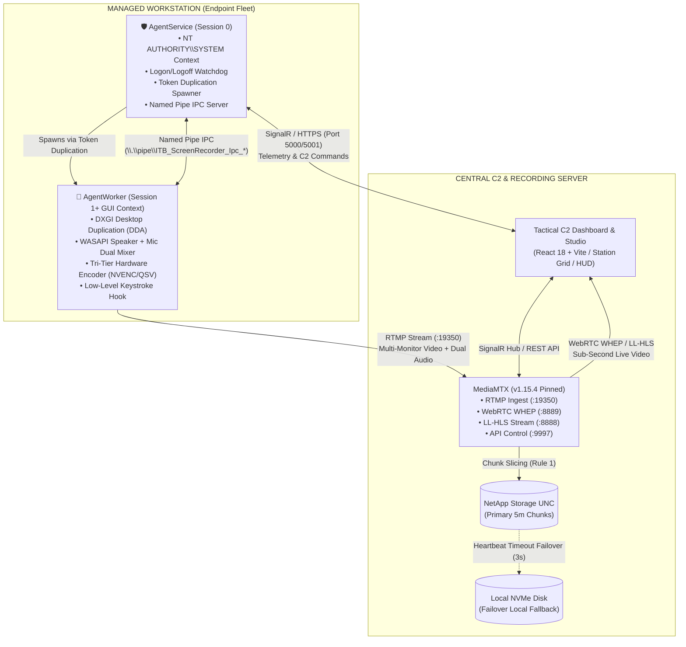
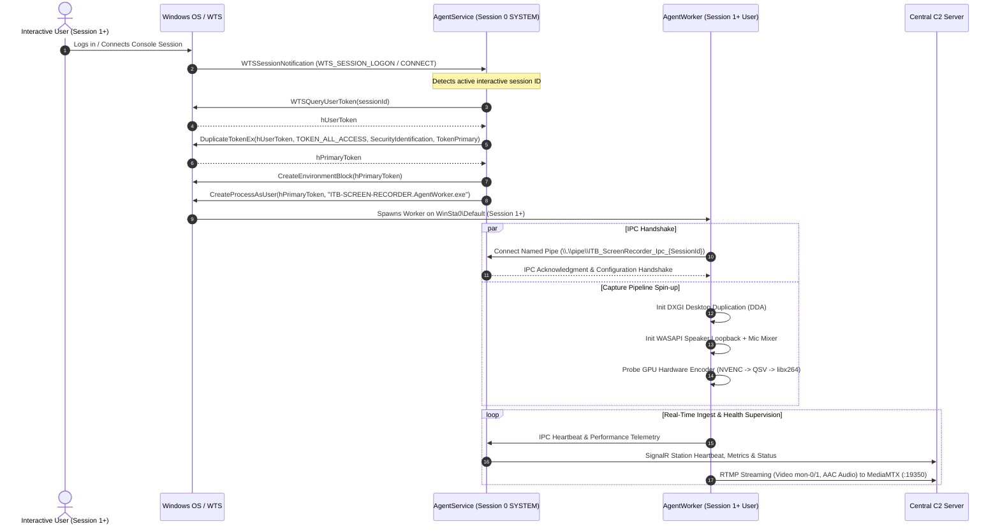
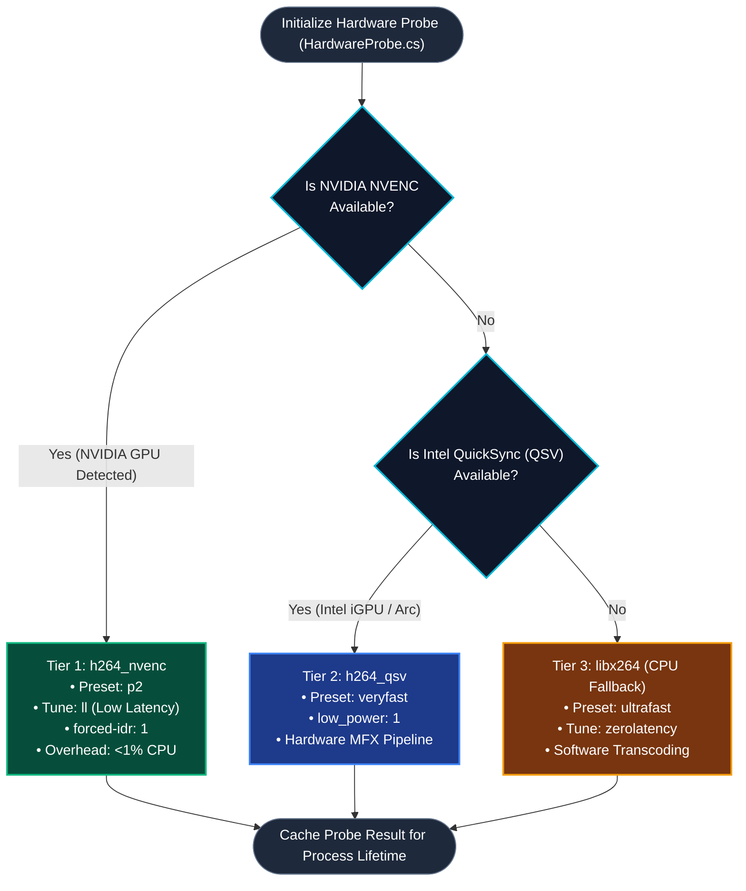
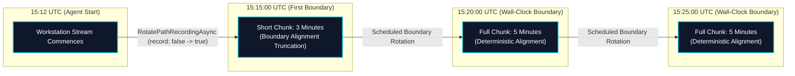
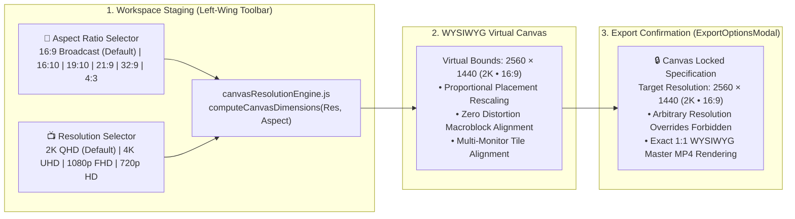

# 📘 ITB-SCREEN-RECORDER — Comprehensive System Book & Developer Architecture Guide
> **Classification**: Enterprise Air-Gapped Operational Platform  
> **Target Audience**: Core Developers, Systems Engineers, DevOps & Security Architects  
> **Last Updated**: 2026-11-07
> **Current Version**: v1.0.70
> **Governing Rules**: Consult [RULES.md](./RULES.md) for behavioral invariants and strict system constraints.

---

## 📑 Table of Contents

### 🏛️ Part I: System Mission, Core Architecture & Low-Level Foundations
1. [Executive Summary & Operational Mission](#1-executive-summary--operational-mission)
2. [High-Level Architecture & Network Topology](#2-high-level-architecture--network-topology)
3. [Component Matrix & Repository Structure](#3-component-matrix--repository-structure)
4. [Windows Session 0 vs. Session 1 Architecture & IPC](#4-windows-session-0-vs-session-1-architecture--ipc)
5. [Media Capture, Hardware Encoding & Streaming Pipeline](#5-media-capture-hardware-encoding--streaming-pipeline)
6. [Wall-Clock Chunking, Storage Failover & File Locking](#6-wall-clock-chunking-storage-failover--file-locking)

### 📡 Part II: Fleet Ingestion, Storage, Telemetry & Environment Invariants
7. [Multi-Monitor Topology & Dynamic Hot-Plug](#7-multi-monitor-topology--dynamic-hot-plug)
8. [Multicam Forensic Extraction & Gap Interpolation](#8-multicam-forensic-extraction--gap-interpolation)
9. [C2 Communication, SignalR Hubs & SQLite Catalog](#9-c2-communication-signalr-hubs--sqlite-catalog)
10. [ClientApp Frontend Architecture & Design System](#10-clientapp-frontend-architecture--design-system)
11. [Air-Gapped & Offline Environment Invariants](#11-air-gapped--offline-environment-invariants)
12. [Developer Playbook: Build, Debug & Test Workflows](#12-developer-playbook-build-debug--test-workflows)
13. [Enterprise Forensic Log Diagnostic & RCA Tool (itb-diagnostics)](#13-enterprise-forensic-log-diagnostic--rca-tool-itb-diagnostics)

### 🔊 Part III: Audio Engineering, Multi-Monitor Capture & Server Core Upgrades
14. [Enterprise UI/UX Modernization, Fleet Intercom & Advanced Resilience Updates (2026-10-28)](#14-enterprise-uiux-modernization-fleet-intercom--advanced-resilience-updates-2026-10-28)
15. [Multi-Screen Studio Editing, Director Track Overrides, Server Folder Browser, 1-Hour Stream Drop Immunity & AD SSO (2026-10-28)](#15-multi-screen-studio-editing-director-track-overrides-server-folder-browser-1-hour-stream-drop-immunity--ad-sso-2026-10-28)
16. [Multi-Monitor Adaptive Video Export Engine (PiP, Split Screen, Auto-Director & Solo Display) (2026-10-28)](#16-multi-monitor-adaptive-video-export-engine-pip-split-screen-auto-director--solo-display-2026-10-28)
17. [Tactical C2 Bulk Recording Iconography & Ergonomic Inversion (2026-10-28)](#17-tactical-c2-bulk-recording-iconography--ergonomic-inversion-2026-10-28)
18. [Multi-Monitor Mouse Pointer & Interaction Isolation Engine (2026-10-28)](#18-multi-monitor-mouse-pointer--interaction-isolation-engine-2026-10-28)
19. [Zero-Black-Screen Persistent Player, Multi-Station Audio Listening & Studio Forensic Canvas Layout (2026-10-28)](#19-zero-black-screen-persistent-player-multi-station-audio-listening--studio-forensic-canvas-layout-2026-10-28)
20. [Cross-Platform CI/CD Architecture & Pipeline Hardening (2026-10-29)](#20-cross-platform-cicd-architecture--pipeline-hardening-2026-10-29)
21. [Multi-Monitor Canvas Layout Normalization, Viewport Collision Prevention & Iconography Hardening (2026-10-29)](#21-multi-monitor-canvas-layout-normalization-viewport-collision-prevention--iconography-hardening-2026-10-29)
22. [Discrete Dual-Channel Audio Architecture & Delayed Intercom Echo Elimination (2026-11-01)](#22-discrete-dual-channel-audio-architecture--delayed-intercom-echo-elimination-2026-11-01)
23. [Graceful Central Server Self-Restart & Online Port Re-Binding Architecture (2026-11-01)](#23-graceful-central-server-self-restart--online-port-re-binding-architecture-2026-11-01)
24. [Host GPU Hardware Detection & Architecture Diagnostics (2026-11-01)](#24-host-gpu-hardware-detection--architecture-diagnostics-2026-11-01)
25. [Server-Calibrated Time Engine & Playhead Synchronization Architecture (2026-11-02)](#25-server-calibrated-time-engine--playhead-synchronization-architecture-2026-11-02)
26. [Multi-Monitor Auto-Director: Active Screen Resolution, Zero-Drift Dip-to-Black & Forensic Timeline Visuals (2026-11-02)](#26-multi-monitor-auto-director-active-screen-resolution-zero-drift-dip-to-black--forensic-timeline-visuals-2026-11-02)

### 🎬 Part IV: Master MP4 Composition, Remote Export API & WYSIWYG Canvas Foundations
27. [Universal Studio Composition Engine & Single Master MP4 Export Architecture (2026-11-02)](#27-universal-studio-composition-engine--single-master-mp4-export-architecture-2026-11-02)
28. [Studio Fullscreen Grid View, Synchronous Multi-Video Playback & Exclusive Audio Solo Architecture (2026-11-02)](#28-studio-fullscreen-grid-view-synchronous-multi-video-playback--exclusive-audio-solo-architecture-2026-11-02)
29. [External Forensic Inspection, Custom Canvas Layout & Master Remote MP4 Export API (2026-11-02)](#29-external-forensic-inspection-custom-canvas-layout--master-remote-mp4-export-api-2026-11-02)
30. [Visual Canvas Composer, Multi-Keyframe Layout Timeline & Dynamic Master Synthesis (2026-11-02)](#30-visual-canvas-composer-multi-keyframe-layout-timeline--dynamic-master-synthesis-2026-11-02)
31. [Multi-Tier Video Quality, Output Resolution & Bitrate Scaling Engine (2026-11-02)](#31-multi-tier-video-quality-output-resolution--bitrate-scaling-engine-2026-11-02)
32. [WYSIWYG Master Canvas Grid Studio, Direct Layout Editing & Screen Switching Architecture (2026-11-02)](#32-wysiwyg-master-canvas-grid-studio-direct-layout-editing--screen-switching-architecture-2026-11-02)
33. [Air-Gapped Fontconfig Elimination & FFmpeg Custom Canvas Hardening (2026-11-02)](#33-air-gapped-fontconfig-elimination--ffmpeg-custom-canvas-hardening-2026-11-02)
34. [Studio Canvas Dimension Stabilization & Frame Quantization (2026-11-02)](#34-studio-canvas-dimension-stabilization--frame-quantization-2026-11-02)

### 🎛️ Part V: Advanced Forensic Studio, Interactive Free-Transform Stage, CAD Rulers & Acoustic DAW Engine
35. [Live Grid Master Canvas Composer, Free Transform Engine & Timeline Keyframe Animation (2026-11-02)](#35-live-grid-master-canvas-composer-free-transform-engine--timeline-keyframe-animation-2026-11-02)
36. [Minimalist Support Tracks, Draggable Keyframes & Live Canvas Auto-Grid Architecture (2026-11-03)](#36-minimalist-support-tracks-draggable-keyframes--live-canvas-auto-grid-architecture-2026-11-03)
37. [Non-Standard Aspect Ratio Preservation & CTRL-Locked Canvas Resizing (2026-11-03)](#37-non-standard-aspect-ratio-preservation--ctrl-locked-canvas-resizing-2026-11-03)
38. [Zero-Collapse Master Canvas Stage & Responsive ResizeObserver Architecture (2026-11-03)](#38-zero-collapse-master-canvas-stage--responsive-resizeobserver-architecture-2026-11-03)
39. [Tactical Master Canvas Workspace Normalization, Layer Stacking Hierarchy, Surface Rotation Isolation & Export/Import Architecture (2026-11-03)](#39-tactical-master-canvas-workspace-normalization-layer-stacking-hierarchy-surface-rotation-isolation--exportimport-architecture-2026-11-03)
40. [FFmpeg Export Resilience, Synthetic Silence Synthesis & Stage-Level Compact Tactical Inspector Architecture (2026-11-03)](#40-ffmpeg-export-resilience-synthetic-silence-synthesis--stage-level-compact-tactical-inspector-architecture-2026-11-03)
41. [Full-Width Responsive Canvas Staging, Dynamic Export Aspect Ratio & True WYSIWYG Dimensional Parity Engine (2026-11-03)](#41-full-width-responsive-canvas-staging-dynamic-export-aspect-ratio--true-wysiwyg-dimensional-parity-engine-2026-11-03)
42. [Tactical Precision CAD/NLE Rulers, Windows Aero Snap Assist & Enhanced Window Drag Ergonomics (2026-11-03)](#42-tactical-precision-cadnle-rulers-windows-aero-snap-assist--enhanced-window-drag-ergonomics-2026-11-03)
43. [Real-Time Web Audio Acoustic VU Meter, Expandable Timeline Audio Track with Dynamic Waveforms & Precision Gain Scale (2026-11-03)](#43-real-time-web-audio-acoustic-vu-meter-expandable-timeline-audio-track-with-dynamic-waveforms--precision-gain-scale-2026-11-03)
44. [Strict Multi-Axis Boundary Clamping, Universal Iconography & Comprehensive Tooltip Architecture for Floating Studio Controls (2026-11-03)](#44-strict-multi-axis-boundary-clamping-universal-iconography--comprehensive-tooltip-architecture-for-floating-studio-controls-2026-11-03)
45. [Minimalist Tactical Display Strip, Elimination of Redundant Minimap Overlays & Smart Multi-Monitor Placement Visibility (2026-11-03)](#45-minimalist-tactical-display-strip-elimination-of-redundant-minimap-overlays--smart-multi-monitor-placement-visibility-2026-11-03)
46. [Root-Level DOM Portal Isolation, Viewport Stacking Context & Modal Inspector Suppression Engine (2026-11-03)](#46-root-level-dom-portal-isolation-viewport-stacking-context--modal-inspector-suppression-engine-2026-11-03)
47. [WYSIWYG Dynamic Canvas Aspect Topology, Proportional Resolution Scaling & Multi-Monitor Native 1:1 Export Fidelity Engine (2026-11-03)](#47-wysiwyg-dynamic-canvas-aspect-topology-proportional-resolution-scaling--multi-monitor-native-11-export-fidelity-engine-2026-11-03)
48. [Undo / Redo History Stack (CTRL+Z / CTRL+Y), Windows-Style State QuickSave (CTRL+S) & Tactical Feedback Toasts Engine (2026-11-03)](#48-undo--redo-history-stack-ctrlz--ctrly-windows-style-state-quicksave-ctrls--tactical-feedback-toasts-engine-2026-11-03)
49. [Tactical Mission Control C2/NOC Unified UX/UI Design Standard & Aesthetic Harmony (2026-11-03)](#49-tactical-mission-control-c2noc-unified-uxui-design-standard--aesthetic-harmony-2026-11-03)
50. [Master Synchronized Canvas Lockstep Playback, Auto-Keyframe Synthesis & Visual Transition Ramp Architecture (2026-11-03)](#50-master-synchronized-canvas-lockstep-playback-auto-keyframe-synthesis--visual-transition-ramp-architecture-2026-11-03)
51. [Workstation-Level Auto-Director Decoupling & Multi-Monitor Conditional Timeline Visibility (2026-11-03)](#51-workstation-level-auto-director-decoupling--multi-monitor-conditional-timeline-visibility-2026-11-03)

### 🎛️ Part VI: NLE Timeline Engine, Studio Canvas Ergonomics, Forensic Metadata & Real-Time Production Mastering
52. [Tactical Station Lifecycle, Solo Mode Multi-Display Filmstrips, and Audio Governance Architecture (2026-11-03)](#52-tactical-station-lifecycle-solo-mode-multi-display-filmstrips-and-audio-governance-architecture-2026-11-03)
53. [Dynamic Mid-Stream Workstation Introduction, NLE Auto-Keyframing & Synchronized Canvas Playback Engine (2026-11-03)](#53-dynamic-mid-stream-workstation-introduction-nle-auto-keyframing--synchronized-canvas-playback-engine-2026-11-03)
54. [Master Export Video Quality & High-Fidelity CFR Framerate Pipeline (2026-11-03)](#54-master-export-video-quality--high-fidelity-cfr-framerate-pipeline-2026-11-03)
55. [NLE Timeline Engine Architecture & Automated Critical Verification Test Matrix (2026-11-03)](#55-nle-timeline-engine-architecture--automated-critical-verification-test-matrix-2026-11-03)
56. [Maximum Canvas Real-Estate Architecture, Paginated Station Accordion with Zero-Scrollbar Guarantee, In/Out Masked Director Coverage & Multi-Track NLE Audio Bus (2026-11-04)](#56-maximum-canvas-real-estate-architecture-paginated-station-accordion-with-zero-scrollbar-guarantee-inout-masked-director-coverage--multi-track-nle-audio-bus-2026-11-04)
57. [Operational Mission Export Notes & Forensic Triage Metadata Architecture (2026-11-05)](#57-operational-mission-export-notes--forensic-triage-metadata-architecture-2026-11-05)
58. [Freeform Draggable Canvas UTC Wall Clock & Mathematical FFmpeg Drawtext Mapping Engine (2026-11-05)](#58-freeform-draggable-canvas-utc-wall-clock--mathematical-ffmpeg-drawtext-mapping-engine-2026-11-05)
59. [Canvas Screen Custom Title Renaming & Video Burn-In Architecture (2026-11-05)](#59-canvas-screen-custom-title-renaming--video-burn-in-architecture-2026-11-05)
60. [Canvas Placement Active-Edit Temporary Z-Index Elevation & Settle Invariant (2026-11-05)](#60-canvas-placement-active-edit-temporary-z-index-elevation--settle-invariant-2026-11-05)
61. [High-Density Canvas Video Streaming Optimization, Hardware Decoder Governance & Constrained VBR Architecture (2026-11-05)](#61-high-density-canvas-video-streaming-optimization-hardware-decoder-governance--constrained-vbr-architecture-2026-11-05)
62. [Decoupled Canvas Resolution & Aspect Ratio Architecture, 2K/16:9 Operational Defaults, Manual Custom Resolution & WYSIWYG Export Lock (2026-11-06)](#62-decoupled-canvas-resolution--aspect-ratio-architecture-2k169-operational-defaults-manual-custom-resolution--wysiwyg-export-lock-2026-11-06)
63. [Master MP4 Real-Time Composition Telemetry, Auto-Director Multi-Station Focus Resolution & Canvas Mount Stabilization (2026-11-07)](#63-master-mp4-real-time-composition-telemetry-auto-director-multi-station-focus-resolution--canvas-mount-stabilization-2026-11-07)
64. [Enterprise Release v1.0.50 & Unified Fleet Version Alignment (2026-11-07)](#64-enterprise-release-v1050--unified-fleet-version-alignment-2026-11-07)
65. [Enterprise Release v1.0.70 & Forensic Gap Keystroke Elimination & CI/CD Security Hardening (2026-11-07)](#65-enterprise-release-v1070--forensic-gap-keystroke-elimination--cicd-security-hardening-2026-11-07)
66. [Comprehensive Viewport Popover & Context Menu Stacking & Occlusion Immunity Architecture (2026-11-08)](#66-comprehensive-viewport-popover--context-menu-stacking--occlusion-immunity-architecture-2026-11-08)
67. [Canvas Layout Keyframe UTC Clock Position Synchronization & Dynamic FFmpeg Drawtext Interval Chaining (2026-11-08)](#67-canvas-layout-keyframe-utc-clock-position-synchronization--dynamic-ffmpeg-drawtext-interval-chaining-2026-11-08)

---

## 1. Executive Summary & Operational Mission

**ITB-SCREEN-RECORDER** is an enterprise-grade command-and-control (C2), multi-screen recording, and live telemetry streaming platform engineered specifically for **fully air-gapped, high-security operational networks**.

### Core Requirements & Key Metrics:
- **Scale**: Continuously captures, encodes, and records 70–100+ high-density workstations (running Windows 11 and Linux).
- **Workstation Overhead**: **<1% CPU utilization** on client endpoints achieved through hardware-accelerated video encoding (NVIDIA NVENC and Intel QuickSync QSV).
- **Live Latency**: Sub-second (200–400ms) glass-to-glass live fleet viewing in standard browsers via WebRTC (WHEP) and Low-Latency HLS.
- **Reliability & Resilience**: 24/7 continuous recording with deterministic wall-clock chunk boundaries, automatic local buffering during network partition, self-healing process watchdogs, and non-blocking Near-Live file access.
- **Air-Gapped Invariant**: **Zero outbound internet dependencies**. No CDNs, no external font services (e.g. Google Fonts), no remote license servers. 100% self-contained within internal subnets.

---

## 2. High-Level Architecture & Network Topology

The system uses a distributed client-server topology separating low-level endpoint capture from centralized streaming, indexing, and storage.



### Protocol & Port Matrix

| Protocol | Port | Direction | Source | Destination | Purpose |
| :--- | :--- | :--- | :--- | :--- | :--- |
| **RTMP** | `19350` | Inbound | AgentWorker | MediaMTX | Video and audio streaming ingest. (Pinned in `mediamtx.yml`). |
| **WHEP / WebRTC** | `8889` / UDP | Inbound | Operator Browser | MediaMTX / Server | Sub-second real-time video playback via WebRTC. |
| **LL-HLS** | `8888` | Inbound | Operator Browser | MediaMTX | Fallback HTTP Live Streaming. |
| **MediaMTX API** | `9997` | Localhost | Server | MediaMTX | Control API for wall-clock chunk rotation (`record: false -> true`). |
| **SignalR / HTTP**| `5000` / `5001` | Bi-directional| AgentService / UI | Server | Real-time C2 telemetry, status reports, remote controls. |
| **SMB / CIFS** | `445` | Outbound | Server | NetApp NAS | Primary recording chunk storage over UNC paths. |
| **Named Pipe** | Dynamic | IPC Local | AgentService | AgentWorker | Session 0 to Session 1 IPC (`\\.\pipe\ITB_ScreenRecorder_Ipc_*`). |

---

## 3. Component Matrix & Repository Structure

```
ITB-SCREEN-RECORDER/
├── ITB-SCREEN-RECORDER.Core\             # Shared domain, contracts, encryption, SQLite DB base
├── ITB-SCREEN-RECORDER.Server\           # Central ASP.NET Core 8 Web API, SignalR, MediaMTX supervisor
│   ├── ClientApp\                        # Tactical C2 Command Dashboard (React 18, Vite, SCSS)
│   ├── MediaMTX\                         # Bundled MediaMTX v1.15.4 binaries (Win/Linux) and mediamtx.yml (source in Tools\Win)
│   ├── Controllers\                      # REST API endpoints (Auth, Fleet, Settings, Maintenance)
│   ├── Hubs\                             # SignalR Realtime Hubs (AgentHub, DashboardHub)
│   └── Services\                         # Storage failover, chunk scheduler, telemetry monitor
├── ITB-SCREEN-RECORDER.AgentService\      # Windows Service / Linux daemon running in Session 0
├── ITB-SCREEN-RECORDER.AgentWorker\       # Interactive Session 1+ screen/audio/keystroke capture worker
├── Features\
│   ├── Extractor\                        # Core multi-camera track cutter and video export engine
│   └── ExtractorAdvanced\                # Forensic LiveTail DVR viewer, Studio canvas, and multi-station timeline
├── Tools\
│   └── ITB-SCREEN-RECORDER.Diagnostics\  # Enterprise forensic log diagnostic & RCA utility
├── Installers\                           # WiX Toolset v4 installer definitions (.msi) & Linux packaging
└── ITB-SCREEN-RECORDER.Tests\            # Complete test suite (450 .NET solution tests + 68 forensic studio client tests)
```

---

## 4. Windows Session 0 vs. Session 1 Architecture & IPC

Windows security restricts Windows Services to **Session 0**, which has no access to interactive display surfaces, window messages, or audio endpoints.



### Key Implementation Details:
1. **Interactive Process Spawning**:
   - Implemented in [`InteractiveProcessLauncher.cs`](./ITB-SCREEN-RECORDER.AgentService/Infrastructure/InteractiveProcessLauncher.cs).
   - Listens for session changes via `WTSSessionNotification` (`WTS_CONSOLE_CONNECT`, `WTS_SESSION_LOGON`).
   - Obtains the logged-in user token via Win32 `WTSQueryUserToken`, duplicates it with `DuplicateTokenEx` (`TOKEN_ALL_ACCESS`), sets the environment block, and calls `CreateProcessAsUser` to spawn `ITB-SCREEN-RECORDER.AgentWorker.exe` directly on `WinSta0\Default`.
2. **Local IPC via Named Pipes**:
   - Implemented in [`IpcServerFactory.cs`](./ITB-SCREEN-RECORDER.Core/Ipc/IpcServerFactory.cs).
   - Pipe name: `\\.\pipe\ITB_ScreenRecorder_Ipc_{SessionId}`.
   - Named pipe security ACLs are explicitly configured with `PipeSecurity` so that the worker (running under non-elevated user credentials) can exchange heartbeats, telemetry, and control commands with the service.
3. **Serialized Channel-Based Single-Writer Pattern**:
   - In [`AgentSupervisorService.cs`](./ITB-SCREEN-RECORDER.AgentService/AgentSupervisorService.cs), duplex NamedPipe writes are decoupled from callers via a bounded `Channel<string> _workerCommandChannel`.
   - A dedicated single-writer background task drains this channel sequentially, strictly guaranteeing that concurrent `WriteLineAsync` calls (such as simultaneous telemetry acknowledgments and C2 `Start`/`SetRecording` commands) never collide on the underlying stream. This eliminates `InvalidOperationException: The stream is currently in use by a previous operation on the stream`.
4. **Silent Background Worker Execution (Zero Window Flashing & Focus Stealing)**:
   - `ITB-SCREEN-RECORDER.AgentWorker` is compiled with `<OutputType>WinExe</OutputType>` on Windows, marking its PE subsystem as `IMAGE_SUBSYSTEM_WINDOWS_GUI` to prevent the Windows kernel from attaching a default console window.
   - When spawned into Session 1 by [`InteractiveProcessLauncher.cs`](./ITB-SCREEN-RECORDER.AgentService/Infrastructure/InteractiveProcessLauncher.cs), `CreateProcessAsUserW` sets `STARTF_USESHOWWINDOW` with `SW_HIDE` in `STARTUPINFO` and combines `CREATE_UNICODE_ENVIRONMENT | CREATE_NO_WINDOW` in creation flags.
   - This ensures 100% silent background execution: the workstation user never sees a black console window popping up or stealing desktop focus during process launch, watchdog recovery, or workstation login.

---

## 5. Media Capture, Hardware Encoding & Streaming Pipeline

The media ingestion engine in `ITB-SCREEN-RECORDER.AgentWorker` is optimized for zero CPU impact and zero packet loss.

### 1. Screen Capture Engine & Resilience
- **Windows Capture Pipeline**: Implemented via [`ResilientScreenCapture.cs`](./ITB-SCREEN-RECORDER.AgentWorker/Providers/Video/ResilientScreenCapture.cs), pairing high-performance DXGI Desktop Duplication with fallback GDI capture.
  - **DXGI DDA ([`DxgiScreenCapture.cs`](./ITB-SCREEN-RECORDER.AgentWorker/Providers/Video/DxgiScreenCapture.cs))**: Grabs GPU surfaces directly in VRAM with zero-copy whenever possible. Supports multi-adapter topologies (`AdapterIndex`, `OutputIndex`).
  - **Static Screen Frame Retention**: When Windows desktop is idle/static, DXGI returns `WaitTimeout`. The capture engine retains and yields the previously captured frame buffer (`_hasCapturedFrame`), preventing video pipelines from emitting empty/black buffers.
  - **Initial Startup Snapshot**: On initialization, `DxgiScreenCapture` immediately takes a 1-shot GDI snapshot to seed `_frameBuffer`. This guarantees frame 0 is never pitch black (zero bytes).
  - **Multi-Monitor GDI Fallback ([`GdiScreenCapture.cs`](./ITB-SCREEN-RECORDER.AgentWorker/Providers/Video/GdiScreenCapture.cs))**: Accepts discrete `(x, y, width, height)` coordinates, enabling accurate BitBlt capture across extended, stacked, or negative-offset secondary monitors when DXGI duplication is unavailable.
- **Linux**: Uses **X11 / XSHM** or **PipeWire** portal interfaces for headless or modern display servers.

### 2. Audio Capture & Intercom Mixer
- Implemented via [`AudioCaptureFactory.cs`](./ITB-SCREEN-RECORDER.AgentWorker/Providers/Audio/AudioCaptureFactory.cs) and [`WasapiDualMixer.cs`](./ITB-SCREEN-RECORDER.AgentWorker/Providers/Audio/WasapiDualMixer.cs) (Windows) / [`LinuxPulseAudioMixer.cs`](./ITB-SCREEN-RECORDER.AgentWorker/Providers/Audio/LinuxPulseAudioMixer.cs) (Linux).
- Captures two discrete audio streams:
  1. **Speaker Output**: System desktop audio loopback (`eRender` endpoint in loopback mode).
  2. **Microphone Input**: Operator headset/microphone intercom (`eCapture` endpoint).
- Employs discrete dual-channel architecture (Channel 0: Desktop loopback, Channel 1: Headset intercom) eliminating delayed intercom echo (detailed in Section 22), with dynamic fallback to [`SilentAudioProvider.cs`](./ITB-SCREEN-RECORDER.AgentWorker/Providers/Audio/SilentAudioProvider.cs) when hardware endpoints are absent.

> [!IMPORTANT]
> **Audio Codec Invariant for RTMP Ingest**: When muxing live feeds into -f flv for MediaMTX RTMP/RTMPS ingest, audio **must** be encoded using -c:a aac (MPEG-4 Audio). Formats such as libopus are unsupported by the FLV container specification; attempting to use libopus with -f flv causes native FFmpeg initialization failure (exit code -22: Invalid argument).

### 3. Tri-Tier Hardware Encoder Selection
Implemented in [`HardwareProbe.cs`](./ITB-SCREEN-RECORDER.Core/Diagnostics/HardwareProbe.cs):
The encoder selection evaluates capabilities in strict sequence:



> [!IMPORTANT]
> **Probe Result Caching**: `HardwareProbe` results are cached for the entire process lifetime. Hardware probes are never re-executed during active streaming to prevent pipeline stutter.

### 4. MediaMTX Streaming Server (CRITICAL VERSION PIN)
- **Pinned Version**: **MediaMTX v1.15.4** ([`mediamtx.exe`](./ITB-SCREEN-RECORDER.Server/Tools/Win/mediamtx.exe)).
- **Why It Is Pinned**: In MediaMTX v1.15.5+, an internal `ntpDriftTolerance` check was introduced in the fMP4 recorder that force-splits chunks if clock jitter occurs. Under real-time workstation encoding, this causes chunks to split every 15–20 seconds instead of adhering to the 5-minute wall-clock rule. **Do not upgrade MediaMTX.**
- **Port Invariant**: MediaMTX RTMP port is hardcoded to `19350` in [`mediamtx.yml`](./ITB-SCREEN-RECORDER.Server/Tools/mediamtx.yml).

---

## 6. Wall-Clock Chunking, Storage Failover & File Locking

### 1. Wall-Clock Aligned Chunking (Rule 1)
Recordings are sliced into deterministic intervals aligned to the wall clock (multiples of `Storage.ChunkIntervalMinutes`, default 5 min).



- **Scheduler**: [`RecordingChunkScheduler.cs`](./ITB-SCREEN-RECORDER.Server/Services/RecordingChunkScheduler.cs) calculates `ComputeNextBoundaryUtc()` using pure UTC clock division, eliminating drift.
- **Trigger**: At the exact boundary, it executes `RotatePathRecordingAsync` against MediaMTX Control API (`record: false -> true`), cleanly finalizing the current MP4 segment and initiating a new segment without dropping frames.
- **Timestamp Format**: MediaMTX uses `%Y-%m-%d_%H-%M-%S-%f` timestamp patterns reflecting exact segment start times.

### 2. Dual-Path Storage Failover (Rule 2)
- Implemented in [`StoragePathResolver.cs`](./ITB-SCREEN-RECORDER.Server/Services/StoragePathResolver.cs).
- **Primary Storage**: NetApp UNC path (`Storage.NetAppUncPath`).
- **Heartbeat Probe**: Probed every chunk tick with a strict 3-second timeout (`Directory.Exists`).
- **Fallback**: If NetApp is unreachable, traffic seamlessly shifts to `Storage.LocalFallbackPath` (`C:\ProgramData\ITB-SCREEN-RECORDER\Recordings`). When NetApp recovers, the scheduler returns to primary storage on the subsequent chunk boundary.

### 3. Non-Locking File Access Semantics (Rule 10)
Active recordings (<30 minutes old) are continuously written by MediaMTX. Any indexer, player, or probe opening these files **must** use non-locking file share semantics:
```csharp
new FileStream(filePath, FileMode.Open, FileAccess.Read, FileShare.ReadWrite | FileShare.Delete);
```
FFmpeg probes on hot files must include:
`-analyzeduration 1M -probesize 1M -threads 2`

---

## 7. Multi-Monitor Topology & Dynamic Hot-Plug

### 1. Multi-Monitor Stream Mapping & WHEP Proxy Routing (Rule 11)
- Each display is captured on its native GPU adapter via DXGI DDA (Windows) or XRandR/PipeWire (Linux). Zero cross-GPU PCIe bus transfers.
- **Deterministic Display Index Sorting ([`DxgiDisplayEnumerator.cs`](./ITB-SCREEN-RECORDER.AgentWorker/Providers/Video/DxgiDisplayEnumerator.cs))**: Enumerated displays are sorted so that the physical Windows primary display (virtual coordinates `X=0, Y=0`) is deterministically indexed as `mon-0`, ensuring it is always the initial audio carrier, while secondary displays are sequentially assigned `mon-1`, `mon-2`, etc.
- Stream paths:
  - Primary Display + Audio: `live/{hostname}/mon-0`
  - Secondary Displays (Video only): `live/{hostname}/mon-1`, `live/{hostname}/mon-2`, etc.
  - Legacy Single-Monitor Path: `live/{hostname}`
- **WHEP Reverse Proxy & Stream Path Fallback ([`WhepProxyController.cs`](./ITB-SCREEN-RECORDER.Server/Controllers/WhepProxyController.cs))**:
  - Exposes an air-gapped reverse proxy endpoint `/api/v1/whep/{*streamPath}` routing WebRTC SDP exchanges to MediaMTX.
  - Automatically handles stream path aliases: if a client requests `live/{hostname}/mon-0` and MediaMTX returns 404 (e.g. older single-monitor agent streaming to root), it seamlessly falls back to `live/{hostname}`. Conversely, if `live/{hostname}` returns 404, it queries `live/{hostname}/mon-0`.
  - Air-Gapped WebRTC configuration: Client players connect via `/api/v1/whep` with empty ICE server lists (`iceServers: []`), eliminating external STUN lookups and cross-origin localhost connection failures.
- **Dynamic Hot-Plug, Audio Carrier Failover & Anti-Flipflop Governor (Rule 11)**:
  - Display connect/disconnect events spawn or cleanly terminate individual display pipelines without interrupting active recording on surviving displays.
  - **Immediate Failover on Carrier Disconnect**: If the primary monitor carrying audio (`mon-0`) disconnects during streaming, [`MultiDisplayPipelineManager`](./ITB-SCREEN-RECORDER.AgentWorker/Engine/MultiDisplayPipelineManager.cs) detects that the audio carrier is lost, promotes the first surviving display (e.g. `mon-1`) to become the active Primary Audio Carrier, and re-engages its pipeline with `audioChannels: 2`. The dynamic audio writer and [`AudioPacer`](./ITB-SCREEN-RECORDER.AgentWorker/Engine/AudioPacer.cs) immediately route live audio packets to the promoted carrier within <800ms, ensuring zero loss of sound during recording.
  - **Anti-Flipflop 60s Stabilization Buffer on Reconnect**: When `mon-0` reconnects or flaps (loose HDMI/DP cable, graphics driver reset), it engages video capture immediately (`audioChannels: 0`) so the workstation's display recording is complete without delay. However, to prevent stream thrashing and audible glitches, audio remains on the surviving carrier (`mon-1`) until `mon-0` has been continuously, stably present for **a full 60 seconds** (`AudioCarrierHysteresisSeconds`).
  - **Flap Abort Resilience**: If `mon-0` disconnects at any point before the 60-second window completes, the stabilization timer aborts and resets to `null`, while the surviving carrier continues streaming audio uninterrupted.
  - **Graceful Handover**: After 60 seconds of uninterrupted stability, the governor smoothly promotes `mon-0` to `audioChannels: 2` and demotes `mon-1` to video-only (`audioChannels: 0`), triggering `AudioCarrierChanged`.
  - **System-Wide Audio Awareness**:
    - [`StationDisplayTopologyDto.cs`](./ITB-SCREEN-RECORDER.Core/Contracts/Topology/StationDisplayTopologyDto.cs) carries `AudioCarrierDisplayId` (e.g. `"mon-0"` or `"mon-1"`) and per-display `HasAudio` booleans.
    - [`RecordingChunkScheduler.cs`](./ITB-SCREEN-RECORDER.Server/Services/RecordingChunkScheduler.cs) inspects `display.HasAudio` and `agent.DisplayTopology.AudioCarrierDisplayId` dynamically rather than hardcoding `mon-0`, ensuring recording chunk metadata accurately reflects the actual audio stream.

### 2. Frontend Topology Display, Audio Solo & Overlap Prevention (Rule 12)
- **Virtual Desktop Canvas**: Real-time monitor positioning according to physical OS virtual desktop bounds $(X, Y, W, H)$.
- **Station Display Bar**: Direct toggle on station cards `[ ⊞ Canvas | 🖥 1 | 🖥 2 ]` positioned at top-right (`top: 8px; right: 8px; z-index: 25`).
- **Four-Quadrant Decoupled Overlays**: To guarantee zero visual collisions across dense fleets:
  - Top-Left: Clickable status tag (`⚠️ MONITOR ONLY` / `⏱ SNOOZED (30m)`).
  - Top-Right: Multi-monitor display selector bar (`StationDisplayBar`).
  - Bottom-Left: Custom configuration / policy tag (`.tactical-override-tag`).
  - Bottom-Right: Audio feed indicator (`.tactical-audio-indicator` — `🔈 MUTED` / `🔊 LIVE`).
- **Responsive Card Geometry**: Minimum card width set to 340px (scaling to 760px) ensuring headers never wrap or overlap controls.
- **Fullscreen Minimap Radar**: Clicking off-canvas displays an interactive HUD Minimap for one-click monitor switching.
- **Exclusive Audio Solo**: Strict intercom radio mode. Only **one** station plays audio across the entire NOC grid at any time; all other video players stay muted to avoid browser audio buffer resource exhaustion.
- **Seamless Live Stream Preservation & Grayscale-to-Color Transition**: Because workstations stream continuous RTMP/WebRTC regardless of recording status, toggling between Live Monitor (`MONITOR`) and Recording (`REC`) does NOT unmount or reload the stream (zero black screen, zero loading matte). The WebRTC peer connection remains uninterrupted, and the video element executes a smooth CSS filter animation between tactical monochrome (`grayscale(100%)`) and full color (`grayscale(0%)`).
- **Stream Health & Black Screen Validation**: Automated suite (`streamHealth.test.js`) continuously verifies luma/entropy across buffers, multi-monitor path non-collision, and WebRTC connection pooling across 100+ stations.

---

## 8. Multicam Forensic Extraction & Gap Interpolation

### 1. Synchronized Multicam Track Cutting (Rule 9)
Handled by [`SynchronizedTrackCutter.cs`](./Features/Extractor/ITB-SCREEN-RECORDER.Features.Extractor/Services/Engine/SynchronizedTrackCutter.cs):
- Trims global idle gaps across all stations equally.
- For station-specific internal dropouts, injects a synthetic 5-second "No Signal" test pattern ([`NoSignalPatternService.cs`](./Features/Extractor/ITB-SCREEN-RECORDER.Features.Extractor/Services/Engine/NoSignalPatternService.cs)) sliced to millisecond precision via `ffconcat`. All exported tracks maintain exact timeline alignment.

### 2. Activity Focus & Dynamic Transitions (Rule 13)
- Evaluates mouse and keyboard activity to generate an intelligent director cut.
- Applies symmetric dip-to-black transitions with a 1-second pre-roll lead-in ($T - 1000\text{ms}$).
- Overlays a persistent minimap HUD that never dips or fades.

### 3. Keystroke Telemetry Sync, Ingestion Latency Calibration & Timeline Ruler
- **Ingestion Pipeline Latency Compensation (`KEYSTROKE_CALIBRATION_OFFSET_MS = 2500`)**:
  - Endpoint keyboard events captured by low-level hooks ([`WindowsKeyboardCaptureProvider`](./ITB-SCREEN-RECORDER.AgentWorker/Providers/Keyboard/WindowsKeyboardCaptureProvider.cs)) are timestamped at the physical keypress instant.
  - Video frames captured by DXGI undergo hardware encoding, RTMP packetization, and MediaMTX storage chunk writing, introducing an end-to-end ingestion latency of ~2.5s before chunks are indexed on disk.
  - Studio video playback overlays ([`KeystrokePlaybackOverlay.jsx`](./Features/ExtractorAdvanced/ITB-SCREEN-RECORDER.Features.ExtractorAdvanced/Client/src/components/Player/KeystrokePlaybackOverlay.jsx)) and timeline ruler tick markers ([`TimelineKeystrokes.jsx`](./Features/ExtractorAdvanced/ITB-SCREEN-RECORDER.Features.ExtractorAdvanced/Client/src/components/Timeline/header/TimelineKeystrokes.jsx)) apply `KEYSTROKE_CALIBRATION_OFFSET_MS` (+2500ms) to ensure tactical keycaps and ruler ticks match the exact visual moment in the video.
- **Physical Hostname & Role Alias Invariant**:
  - Keystroke queries in [`ExtractorAdvancedController.cs`](./Features/ExtractorAdvanced/ITB-SCREEN-RECORDER.Features.ExtractorAdvanced/Controllers/ExtractorAdvancedController.cs) automatically resolve station role aliases (e.g. `AWS Commander` ➔ `PROJECT-LAPTOP`) against `_stationRoleProvider`, ensuring database queries never return empty results when queried by operational alias.
  - [`TimelineBoard.jsx`](./Features/ExtractorAdvanced/ITB-SCREEN-RECORDER.Features.ExtractorAdvanced/Client/src/components/Timeline/TimelineBoard.jsx) and [`TimelineRuler.jsx`](./Features/ExtractorAdvanced/ITB-SCREEN-RECORDER.Features.ExtractorAdvanced/Client/src/components/Timeline/header/TimelineRuler.jsx) forward physical `stationHostname` alongside active display names and pass `keystrokes` down the component tree to guarantee reliable tick mark rendering when `+ RULER TICKS: ON` is active.
- **Live Dashboard Viewing vs. Database Storage Invariant (Active Streaming vs. Active Recording)**:
  - **Live Dashboard Telemetry (`_isStreaming == true`)**: Whenever a station is actively streaming (operator viewing or monitoring), keystrokes are captured by [`WorkerEngine.cs`](./ITB-SCREEN-RECORDER.AgentWorker/Engine/WorkerEngine.cs), forwarded over IPC to [`AgentSupervisorService.cs`](./ITB-SCREEN-RECORDER.AgentService/AgentSupervisorService.cs), and transmitted in real-time to the server over Fast Path (`/api/v1/agent/keystrokes/fast`) and periodic heartbeat. The server broadcasts them via SignalR (`_broadcastService.BroadcastLiveKeystrokesAsync` and `BroadcastTelemetryAsync`), ensuring the operator sees live keystroke overlays in the NOC Dashboard and Station Grid.
  - **Database Persistence Gate (`IsRecording == true`)**: Keystrokes are strictly persisted to SQLite (`catalog.db`) and offline disk storage **ONLY** when the workstation is in an active recording state. [`AgentController.cs`](./ITB-SCREEN-RECORDER.Server/Controllers/AgentController.cs) inspects `report.IsRecording` and `_telemetryState.IsStationRecording(hostname)` before queuing `_catalogRepository.BulkInsertKeystrokesAsync`. If recording is inactive, database storage is bypassed, ensuring non-recorded typing is never stored in the database.
  - **Forensic Timeline Replay Correlation**: Forensic extraction ([`ExtractorAdvancedController.cs`](./Features/ExtractorAdvanced/ITB-SCREEN-RECORDER.Features.ExtractorAdvanced/Controllers/ExtractorAdvancedController.cs)) queries active video chunks and strips out any keystrokes falling into timeline gaps outside recorded video chunks. Studio Timeline UI ([`TimelineKeystrokes.jsx`](./Features/ExtractorAdvanced/ITB-SCREEN-RECORDER.Features.ExtractorAdvanced/Client/src/components/Timeline/header/TimelineKeystrokes.jsx)) validates all keystrokes against `recordingSegments`, completely eliminating false keystroke indicators in gap regions.

---

## 9. C2 Communication, SignalR Hubs & SQLite Catalog

### 1. Real-Time SignalR Hubs
- **`AgentHub` (`/hubs/agent`)**:
  - `RegisterAgentAsync(AgentRegistrationDto)`
  - `HeartbeatAsync(AgentHeartbeatDto)`
  - `ReportMetricsAsync(AgentMetricsDto)`
  - `PushKeystrokeBatchAsync(KeystrokeBatchDto)`
- **`DashboardHub` (`/hubs/dashboard`)**:
  - Broadcasts live station status, CPU/GPU telemetry, storage pool health, and active alerts.

### 2. SQLite Metadata Catalog
- Located at: `ITB-SCREEN-RECORDER.Server/Data/catalog.db`.
- Operates strictly in **WAL (Write-Ahead Logging)** mode (`PRAGMA journal_mode=WAL; PRAGMA synchronous=NORMAL;`).
- Manages indexed recordings, stations, active roles, and custom operational dashboard tabs.

### 3. Fleet Station Identity & Operational Role Aliases (Uniqueness & Multi-View Rendering)
- **Operational Purpose**: Maps physical endpoint hostnames (e.g. `PROJECT-LAPTOP`) to human-readable operational system names (e.g. `AWS Commander`).
- **Strict Case-Insensitive Uniqueness (1-to-1 Mapping)**:
  - **Backend Validation ([`StationRolesService.cs`](./ITB-SCREEN-RECORDER.Server/Services/StationRolesService.cs))**: `SetRoleAliasAsync` and `ApplyMappingAsync` validate that no two stations share the same role alias (`StringComparison.OrdinalIgnoreCase`). Duplicate aliases are rejected with HTTP 400 Bad Request.
  - **Comprehensive Fleet CSV Export & Default Alias Fallback**: `ExportMappingCsvAsync` aggregates all workstations known to the system (from SQLite `station_nodes`, `recording_chunks`, `station_overrides`, and active telemetry agents via `ITelemetryStateService`). Stations without an assigned alias are exported as `Default`. During CSV upload/import, `Default` (case-insensitive) is automatically normalized to `null` (unassigned), completely avoiding false collision conflicts across unaliased fleet endpoints.
  - **CSV Bulk Import & Collision Prevention**: `PreviewCsvMappingAsync` inspects batch mappings against both existing SQLite records and internal CSV rows, flagging colliding stations (`conflictWith`) and disabling the "Apply Mappings to Fleet" action until collisions are resolved.
  - **Live Client-Side Collision Guard**: `StationsRolesTab.jsx` detects duplicate alias inputs in real-time, displaying a collision warning and disabling the Save button.
  - **Atomic Cross-Swap (הצלבת שמות עמדות)**:
    - Allows operators to exchange operational names between two workstations in a single atomic action (`POST /api/v1/stations/roles/swap`).
    - Handled in [`CatalogRepository.cs`](./ITB-SCREEN-RECORDER.Server/Data/Repositories/CatalogRepository.cs) within an atomic SQLite transaction, circumventing unique constraint collisions without requiring temporary placeholder renames.
    - Interactive UI modal in `StationsRolesTab.jsx` provides two-station selection, swap inversion toggle (`⇄`), live outcome preview, and one-click execution accessible from either the tab toolbar or per-station row actions.
- **End-to-End System-Wide Representation**:
  - **Tactical C2 Dashboard**:
    - Station Cards ([`StationThumbnail.jsx`](./ITB-SCREEN-RECORDER.Server/ClientApp/src/components/Station/StationThumbnail.jsx)): Header displays the operational alias as primary title with a small physical hostname badge (`.station-host-badge`).
    - Inspection Drawer ([`StationInspectorDrawer.jsx`](./ITB-SCREEN-RECORDER.Server/ClientApp/src/components/Station/StationInspectorDrawer.jsx)): Primary title shows operational alias alongside `HOST: {hostname}` pill badge.
    - Master Audio Dock ([`MasterAudioDock.jsx`](./ITB-SCREEN-RECORDER.Server/ClientApp/src/components/Station/MasterAudioDock.jsx)): Displays operational alias next to live VU meters.
    - Dense Fleet View ([`StationsDenseView.jsx`](./ITB-SCREEN-RECORDER.Server/ClientApp/src/components/Dashboard/StationsDenseView.jsx)): Renders primary operational title with physical host in brackets.
    - Search & Sorting ([`useDashboardLogic.js`](./ITB-SCREEN-RECORDER.Server/ClientApp/src/components/Dashboard/useDashboardLogic.js)): Fleet search query matches physical hostname, IP, and operational alias; sorting prioritizes operational alias.
  - **Forensic Studio & Replay ([`ExtractorAdvanced`](./Features/ExtractorAdvanced)):
    - Integrated across backend and frontend via [`IStationRoleProvider`](./ITB-SCREEN-RECORDER.Core/Contracts/Network/StationRoleContracts.cs).
    - Multicam Timeline ([`TimelineTrack.jsx`](./Features/ExtractorAdvanced/ITB-SCREEN-RECORDER.Features.ExtractorAdvanced/Client/src/components/Timeline/tracks/TimelineTrack.jsx)): Displays operational alias in track headers with physical host sublabel.
    - Card Grid & Video Viewport ([`CameraCard.jsx`](./Features/ExtractorAdvanced/ITB-SCREEN-RECORDER.Features.ExtractorAdvanced/Client/src/components/Viewport/views/Card/CameraCard.jsx)): Renders operational title with physical machine badge.
    - Cinema Inspection ([`SoloSpotlightModal.jsx`](./Features/ExtractorAdvanced/ITB-SCREEN-RECORDER.Features.ExtractorAdvanced/Client/src/components/Modals/SoloSpotlightModal.jsx)): Top brand pill displays operational name and physical machine badge.
    - Station Drawer & Replay Hub ([`StationDrawerRow.jsx`](./Features/ExtractorAdvanced/ITB-SCREEN-RECORDER.Features.ExtractorAdvanced/Client/src/components/StationDrawer/views/Drawer/StationDrawerRow.jsx), [`StationHubCard.jsx`](./Features/ExtractorAdvanced/ITB-SCREEN-RECORDER.Features.ExtractorAdvanced/Client/src/components/StationDrawer/views/Hub/StationHubCard.jsx), [`StationHubTableRow.jsx`](./Features/ExtractorAdvanced/ITB-SCREEN-RECORDER.Features.ExtractorAdvanced/Client/src/components/StationDrawer/views/Hub/StationHubTableRow.jsx)): Displays operational alias with physical host badge/sublabel.
    - Station Context Menu ([`StationContextMenu.jsx`](./Features/ExtractorAdvanced/ITB-SCREEN-RECORDER.Features.ExtractorAdvanced/Client/src/components/Modals/StationContextMenu.jsx)): Header shows operational alias with `HOST: {hostname}` in subtext.

---

## 10. ClientApp Frontend Architecture & Design System

Built on **React 18 + Vite + SCSS**:
- **Design Tokens**: Standard tactical dark NOC palette:
  - App Background: `--bg-app: #070A10`
  - Panel Surfaces: `--surface-panel: #0F172A`, `--surface-card: #151E2E`
  - Accents: `--accent-cyan: #06B6D4`, `--accent-emerald: #10B981` (Live/Nominal), `--accent-rose: #F43F5E` (Alert), `--accent-amber: #F59E0B` (Fallback)
- **Virtualization**: Off-screen station video streams are automatically unmounted via Intersection Observer to eliminate browser hardware decoder exhaustion.
- **Continuous Quality & Linting**: ESLint and unit test validation (`npm run lint`, `npm test`) are strictly integrated into MSBuild (`CompileFrontend` in `ITB-SCREEN-RECORDER.Server.csproj`) and GitHub Actions CI (`frontend-lint.yml`, `node.js.yml`), preventing unlinted code from compiling or merging.

### 1. Station Inspection Drawer & Verified Operations Protocol
The station inspector drawer ([`StationInspectorDrawer.jsx`](./ITB-SCREEN-RECORDER.Server/ClientApp/src/components/Station/StationInspectorDrawer.jsx)) serves as the primary tactical C2 hub for individual endpoints. All operations presented to the operator strictly represent verified, functional capabilities without phantom buttons or placeholder stubs:
- **Stream Lifecycle Control**:
  - `START RECORDING STREAM` / `STOP STREAM` directly invokes the agent control pipeline (`/api/agents/{hostname}/start` / `stop`).
  - Stopping an active stream requires explicit two-step confirmation with a 4-second safety timeout to avoid accidental interruption of operational recordings.
- **Theater Fullscreen Mode**:
  - Launches real-time cinema monitoring via WebRTC WHEP / LL-HLS with dynamic PIP minimap navigation for multi-monitor topologies.
- **Extract Recording Clip**:
  - Activates the forensic clip slicer engine (`extractor-slicer`) focused on the target station for instant synchronized timeline extraction.
- **Radio Audio Intercom (Solo Sink)**:
  - Connects directly to [`AudioSoloContext`](./ITB-SCREEN-RECORDER.Server/ClientApp/src/context/AudioSoloContext.jsx) implementing Rule 12's single-station solo audio invariant.
  - Dynamically indicates live listening status (`LISTEN LIVE` / `MUTE AUDIO`) with live visual cues when routed to the operator's headset.
- **Recording Alert Snooze**:
  - Integrated with [`useAlertSnooze`](./ITB-SCREEN-RECORDER.Server/ClientApp/src/hooks/useAlertSnooze.js).
  - Allows operators to postpone offline or unrecorded alerts for 30 minutes or 1 hour, or immediately resume alerts with live remaining countdowns.

---

## 11. Air-Gapped & Offline Environment Invariants

> [!CAUTION]
> **Rule 14 Enforcement**: Under no circumstances may any component make calls to the public internet, load CDN assets, or query external APIs.

1. **Fonts & Assets**: All fonts (`Inter`, `JetBrains Mono`) are bundled locally as static assets.
2. **Scripts & Styles**: Zero remote `<script>` or `<link>` tags (no `unpkg`, `cdnjs`, `jsdelivr`).
3. **NPM & NuGet**: Packages are pre-cached and committed or sourced from internal mirror feeds.
4. **Network Subnets**: All communications target private operational ranges (`10.0.0.0/8`, `172.16.0.0/12`, `192.168.0.0/16`, `128.x.x.x`, `.local`, `.internal`).
5. **Zero External Socket Probes**: Hardware diagnostics and network adapters are enumerated exclusively via local OS APIs (`NetworkInterface.GetAllNetworkInterfaces()`). Outbound socket connections to public IPs (such as `8.8.8.8`) are strictly prohibited and eliminated.

---

## 12. Developer Playbook: Build, Debug & Test Workflows

### 1. Building the Backend (.NET 8)
```powershell
# Set sandboxed dotnet home if building inside restricted environments
$env:DOTNET_CLI_HOME = "$pwd\.tmp_dotnet"
dotnet build ITB-Screen-Recorder.sln --no-restore -nodeReuse:false
```

### 2. Running Unit & Integration Tests
```powershell
dotnet test ITB-SCREEN-RECORDER.Tests/ITB-SCREEN-RECORDER.Tests.csproj --no-restore -nodeReuse:false
```

### 3. Frontend Development, Linting & Integrity Testing
```bash
cd ITB-SCREEN-RECORDER.Server/ClientApp
npm install
npm run lint      # Must return 0 errors and 0 warnings
npm run build     # Compiles production bundle to wwwroot
```

- **ExtractorAdvanced Studio (Forensic Replay & Visual Canvas Composer)**:
```bash
cd Features/ExtractorAdvanced/ITB-SCREEN-RECORDER.Features.ExtractorAdvanced/Client
npm install
npm run lint      # Enforces 0 undefined variables, hook rules and syntax checks
npm run build     # Runs ESLint gating followed by Vite production widget bundling
```

- **Automated Frontend Integrity Verification**:
Covered by `FrontendBundleIntegrityTests.cs` inside `ITB-SCREEN-RECORDER.Tests`, verifying widget bundle presence, non-empty compiled artifacts, absence of undefined identifiers, and zero ESLint errors during `dotnet test`.

### 4. Running the Complete System Locally for Debugging
1. **Start MediaMTX**: Run `ITB-SCREEN-RECORDER.Server/MediaMTX/mediamtx.exe`.
2. **Start Server**: Launch `ITB-SCREEN-RECORDER.Server` (port `5000` / `5001`).
3. **Run Worker Standalone (Development Mode)**:
   ```powershell
   cd ITB-SCREEN-RECORDER.AgentWorker
   dotnet run -- --standalone --server http://localhost:5000
   ```
4. **Open Dashboard**: Navigate to `http://localhost:5000` in Google Chrome or Microsoft Edge.

---

## 13. Enterprise Forensic Log Diagnostic & RCA Tool (itb-diagnostics)

To enable rapid field triaging without manual log parsing, the platform provides a dedicated standalone forensic diagnostic CLI tool located in [`Tools/ITB-SCREEN-RECORDER.Diagnostics`](./Tools/ITB-SCREEN-RECORDER.Diagnostics).

### Key Capabilities:
- **True Cross-Platform (Windows & Linux)**:
  - Windows: Single-file executable `itb-diagnostics.exe` (`Publish/Diagnostics/win-x64/`).
  - Linux: Native single-file ELF binary `itb-diagnostics` (`Publish/Diagnostics/linux-x64/`).
  - Automatically identifies local OS and scans default installation paths (`C:\ProgramData\ITB-SCREEN-RECORDER\Logs` on Windows, `/var/log/itb-server` and `/opt/itb-screenrecorder-server/logs` on Linux).
- **Bundled Directly With Server Installations**:
  - **Windows Server MSI**: Packed directly into `C:\Program Files\ITB-ScreenRecorder-Server\Tools\itb-diagnostics.exe` via WiX v4 installer (`ITB-SCREEN-RECORDER.Server.Installer`).
  - **Linux Server Package**: Deployed into `/opt/itb-screenrecorder-server/Tools/itb-diagnostics` via the native `.run` payload installer, with execution permissions (`chmod +x`) automatically applied.
  - **Server Build Pipeline**: Whenever `ITB-SCREEN-RECORDER.Server` is built or published, the single-file diagnostic binary is automatically bundled into its `Tools/` directory.
- **Automated Rule Engine & Pattern Correlation**:
  - `INCIDENT-001`: Correlates fleet-wide post-reboot crash loops where IPC contention prevents worker command receipt and triggers watchdog 30-second restart cascades.
  - `IPC-001` / `IPC-002`: Flags NamedPipe stream concurrency collisions and broken pipe / disposed TextWriter warnings.
  - `WDOG-001`: Detects worker `LaunchTimeout` / heartbeat watchdog process kills.
  - `AIRGAP-001`: Flags outbound public IP socket probes violating Rule 14.
  - `NET-001`: Identifies autonomous server discovery timeouts and blocked UDP 5098 broadcast ports.
  - `CLOCK-001`: Detects domain time drift exceeding 500ms.
  - `STREAM-001`: Pinpoints WebRTC WHEP 404 responses caused by inactive RTMP publication.
  - `LNX-001` / `LNX-002`: Detects Linux systemd service exits and X11/PipeWire display server acquisition errors.
- **Usage**:
  ```powershell
  # Windows:
  .\Tools\itb-diagnostics.exe "C:\ProgramData\ITB-SCREEN-RECORDER\Logs"
  
  # Linux:
  /opt/itb-screenrecorder-server/Tools/itb-diagnostics /var/log/itb-server
  
  # Interactive mode (drag-and-drop or auto-scan default directories):
  .\itb-diagnostics.exe
  ```
- **Exportable Reports**: Automatically saves full forensic summary text files (`ITB_Diagnostic_Report_<timestamp>.txt`) alongside the terminal output.

---
---

## 14. Enterprise UI/UX Modernization, Fleet Intercom & Advanced Resilience Updates (2026-10-28)

To address real-world deployment feedback across 70–100+ dense workstations, the following enterprise architecture enhancements and invariants were integrated:

### 1. Multi-Device WASAPI Intercom & Dual Audio Mixer (WasapiDualMixer.cs)
- **Universal Render Enumeration**: Rather than binding only to the OS default multimedia endpoint, WasapiDualMixer now enumerates all active audio render endpoints (DataFlow.Render, DeviceState.Active). Any audio played through speakers, headsets, or monitor HDMI/DP audio channels is dynamically captured and mixed into the master AAC stream.
- **Microsecond Audio Pacing**: Replaced jittery Task.Delay with high-precision Stopwatch timing producing exact 50 frames/sec (20ms) at 48000 Hz, strictly preventing RTMP timestamp drift.
- **Pacer Watchdog Grace Threshold**: Relaxed synthetic silence watchdog to 500ms to allow smooth audio pipeline startup without packet contention.

### 2. Multi-Monitor Topology & Screen Collision Elimination
- **Collision-Free HUD**: Repositioned .monitor-only-overlay to center-top (left: 50%; transform: translateX(-50%)), completely freeing the top-left for .solo-display-badge and multi-monitor resolution pills (.sub-display-overlay).
- **Stable Header Metrics**: Removed wide text snooze buttons from card-minimal-header. Workstation hostname, physical alias, and IP address now retain dedicated fixed horizontal layout space without truncation or wrapping.
- **Symmetrical 100% Equal Card Heights**: Card header (44px), viewport (16:9), and footer (24px) are locked to identical pixel heights across the entire fleet grid. The footer reserves inline slots for dropped frames warnings and 3px health scores.

### 3. Debounced Audio State & 3-Tier Fault Detection
- **Hysteresis Smoothing**: Integrated a 3.5-second debounce buffer on audio presence telemetry to eliminate rapid green/grey flickering caused by network polling bursts.
- **3-Tier Health States**:
  - **Active (Emerald)**: Real-time audio stream flowing smoothly.
  - **Fault (Amber)**: Workstation audio hardware (speakers/mic) present and configured, but audio stream packets are stalled or absent.
  - **Muted (Slate)**: Workstation has no audio devices or is operating in silent mode.

### 4. Storage Quota Clamping & Physical NetApp Enforcement
- Max storage quota in settings is dynamically clamped to the total physical capacity of the active NetApp pool (liveStorage.totalSizeBytes), preventing operators from setting quotas beyond actual disk boundaries.

### 5. System Overview & Health Launchpad (SystemOverviewTab.jsx)
- Introduced as the primary first tab in the Settings view:
  - Real-time fleet health score, online, recording, monitor-only, and frame-drop counters.
  - Interactive Fleet Operational Status Distribution breakdown bar (Recording, Standby, Drops Alert, and Offline ratios).
  - Real-time tactical SVG telemetry charts with zero external CDN dependencies:
    - Server CPU Utilization (Host CPU % vs Server Process CPU % curves with live gradient area fill).
    - Server RAM Allocation & Process Heap (App Process Memory in MB).
    - Network Bandwidth Throughput (NIC Rx Ingest vs Tx WHEP in Mbps).
    - Fleet Capture Stability (average captured FPS across active fleet and dropped frame indicators).
  - Hardware Encoder Invariant Process Flow Graph (Rule 8): visual sequential waterfall diagram showing evaluation stages (NVIDIA NVENC -> AMD AMF -> Intel QuickSync -> CPU libx264) with status indicators: selected (✓), failed (✗), and untested/skipped (—).
  - Active storage pool capacity visualization (NetApp Primary vs Local NVMe Fallback) and MediaMTX stream engine status.
  - 1-click tactical square navigation cards directly launching the C2 Monitoring Grid, Storage settings, Station overrides, Roles, Agent defaults, Security, and Diagnostics.

### 6. Indefinite Alert Postponement (∞ Forever)
- SnoozeAlertModal and useAlertSnooze now support an indefinite ∞ Forever option (until: 253402300799000), persisting snooze state across sessions and displaying ⏱ SNOOZED (FOREVER).

### 7. Active Directory Real OU Integration & Zero-Coverage Filtering
- **Real AD Tree Query**: TabConfigModal removes hardcoded placeholder strings and only enables OU-based grouping when LDAP/AD is verified active, fetching live organizational units directly from /api/v1/settings/security/ad/tree.
- **Forensic Studio Pruning**: Stations with 0% recording coverage within the selected debriefing time range are automatically filtered out from StationDrawer and studio hubs.

### 8. Viewport-Adaptive Fleet Pagination
- Dense list view and settings configuration tables (Station Overrides & Roles) calculate rows dynamically based on available viewport height, eliminating vertical scrolling and docking pagination controls cleanly at the bottom.
- Consolidated the postponed stations banner into an interactive count summary with dedicated [ 🔍 View Postponed Stations ] and [ ✕ Return to All Stations ] filter toggles.

---

## 15. Multi-Screen Studio Editing, Director Track Overrides, Server Folder Browser, 1-Hour Stream Drop Immunity & AD SSO (2026-10-28)

### 1. Multi-Screen Studio Editing & Auto-Director Track (ExtractorAdvanced)
- **Per-Display Forensic Extraction**: `AdvancedExtractorService.cs` accepts `displayId` parameter (`mon-0`, `mon-1`, etc.) for sub-millisecond accurate frame extraction (`ExtractFrameAsync`) with quantized multi-monitor cache keys (`frame_{hostname}_{cleanDisplay}_{quantEpoch}`).
- **Auto-Director Track with Live Orientation**: `DirectorTrack.jsx` renders directly beneath the video health bar, visualizing active display intervals. The track dynamically displays an orientation badge (`⚡ MON-0 (AUTO)` vs `✋ MON-1 (OVERRIDE)`), clearly indicating which monitor is active at the playhead position.
- **Interactive Cut & Override**: Operators can split segments at the playhead (via `✂️ Split` button or hotkey `S`), assign monitor overrides, or reset segments back to automatic activity-based routing.
- **Multi-Monitor Studio View Modes**: `StudioVideoFeed.jsx` introduces a tactical view switcher:
  - **🎬 DIRECTOR**: Plays the director cut following automatic or overridden display sequences.
  - **🔲 SPLIT**: Displays dual side-by-side synchronized monitors for simultaneous multi-screen analysis.
  - **🪟 PiP**: Renders secondary monitors inside a floating picture-in-picture viewport with 1-click screen swap.
  - **🖥️ Monitor Pins**: Locks playback exclusively to a specific monitor (`mon-0`, `mon-1`).

### 2. Server Directory Browse & Safe Path Navigator
- **Secure FileSystem Exploration**: `/api/v1/settings/browse-directories` enumerates logical system drives (`C:\`, `D:\`, etc.) and allows navigating server-side directories safely without manual typing.
- **Directory Creation**: `/api/v1/settings/create-directory` enables creating new storage folders directly from the dashboard.
- **Tactical Browse Modal**: `FolderBrowseModal.jsx` provides a portal-rendered file explorer for NetApp UNC paths, local fallback storage, and chunk event logs.

### 3. Root Cause Resolution for 1-Hour Continuous Stream Drops
- **Windows Power Manager Display Sleep Defeated**: Windows default power scheme triggers display sleep after 60 minutes of inactivity (`VIDEO_TIMEOUT`), causing DXGI DDA `DXGI_ERROR_ACCESS_LOST` and GDI black frames. `WorkerEngine.cs` now invokes Win32 `SetThreadExecutionState(ES_CONTINUOUS | ES_SYSTEM_REQUIRED | ES_DISPLAY_REQUIRED)` during active capture sessions, refreshing every 60 seconds to guarantee displays remain awake indefinitely.
- **Resilient WebRTC Reconnection**: `WebRTCPlayer.jsx` replaces the rigid 5-retry cutoff with an infinite smart reconnection scheduler (fast retry followed by steady 6s cadence) and a 3.5-second frame stall watchdog that triggers silent renegotiation if playback freezes.

### 4. Modal Viewport Trapping Elimination via React Portals
- **Ancestor Transform Isolation**: Fixed CSS `transform: translateY(...)` inside `fullPageFadeIn` animation in `SettingsView.scss`, which previously caused child `position: fixed` elements to treat the scrolled canvas as their containing block.
- **Root DOM Portaling**: All settings modals (`FolderBrowseModal`, `AdTreeBrowserModal`, `SecurityAccessTab` role and user modals, and `StationsRolesTab` modals) are rendered directly into `document.body` via `ReactDOM.createPortal`, guaranteeing permanent center-screen viewport alignment regardless of scroll depth.

### 5. Windows Integrated Authentication & Silent Active Directory SSO
- **Zero-Prompt SSO Handshake**: `/api/v1/auth/windows-sso` detects Windows domain identity (`User.Identity?.Name` via Negotiate / Kerberos / NTLM or `X-Remote-User` reverse-proxy headers).
- **Service Account Group Resolution**: `LdapAuthenticationProvider.AuthenticateSsoUserAsync` authenticates the domain user against Active Directory, queries their `memberOf` LDAP group hierarchy, maps their operational roles, and generates a signed JWT token.
- **Silent Dashboard Ingress**: `AuthContext.jsx` issues a silent SSO probe upon application load (`credentials: 'include'`). If the domain user is recognized, they are logged in automatically without prompting for credentials.

---

## 16. Multi-Monitor Adaptive Video Export Engine (PiP, Split Screen, Auto-Director & Solo Display) (2026-10-28)

### 1. Unified Studio-to-Export WYSIWYG Parity (Rule 13)
- **Problem Solved**: Multi-monitor stations previously defaulted to only exporting `mon-0` (the primary display), discarding the operator's active view choice in the Extractor Studio.
- **Adaptive Render Pipeline**: The export engine in `SynchronizedTrackCutter.cs` now strictly adapts the rendered output video to match the layout chosen in the editing studio:
  - **🪟 Picture-in-Picture (PiP)**: Multi-input FFmpeg pipeline (`[0:v]` and `[1:v]`). The Hero display is scaled to 1920x1080 (preserving aspect ratio with letterboxing), while the secondary display is scaled to 576x324 (30% scale), framed with a 2px tactical cyan border (`#06B6D4`), and positioned in the bottom-right corner (`W-w-24:H-h-24`). Respects 1-click primary/secondary display swap (`isPipSwapped`).
  - **🔲 Split Screen (Side-by-Side)**: Scales both monitors to 960x1080 each (preserving native aspect ratios with centering pads) and joins them via `hstack=inputs=2` with a 2px dark-slate tactical divider (`#1E293B`), outputting a pristine 1920x1080 dual-screen MP4.
  - **🎬 Auto-Director Cut**: Slices between displays according to the Auto-Director schedule or operator manual overrides, applying smooth zero-time-drift 0.3s dip-to-black fade transitions.
  - **🖥️ Solo Display Pin**: Explicitly renders a single monitor (`mon-0` or `mon-1`), automatically bridging primary audio from `mon-0` even when exporting a silent secondary display.

### 2. Dual-Track Clock Synchronization & Gap Compensation
- When generating multi-display exports, both displays are processed against the master `plan.ActiveSegments`.
- If an individual monitor experienced a temporary capture interruption or delayed initialization, `AppendDummyGapAsync` automatically inserts a mathematical "No Signal" slate into that specific monitor's manifest. This guarantees that both display streams remain 100% time-synchronized down to the millisecond without drift.

### 3. End-to-End Contract Propagation
- `ExtractionRequestDto`, `SynchronizationPlan`, `AdvanceCutRequestDto`, and `AdvanceJobInfo` now propagate `LayoutMode`, `TargetDisplayId`, `IsPipSwapped`, and `DirectorSegments`.
- `SoloSpotlightModal.jsx` and `ExtractorAdvancedStudio.jsx` synchronize their active view mode and swap states directly into the export payloads, providing live visual feedback on the `[EXPORT CUT (MODE)]` action button.

---

## 17. Tactical C2 Bulk Recording Iconography & Ergonomic Inversion (2026-10-28)

### 1. Tactical Bulk Recording Controls & Operational Semantics
- **Ergonomic Inversion to Standard C2 Operations**:
  - **Bulk Start Recording (`tactical-btn-start`)**:
    - **Visual Styling**: Rendered in tactical red (`color: var(--accent-rose, #EF4444); background: rgba(239, 68, 68, 0.15); border-color: rgba(239, 68, 68, 0.45);`). On hover, illuminates into solid red (`#EF4444`) with a glowing halo (`0 0 12px rgba(239, 68, 68, 0.6)`).
    - **Iconography**: Outer rounded stroke square enclosing a centered solid circle (`<rect x="3.5" y="3.5" width="17" height="17" rx="3" stroke="currentColor" strokeWidth="2.2" />` + `<circle cx="12" cy="12" r="4.5" fill="currentColor" />`), reflecting standard tactical broadcast recording indicators.
  - **Bulk Stop Recording (`tactical-btn-stop`)**:
    - **Visual Styling**: Rendered in operational standby emerald green (`color: var(--accent-emerald-light, #34D399); background: rgba(16, 185, 129, 0.15); border-color: rgba(16, 185, 129, 0.45);`). On hover, illuminates into solid emerald (`#10B981`) with dark text and green glow (`var(--glow-green)`).
    - **Iconography**: Solid square (`<rect x="5.5" y="5.5" width="13" height="13" rx="2" fill="currentColor" />`), indicating standby/stop state.
- **Component File Mapping**:
  - `ITB-SCREEN-RECORDER.Server/ClientApp/src/components/Dashboard/DashboardDock.jsx`
  - `ITB-SCREEN-RECORDER.Server/ClientApp/src/components/Dashboard/DashboardDock.scss`

---

## 18. Multi-Monitor Mouse Pointer & Interaction Isolation Engine (2026-10-28)

### 1. Root Causes Resolved in Multi-Monitor Capture
- **GDI Concurrency Contention Defeated**: Parallel video pipelines (e.g. `mon-0` and `mon-1`) running on concurrent pacer threads previously collided on shared static cursor pixel buffers and `LockBits` operations on `_cursorBmp` (`Bitmap region is already locked`), causing mouse overlay rendering to abort. Synchronized with internal re-entrant thread locks (`_renderLock`).
- **Global Virtual Desktop Coordinate Mismatch**: Win32 `GetCursorInfo`, `GetCursorPos`, and `MSLLHOOKSTRUCT` coordinates span the entire multi-monitor virtual desktop (e.g. `X: 0..5360`). Display pipelines previously operated on origin `(0, 0)`. Secondary monitors whose global $X$ exceeded their local resolution (e.g. $X=4521$ on a 1920-wide monitor) dropped all cursor rasterization pixels as out-of-bounds, rendering the pointer completely invisible.
- **Cross-Monitor Ghost Interaction Ripples**: Mouse clicks executed on the primary monitor (`mon-0`) were inadvertently rasterized at matching local coordinates on secondary monitors (`mon-1`) or clamped to monitor borders, creating phantom click ripples.

### 2. Multi-Display Viewport Translation & Strict Isolation Pipeline
- **Coordinate Offset Propagation**:
  - `MultiDisplayPipelineManager` passes monitor geometry (`desc.X`, `desc.Y`) into `VideoPipeline`.
  - `VideoPipeline` provides `screenOffsetX` and `screenOffsetY` directly to `MouseCursorOverlay.DrawMouseToFrame`.
  - `IMouseOverlayProvider`, `WindowsMouseOverlay`, and `LinuxMouseOverlay` translate pointers:
    $$\text{localX} = \text{cursorPosX} - \text{screenOffsetX}, \quad \text{localY} = \text{cursorPosY} - \text{screenOffsetY}$$
  - A fast boundary check immediately skips cursor rasterization if the pointer does not intersect the target display's active surface:
    $$\text{localX} \in [-128, \text{width} + 128], \quad \text{localY} \in [-128, \text{height} + 128]$$
- **Interaction Ring & Badge Isolation**:
  - `MouseVisualRasterizer.RenderRingsAndScroll`: Translates shockwave ripple and scroll arrow events by display offsets; events occurring outside the display viewport (with a 64px ripple boundary) are discarded from that display's stream.
  - `MouseVisualRasterizer.RenderClickBadges`: Strictly verifies monitor containment without cross-monitor clamping, ensuring click indicators illuminate only on the physical display where the user action occurred.
- **Color Cursor Fidelity & Transparency Recovery**:
  - `WindowsMouseOverlay` dynamically queries `iconInfo.hbmColor` BITMAP dimensions via Win32 `GetObject` to avoid unnecessary 128x128 over-sampling.
  - For cursors lacking 32-bit alpha channels, the 1-bit transparency mask is decoded from `iconInfo.hbmMask`, preserving dark and black cursor borders.

### 3. Automated Verification & Isolation Regression Suite
- **Pixel-Perfect Buffer Testing**:
  - `ITB-SCREEN-RECORDER.Tests/AgentWorker/MultiMonitorMouseIsolationTests.cs`:
    - `PrimaryScreenClick_RendersOnlyOnPrimaryMonitorBuffer`: Verifies that a click at `(500, 300)` renders on `mon-0` (3440x1440) while `mon-1` (1920x1080 @ 3440,0) remains 100% untouched (`0x00000000` pristine).
    - `SecondaryScreenClick_RendersOnlyOnSecondaryMonitorBuffer`: Verifies that a click at `(4000, 500)` renders solely on `mon-1` (local `560, 500`), while `mon-0` contains zero rendered pixels.
    - `ClicksInVerticalDeltaRegions_AreIsolatedAccurately`: Verifies that clicks in vertical asymmetric zones ($Y > 1080$) are strictly discarded from secondary monitor feeds.
- **Deterministic Test Lifecycle**:
  - `MouseVisualRasterizer.ClearEvents()` provides atomic ring and badge event flushing between test executions to guarantee zero cross-test temporal leakage.

---

## 19. Zero-Black-Screen Persistent Player, Multi-Station Audio Listening & Studio Forensic Canvas Layout (2026-10-28)

### 1. Zero-Black-Screen Persistent WebRTC Topology Architecture
- **Root Problem**:
  - When switching display view modes (`[ ⊞ Canvas | 🖥 1 | 🖥 2 ]`) on station cards, previous implementations destroyed `<WebRTCPlayer>` components and unmounted DOM nodes.
  - This unmounting terminated active `RTCPeerConnection` instances, triggering teardown, new WHEP POST requests, and SDP offer/answer handshakes.
  - This resulted in an unavoidable **500–1500ms black screen** and operator visual disruption whenever inspecting individual displays.
- **Architectural Solution (`VirtualTopologyCanvas.jsx` & `VirtualTopologyCanvas.scss`)**:
  - **Continuous Mounting**: All active `<WebRTCPlayer>` instances remain permanently mounted in the DOM. Switching between `canvas` mode and solo monitor views (`mon-0`, `mon-1`, etc.) never unmounts or interrupts WebRTC stream receivers.
  - **Hardware-Accelerated CSS Transitions**: Display coordinates and dimensions dynamically shift using GPU-accelerated CSS properties:
    ```scss
    transition: left 0.32s cubic-bezier(0.16, 1, 0.3, 1),
                top 0.32s cubic-bezier(0.16, 1, 0.3, 1),
                width 0.32s cubic-bezier(0.16, 1, 0.3, 1),
                height 0.32s cubic-bezier(0.16, 1, 0.3, 1),
                opacity 0.25s ease-out;
    ```
  - **Solo Expansion & Smooth Dimming**:
    - `.is-solo-expanded`: Fills 100% of the canvas container (`inset: 0; width: 100%; height: 100%; z-index: 10; opacity: 1; pointer-events: auto;`).
    - `.is-solo-hidden`: Scales and dims gracefully (`opacity: 0; pointer-events: none; transform: scale(0.96);`).
  - **Result**: Instant, butter-smooth 0ms transitions with **zero black frames** and **zero SDP renegotiation**.

### 2. Multi-Station Audio Listening & Dynamic Master Intercom Dock
- **Evolution to Fleet Multi-Sink Intercom**:
  - Replaced the single-station constraint with multi-station listening capabilities (`activeAudioStationIds: []`).
  - Operators can now monitor audio from multiple operational workstations simultaneously without dropping previous audio sinks.
  - Full backward compatibility maintained for legacy single-station state (`activeAudioStationId`).
- **Tactical Audio Sinks & UI Orchestration**:
  - `AudioSoloContext.jsx`: Manages `activeAudioStationIds`, multi-stream registry `activeAudioStreams`, and atomic station muting via `muteStation(stationId)`.
  - `StationThumbnail.jsx`: Visual listen toggle reflects multi-sink listening status (`activeAudioStationIds.includes(hostname)`).
  - `MasterAudioDock.jsx`:
    - Renders interactive station chips: `[ 🔊 Station-01 ✕ ]`, `[ 🔊 Station-02 ✕ ]` with hover-to-mute actions.
    - Master volume slider controlling combined audio gain.
    - Web Audio API spectral VU analysis for live visual audio levels.

### 3. Forensic Editing Studio: Real-Topology Canvas Layout & Live Director Punch Switcher
- **Physical Topology Canvas Mode (`StudioVideoFeed.jsx`)**:
  - In addition to Split Screen and PiP modes, ExtractorAdvanced Studio now provides a **Physical Canvas** view (`layoutMode === 'canvas'`).
  - Workstation displays are laid out according to actual Windows virtual desktop coordinates ($X, Y, \text{Width}, \text{Height}$) computed via `calculateTopologyBounds` and `calculateNormalizedDisplayRect`.
  - Displays are rendered in true physical aspect ratio with subtle bezel separation and active screen focus borders.
- **Broadcast-Grade Director Live Punch Switcher**:
  - Integrated directly on the video player toolbar, orientation banner, and timeline tracks.
  - Operators can punch cameras live: `[CAM 1]`, `[CAM 2]`, `[↩ AUTO]` directly from the preview monitor without digging into submenus.
  - Hover quick-actions on the timeline allow immediate camera punching or reverting to algorithmic Auto-Director cuts.
- **FFmpeg Multicam Export Synchronization (`SynchronizedTrackCutter.cs`)**:
  - Engine supports `"canvas"` alongside `"split"` and `"pip"` in filtergraph generation.
  - Accurately generates canvas overlays respecting multi-monitor coordinate offsets during video export.

### 4. Multi-Display Keystroke Telemetry Visibility
- **Keystroke Display Decoupling**:
  - Resolved missing keystroke display in multi-screen grids and fullscreen previews.
  - Telemetry fallbacks inspect both fast-path keys and periodic heartbeat properties (`keystrokes`, `Keystrokes`, `recentKeystrokes`).
  - `FullscreenModal.jsx` decouples keystroke rendering from active streaming state, allowing keystroke inspection during both live stream viewing and offline chunk replay.

---

## 20. Cross-Platform CI/CD Architecture & Pipeline Hardening (2026-10-29)

### 1. Cross-Platform Test Runner & Shell Determinism
- **Root Problem**:
  - `package.json` previously defined `"test": "node --test src/tests/*.test.js"`.
  - On Linux/macOS runners, bash expands file wildcards before invoking Node.
  - On Windows GitHub Actions runners (`windows-latest`), `cmd.exe` does not expand wildcards, passing literal `src/tests/*.test.js` to `node.exe`. Node failed to locate the wildcard path, throwing `ENOENT / MODULE_NOT_FOUND`.
- **Architectural Solution**:
  - Standardized the test script to `"test": "node --test"` without arguments.
  - Node's native test runner automatically traverses and discovers `*.test.js` and `test/**/*.js` suites cross-platform while properly ignoring `node_modules`.

### 2. Lockfile Synchronization & npm ci Invariant
- **Root Problem**:
  - `package-lock.json` in `ClientApp` was versioned at `0.0.0` while `package.json` had evolved to `1.0.44`.
  - In CI workflows, `npm ci` strictly enforces lockfile parity with `package.json`. Version mismatches trigger fatal errors during fresh repository installations.
- **Resolution**:
  - Synchronized `package-lock.json` via `npm i --package-lock-only`, aligning package versions and dependency trees across both Linux and Windows runners.
  - Workflow cache keys explicitly target `./ITB-SCREEN-RECORDER.Server/ClientApp/package-lock.json` rather than multi-matching wildcards.

### 3. Server Project CompileFrontend Target & Node.js CI Integration
- **Frontend Build Target Invariant**:
  - `ITB-SCREEN-RECORDER.Server.csproj` declares `<Target Name="CompileFrontend" BeforeTargets="Build">`, triggering `npm run lint`, `npm test`, and `npm run build` during server compilation.
  - `.NET Core Cross-Platform CI` (`dotnet-build-test.yml`) was enhanced with `actions/setup-node@v4` (Node 20.x) immediately following `actions/setup-dotnet@v4` to guarantee consistent Node.js runtimes across both `ubuntu-latest` and `windows-latest`.
  - Unit test execution timeout was extended to `timeout-minutes: 10` to accommodate complete multicam synchronization, SQLite failover, and installer packaging suites.

### 4. React 19 / ESLint 10 Hook & Assignment Strictness
- **Rules of Hooks Invariant**:
  - In `KeystrokePlaybackOverlay.jsx` and `PersistentMinimapHud.jsx`, `useMemo` declarations were hoisted above conditional early-exit returns, ensuring invariant hook invocation counts across renders.
- **Dead Assignment Invariant**:
  - In `ExtractorAdvancedStudio.jsx` and `SoloSpotlightModal.jsx`, eliminated dead initializations (`let resolvedMode;`) flagged by `no-useless-assignment`.

---

## 21. Multi-Monitor Canvas Layout Normalization, Viewport Collision Prevention & Iconography Hardening (2026-10-29)

### 1. Studio Canvas Desktop Geometry & Zero-Stacking Prevention
- **Coordinate Normalization Invariant**:
  - In `StudioVideoFeed.jsx`, `stationDisplays` memoizes displays across all metadata representations (`displays`, `Displays`, `displayTopology.displays`, `topology.displays`).
  - When historical recordings or uncalibrated fallback metadata report identical `(0, 0)` offsets for multiple monitors, the auto-layout engine detects `allZeroCoords` and distributes monitor panes side-by-side using real horizontal physical offsets ($X_{\text{offset}} = \sum \text{Width}_i, Y = 0$).
  - When physical DXGI virtual desktop coordinates are present, true physical topology is strictly preserved.
- **Proportional Canvas Stage Board (`.feed-canvas-board`)**:
  - Encapsulated display panes within `.feed-canvas-board` having inline `aspectRatio: totalWidth / totalHeight`.
  - `.feed-canvas-container` provides top and boundary padding (`padding: 64px 24px 24px 24px`), preventing the canvas stage from stretching, distorting monitor aspect ratios, or hiding behind the command toolbar.

### 2. Viewport HUD Decoupling & Collision Elimination
- **Command Toolbar Centering**:
  - `.feed-viewmode-toolbar` is horizontally centered at `top: 14px; left: 50%; transform: translateX(-50%); z-index: 30;` with `max-width: calc(100% - 240px); overflow-x: auto; scrollbar-width: none;`.
  - Positioned safely away from the top-right corner, leaving room for HUD radars and status overlays.
- **Minimap HUD Separation & Canvas Redundancy Filter**:
  - `.persistent-minimap-hud` is anchored at `top: 14px; right: 14px; z-index: 25;`, completely preventing visual collision with the centered command bar.
  - In `canvas` view mode, `PersistentMinimapHud` is intentionally unrendered, eliminating visual clutter since all monitors are already in full view.

### 3. Tactical Bulk Recording Controls & Fleet Resilience
- **Side Menu Actionability**:
  - In `DashboardDock.jsx`, `canControlStations` evaluates `isOpenMode || isSystemRoot || hasPermission('stations.control')`, ensuring operators in standard Open/Air-gapped installations can trigger fleet recording without administrative deadlocks.
  - In `useDashboardLogic.js`, `canStartAny` and `canStopAny` check multiple casing invariants (`isOnline`, `IsOnline`, `status: 1 | 2`, `isProcessRunning`, `isRecording`, `IsRecording`).
  - `handleFilteredBulkStart` and `handleFilteredBulkStop` target unrecorded online stations from the active filtered view, and automatically fall back to the global fleet pool if filtered views are empty.
  - `App.jsx` optimistically updates station recording badges upon dispatch, eliminating latency stalls.

### 4. Iconography Hardening & Question Mark Elimination
- **Clean SVG Icon Invariant**:
  - Replaced corrupted character artifacts (`?`, `??`, `\uFFFD`) in `StationThumbnail.jsx`, `NotRecordingAlertBanner.jsx`, `StationsRolesTab.jsx`, `StorageRetentionTab.jsx`, `TopScopeBar.jsx`, and `SoloSpotlightModal.jsx` with crisp inline SVGs, semantic badges (`⏰`, `⚠️`, `📌`, `⏺`, `↺`), and correct Unicode symbols (`✕`, `→`, `—`).
  - Preserves 100% offline, self-contained air-gapped compliance (zero external web fonts or CDN downloads).

---
## 22. Discrete Dual-Channel Audio Architecture & Delayed Intercom Echo Elimination (2026-11-01)

### 1. Operational Problem: Acoustic Bleed & Delayed Intercom Loopback
In multi-station recording environments (control rooms, dispatch consoles, operations centers):
- When an operator on Station A speaks into their microphone, their voice is captured immediately ($t = 0$).
- Station B listens to the broadcast over VoIP/intercom/speakers, where network transmission, audio drivers, and buffering introduce a latency of $\Delta t \approx 100\text{ms} - 300\text{ms}$.
- Because workstations previously summed system loopback and microphone audio into a single mixed stereo stream, Station B re-recorded Station A's voice from its loopback speakers with delay $\Delta t$.
- When an investigator or operator listens to both Station A and Station B simultaneously, speech is repeated with a hollow, unintelligible echo ("השמעה כפולה בדיליי").

### 2. Endpoint Discrete Multiplexing Pipeline (AgentWorker)
- **Architectural Solution**: Separation of system audio and operator voice into discrete channels at the capture source.
- **`DiscreteStereoSampleProvider.cs`**:
  - Implements an allocation-free, zero-lock interleaved stereo sample multiplexer.
  - Channel 0 (Left): Loopback (System audio, incoming communications, VoIP, applications).
  - Channel 1 (Right): Microphone (Local operator voice capture).
- **`WasapiDualMixer.cs` Refactoring**:
  - Replaced the unified `MixingSampleProvider` with two isolated mixers: `_loopbackMixer` (mono 48kHz) and `_micMixer` (mono 48kHz).
  - Multi-device render endpoints are downmixed to mono and routed strictly to Channel 0.
  - The default capture device is downmixed to mono and routed strictly to Channel 1.
  - High-precision 20ms pacer outputs standard 2-channel IEEE float32 PCM over TCP loopback to FFmpeg.
- **Protocol Invariant & Zero Breaking Changes**:
  - FFmpeg encodes the stream as standard 2-channel 48kHz AAC (`-c:a aac -b:a 128k -ar 48000 -ac 2`) into RTMP.
  - MediaMTX, chunk storage, SQLite indexing, and WebRTC WHEP remain 100% compliant with existing invariants.

### 3. Live Dashboard Matrix Mixer & Dual VU Meters (`MasterAudioDock.jsx`)
- **Real-Time Web Audio API Routing**:
  - `MasterAudioDock` uses `createChannelSplitter(2)` and `createChannelMerger(2)` to dynamically matrix the live WebRTC audio stream without element reloads.
  - **4 Tactical Listening Modes**:
    1. **🎧 BOTH (Balanced Downmix, Default)**: Sums Channel 0 (System) and Channel 1 (Mic) equally (gain: 0.5 each) into both ears. The operator hears everything centered with natural balance.
    2. **🎤 MIC ONLY**: Mutes system loopback and routes operator microphone to both ears. Instantly eliminates delayed intercom echo when listening to multiple workstations.
    3. **🔊 SYS ONLY**: Mutes local microphone and routes system/VoIP audio to both ears.
    4. **⮂ STEREO SPLIT**: Routes System Audio to Left ear and Microphone to Right ear.
- **Discrete Dual-Channel Tactical VU Meters**:
  - Real-time spectrum analysis with dedicated visual bars for `[SYS]` (Channel 0) and `[MIC]` (Channel 1).
  - Operators can immediately distinguish between workstation background noise and active voice transmission.

### 4. Forensic Track Extraction & Studio Playback
- **Export Packaging (`ExtractorService.cs` & `ExtractorContracts.cs`)**:
  - Extractor tracks preserve the 2 discrete audio channels with full fidelity (`-ac 2`).
  - `session.json` includes typed `audioConfiguration` metadata:
    ```json
    "audioConfiguration": {
      "channels": 2,
      "sampleRate": 48000,
      "discreteMapping": { "0": "Loopback", "1": "Microphone" }
    }
    ```
- **Forensic Studio Replay (`TransportBar.jsx` & `studioSessionStore.js`)**:
  - Integrated channel mode toggle `[🎧 BOTH | 🎤 MIC | 🔊 SYS | ⮂ STEREO]` directly on the transport bar, enabling investigators to isolate clean dialogue across multi-camera timelines.

---

## 23. Graceful Central Server Self-Restart & Online Port Re-Binding Architecture (2026-11-01)

### 1. Operational Problem: Kestrel Dynamic Port Re-Binding
In enterprise operational deployments, operators may reconfigure the central server port (e.g. from default `:5090` to `:8080`, `:443` for standard HTTPS, or `:80` for standard HTTP) directly via the C2 Settings Dashboard (`SystemNetworkTab`).
- **Operating System Socket Invariant**: The ASP.NET Core Kestrel web server binds its TCP listening sockets at process initialization. Under OS network constraints, an active socket cannot be rebound dynamically without restarting the host process.
- **Agent Discovery Desynchronization Risk**: If the server persisted a port change without immediately rebinding, Multicast Discovery would broadcast the new port while Kestrel remained listening on the old port, temporarily severing communications.

### 2. Backend Self-Restart & Cross-Platform Orchestration (`ServerRestartService.cs`)
- **`IServerRestartService` & `ServerRestartService.cs`**:
  - Encapsulates delayed asynchronous dispatching (`ScheduleRestart(int delayMilliseconds = 1500)`) allowing the current HTTP response to flush completely to the client.
  - **Windows Service Orchestration (`ITB_ServerService`)**:
    Detects if running under Windows Service context via `WindowsServiceHelpers.IsWindowsService()`. Spawns a detached background PowerShell command:
    ```powershell
    Start-Sleep -Seconds 2; try { Restart-Service -Name 'ITB_ServerService' -Force } catch { Start-Service -Name 'ITB_ServerService' }
    ```
  - **Console / Interactive Fallback**:
    In developer workstations or standalone executions, restarts the executable via `Process.Start(Environment.ProcessPath)` and calls `_appLifetime.StopApplication()`.
  - **Linux Systemd Support**:
    Executes detached `systemctl restart ITB_ServerService || itb-server`.
- **Atomic Disk & Database Synchronization (`SystemConfigDbSyncService.cs`)**:
  - Updates the SQLite catalog table (`catalog_config`).
  - Atomically writes updated settings across `appsettings.json`, `appsettings.Windows.json`, and `appsettings.Linux.json`.
  - Synchronizes both `SystemConfig:HttpPort` and `Kestrel:Endpoints:Https:Url` / `Http:Url` using regex replacement so that on boot, Kestrel binds to the new port without configuration drift.
- **C2 API Endpoints (`SettingsController.cs`)**:
  - `PUT /api/v1/settings`: Detects port changes (`updatedConfig.HttpPort != currentConfig.HttpPort`), flushes configuration, returns `{ requiresRestart: true, oldPort, newPort }`, and schedules restart.
  - `POST /api/v1/settings/restart`: Dedicated operator endpoint for on-demand server restarts.

### 3. Frontend Tactical Redirect & Transition Overlay (`ServerRestartModal.jsx`)
- **`ServerRestartModal.jsx` & `_serverRestartModal.scss`**:
  - Automatically intercepts `requiresRestart` responses from settings updates or maintenance restart triggers.
  - Renders a tactical NOC countdown overlay with radar radar pulse animations and real-time transition metrics (`oldPort ➔ newPort`).
  - Pre-computes target URL handling standard browser port omissions (omits `:443` for HTTPS, `:80` for HTTP).
  - Provides a 5-second countdown with an instant "GO NOW" override button, redirecting the operator's browser smoothly to the new endpoint (`window.location.href`).
- **Endpoint Offline Buffering Invariant (Zero Data Loss)**:
  - During the 2–3 second restart window, Agent workers smoothly store continuous captures in `LocalBufferPath` (`RecordingsBuffer`) under Rule 1 & Rule 2.
  - Once the server resumes listening on the new port, Agent discovery reconnects and drains buffered chunks without a single lost frame.

---
## 24. Host GPU Hardware Detection & Architecture Diagnostics (2026-11-01)

### 1. Host Hardware GPU Enumeration (HardwareProbe.cs)
- **Lightweight System Registry & Kernel Probing**:
  - **Windows**: Enumerates display adapters directly from the Windows Registry:
    HKLM\SYSTEM\CurrentControlSet\Control\Class\{4d36e968-e325-11ce-bfc1-08002be10318}. Extracts DriverDesc, DriverVersion, and ProviderName in sub-millisecond time without spawning heavy WMI or DirectX processes.
  - **Linux**: Probes /proc/driver/nvidia/version or lspci for discrete acceleration hardware.
  - Log output explicitly displays all detected graphics adapters at probe initialization (e.g., [PROBE] Detected Host GPU [0]: NVIDIA A100-PCIE-40GB (Driver: 31.0.15.5222, Provider: NVIDIA)).

### 2. NVIDIA A100/H100 Compute-Only Architecture Invariant
- **Architectural Clarification**:
  - The **NVIDIA A100 (GA100)** and **H100 (GH100)** Tensor Core GPUs are designed by NVIDIA strictly for datacenter AI training, high-performance computing (HPC), and deep learning inference.
  - **Physical Die Design**: NVIDIA intentionally **omitted NVENC hardware video encoding silicon** from the GA100 and GH100 chips. While they feature 5 NVDEC hardware video decoders and 1 JPEG decoder, they have **0 NVENC encoders**.
  - **Encoder Failure Diagnosis**: When FFmpeg or MediaMTX attempts h264_nvenc against an A100, the NVIDIA driver returns exitCode -40 / Function not implemented or Driver does not support required nvenc API version.
  - **Automated Diagnostic Logging**: HardwareProbe.cs now cross-references detected GPU hardware. If an A100 or H100 GPU is detected without NVENC support, it explicitly logs:
    "NVIDIA A100/H100 architecture lacks NVENC video encoder (Compute-only GPU, NVDEC decoders only). Falling back to software/CPU encoding."
  - The pipeline gracefully and deterministically transitions to CPU fallback (libx264, -preset ultrafast -tune zerolatency) or secondary workstation adapters.

### 3. Tactical C2 UI Display (SystemOverviewTab.jsx)
- Detected GPU models and driver versions are surfaced directly in the C2 Dashboard System Overview pipeline header as interactive badges (🖥️ HOST GPU: <Model> (v<Driver>)), providing immediate hardware visibility to NOC operators.

---
## 25. Server-Calibrated Time Engine & Playhead Synchronization Architecture (2026-11-02)

### 1. Operational Problem: Client Host Timezone Drift & Playhead Desynchronization
In air-gapped operational environments, client workstations accessing the Forensic Studio (`ExtractorAdvancedStudio`) or NOC Dashboard may run with divergent local OS timezones, uncalibrated system clocks, or UTC/GMT settings.
- **Playhead Needle Clock Drift**: Previously, `Playhead.jsx` utilized a local `new Date().getHours()` formatter that queried the client browser's local OS clock. If the client machine was set to UTC while the server operated in Israel Standard/Daylight Time (IST/IDT), the playhead badge displayed UTC hours while the timeline ruler labels displayed calibrated server hours.
- **Mission Time Range Modal Shift**: Opening `MasterTimeRangeModal.jsx` previously decomposed timestamps using browser-local date accessors (`getFullYear()`, `getHours()`). When saving the mission time range, it subtracted the server's DST offset from nominal UTC milliseconds, introducing a double-shift in `startEpoch` / `endEpoch`.
- **Stream Seek Desynchronization**: Because backend chunk storage and `/api/v1/extractor-advanced/stream` query recordings via exact Unix Epoch milliseconds, the shifted timestamps caused video playback requests to fetch chunks from non-existent or misaligned time windows, creating an anomaly between the playhead needle, timeline cut boundaries, and the streamed video frames.

### 2. Unified DST Time Decomposition Architecture (`dstEngine.js`)
To guarantee 100% deterministic time representation regardless of host operating system or browser timezone settings, the shared DST Engine (`dstEngine.js`) was extended with pure mathematical time decomposition and composition utilities:
- **`getLocalTimeComponents(epochMs)`**: Decomposes UTC Epoch milliseconds into `{ year, month, day, hour, minute, second, offsetMin, label }` by applying server-calibrated DST rules and reading UTC date parts from the offset-adjusted timestamp. Zero client OS timezone interference.
- **`getUtcTimeComponents(epochMs)`**: Extracts pure UTC time components `{ year, month, day, hour, minute, second, offsetMin: 0, label: 'UTC' }`.
- **`getTimeComponents(epochMs, mode = 'LOCAL')`**: Unified dispatcher returning either local calibrated or UTC time components.
- **`formatDateTimeComponents(epochMs, mode = 'LOCAL')`**: Returns formatted `{ dateStr: "YYYY-MM-DD", timeStr: "HH:MM:SS", fullStr: "YYYY-MM-DDTHH:MM:SS", label, offsetMin }`.
- **`dateTimeToEpochMs(dateStr, timeStr, mode = 'LOCAL', occurrence = 1)`**: Reconstructs exact UTC Unix Epoch milliseconds from nominal date and time strings with automated DST fall-back ambiguity resolution.

### 3. Comprehensive Component Time Alignment
- **Playhead Needle Badge (`Playhead.jsx`)**:
  - Replaced internal flawed formatter with `formatTimelineClock(baseEpochMs + playheadMs, timeMode)`.
  - Playhead needle badge now perfectly matches timeline ruler tick labels and server operational time across all zoom levels and time modes.
- **Master Mission Time Picker Modal (`MasterTimeRangeModal.jsx`)**:
  - Modal initialization and quick presets (`1h`, `4h`, `24h`, `7d`) populate date/time fields using `getTimeComponents(epoch, timeMode)`.
  - Date picking and calendar navigation operate on UTC date instances (`getUTCFullYear()`, `getUTCMonth()`, `getUTCDate()`), eliminating midnight date skew in negative or positive timezone offsets.
  - Form submission calculates exact Unix Epoch milliseconds via `dateTimeToEpochMs`.
- **Tactical Mission Scope Bar (`TopScopeBar.jsx`)**:
  - Uses `getTimeComponents` to format start and end dates/times, eliminating date mismatches across midnight boundaries.
- **Keystroke Burst Overlay (`TimelineKeystrokes.jsx`)**:
  - Tooltip timestamps now call `formatTimelineClock(cluster.startEpochMs, timeMode)`.
- **Incident Bookmarks (`BookmarksModal.jsx`)**:
  - Bookmark cut times format via `formatTimelineClock(epochMs, timeMode)` respecting active studio display mode.
- **Studio Session Invariant (`ExtractorAdvancedStudio.jsx`)**:
  - `generateDefaultTimeRange` formats initial time scope using `formatDateTimeComponents`.
  - `parseSafeEpoch` parses ISO date strings without timezone indicators via `dateTimeToEpochMs` instead of browser-local parsing.

---
## 26. Multi-Monitor Auto-Director: Active Screen Resolution, Zero-Drift Dip-to-Black & Forensic Timeline Visuals (2026-11-02)

### 1. Active Screen Focus Detection & Telemetry Coordinate Capture
- **Global Coordinate Tracking**:
  - `WindowsKeyboardCaptureProvider.cs` and `WindowsMouseOverlay.cs` invoke Win32 `GetCursorPos` and `GetForegroundWindow` / `GetWindowRect` to capture precise virtual desktop coordinates `(X, Y)` at interaction time.
  - Telemetry DTOs (`KeystrokeEventDto`, `ActivityEventDto`) and SQLite schema (`keystroke_events`) are augmented with `x`, `y`, and `display_id` columns.
- **Intelligent Video Bitrate Activity Heuristic**:
  - In `ExtractorAdvancedController.cs`, `ComputeStationDirectorPlanAsync` analyzes per-monitor chunk bitrates (`FileSizeBytes / Duration.TotalMilliseconds`) across the timeline.
  - When workstations operate without active typing or with legacy coordinates, the engine correlates encoding bandwidth deltas between primary and secondary displays, seamlessly detecting when user interaction migrates to secondary monitors.
  - Multi-monitor station queries (`/api/v1/extractor-advanced/stations`) automatically return dynamic, activity-based director plans rather than static primary-monitor defaults.

### 2. Multi-Display Dip-to-Black Video Slicing Engine (`SynchronizedTrackCutter.cs`)
- **Mathematical Zero-Drift Multi-Monitor Slicing**:
  - When rendering tracks in `layoutMode == "director"`, `SynchronizedTrackCutter` builds FFmpeg manifests across all relevant displays (`mon-0`, `mon-1`, etc.).
  - Each director segment is trimmed from its corresponding input stream (`[0:v]`, `[1:v]`) with a 150ms fade-out and 150ms fade-in (300ms symmetrical Dip-to-Black transition), concatenated via `concat=n=...:v=1:a=0[vbase]`.
  - Preserves 100% full native resolution without letterbox distortion, and retains continuous, drift-free audio synchronization mapped from input 0.

### 3. Package Manifest Integration (`session.json`) & Forensic Studio Parity
- **Metadata Persistence in Archives & Studio**:
  - `AdvanceJobManager.cs` and `ExtractorService.cs` embed `directorSegments` into `session.json` inside exported packages and studio playback models.
  - ExtractorAdvanced Studio reads `directorSegments` to visualize historical director cuts on the timeline and synchronize multi-camera previews.
- **Dynamic Playhead Status Badge**:
  - During playback in Director Mode, `DirectorTrack.jsx` and `StudioVideoFeed.jsx` dynamically update with the active screen and time interval using the 1-based display standard: `⚡ AUTO-DIRECTOR: SCREEN 1 [10:14:00 - 10:18:30]`.

### 4. Advanced Extractor Studio Timeline & HUD Enhancements
- **Configurable Auto-Director Minimum Screen Dwell Time (`SystemConfig.AutoDirector.MinDwellSeconds`)**:
  - `ActivityFocusAnalyzer.cs`, `ExtractorAdvancedController.cs`, and `AdvanceJobManager.cs` enforce a configurable minimum screen dwell threshold (`minDwellMs = config.AutoDirector.MinDwellSeconds * 1000`, default 10 seconds, range 1–120s).
  - Rapid interactions across monitors are smoothed out to eliminate visual fatigue: the camera remains locked on the current screen for at least the configured dwell duration before any automated transition can occur. Trailing micro-segments under this duration are absorbed backward into the preceding segment.
  - **Central Administration in System Settings**: Accessible directly via the C2 System Settings UI (`System & Network` tab -> `AUTO-DIRECTOR & REPLAY STUDIO ENGINE`), featuring an ergonomic tactical range slider, direct numeric input, preset ticks (3s, 5s, 10s, 15s, 30s, 60s), and bilingual guidance notes. Changes persist to SQLite and configuration files on disk (`appsettings.Windows.json` / `appsettings.Linux.json`) and apply dynamically to future director plan analyses and export cuts without server restarts.


- **Minimalist Timeline Segment Visualization (`DirectorTrack.jsx`)**:
  - Segments are rendered with high visual minimalism: displaying only the screen number (`🖥 1` / `🖥 2` or `1` / `2`), color-coded per physical display (Cyan for Screen 1, Purple for Screen 2, Emerald for Screen 3, Blue for Screen 4).
  - Overlap Prevention in Zoom-Out: Exact floating-point percentages without artificial minimum widths ensure contiguous, non-overlapping segment layout even across multi-hour zoom scales. Text is automatically suppressed when segment pixel width is insufficient.
- **Right-Click Context Menu Segment Editing**:
  - Right-clicking (`onContextMenu`) any director segment opens a dedicated tactical context menu allowing operators to:
    - Instantly reassign that specific segment to any available physical display (`Screen 1`, `Screen 2`, etc.), marking it as a manual override (`isManualOverride: true`).
    - Revert the segment back to algorithmic AI Auto-Director decisions.
    - Split the segment at the exact right-click timeline timestamp or at the current playhead position.
- **Persistent Minimap HUD & Multi-Screen Indicators**:
  - `PersistentMinimapHud.jsx` and `StudioVideoFeed.jsx` render real-time time range badges, giving operators immediate visual clarity on which display is currently selected and for what exact time span.

---

## 27. Universal Studio Composition Engine & Single Master MP4 Export Architecture (2026-11-02)

### 1. Executive Strategic Pivot: Standalone Player Discontinuation & Studio Convergence
- **Single Operational Platform**: In accordance with executive steering directives, the standalone desktop player (`Tools/ITB-SCREEN-RECORDER.Player`) has been officially retired. All forensic playback, multi-monitor display switching, PiP/split composition, and timeline investigation capabilities have been completely absorbed into the web-based **ExtractorAdvanced Studio** (`Features/ExtractorAdvanced/Client`).
- **Zero-Dependency Universal Replay**: Rather than requiring operators or third-party forensic authorities to install and maintain specialized desktop player clients, the platform now exports a **single, standalone, universally playable `.mp4` video file named directly after the export time** (`{yyyy-MM-dd_HH-mm-ss}.mp4`, e.g. `2026-11-02_14-30-00.mp4`). All multi-station or multi-monitor feeds, active director cuts, audio channel routing, and keystroke forensic evidence are rendered directly into the master container.

### 2. Universal Studio Composition Engine: Inter-Station & Intra-Station Matrix
- **Dual-Scope Composition Architecture**:
  - **Inter-Station Composition**: Allows operators to compose video across separate workstations in the fleet:
    - **Split Screen**: Side-by-side 960x1080 display with 2px tactical divider for concurrent station investigation.
    - **Picture-in-Picture (PiP)**: Full 1080p hero station with 28% inset station in the bottom-right corner with tactical cyan border.
    - **Virtual Canvas / Station Grid**: Multi-station layout arranging up to 4 stations in an ergonomic 2x2 grid on a 1920x1080 tactical dark canvas (`#070A10`).
    - **Director Cut**: Dynamically cuts between stations based on active interaction telemetry or manual director segments.
  - **Intra-Station Composition**: Composes across multiple physical monitors (`mon-0`, `mon-1`, `mon-2`) of a single workstation in Split, PiP, Virtual Canvas, or Auto-Director mode.
- **Solo Mode Canvas Default & Memory Invariant**:
  - When entering Solo focus mode (focusing a workstation from the grid), the composition layout defaults **automatically to Virtual Canvas (`viewMode = 'canvas'`)**, displaying all physical displays arranged proportionally according to real OS virtual desktop bounds.
  - The engine persists the operator's last chosen layout (e.g. Canvas, Split, PiP, Director, or single screen) in `localStorage`, restoring it automatically on subsequent Solo sessions.
- **Fullscreen Target Screen Inheritance Invariant**:
  - When entering Fullscreen mode (Cinema Spotlight or Theater Modal), the system directly selects and focuses whichever specific physical monitor was clicked to trigger the transition (`initialDisplayId`). Clicking Display 2 in Canvas enters Fullscreen showing Display 2, while clicking the generic Fullscreen button or canvas background enters Fullscreen in Canvas mode.
- **Dynamic Orientation Controls**:
  - `⇄ SWAP`: Instant single-click transposition between Left/Right in Split Screen or Main/Inset in Picture-in-Picture.
  - `🎬 AUTO-DIRECTOR: ON / OFF`: Toggles automated screen switching. When OFF, the composition layout remains locked to the operator's manual layout selection.

### 3. Master Audio Routing Timeline Track (`AudioRoutingTrack.jsx`)
- **Dedicated Timeline Audio Track**:
  - Rendered prominently across the timeline board with real-time waveform animation, indicating the active audio source workstation for every temporal slice: `🎙️ AUDIO ROUTING (MASTER MIX)`.
  - Color-coded segments display workstation name, display badge, and active interval boundaries: `[🎙️ WS-01: 10:14:00 - 10:18:30]`.
- **Interactive Routing Operations**:
  - **Split at Playhead (`✂️`)**: Slices the audio routing track at the current playhead position to reassign audio channels during critical forensic moments.
  - **Tactical Station Selector Menu**: Clicking or right-clicking any segment opens a context menu allowing the operator to route audio from any active workstation or select **Mute Interval (`🔇 MUTE`)**.
  - **Follow Visual Feed (`🎯`)**: Automatically synchronizes audio routing segments to whichever workstation or screen is currently in active visual focus.
- **Unified Master Audio Synthesis**:
  - During export, `AdvanceJobManager.ComposeMasterMp4Async` constructs an FFmpeg audio filtergraph that trims audio from each designated workstation (`[{inIdx}:a]atrim=...[a_seg]`) or synthesizes silence (`anullsrc`) during muted intervals, and concatenates them seamlessly into a single master audio stream (`[outa]`).

### 4. Hard In-Place Keystroke Burn-In Invariant
- **Permanent Courtroom-Admissible Evidence**:
  - Soft subtitle tracks (`mov_text` / `.srt`) have been eliminated from the master export pipeline.
  - Keystroke forensic presentation is strictly binary:
    1. **Hard Burn-In (`KeystrokeExportMode.BurnIn`)**: Permanently bakes ASS keycaps directly onto the video pixels at the exact coordinate surface `(X, Y)` of each individual screen before composition.
    2. **None (`KeystrokeExportMode.None`)**: Clean video output without on-screen keystrokes.

### 5. Single Master MP4 Export Pipeline (`AdvanceJobManager.cs`)
- **Direct MP4 Rendering**:
  - The legacy `.tar` pax archive packing loop has been replaced with `ComposeMasterMp4Async`.
  - **Export-Time Filename Invariant**: The master MP4 is named strictly after the exact export timestamp (`yyyy-MM-dd_HH-mm-ss.mp4`, e.g. `2026-11-02_14-30-00.mp4`).
  - **Grid Canvas Synthesis & Auto-Director Governance**: What is exported is the master Grid/Canvas. If a station has only one screen slot in the layout but multiple recorded displays, that slot automatically follows the Auto-Director, dynamically switching between active screens based on operator interaction. If multiple screens of the station are explicitly placed on the canvas, each screen is rendered independently and simultaneously.
  - Individual gap-filled, wall-clock aligned tracks are rendered in `tempStagingDir`.
  - FFmpeg applies hardware-accelerated video filters (NVENC -> Intel QSV -> libx264) with faststart metadata (`-movflags +faststart`) to produce a single master `.mp4` file.
  - Delivered directly through `/api/v1/extractor/jobs/{jobId}/download` with `video/mp4` MIME type.

## 28. Studio Fullscreen Grid View, Synchronous Multi-Video Playback & Exclusive Audio Solo Architecture (2026-11-02)

### 1. Architectural Scope & Mission
In accordance with operational requirements for high-density command-and-control (C2) monitoring in ExtractorAdvanced Studio, the platform features:
1. **Fullscreen Multi-Station Grid View**: Seamless transition from standard workspace into an immersive 100vw x 100vh monitoring wall with dynamic auto-scaling cells and zero distortion.
2. **Synchronous Multi-Video Playback Engine**: Real-time parallel video playback across all visible grid cards in lockstep synchronization with the master playhead epoch.
3. **Exclusive Audio Solo Sink (Rule 12 Compliance)**: Strict enforcement that only one workstation plays audio in the grid at any given moment, with 1-click station audio switching and mute-all support.

### 2. Multi-Video Synchronous Playback Pipeline (`CameraCardFeed.jsx` & `usePlaybackEngine.js`)
- **Master Monotonic Clock & Slave Decoders**:
  - In Grid Mode (`!isSolo`), the master timeline animation loop in `usePlaybackEngine.js` executes at 60fps, smoothly advancing `playheadMs` and broadcasting `currentEpochMs`.
  - Individual workstation video elements act as precision slave decoders.
  - Video streams are initialized on `/api/v1/extractor-advanced/stream?hostname=...&startEpoch=...&endEpoch=...&seekEpoch=...&displayId=...`.
  - **Dynamic Anti-Drift Alignment**: Each card feed compares `video.currentTime` with expected elapsed seconds `(currentEpochMs - streamStartEpochMs) / 1000`. If decoder or network buffer jitter creates a drift $>350\text{ms}$, `video.currentTime` is gently realigned to avoid visual drift while avoiding stream teardown.
  - **Coordinated Scrubbing & Seeking**: When the operator scrubs $>800\text{ms}$ on the timeline scrubber, all active grid feeds debounce and rebind their stream offsets in lockstep.
- **Resource & Decoder Governance**:
  - When paused, card feeds gracefully detach streaming pipelines and fall back to high-fidelity static frames via `frameStore`, releasing GPU decoders and network bandwidth.
  - On play, streams spin up in parallel across visible grid cells with smooth opacity transitions.

### 3. Fullscreen Grid View & Tactical Floating Transport Dock (`MulticamViewport.jsx`)
- **Immersive 100vw x 100vh Tactical Canvas**:
  - Activated via the `⛶ FULLSCREEN GRID` toolbar button, top composition bar toggle, or hotkeys (`F` / `F11`).
  - Native browser `requestFullscreen()` with CSS fixed overlay fallback (`position: fixed; inset: 0; z-index: 999999; background: #070A10`).
  - Top composition controls automatically retract to maximize monitor surface area for workstation feeds.
- **Tactical Glassmorphic Floating Transport HUD**:
  - Floating pill dock (`.grid-fullscreen-floating-dock`) with cyan glassmorphic styling (`rgba(10, 15, 29, 0.94)`, `backdrop-filter: blur(20px)`).
  - **Master Play/Pause All (`▶ PLAY ALL` / `⏸ PAUSE ALL`)**: Toggles synchronous playback across all workstations with `[Space]` shortcut support.
  - **Global Timeline Scrubber**: Allows smooth seeking across the full timeline scope.
  - **Playhead Clock Display**: Live badge indicating wall-clock or UTC epoch (`[10:14:25 / 14:00:00]`).
  - **Multi-Rate Playback Selector**: `0.5x`, `1x`, `2x`, `4x` with real-time rate propagation across all video elements.
  - **Auto-Hide Inactivity Timer**: Smoothly dims after 3.2 seconds of mouse idle; instantly reappears on cursor motion.
  - **Exit Fullscreen (`⤓ EXIT`)**: One-click or `[Esc]` return to normal studio workspace.

### 4. Rule 12 Exclusive Audio Solo Governance
- **Zero-Cacophony Invariant**:
  - Playing 4–12 audio streams concurrently creates operational chaos.
  - In Grid mode, all cards are strictly muted (`muted = true`) except for the designated `activeAudioStationId`.
- **Operator Selection Interface**:
  - Card Header Speaker Action: Each card header features an audio solo button with glowing emerald wave animations (`🔊 AUDIO ACTIVE`) when unmuted, or subdued mute icon (`🔇`).
  - Floating Transport Dock Dropdown: Quick dropdown selector allowing instant audio assignment to any station or total silence (`🔇 MUTE ALL AUDIO`).

---


## 29. External Forensic Inspection, Custom Canvas Layout & Master Remote MP4 Export API (2026-11-02)

### 1. Architectural Mission & Integration Scope
In enterprise and tactical military C2 deployments, external command systems, automated analysis suites, and forensic audit platforms require the capability to programmatically interrogate the server's recording state and request customized multi-station video compilations via an automated REST/XML API.
To achieve this, the server exposes:
1. **Forensic Inspection API (`/api/v1/extractor-advanced/inspect` & `/api/v1/extractor/inspect`)**: A comprehensive discovery endpoint allowing external consumers to interrogate workstation availability, functional role mappings, audio presence, keystroke activity, and display hardware parameters across arbitrary time ranges.
2. **Custom Canvas Layout Engine (`CustomCanvasLayoutDto`)**: A parametric composition engine supporting arbitrary placement coordinates `(x, y)`, sizing `(width, height)`, and stacking layer depth (`zIndex`), allowing external clients to define custom hero/PiP/split configurations with tactical borders and burn-in labels.
3. **Automated Master MP4 Export Pipeline**: Asynchronous background rendering with hardware acceleration (NVENC -> Intel QSV -> libx264) producing a unified, single `.mp4` video with faststart streaming metadata and coordinated master audio routing.
4. **Dual Content-Type Serialization**: Native interoperability supporting both standard JSON (`application/json`) and enterprise XML (`application/xml`, `text/xml`) requests and responses.

### 2. Forensic Inspection API (`ExtractorAdvancedController.cs`)
- **Route Mapping**:
  - `GET /api/v1/extractor-advanced/inspect`
  - `POST /api/v1/extractor-advanced/inspect`
  - `GET /api/v1/extractor/inspect` (alias for backward compatibility)
  - `POST /api/v1/extractor/inspect`
- **Request Parameters (`ForensicInspectionRequestDto`)**:
  - `startEpoch` / `endEpoch`: Time range as Unix epoch milliseconds or seconds.
  - `startTime` / `endTime`: ISO 8601 formatted timestamps (e.g. `2026-11-02T10:00:00Z`).
  - `stations` / `stationIds`: Optional filter for specific hostnames or tactical role names.
- **Inspection Intelligence Returned (`ForensicInspectionResultDto`)**:
  - `TimeRange`: Validated start/end epoch milliseconds, UTC datetimes, and total duration.
  - `TotalStationsFound` & `ActiveRecordingStationsCount`: Total stations identified vs. those with active recording chunks.
  - `StationsWithAudioCount` & `StationsWithKeystrokesCount`: Forensic telemetry availability counters.
  - `RoleToStationMap` & `StationToRoleMap`: Complete bidirectional mapping between operational roles (e.g. "Commander", "Radar Specialist") and physical workstation hostnames (e.g. "WS-ALPHA", "WS-BRAVO").
  - `Stations` (List of `StationInspectionDto`):
    - `StationId`, `Hostname`, `RoleAlias`, `DisplayName`, `IsOnline`.
    - `HasRecordings`, `HasAudio`, `HasKeystrokes`, `KeystrokeCount`, `RecordingsCount`.
    - `Displays` (`StationDisplayInspectionDto`): Screen identifier (`mon-0`, `mon-1`), display number, width, height, framerate, resolution (`1080p`), primary flag, and bounds coordinates `(x, y)`.
    - `RecordingSegments` (`TimelineSegmentInspectionDto`): Discrete chunk coverage intervals with millisecond start/end epochs and audio presence flags.

### 3. Custom Canvas Layout & Stacking Depth Specification
External clients define output video geometry via `CustomCanvasLayoutDto` and `CanvasPlacementDto`:
- **Canvas Properties**:
  - `Width` (int, default `1920`): Output video horizontal resolution.
  - `Height` (int, default `1080`): Output video vertical resolution.
  - `BackgroundColor` (string, default `"#070A10"`): Canvas canvas fill color.
  - `Fps` (double, default `30.0`): Target video framerate.
- **Feed Placement Definition (`CanvasPlacementDto`)**:
  - `StationId`: Physical workstation hostname (`WS-01`) OR operational role alias (`Commander`). The server automatically resolves role aliases to physical hostnames via `IStationRoleProvider`.
  - `DisplayId`: Target monitor (`mon-0`, `mon-1`, or `director`). Defaults to `mon-0`.
  - `X`, `Y`: Canvas origin coordinates (supports absolute pixels or normalized `0.0 - 1.0` floats).
  - `Width`, `Height`: Dimension on canvas (absolute pixels or normalized `0.0 - 1.0` floats).
  - `ZIndex` (int): Stacking depth layer ("what is in front of what"). Placements are ordered by `ZIndex` ascending; items with `ZIndex = 0` are placed on the base canvas (hero feed), and items with `ZIndex = 1` or higher overlay on top (e.g. PiP inset).
  - `BorderWidth` & `BorderColor`: Optional tactical border (e.g. `2px #06B6D4` cyan, `#10B981` emerald, `#F43F5E` rose).
  - `Label`: Optional tactical burn-in caption rendered directly on the feed.
  - `StartOffsetMs` & `EndOffsetMs`: Optional millisecond time window during which this placement is visible (enabling timed PiP appearance/disappearance).

### 4. Custom Canvas Master MP4 Synthesis (`AdvanceJobManager.cs`)
When `LayoutMode = "custom"` or `CanvasLayout` is supplied in `AdvanceCutRequestDto`:
1. **Role Resolution**: Hostnames and role aliases across `StationIds`, `CanvasLayout.Placements`, and `AudioSourceStation` are resolved using `IStationRoleProvider.GetAllStationRoleAliasesAsync()`.
2. **Individual Track Rendering**: Slices each unique workstation track with gap-filling, wall-clock synchronization, and hard keystroke burn-in (`KeystrokeExportMode.BurnIn`).
3. **FFmpeg Filtergraph Assembly (`ComposeCustomCanvasMasterMp4Async`)**:
   - Canvas Base: `color=c={bg}:s={w}x{h}:r={fps}[bg]`
   - Feed Scaling & Bordering: Feeds are scaled with aspect preservation, boxed, padded, and bordered per `CanvasPlacementDto`.
   - Stacking Chain: Overlays are sequentially daisy-chained ordered by `ZIndex` ascending:
     `[bg][feed_0]overlay=x=...:y=...[ol_0]; [ol_0][feed_1]overlay=x=...:y=...:enable='between(t,...)'[ol_1]...`
4. **Master Audio Synthesis**: Audio is pulled from the designated `AudioSourceStation` (or mapped audio routing track), with mute intervals generating synchronized silence (`anullsrc`).
5. **Deadlock-Free Concurrent Stream Redirection**: Both RedirectStandardOutput and RedirectStandardError are captured concurrently (Task.WhenAll(stderrTask, stdoutTask, process.WaitForExitAsync())) to prevent OS pipe buffer saturation and guarantee deadlock immunity on long compositions.
6. **Output**: Renders directly to master .mp4 with faststart metadata (-movflags +faststart).

### 5. API Usage Example (JSON & XML)

#### JSON Export Request (`POST /api/v1/extractor-advanced/export`):
```json
{
  "stationIds": ["Commander", "RadarOperator"],
  "startTime": "2026-11-02T10:00:00Z",
  "endTime": "2026-11-02T10:15:00Z",
  "layoutMode": "custom",
  "audioSourceStation": "Commander",
  "keystrokeMode": 2,
  "canvasLayout": {
    "width": 1920,
    "height": 1080,
    "backgroundColor": "#070A10",
    "placements": [
      {
        "stationId": "Commander",
        "displayId": "mon-0",
        "x": 0, "y": 0, "width": 1920, "height": 1080,
        "zIndex": 0,
        "label": "COMMANDER - PRIMARY FEED"
      },
      {
        "stationId": "RadarOperator",
        "displayId": "mon-0",
        "x": 1380, "y": 720, "width": 500, "height": 320,
        "zIndex": 1,
        "borderWidth": 2,
        "borderColor": "#06B6D4",
        "label": "RADAR OPERATOR (PIP)"
      }
    ]
  }
}
```

#### XML Export Request (`POST /api/v1/extractor/export`):
```xml
<?xml version="1.0" encoding="utf-8"?>
<AdvanceCutRequestDto xmlns:xsi="http://www.w3.org/2001/XMLSchema-instance" xmlns:xsd="http://www.w3.org/2001/XMLSchema">
  <StationIds>
    <string>Commander</string>
    <string>RadarOperator</string>
  </StationIds>
  <StartTime>2026-11-02T10:00:00Z</StartTime>
  <EndTime>2026-11-02T10:15:00Z</EndTime>
  <LayoutMode>custom</LayoutMode>
  <AudioSourceStation>Commander</AudioSourceStation>
  <KeystrokeMode>BurnIn</KeystrokeMode>
  <CanvasLayout>
    <Width>1920</Width>
    <Height>1080</Height>
    <BackgroundColor>#070A10</BackgroundColor>
    <Placements>
      <CanvasPlacementDto>
        <StationId>Commander</StationId>
        <DisplayId>mon-0</DisplayId>
        <X>0</X>
        <Y>0</Y>
        <Width>1920</Width>
        <Height>1080</Height>
        <ZIndex>0</ZIndex>
        <Label>COMMANDER</Label>
      </CanvasPlacementDto>
      <CanvasPlacementDto>
        <StationId>RadarOperator</StationId>
        <DisplayId>mon-0</DisplayId>
        <X>1380</X>
        <Y>720</Y>
        <Width>500</Width>
        <Height>320</Height>
        <ZIndex>1</ZIndex>
        <BorderWidth>2</BorderWidth>
        <BorderColor>#06B6D4</BorderColor>
        <Label>RADAR OPERATOR</Label>
      </CanvasPlacementDto>
    </Placements>
  </CanvasLayout>
</AdvanceCutRequestDto>
```

#### Response (HTTP 202 Accepted):
```json
{
  "jobId": "f78a2e1c-5d39-440a-912b-312984bcde21",
  "statusUrl": "/api/v1/extractor-advanced/jobs/f78a2e1c-5d39-440a-912b-312984bcde21",
  "downloadUrl": "/api/v1/extractor/jobs/f78a2e1c-5d39-440a-912b-312984bcde21/download"
}
```

### 6. Temporal & Historical Station Role Assignment Architecture
- **Operational Reality & Shift Swapping Invariant**:
  - In dynamic military operations and command centers, operational roles ("Commander", "Radar North", "Interception Controller") are assigned to workstations dynamically.
  - Workstations may change roles or swap stations between operational shifts (הצלבת עמדות).
  - A role assignment is strictly valid **only for the duration it was actively assigned**, and must never retroactively alter the identity of past recordings or corrupt future logs.
- **Dedicated Temporal Persistence (`station_role_history` Table)**:
  - Managed by `CatalogDbInitializer.cs` and `CatalogRepository.cs`:
    ```sql
    CREATE TABLE IF NOT EXISTS station_role_history (
        id INTEGER PRIMARY KEY AUTOINCREMENT,
        station_id TEXT NOT NULL COLLATE NOCASE,
        role_alias TEXT NOT NULL,
        assigned_at_utc INTEGER NOT NULL,
        released_at_utc INTEGER
    );
    CREATE INDEX IF NOT EXISTS idx_role_history_station_time 
    ON station_role_history (station_id COLLATE NOCASE, assigned_at_utc, released_at_utc);
    CREATE INDEX IF NOT EXISTS idx_role_history_alias_time 
    ON station_role_history (role_alias COLLATE NOCASE, assigned_at_utc, released_at_utc);
    ```
  - Automatic migration seeds existing `station_nodes.role_alias` records from `assigned_at_utc = 0` to maintain continuous backward compatibility.
- **Time-Bounded Resolution Pipeline (`IStationRoleProvider`)**:
  - `GetStationRoleAliasesAtEpochAsync(long epochMs)`: Resolves the exact role held by each workstation at a specific timestamp.
  - `GetStationRoleAliasesForTimeRangeAsync(long startEpochMs, long endEpochMs)`: Resolves role-to-hostname mappings active during the requested time window.
  - `GetStationRoleHistoryAsync(...)`: Exposes complete assignment timelines (`StationRoleIntervalDto`) with `assignedUtc`, `releasedUtc`, and `isActive` state flags.
- **Seamless Impact across the Platform**:
  - **ExtractorAdvanced Studio**: When an operator navigates to a past incident on the timeline scrubber, `/api/v1/extractor-advanced/stations` automatically tags cards and tracks with the role each workstation held **at that historical time**, preventing operator confusion when viewing previous shifts.
  - **Forensic Inspection API (`/inspect`)**: Returns bidirectional `RoleToStationMap` and `StationToRoleMap` along with `RoleHistory` corresponding specifically to the inspected time window.
  - **Master MP4 Export Pipeline**: When external systems request a cut for "Commander" at a given time window, `AdvanceJobManager` resolves the role alias to the physical machine that actually operated as Commander **during that historical time range**, completely preventing accidental extraction of stations that only assumed the role at a later date.


### 7. Universal 1-Based Display & Screen Numbering Standard across UI, DTOs & Export Pipeline (2026-11-02)

- **Requirement & Mission Objective**:
  - In tactical command centers and multi-display environments, screen numbering must strictly start from **1** (`Screen 1`, `Screen 2`, `Display 1`, `Display 2`) across all operator interfaces, timeline tracks, inspector dialogs, and external API responses.
  - Exposing raw zero-indexed hardware device keys (e.g. `mon-0`) in user badges, tooltips, or director cut segments is prohibited.
- **Data Model & DTO Standard**:
  - `DisplayMetadataDto`: Added `DisplayNumber` (`int`, 1-based) alongside `DisplayName` (`"Screen 1"`, `"Screen 2"`).
  - `StationDirectorSegmentDto` and `DirectorCutSegmentDto`: Added `TargetDisplayNumber` (`int`, 1-based) and `TargetDisplayName` (`string`, e.g. `"Screen 1"`, `"Screen 2"`).
  - `StationDisplayInspectionDto`: Emits `DisplayNumber` (1, 2...) and clean `DisplayName` without hardware suffixes.
- **Auto-Director Bitrate Focus Hysteresis Resolution**:
  - In dual/multi-display environments where keystroke coordinates are unmapped, `ComputeStationDirectorPlanAsync` infers focus transitions by comparing chunk encoding bitrates across monitors over time slices.
  - Previous implementations emitted isolated `MouseMove` events that were discarded by the hysteresis minimum dwell threshold (`minDwellMs`). The analyzer now tracks active display continuity (`lastActiveDisp`) and triggers immediate cut transitions (`ActivityEventType.MouseClick`) when encoding bitrate shifts between displays and smoothly returns to the primary monitor when active work returns.
- **Bidirectional Display Identifier Resolution (`AdvanceJobManager.cs`)**:
  - External API clients and UI components can refer to displays using any convention:
    - 1-Based Numbers: `"1"`, `"2"`, `"3"`
    - Tactical Names: `"Screen 1"`, `"Screen 2"`, `"Display 1"`, `"Display 2"`
    - Hardware Keys: `"mon-0"`, `"mon-1"`, `"mon-2"`
  - `ResolveTargetDisplayKey` and `MatchesDisplay` automatically normalize and resolve these references to the appropriate track and stream segments, ensuring 100% interoperability without breaks.
- **Frontend Living UI Alignments**:
  - `DirectorTrack.jsx`: Active badge displays `⚡ AUTO: SCREEN 1` or `✋ OVERRIDE: SCREEN 2`. Timeline segment badges display `SCREEN 1` / `SCREEN 2`. Hover quick-action buttons display `1`, `2` (1-based).
  - `StudioVideoFeed.jsx`: Split view pane headers render `SCREEN 1` and `SCREEN 2`. PiP inset header renders `PiP: SCREEN 2`. Multicam Punch buttons render `SCREEN 1`, `SCREEN 2`. Orientation banner renders `⚡ AUTO-DIRECTOR: SCREEN 1` (or active screen).
  - `PersistentMinimapHud.jsx`: Radar overlay displays active orientation as `SCREEN 1` / `SCREEN 2` with numeric nodes `1`, `2`.
  - `SoloSpotlightModal.jsx`: Export cut action button displays `EXPORT CUT (SCREEN 1)` or `EXPORT CUT (SCREEN 2)`.

---

## 30. Visual Canvas Composer, Multi-Keyframe Layout Timeline & Dynamic Master Synthesis (2026-11-02)

### 1. Architectural Mission & Operational Scope
In mission-critical command centers, forensic incident replay requires more than fixed split or PiP matrices: operators and automated directing agents require full visual authority to compose arbitrary multi-workstation and multi-monitor layouts, position and size feeds dynamically on a master 16:9 canvas, and sequence layout transitions over time.

To realize this capability, ExtractorAdvanced introduces:
1. **Interactive Visual Canvas Composer (`CanvasComposerModal.jsx`, `CanvasComposerModal.scss`)**: A rich tactical NOC interface allowing operators to drag, resize, layer, and style feeds on a responsive 16:9 canvas (simulating 1920×1080 master output).
2. **Layer Stacking Depth Engine (Z-Index / "מי מעל מי")**: Complete stacking order control with Bring Forward, Send Backward, Bring to Front, and Send to Back capabilities, custom border widths, and tactical highlight colors (`#06B6D4`, `#10B981`, `#F43F5E`, `#F59E0B`).
3. **Multi-Keyframe Layout Timeline (`CanvasLayoutTimelineDto`)**: Temporal keyframing allowing layouts to be applied globally across the entire cut, or modified dynamically at specific playhead timepoints with smooth animations (`smooth` fade/cross-reveal), instantaneous cuts (`cut`), or dips to black (`dip`).
4. **Universal Data Model (JSON & XML)**: Native JSON and XML serialization enabling external C2 systems and API clients to query, import, and submit custom timeline keyframes programmatically.
5. **Dynamic FFmpeg Master MP4 Multi-Interval Synthesis (`AdvanceJobManager.cs`)**: Automatic backend rendering that partitions the export duration into discrete keyframe intervals, renders per-interval composites with aspect-ratio scaling and tactical burn-in labels, applies transition filters, and concatenates intervals into a single standalone MP4 with synchronized master audio.

---

### 2. Interactive Canvas Composer & Studio Integration
- **Studio Entry Points**:
  - `TopScopeBar.jsx`: Prominent `🎨 CANVAS COMPOSER` button styled with tactical glowing gradient in the studio top bar.
  - `MulticamViewport.jsx`: Integrated `🎨 CANVAS` tab in the layout selector bar, allowing immediate switching and composition.
- **Left Panel (Presets & Feeds Inventory)**:
  - **Quick Presets**: 50/50 Split (Horizontal / Vertical), PiP Inset (Top-Right / Bottom-Right), Quad 2×2 Matrix, and 1 Hero + 2 Stacked.
  - **Feeds Inventory**: Enumerates all workstations in the timeline with assigned operational roles (e.g. `COMMANDER (WS-01)`), and displays all monitors strictly starting from **1** (`Screen 1`, `Screen 2`). Clicking `+ Add` inserts the feed onto the canvas with an automatically incremented Z-Index.
- **Center Workspace (Interactive Canvas Stage & Keyframe Strip)**:
  - **16:9 Stage**: Renders positioned feeds with real-time coordinate readouts, center guides, and selection halos.
  - **Drag & Resize Engine**: Mouse-driven box translation with edge boundaries and center snapping. Bottom-right corner resize handle dynamically updates width and height while maintaining hardware-even pixel bounds.
  - **Keyframe Controls**:
    - `🌐 Apply to Entire Timeline (Global)`: Sets a single master layout governing the entire export duration.
    - `⏱️ Add Keyframe at Playhead`: Inserts a keyframe at the current playhead timestamp (`playheadEpochMs`).
    - **Transition Selector**: Configures incoming transition behavior: `smooth` (fade in/cross-reveal), `cut` (instant cut), or `dip` (dip-to-black), with a configurable duration slider (0.1s – 2.0s).
    - **Keyframe Track Bar**: Visual strip displaying keyframe chips with relative timestamp offsets (`+15.0s (🌊)`), allowing instant selection, inspection, or deletion.
- **Right Panel (Layer Depth & Property Inspector)**:
  - Live inspection of selected feed: Station ID, Display Name (`Screen 1`, `Screen 2`), Burn-In Label, Position `(X, Y)` and Size `(W, H)`.
  - **Z-Index Stacking Actions**: `Bring Forward`, `Send Backward`, `To Front`, `To Back`.
  - **Tactical Borders**: Width selector (0px, 2px, 4px, 6px) and color palette picker.
  - **Layer Stack Hierarchy**: Reversed visual stack displaying all canvas items ordered from top layer to base layer.

---

### 3. Universal JSON & XML Specification
External C2 systems, forensic APIs, and the UI communicate layout timelines using standardized JSON and XML models:

#### JSON Schema (`CanvasLayoutTimelineDto`):
```json
{
  "keyframes": [
    {
      "timestampEpochMs": 1700000000000,
      "transitionType": "smooth",
      "transitionDurationSec": 0.5,
      "layout": {
        "width": 1920,
        "height": 1080,
        "backgroundColor": "#070A10",
        "fps": 30.0,
        "placements": [
          {
            "stationId": "WS-01",
            "displayId": "mon-0",
            "x": 0, "y": 0, "width": 960, "height": 1080,
            "zIndex": 0,
            "borderWidth": 2, "borderColor": "#06B6D4",
            "label": "COMMANDER - Screen 1"
          },
          {
            "stationId": "WS-02",
            "displayId": "mon-0",
            "x": 960, "y": 0, "width": 960, "height": 1080,
            "zIndex": 1,
            "borderWidth": 2, "borderColor": "#10B981",
            "label": "RADAR SPECIALIST - Screen 1"
          }
        ]
      }
    },
    {
      "timestampEpochMs": 1700000015000,
      "transitionType": "dip",
      "transitionDurationSec": 0.3,
      "layout": {
        "width": 1920,
        "height": 1080,
        "backgroundColor": "#070A10",
        "fps": 30.0,
        "placements": [
          {
            "stationId": "WS-01",
            "displayId": "mon-0",
            "x": 0, "y": 0, "width": 1920, "height": 1080,
            "zIndex": 0,
            "label": "COMMANDER - FULLSCREEN"
          },
          {
            "stationId": "WS-02",
            "displayId": "mon-0",
            "x": 1380, "y": 40, "width": 500, "height": 281,
            "zIndex": 10,
            "borderWidth": 3, "borderColor": "#06B6D4",
            "label": "RADAR PIP"
          }
        ]
      }
    }
  ]
}
```

#### XML Schema (`<CanvasLayoutTimeline>`):
```xml
<?xml version="1.0" encoding="utf-8"?>
<CanvasLayoutTimeline>
  <Keyframe timestampEpochMs="1700000000000" transitionDurationSec="0.5" transitionType="smooth">
    <Layout>
      <Width>1920</Width>
      <Height>1080</Height>
      <BackgroundColor>#070A10</BackgroundColor>
      <Fps>30</Fps>
      <Placement>
        <StationId>WS-01</StationId>
        <DisplayId>mon-0</DisplayId>
        <X>0</X>
        <Y>0</Y>
        <Width>960</Width>
        <Height>1080</Height>
        <ZIndex>0</ZIndex>
        <BorderWidth>2</BorderWidth>
        <BorderColor>#06B6D4</BorderColor>
        <Label>COMMANDER - Screen 1</Label>
      </Placement>
    </Layout>
  </Keyframe>
</CanvasLayoutTimeline>
```

---

### 4. Automated Multi-Interval FFmpeg Master MP4 Synthesis
In `AdvanceJobManager.cs`:
1. **Station Aggregation & Temporal Role Resolution**:
   - Gathers distinct station IDs across all placements across all keyframes.
   - For each keyframe timestamp, resolves operational roles (e.g. "Commander") using `IStationRoleProvider.GetStationRoleAliasesForTimeRangeAsync(kfEpoch, kfEpoch + 1000)`. If roles changed historically, each interval binds to the station that held that role at that time.
2. **Timeline Partitioning**:
   - Keyframes are sorted by `TimestampEpochMs`.
   - The export window $[T_{in}, T_{out}]$ is sliced into continuous intervals $[t_j, t_{j+1}]$ with durations $D_j$.
3. **Per-Interval Filtergraph Construction**:
   - Interval Base: `color=c={bgHex}:s={W}x{H}:d={D_j}[bg_int_j];`
   - Feed Processing: Each placement trims its input track with `trim=start={t_j}:end={t_{j+1}},setpts=PTS-STARTPTS`, scales with aspect preservation, pads, applies tactical borders (`drawbox`), and burns labels (`drawtext`).
   - Daisy-Chain Stacking: Overlaid in `ZIndex` ascending order:
     `[bg_int_j][p_j_0]overlay=x:y[t_j_0]; [t_j_0][p_j_1]overlay=x:y... -> [raw_int_j]`
   - Transition Filtering:
     - For incoming `smooth` or `dip` transitions ($j > 0$): applies `fade=type=in:start_time=0:duration={transDur}`.
     - For outgoing `dip` transitions ($j < M - 1$): applies `fade=type=out:start_time={D_j - nextTransDur}:duration={nextTransDur}`.
4. **Seamless Interval Concatenation**:
   - Visual streams are concatenated: `[v_int_0][v_int_1]...concat=n=M:v=1:a=0[vbase]`.
   - Combined with synchronized master audio routing (`[outa]`), faststart streaming flags (`-movflags +faststart`), and hardware encoding (NVENC / Intel QSV / libx264).
   - Produces a single, perfectly synchronized, standalone MP4 playable in any video player.

---


## 31. Multi-Tier Video Quality, Output Resolution & Bitrate Scaling Engine (2026-11-02)

### 1. Architectural Mission
To support diverse operational workflows—ranging from rapid, lightweight forensic exports over constrained links to ultra-high-density forensic reviews on large command wall displays—the export pipeline features an end-to-end **Video Quality & Resolution Scaling Engine**.

The engine dynamically translates operator or API quality selections into proportional canvas geometry, scaled typography, border strokes, hardware encoder rate-control parameters, and monotonically estimated export file sizes.

---

### 2. Standardized Quality & Resolution Profiles

The platform standardizes on four deterministic quality tiers:

| Tier Identifier | Aliases | Target Resolution | Target Bitrate | Est. Output File Size | Operational Profile |
| :--- | :--- | :--- | :--- | :--- | :--- |
| **`HD`** | `720p`, `720`, `1280x720` | **1280 x 720** | **2,500 kbps** | **~19.7 MB / min** | Compact payload, rapid rendering; optimized for low-bandwidth networks or preliminary triage. |
| **`FHD`** *(Default)* | `1080p`, `1080`, `1920x1080`, `FullHD` | **1920 x 1080** | **6,000 kbps** | **~45.9 MB / min** | Standard high-fidelity NOC master output; optimal balance of visual clarity and storage efficiency. |
| **`2K`** | `1440p`, `1440`, `2560x1440`, `QHD` | **2560 x 1440** | **12,000 kbps** | **~90.9 MB / min** | High pixel density; preserves fine font readability, terminal telemetry, and complex multi-window splits. |
| **`4K`** | `2160p`, `2160`, `3840x2160`, `UHD` | **3840 x 2160** | **24,000 kbps** | **~180.9 MB / min** | Maximum forensic fidelity; uncompromised clarity for massive multi-monitor canvases on video walls. |

---

### 3. Proportional Geometry & Typography Scaling Math

When canvas layouts designed in the default 1080p virtual editor (1920 x 1080) are exported at alternative resolutions, coordinates and visual elements scale proportionally without distortion:

1. **Scale Factors**:
   - `scaleX = targetWidth / referenceWidth`
   - `scaleY = targetHeight / referenceHeight`
2. **Placement Dimensions & Positioning**:
   - For normalized placements (`0 < w <= 1.0`):
     - `TargetW = round(w * targetWidth)`, `TargetX = round(x * targetWidth)`
   - For absolute pixel placements (`w > 1.0`):
     - `TargetW = round(w * scaleX)`, `TargetX = round(x * scaleX)`
   - Even-pixel clamping: all dimensions and coordinates are aligned to multiples of 2 for strict H.264 / `yuv420p` encoder compliance (`w -= w % 2`, `x -= x % 2`).
3. **Burn-In Label Font Size**:
   - `ScaledFontSize = max(10, round(13 * scaleX))` (10px on 720p, 13px on 1080p, 17px on 2K, 26px on 4K)
4. **Tactical Placement Borders**:
   - `ScaledBorderWidth = max(1, round(baseBorder * scaleX))`

---

### 4. Hardware Encoder Rate-Control Integration

`FfmpegBinaryResolver` injects dynamic bitrate limits into NVIDIA NVENC, Intel QuickSync QSV, and CPU libx264 software encoders:
- Appends or overrides `-b:v {targetBitrateKbps}k -maxrate {targetBitrateKbps}k -bufsize {targetBitrateKbps}k`.
- Maintains CBR/VBR rate control ensuring predictable output bitrates matching the chosen tier.

---

### 5. Multi-Tier File Size Estimation Formula

For an active export duration $D$ (in seconds), `EstimateCutJobAsync` and `EnqueueAdvanceCutJob` calculate estimated file size in bytes:
- `EstimatedBytes = max(5 MB, (((targetBitrateKbps + 128) * 1000) / 8) * D)`
Where 128 kbps accounts for the synchronized AAC stereo audio master mix.

---

### 6. User Interface Integration

1. **Export Options Confirmation Modal (`ExportOptionsModal.jsx`)**:
   - Features a dedicated **2x2 Tactical Quality Grid** allowing one-click selection between HD, FHD, 2K, and 4K.
   - Each card displays real-time badges, pixel dimensions, bitrate metrics, and operational descriptions.
   - Selected resolution is dynamically reflected in the composition summary header and the confirm action button (`CONFIRM & EXPORT MASTER MP4 (FHD 1080p)`).
2. **Visual Canvas Composer Studio (`CanvasComposerModal.jsx`)**:
   - Header contains responsive resolution pills: `[ 720p HD | 1080p FHD | 2K QHD | 4K UHD ]`.
   - Dynamic canvas badge displays real-time target dimensions (`3840x2160 4K UHD`, `1920x1080 FHD`, etc.).
   - Persists selected resolution across keyframe editing, timeline saves, and master composition requests.


---
## 32. WYSIWYG Master Canvas Grid Studio, Direct Layout Editing & Screen Switching Architecture (2026-11-02)

### 1. Unified Master Canvas Grid Concept & Elimination of Obsolete Modes
Prior iterations presented a conceptual disconnect between the multi-station matrix grid and canvas export composition, featuring detached modals and obsolete layout modes (`SPLIT`, `PIP`, `INTER-STATION`, `INTRA-STATION`). In accordance with core directives:
- **The Viewport Grid IS the Canvas Stage**: The studio multicam viewport is housed in a fixed 16:9 Master Video Frame (`aspect-ratio: 16 / 9`, background `#070A10`), representing the exact 1920x1080 master MP4 export canvas.
- **Pure Canvas Presets**: Obsolete split/pip tabs are replaced by standardized canvas presets:
  - `⊞ 1x1`: Single full-frame feed.
  - `⊞ 1x2 DUAL`: 2 equal columns side by side (Slot 0 left, Slot 1 right).
  - `⊞ 3-GRID`: 3 feeds (Slot 0 top-left, Slot 1 top-right, Slot 2 bottom-center).
  - `⊞ 2x2 QUAD`: 4 feeds in a 2x2 quad matrix.
  - `⊞ AUTO-GRID`: Optimal 16:9 placement based on active feed count.

### 2. Direct Layout & Feed Composition on the Grid
All composition actions are performed directly on the grid itself without opening detached dialogs:
1. **Interactive Slot Reordering**:
   - **HTML5 Drag & Drop**: Operators can drag any slot card and drop it onto another to instantly swap their canvas positions (`handleSwapSlots`).
   - **Quick Swap Actions**: Toolbar button `⇄ SWAP FEEDS` (swaps slots 0 and 1) and per-card `⇄` quick-swap button.
2. **Per-Slot Screen Picker Pills**:
   - For multi-monitor workstations, each card topbar presents instant screen picker pills: `[ ⚡ Auto | 🖥 1 | 🖥 2 ]`.
   - `⚡ Auto` enables the Auto-Director, smoothly following keyframe cuts across monitors.
   - `🖥 1` / `🖥 2` locks the slot to that specific physical screen.
3. **Single Workstation Multi-Screen Composition**:
   - When a single multi-display workstation is selected in `1x2` or `2x2` preset, Slot 0 automatically binds to Screen 1 and Slot 1 to Screen 2, allowing side-by-side multi-screen review and export.

### 3. WYSIWYG Export Parity & Backend Pipeline Integration
1. **Live Preview Fidelity**:
   - Scrubbing and synchronous playback in the Studio Viewport displays the exact active monitors, slot assignments, and Auto-Director screen cuts that will be rendered by FFmpeg.
2. **Direct Layout Dispatch**:
   - `MulticamViewport` calculates pixel-perfect 1920x1080 placement geometry (`getCanvasPlacementsForExport`) and broadcasts it to `ExtractorAdvancedStudio`.
   - On clicking `EXPORT`, the master export dialog takes the visible `canvasLayout` directly (`layoutMode: 'canvas'`), guaranteeing that the exported MP4 video is 100% WYSIWYG identical to the preview.
3. **Automatic Dwell-Time Compliance**:
   - In accordance with `SystemConfig.AutoDirector.MinDwellSeconds` (default 10s, configurable in system settings), Auto-Director cuts guarantee stable, non-jarring screen dwell times in both the preview player and the master MP4.

### 4. Solo Focus & Fullscreen Display Transitions
1. **Solo Focus Mode**:
   - Selecting a workstation into Solo mode automatically defaults to `canvas` view (Virtual Topology Canvas), while remembering the operator's last layout choice in `localStorage`.
2. **Display-Preserving Fullscreen**:
   - Entering Cinema Fullscreen / Spotlight from a card or topology monitor automatically focuses on the exact screen clicked (`spotlightInitialDisplayId`), eliminating redundant screen re-selection.

---
## 33. Air-Gapped Fontconfig Elimination & FFmpeg Custom Canvas Hardening (2026-11-02)

### 1. Root Cause Analysis: Windows Fontconfig Crash (Exit Code -1073741819 / 0xC0000005)
When FFmpeg executes the `drawtext` video filter without an explicit `fontfile` argument (e.g. `drawtext=text='Station 1':...`), it delegates font resolution to `libfontconfig`.
- In standard Windows installations and air-gapped environments, fontconfig searches for `/etc/fonts/fonts.conf` (or Unix-style paths) which do not exist.
- It logs `Fontconfig error: Cannot load default config file: File not found` and subsequently attempts to dereference an uninitialized configuration struct, causing an immediate segmentation fault / access violation (`STATUS_ACCESS_VIOLATION`, exit code `0xC0000005` / `-1073741819`).

### 2. Resolution Strategy & Bypassing Fontconfig
To completely eliminate `libfontconfig` initialization:
1. **Dynamic Font Discovery (`ResolveSystemFontClause`)**:
   - Both `AdvanceJobManager` and `NoSignalPatternService` inspect local system font paths dynamically:
     - **Windows**: `Environment.GetFolderPath(Environment.SpecialFolder.Fonts)` probing `arial.ttf`, `segoeui.ttf`, `tahoma.ttf`, `consola.ttf`, and standard fallback `C:/Windows/Fonts/arial.ttf`.
     - **Linux**: `/usr/share/fonts/truetype/dejavu/DejaVuSans.ttf`, `/usr/share/fonts/truetype/liberation/LiberationSans-Regular.ttf`, etc.
   - When located, the path is normalized (`\` to `/` and `:` to `\:`) and formatted as `fontfile='{normalized}':`.
   - By supplying `fontfile` directly to `drawtext`, FFmpeg's `libfreetype` reads the font file from disk directly, bypassing `libfontconfig` 100%.
2. **Safe Fallback**:
   - If no system font file exists on disk, `drawtext` is safely omitted from the filtergraph while preserving all other canvas features (scaling, padding, border `drawbox`, overlays, audio multiplexing). This prevents any risk of FFmpeg crash.
3. **Automated Verification**:
   - Regression tests in `ExternalApiAndCustomCanvasTests.cs` (`ResolveSystemFontClause_ReturnsValidFontClause_WhenFontsExistOnSystem` and `ResolveSystemFontClause_BypassesFontconfig_AndRunsSuccessfullyInFfmpeg`) assert font resolution and verify FFmpeg execution with 0 error exit code and zero Fontconfig errors.

---
## 34. Studio Canvas Dimension Stabilization & Frame Quantization (2026-11-02)

### 1. Root Cause Analysis: Black Screen in Studio Canvas Mode
When rendering multi-monitor workstations in Studio Canvas mode (`viewMode === 'canvas'`), the display rendered completely black due to three distinct compounding factors:
1. **Container Dimension Collapse (0px by 0px)**:
   - In `StudioVideoFeed.scss`, `.feed-canvas-board` was styled with `width: auto; height: auto; max-width: 100%; max-height: 100%`.
   - Because all monitor pane children (`.canvas-display-pane`) use `position: absolute`, the flex child board had zero intrinsic content dimensions and collapsed to `0px x 0px` inside the centering flex container.
   - The parent `.feed-canvas-container` had a solid black background (`#070A10`), rendering an entirely blank/black viewport.
2. **Playhead Scrubbing / Playback Abort Thrashing**:
   - In `StudioVideoFeed.jsx`, the frame extraction `useEffect` was keyed directly to `playheadMs`. During playback or rapid scrubbing, `playheadMs` updated every ~30ms, causing the cleanup function to trigger `abortController.abort()` on every frame request before any response could complete.
   - As a result, `canvasFrames` remained empty `{}` indefinitely, leaving placeholders or un-rendered frames.
3. **Premature Auto-Solo Lockout for Single Workstations**:
   - In `ExtractorAdvancedStudio.jsx`, an effect forcibly set `activeStationId = singleId` whenever `selectedStationIds.length === 1`. This immediately locked single workstations (such as `OHAD-DESKTOP`) into Solo Focus mode instead of allowing them into the multi-slot Master Canvas Grid.
4. **Stacked Monitor Coordinate Collisions**:
   - In `VirtualTopologyCanvas.jsx`, when an agent reported multiple monitors sharing `(X=0, Y=0)` without explicit virtual desktop offsets, both monitors rendered stacked directly on top of each other at `left: 0%, top: 0%`.

### 2. Resolution & Invariants Enforced
1. **Dynamic Pixel-Sized Board (`ResizeObserver`)**:
   - `StudioVideoFeed.jsx` mounts a `ResizeObserver` on `canvasContainerRef` and calculates pixel-perfect dimensions (`canvasBoardSize`) based on available container dimensions minus padding, scaling to match `topologyBounds.totalWidth / topologyBounds.totalHeight`.
   - `.feed-canvas-board` now explicitly specifies `width: ${canvasBoardSize.width}px; height: ${canvasBoardSize.height}px`, completely preventing 0x0 flex collapse.
2. **Frame Request Quantization (250ms Buckets)**:
   - Playhead updates are quantized via `Math.round((baseEpochMs + playheadMs) / 250) * 250`.
   - Rapid scrubbing or playback updates no longer thrash or abort in-flight thumbnail/frame requests, stabilizing frame rendering.
3. **Tactical Skeleton Loading Beacon**:
   - When a display frame is pending decode, `.canvas-pane-placeholder` renders an animated radar beacon pulse (`SYNCING {dispName}...`) with cyan accents instead of a dark blank screen.
4. **Single-Station Multi-Monitor WYSIWYG Auto Layout**:
   - When a single multi-monitor workstation is loaded, `MulticamViewport` automatically maps monitor 0 to Slot 0 and monitor 1 to Slot 1 in `1x2`, `2x2`, and `auto` presets. Single workstations enter directly into the Master Canvas Grid for WYSIWYG editing.
5. **Normalized Horizontal Fallback Coordinates**:
   - In `VirtualTopologyCanvas.jsx`, when all monitors report `(0, 0)`, coordinates dynamically fallback to horizontal concatenation (`cumulativeX += dWidth`), ensuring zero display occlusion.

---
## 35. Live Grid Master Canvas Composer, Free Transform Engine & Timeline Keyframe Animation (2026-11-02)

### 1. Operational Scope & Architectural Motivation
Previously, the Canvas Composer existed as a detached secondary modal dialog accessible via a toolbar button, separating composition from the active studio workspace. Furthermore, grid layouts were restricted to rigid slot structures without continuous multi-station presentation, free spatial transformation, or keyframed timeline animation.

The Live Grid Master Canvas Composer unites workspace playback, freeform composition, keyframe timeline animation, and high-definition WYSIWYG export directly into the central studio viewport:
1. **Unified Grid Composer**:
   - The detached side modal has been eliminated. The primary workspace grid (`MulticamViewport`) natively functions as the Live Canvas Composer.
2. **Default High-Density Presentation**:
   - By default, all available stations and displays are packed onto the virtual 16:9 canvas (`1920x1080` coordinate space) in an optimal aspect-ratio fitted layout, ensuring full operational coverage.
3. **Freeform Direct Manipulation & 60fps Modal Parity**:
   - **Full-Surface Drag (`card-drag-surface`)**: The entire window area (not just a 22px title bar) responds immediately to mouse down, enabling fluid, effortless dragging matching `CanvasComposerModal`.
   - **Solo Mode Decoupling**: In the Live Canvas Composer grid, `<CameraCard>` operates with `onSelectActiveStation={null}` to prevent click hijacking and accidental mode switching. Solo mode remains accessible via the dedicated `🔍 SOLO` tool in the floating inspector.
   - **Global Drag Shield (`canvas-global-drag-shield`)**: When dragging or resizing begins, a transparent fullscreen shield (`fixed, inset 0, z-index 999999`) captures all mouse events, guaranteeing pointer events are never lost over nested video elements or window bounds.
   - **Zero-Latency 60fps Tracking**: CSS transitions are suppressed (`transition: none !important`) during drag and resize gestures for instantaneous response.
   - **Magnetic Snap Guidelines**: Renders glowing cyan guidelines (`canvas-snap-guide-v`, `canvas-snap-guide-h`) with 16–18px magnetic snapping to 50% centerlines and 0%/100% canvas borders.
   - **HUD Coordinate Badge**: Live display of dimensions and coordinates (`W×H @ (X,Y)`), layer, and rotation angle directly in the card header.
   - **Scaling (Resize)**: Corner drag handles (`↘`) for interactive resizing with optional 16:9 aspect constraint.
   - **Rotation**: Integrated 90° stepping (`↺ 90°`) and continuous angle adjustment (-180° to +180°) rendered via CSS transforms (`rotate(θ deg)`).
   - **Border & Layer Styling**: Floating tactical inspector providing real-time palette selection (`#06B6D4` Cyan, `#10B981` Emerald, `#F59E0B` Amber, `#F43F5E` Rose, `#A855F7` Purple, `#38BDF8` Sky, `#FFFFFF` White, `transparent`), border thickness (0px, 2px, 4px, 6px, 8px), and Z-Index stacking order.
4. **Timeline Keyframe Animation & Interpolation Engine**:
   - **Keyframe Capture**: Keyframes can be added at the current playhead timestamp with a single click, recording current placements and spatial transforms.
   - **Transition Types**: Operators can configure transitions between keyframes:
     - `Smooth Ease`: Cubic bezier ease-in-out interpolation of X, Y, Width, Height, and Rotation.
     - `Linear`: Constant velocity transformation.
     - `Instant Cut`: Discrete layout switch at keyframe timestamp.
     - `Crossfade`: Smooth opacity crossfade.
     - `Dip to Black`: Symmetric luminance fade-out and fade-in.
   - **Live Real-Time Playback Interpolation**: Scrubbing or playing on the timeline dynamically computes intermediate feed positions and smoothly renders real-time motion on the live canvas.
   - **Dedicated Timeline Track (`CanvasKeyframeTrack`)**: Visual representation of layout keyframes directly on `TimelineBoard` with interactive seek, selection, and deletion.
5. **Backend Export Parity, Rotation & Shadow Support**:
   - `CanvasPlacementDto.Rotation`, `ShadowEffect`, and `BorderRadius` added in `AdvanceJobInfo.cs`.
   - `AdvanceJobManager.cs` synthesizes FFmpeg `rotate` filter clauses (`rotate={radStr}:ow='rotw({radStr})':oh='roth({radStr})':c=none`) alongside `scale`, `pad`, and `drawbox` operations for both single layouts and multi-keyframe interval timelines.
6. **Playback Network Stabilization & Live Feeds/Presets Parity**:
   - **Zero-Thrash Stream Playback**: Suppresses all static frame requests (`if (isPlaying) return;`) across `CameraCardFeed.jsx` and `StudioVideoFeed.jsx` during active playback, guaranteeing zero network saturation and seamless continuous H.264 stream decode.
   - **Feeds & Displays Inventory Palette (`＋ FEEDS PALETTE`)**: Collapsible tactical drawer displaying all stations and individual displays (Screen 1, Screen 2...) with 1-click `＋ ADD TO CANVAS` and `CLEAR CANVAS` for creating manual canvas layouts from scratch.
   - **Layers Stacking Depth (`≡ LAYERS`)**: Direct visual layer hierarchy manager supporting `⏫ To Front`, `⬆️ Forward`, `⬇️ Backward`, `⏬ To Back`, and individual feed deletion.
   - **Shadow & Glow Effects**: Floating inspector and canvas feed boxes support `Deep Cinema` shadow, tactical glows (`Cyan`, `Emerald`, `Rose`, `Amber`), and custom border widths.
   - **Persistent Custom Presets & JSON Data**: Operators can name and save custom layouts to `localStorage` (`itb_canvas_saved_presets`), recall them instantly from the `📁 SAVED PRESETS` dropdown, or export/import JSON configurations across sessions.

---
## 36. Minimalist Support Tracks, Draggable Keyframes & Live Canvas Auto-Grid Architecture (2026-11-03)

### 1. Operational Scope & UX Enhancements
To optimize tactical operator workflow and eliminate timeline clutter, the studio canvas and timeline tracks have been upgraded:

1. **Default AUTO-GRID & Zero-Blank Initial View**:
   - Workstations and screens populate automatically into `AUTO-GRID` (renamed from `AUTO-PACK`) upon opening the studio, marked as selected and active.
   - User custom edits and placements are preserved in local state (`hasUserCustomizedRef`).
   - A dedicated `↺ RESET CANVAS` button in the toolbar allows operators to immediately revert to a clean, balanced auto-grid of all connected screens at any point.
2. **Draggable Keyframes with Instant Anchoring (`CanvasKeyframeTrack`)**:
   - Initial Keyframe 0 anchors precisely to `baseEpochMs` (`00:00:00` of the timeline), eliminating the artificial 23-second startup offset.
   - Layout keyframe diamond pins (`❖`) support fluid mouse drag (`onMouseDownMarker`) across the timeline surface to adjust transition timestamps dynamically.
   - During drag gestures, a glowing yellow floating badge displays the exact clock timestamp and positive offset (`+XX.Xs`).
3. **Minimalist 26px Unified Support Tracks & 180px Sidebar Alignment**:
   - Both `CanvasKeyframeTrack` (`❖ LAYOUT`) and `AudioRoutingTrack` (`🎙️ AUDIO`) have been streamlined into compact, single-row 26px heights, matching the height and style of `DirectorTrack`.
   - The sidebar header cell across all tracks strictly adheres to the 180px standard width, eliminating header misalignments and redundant vertical stacking.
4. **Timeline Track Stacking Order**:
   - Primary station video tracks (`TimelineTrack`) and display director tracks (`DirectorTrack`) render at the top of the timeline board.
   - All global support tracks (`AudioRoutingTrack` and `CanvasKeyframeTrack`) are grouped together at the bottom of the timeline board, one after the other.
5. **Multi-Corner Freeform Resizing & Tactical Hotkeys**:
   - Selected card boxes feature four corner resize handles (`tl`, `tr`, `bl`, `br`) supporting aspect-locked (Shift) and freeform scaling from any direction.
   - Keyboard shortcuts: `Delete` / `Backspace` removes selected boxes, `Escape` dismisses drawers and popovers, arrow keys nudge selected feeds by 10px (or 1px with Shift), and `+` adds a layout keyframe at the current epoch.
   - The redundant `WYSIWYG MASTER CANVAS STUDIO` center badge has been removed from the canvas toolbar to maximize operational screen real-estate.
6. **Strict Unix Epoch Millisecond Time-Anchor & Cross-Track Synchronization**:
   - All interval boundaries, cut points, keyframes, and audio routing segments are strictly stored, manipulated, and exported in absolute Unix Epoch milliseconds (`EpochMs`, UTC-anchored).
   - Toggling between `LOCAL` and `UTC` time modes in `TopScopeBar` only modifies the textual presentation in `formatTimelineClock` with zero drift in the underlying cut data.
   - Time-range scope updates and bookmark loading re-anchor existing keyframes and audio routing segments to prevent stale offsets from old sessions.
   - Audio routing track supports precision splitting directly at mouse click coordinates (`clickEpoch`) or playhead position (`playheadEpoch`) with right-click context menu and time display.
   - Keyframe dragging is stabilized using unique string IDs, updating only local drag state during cursor movement to prevent mid-drag array re-sorting and index corruption.

---

## 37. Non-Standard Aspect Ratio Preservation & CTRL-Locked Canvas Resizing (2026-11-03)

### 1. Architectural Challenge: Non-Standard Workstation Displays
Operational workstations in air-gapped environments frequently feature non-standard display geometries:
- Ultra-wide monitoring screens (21:9, 32:9).
- Vertical/portrait document and code monitors (9:16).
- Legacy 4:3 and 5:4 square radar/telemetry displays.
- Standard 16:10 laptop/desktop monitors.

Previously, auto-grid packing and canvas additions assumed fixed 16:9 boxes, leading to black pillarbox/letterbox bars or distorted aspect ratios when repositioned or scaled manually.

### 2. Multi-Aspect Native Preservation Engine (`MulticamViewport.jsx`)
1. **Source Geometry Discovery**:
   - Every available display feed probes and maintains its recorded native resolution (`sourceWidth`, `sourceHeight`) and computes `nativeAspectRatio = sourceWidth / sourceHeight`.
   - `getReadableAspectRatio(w, h)` classifies ratios into clear tactical badges: `16:9`, `4:3`, `16:10`, `21:9`, `32:9`, `5:4`, `9:16`, `1:1`, or `X.XX:1`.
2. **Auto-Grid Proportional Cell Packing (`fitInCell`)**:
   - When calculating auto-grid layouts (1x1, 1x2, 2x2, 3-screen, 5+ screen dynamic grids), each screen is bounded inside its assigned grid cell using `fitInCell(cellX, cellY, cellW, cellH, nativeAspectRatio)`.
   - The feed maintains its exact recorded proportions centered inside the cell without stretching or squishing.
3. **CTRL / Shift Aspect Ratio Lock Across All 4 Resize Corners**:
   - When dragging any of the 4 corner resize handles (`tl`, `tr`, `bl`, `br`), holding **`CTRL`** (or `Shift`) locks scaling strictly to the recorded native aspect ratio (`nativeRatio = sourceWidth / sourceHeight`).
   - Freeform resizing remains available when releasing the modifier keys.
4. **One-Click Native Ratio Snap (`📐 NATIVE RATIO`)**:
   - The floating tactical inspector above selected feeds features a dedicated snap button: `📐 NATIVE (W:H)`.
   - Clicking it instantaneously snaps the placement's dimensions to match its recorded aspect ratio while respecting the canvas boundary limits.
5. **Real-Time Dimension & Aspect Ratio HUD**:
   - The draggable top bar of each canvas window displays real-time dimensions and aspect ratio tags: `{width}×{height} ({readableAspect}) @ ({x},{y})`.

---

## 38. Zero-Collapse Master Canvas Stage & Responsive ResizeObserver Architecture (2026-11-03)

### 1. Root Cause Analysis: The 4-Pixel Slit Showstopper Bug
When opening the forensic studio in Master Canvas Grid mode (`!isSoloMode`), workstations and screens populated on the canvas were rendered completely invisible.
Chrome DevTools inspection revealed that the `.canvas-master-frame-16-9` container had computed dimensions of `724px × 4px`:
1. **The CSS Flexbox Auto-Height Collapse**:
   - `.canvas-master-frame-16-9` was styled with `width: auto; height: auto; aspect-ratio: 16 / 9; max-width: 100%; max-height: 100%;` inside a flex container (`.canvas-stage-wrapper`) with `align-items: center`.
   - Every child of `.canvas-master-frame-16-9` (snap guides, empty guide, and station card boxes) is `position: absolute`.
   - In CSS specification, an element containing exclusively out-of-flow (absolute) children has a min-content height of `0px`.
   - In a flex row layout with `align-items: center`, `height: auto` resolves to the min-content height (`0px`).
   - Adding top border (2px) and bottom border (2px) yielded a total computed height of **exactly 4px** (`724 × 4`).
   - Station cards inside it were scaled to percentages of 4px, resulting in sub-pixel heights where the 22px header completely clipped out the video viewport (`height: calc(100% - 22px) <= 0px`).

### 2. Architectural Solution: Dual-Tier Dynamic Responsive Canvas Engine
1. **JavaScript Dynamic Responsive Measurement (`ResizeObserver`)**:
   - Attached `stageWrapperRef` to `.canvas-stage-wrapper`.
   - Integrated a `ResizeObserver` lifecycle listener inside `MulticamViewport.jsx` that dynamically computes available stage width and height (`availableW`, `availableH`).
   - Computes the exact, maximum 16:9 bounding box that fits inside the stage:
     $$\text{if } \frac{W}{H} \ge \frac{16}{9} \implies H_{\text{final}} = H, \quad W_{\text{final}} = \text{round}\left(H \cdot \frac{16}{9}\right) \quad (\text{pillarbox})$$
     $$\text{else} \implies W_{\text{final}} = W, \quad H_{\text{final}} = \text{round}\left(W \cdot \frac{9}{16}\right) \quad (\text{letterbox})$$
   - Explicit inline pixel dimensions `style={{ width: `${canvasFrameDimensions.width}px`, height: `${canvasFrameDimensions.height}px` }}` are stamped directly onto `.canvas-master-frame-16-9`.
   - Guarantees `canvasFrameRef.current.getBoundingClientRect()` always returns healthy non-zero dimensions for exact mouse drag/resize translations.
2. **CSS Defensive Hardening**:
   - Added `min-height: 240px; min-width: 320px; box-sizing: border-box; padding: 8px;` to `.canvas-stage-wrapper`.
   - Added `min-width: 320px; min-height: 180px; flex-shrink: 0;` to `.canvas-master-frame-16-9`, mathematically eliminating 4px/0px collapses regardless of rendering conditions.
3. **Station Identity Resolution Defense**:
   - In `CameraCardFeed.jsx`, updated station identity resolution to `const stationName = station.hostname || station.name || station.id || ''`.
   - In `MulticamViewport.jsx`, added case-insensitive matching against `allStations` and `timelineStations` with metadata hydration from `availableFeeds`.

### 3. Automated Integrity Regression Tests
Enforced in `ITB-SCREEN-RECORDER.Tests/Frontend/FrontendBundleIntegrityTests.cs`:
- `ExtractorAdvanced_CanvasStageFrame_EnforcesMinDimensionsAndNonCollapsedStyles`: Asserts compiled CSS and SCSS source enforce `min-height: 240px`, `min-height: 180px`, and `min-width: 320px`.
- `ExtractorAdvanced_CanvasResponsiveEngine_HasResizeObserverAndStationFallback`: Asserts production JS bundle includes `ResizeObserver` responsive sizing logic and `station.id` fallback.

---

## 39. Tactical Master Canvas Workspace Normalization, Layer Stacking Hierarchy, Surface Rotation Isolation & Export/Import Architecture (2026-11-03)

### 1. Architectural Problem Analysis
During extensive forensic and multi-station layout editing, five workflow and UI anomalies were identified:
1. **Top-Edge Inspector Invisibility**: When a station card was snapped or moved to the absolute top edge ($y = 0$), its floating tactical inspector (`top: -36px`) was placed above the window bounds, and got clipped out by `.canvas-master-frame-16-9`'s `overflow: hidden`.
2. **Layer Hierarchy Invalidation by Selection**: The layer stacking hierarchy ("מי לפני מי") was broken because `.canvas-feed-card-box.is-selected` had `z-index: 60 !important;` in SCSS, causing any selected window to artificially jump in front of or behind other elements, overriding user-configured layer priorities.
3. **Inspector & Control Skew During Rotation**: When rotating a workstation screen (e.g. 90° portrait / flipped displays), `transform: rotate` was applied to the outer `.canvas-feed-card-box`, causing header titles, badges, resize handles, and the floating inspector menu to rotate diagonally along with the video.
4. **Friction in Canvas Data Sharing**: Inspecting and moving canvas layouts required viewing and manually copying raw JSON blobs from a modal dialog rather than exporting/importing standardized `.json` configuration files.
5. **Solo Viewport Workflow Fragmentation**: The old modal/mode-swapping Solo mechanism completely removed the user from the 16:9 Master Canvas, jarring the editing context when reviewing workstations with multi-monitor configurations.

### 2. Implementation & Architectural Patterns
1. **Adaptive Floating Inspector Positioning**:
   - Integrated geometry boundary detection (`isFlippedDown = p.y < 50; isNearLeft = p.x < 100; isNearRight = (p.x + p.width) > 1820;`).
   - Added `.floating-feed-inspector.is-flipped-down` with `top: 26px`, positioning the inspector immediately beneath the 22px window title bar inside the card when touching the top canvas edge.
   - Realigned shadow dropdowns to open downwards (`top: calc(100% + 4px)`) when flipped down.
2. **Normalized Discrete Layer Stacking Hierarchy**:
   - Removed `z-index: 60 !important;` from `.is-selected`.
   - Normalizes placement layers into discrete sequential 1-based ranks (`Layer #1, #2, #3...`).
   - Stacks elements via `zIndex: (layerRank * 10) + (isThisDragging ? 100 : 0)`. Active selection never overrides layer ordering.
   - Added discrete step controls (`⬇️ -1`, `⬆️ +1`, `⏬ BACK`, `⏫ FRONT`) and displayed `#{layerRank}` badge on window headers.
3. **Inner Surface Rotation Isolation**:
   - Isolated `transform: rotate(...)` to an inner `.feed-rotation-surface` wrapping `<CameraCard>`.
   - The outer card, title bar, resize handles, and floating inspector remain perfectly horizontal and stable while the video screen rotates freely.
4. **1-Click Canvas File Export & Import Engine**:
   - Added `📤 EXPORT CANVAS` downloading timestamped `canvas_layout_YYYYMMDD_HHmmss.json`.
   - Added `📥 IMPORT CANVAS` utilizing a silent file picker reading standard JSON layout schemas.
   - Completely eliminated the legacy raw JSON text modal.
5. **Unified Master Canvas Mode & 1x1 Focus**:
   - Eliminated `isSoloMode` viewport swapping. The Master Canvas Grid is now the single continuous stage.
   - Added `⊞ 1x1 FOCUS` in the inspector which instantly expands the selected station to fill the full 16:9 canvas (1920x1080 at 0,0) without leaving the canvas workspace.
   - Hardened `1x2 DUAL` preset to compute proportional aspect-preserved cells for stations with dual monitors.
6. **Unified Minimalist Feeds & Layers Drawer with Native Drag & Drop (D&D) Reordering**:
   - Combined the separate left "Feeds Palette" and right "Layers Panel" into a single, compact `🗂️ FEEDS & LAYERS` drawer.
   - Reduced feed items to a strict, elegant **single-row layout** (`27px` height) showing a drag grip handle (`⠿`), `#Rank`, active status dot, station/display title, native resolution, and quick action buttons (`⬆️`, `⬇️`, `✕` or `＋ ADD`).
   - **Native HTML5 Drag & Drop (D&D)**:
     - Users can drag any layer row up or down within the list with real-time glowing drop-indicator lines (`.drop-above` / `.drop-below`).
     - Dropping instantly recalculates the sequential layer ranks (`zIndex: N - position`) so the list order directly dictates the visual stacking order on the canvas.
     - Unplaced feeds can be dragged directly into the layers list to insert them at a chosen layer rank, or dragged onto the 16:9 Master Canvas stage to position them at the exact drop coordinates.


---

## 40. FFmpeg Export Resilience, Synthetic Silence Synthesis & Stage-Level Compact Tactical Inspector Architecture (2026-11-03)

### 1. Root Cause Analysis: FFmpeg Exit Code -22 Stream Specifier Mismatch
During Master MP4 Export compositions involving multi-station layouts with secondary monitors or video-only captures, FFmpeg composition jobs crashed with exit code `-22`:
```text
[fc#0 @ 000001b5753f44c0] Stream specifier ':a' in filtergraph description [0:v]...; [0:a]atrim=start=0.00:end=309.86,asetpts=PTS-STARTPTS[a_seg_0]; [vbase]format=yuv420p[outv] matches no streams.
Error binding filtergraph inputs/outputs: Invalid argument
```
Investigation revealed three distinct flaws:
1. **Hardcoded Audio Existence**: `AdvanceJobManager.cs` hardcoded `HasAudio = true` when packaging intermediate render tasks into `trackDescriptors` (line 967), disregarding `trackResult.HasAudio`.
2. **Missing Audio in Secondary Displays (Rule 11)**: Secondary workstation screens (`mon-1`, `mon-2`) stream video-only streams without WASAPI audio loopback or microphones. Attempting to map `[inIdx:a]` for secondary screens or workstations without audio streams triggers FFmpeg fatal stream mismatch errors.
3. **Filtergraph Deadlocks on Audio-Free Compositions**: Compositions where zero tracks had audio still attempted to bind audio routing chains instead of cleanly emitting a video-only MP4 container.

### 2. Implementation & Architectural Patterns
1. **Defensive Audio Validation (`ProbeFileHasAudio`)**:
   - `AdvanceJobManager.cs` executes a fast, non-locking `ffprobe` verification probe prior to composing intermediate staging tracks:
     ```bash
     ffprobe -v error -select_streams a -show_entries stream=codec_type -of csv=p=0 "{filePath}"
     ```
   - Only intermediate files with physically verified audio streams receive `HasAudio = true`.
2. **Synthetic Silence Injection (`anullsrc`)**:
   - In both `ComposeMasterMp4Async` and `ComposeCustomCanvasMasterMp4Async`, if an audio routing segment references a station whose stream does not contain audio, the engine automatically synthesizes synthetic silence:
     ```text
     anullsrc=r=48000:cl=stereo:d={aDur}[a_seg_i]
     ```
   - The engine never maps non-existent `[{inIdx}:a]` stream specifiers into filtergraphs, completely eliminating exit code `-22`.
3. **Multi-Display Station Audio Resolution**:
   - In multi-display setups (e.g. `mon-0` with audio, `mon-1` without audio), the audio router scans and prioritizes the display that actually carries audio streams when resolving a station ID.
   - When no tracks in the composition have audio, the engine completely omits audio filters and maps `-map "[outv]"` alone without audio overhead.
4. **Stage-Level Floating Tactical Inspector Overlay (`z-index: 99999`)**:
   - In `MulticamViewport.jsx`, the floating inspector (`.floating-feed-inspector`) was elevated out of the `.canvas-feed-card-box` DOM hierarchy and rendered directly at the stage level (`.canvas-master-frame-16-9`).
   - Eliminates CSS stacking-context traps where cards with higher layer ranks covered the inspector of a selected card.
   - Positioned reactively relative to the selected card's coordinates (`p.x, p.y, p.width`) with automatic boundary detection and flip-down positioning (`top: 26px`) when snapped against the top edge.
5. **Ultra-Compact Minimalist Inspector with Dropdown Select Boxes**:
   - Replaced horizontal button bars (>750px wide) with sleek tactical `<select>` dropdowns:
     - **Border Thickness**: Compact select box with visual stroke representations (`━ None`, `━ 2px`, `━━ 4px`, `━━━ 6px`, `━━━━ 8px`, `━━━━━ 12px`).
     - **Border Color**: Single swatch button (`🎨 [swatch] ▾`) with popover color palette.
     - **Shadow Effect**: Dropdown select box (`🌑 None / Soft / Medium / Deep / Tactical Cyan / Neon Rose / Emerald Glow`).
     - **Layer Stacking**: Dropdown select box (`L#{layerRank} ▾` -> `⏫ Front`, `▲ +1`, `▼ -1`, `⏬ Back`).
     - **Rotation**: Compact `↺ 90°` button + `📐 {rot}°` fine-tune toggle.
   - Reduced inspector footprint to under 340px wide, preventing canvas occlusion.

---

## 41. Full-Width Responsive Canvas Staging, Dynamic Export Aspect Ratio & True WYSIWYG Dimensional Parity Engine (2026-11-03)

### 1. Operational Problem & Requirement
On modern widescreen (1920x1080), ultrawide (2560x1080), or multi-monitor workstations, the master composition canvas was previously constrained to an inner box (e.g. 800px wide) bounded by available vertical viewport height (`finalH = availableH; finalW = finalH * 16/9`), leaving extensive black pillarboxed voids on the sides.
Furthermore, dual-monitor workstations (whose screens natively combine into a `32:9` ultra-wide aspect ratio) or non-16:9 displays (16:10, 4:3) experienced squishing or forced pillarboxing, and lacked accurate dimensional representation between editor view and final exported MP4 master video.

### 2. Architectural Solution & Mathematical Foundations
1. **Full-Width Canvas Grid (`isFullWidth = true`)**:
   - The master canvas frame utilizes **100% of available screen width** (`finalW = availableW`).
   - Frame height is calculated strictly from the chosen export aspect ratio:
     $$\text{finalH} = \text{round}\left(\frac{\text{finalW}}{\text{currentAspect}}\right)$$
   - When $\text{finalH} > \text{availableH}$, the stage container (`.canvas-stage-wrapper`) activates smooth tactical vertical scrolling (`overflow-y: auto; overflow-x: hidden;`) with custom cyan-accented micro-scrollbars.
   - A toggle button on the composition toolbar allows switching between `↔ 100% WIDTH` (default) and `⊞ FIT STAGE` (contain mode).
2. **Configurable Target Export Aspect Ratios**:
   - The composition toolbar provides an instant dropdown selector (`📐 EXPORT ASPECT`):
     - **`16:9 Broadcast`**: Virtual bounds $1920 \times 1080$ (Ratio: 1.777)
     - **`32:9 Dual Screen`**: Virtual bounds $3840 \times 1080$ (Ratio: 3.555) — perfect side-by-side dual screen forensic review.
     - **`21:9 Ultrawide`**: Virtual bounds $2560 \times 1080$ (Ratio: 2.333)
     - **`16:10 WUXGA`**: Virtual bounds $1920 \times 1200$ (Ratio: 1.600)
     - **`4:3 Standard`**: Virtual bounds $1440 \times 1080$ (Ratio: 1.333)
   - Switching the aspect ratio automatically rescales existing placements proportionally to the new virtual boundaries:
     $$\text{ratioX} = \frac{W_{\text{new}}}{W_{\text{old}}}, \quad \text{ratioY} = \frac{H_{\text{new}}}{H_{\text{old}}}$$
     $$x' = \text{round}(x \cdot \text{ratioX}), \quad y' = \text{round}(y \cdot \text{ratioY}), \quad w' = \text{round}(w \cdot \text{ratioX}), \quad h' = \text{round}(h \cdot \text{ratioY})$$
3. **True WYSIWYG Dimensional & Geometric Parity**:
   - Internal placement coordinates in the viewport are rendered as exact percentages of the virtual canvas bounds:
     $$\text{leftPct} = \frac{p.x}{W_{\text{virtual}}} \times 100\%, \quad \text{topPct} = \frac{p.y}{H_{\text{virtual}}} \times 100\%$$
     $$\text{widthPct} = \frac{p.width}{W_{\text{virtual}}} \times 100\%, \quad \text{heightPct} = \frac{p.height}{H_{\text{virtual}}} \times 100\%$$
   - Since the canvas frame's CSS `aspect-ratio` matches $W_{\text{virtual}} / H_{\text{virtual}}$, every feed card displayed in the editor maintains its exact native aspect ratio:
     $$\frac{\text{renderedWidth}}{\text{renderedHeight}} = \frac{p.width}{p.height}$$
   - When passed to `AdvanceJobManager.cs`, FFmpeg scales placements with $\text{scaleX} = \frac{\text{targetW}}{W_{\text{virtual}}}$ and $\text{scaleY} = \frac{\text{targetH}}{H_{\text{virtual}}}$. Because $\text{scaleX} == \text{scaleY}$, the exported MP4 master video has zero distortion, zero squishing, and 100% visual identity to the editor stage.
4. **Adaptive Multi-Display Auto-Grid Layout**:
   - `generateAutoPackPlacements(feeds, W, H)` dynamically handles arbitrary canvas dimensions.
   - For `count == 2` on a `32:9` canvas: Each 16:9 monitor occupies exactly half the width ($1920 \times 1080$) at full height ($y = 0, h = 1080$), seamlessly spanning dual displays side-by-side with 0% black bars.
   - For `count == 3` on wide canvases ($W / H \ge 2.5$): Automatically arranges 3 screens side-by-side ($W / 3$).
5. **Interactive Controls & Snapping**:
   - Resizing feeds while holding **Ctrl** or **Shift** continues to strictly lock the feed's recorded native aspect ratio (`nativeAspectRatio`).
   - Boundary clamping, guidelines, and arrow key nudging automatically adapt to the dynamic virtual boundaries ($W_{\text{virtual}}, H_{\text{virtual}}$).

---

## 42. Tactical Precision CAD/NLE Rulers, Windows Aero Snap Assist & Enhanced Window Drag Ergonomics (2026-11-03)

### 1. Operational Problem & Requirement
Manipulating multi-station and multi-display windows across high-density grid canvases required precise pixel positioning and effortless drag-and-drop ergonomics:
1. Previously, dragging was constrained to the top 22px bar; clicking on the video surface was absorbed without initiating a drag.
2. Operators arranging multi-monitor matrices needed visual pixel rulers and coordinate tracking for millimeter-accurate NLE alignments.
3. Operators needed intuitive Windows 11-style Aero Snap (docking to left/right halves, quadrants, or maximizing) as well as magnetic snapping against adjacent display windows.

### 2. Architectural Solution & Implementation
1. **Effortless Surface-Wide Drag Ergonomics**:
   - Overlayed a transparent tactical drag surface (`.card-drag-surface`, `z-index: 5`) over the entire feed area with `onMouseDown` and `onDoubleClick` handlers.
   - Operators can click and drag anywhere on the window card to move it freely across the canvas.
   - Integrated tactical drag cursor (`grab` / `grabbing`), elevated header badge (24px) with grip symbol (`⠿`), and double-click to maximize into 1x1 focus.
2. **Tactical Precision CAD / NLE Rulers**:
   - Embedded dynamic SVG rulers (`.canvas-ruler-top-bar` and `.canvas-ruler-left-bar`) overlaid along the top ($X$-axis) and left ($Y$-axis) edges of `.canvas-master-frame-16-9`:
     - **Major, Medium, and Minor Ticks**: Dynamically generated to scale with virtual boundaries ($W_{\text{virtual}} \times H_{\text{virtual}}$).
     - **Active Window Span Highlighting**: Automatically renders a translucent cyan rectangular span along both rulers highlighting the exact $X$ and $Y$ extents of the currently selected window (`selectedPlacement.x` to `x + width`, `y` to `y + height`).
     - **Real-Time Hairline Tracker**: Dynamic cyan hairlines track the mouse coordinates along both axes in real time.
     - **Corner Coordinate Readout**: Top-left corner box (`.canvas-ruler-corner`) displays live $[X, Y]$ virtual coordinates.
     - **Non-Interfering Overlay**: Styled with `pointer-events: none` to guarantee zero interference with underlying drag surfaces and resize handles.
   - Dedicated toolbar toggle `[ 📏 RULERS: ON/OFF ]` and keyboard shortcut (`R`) for instant toggling.
3. **Windows Aero Snap Assist & Magnetic Smart Guides**:
   - **Windows 11-Style Aero Snap Edge Zones**:
     - When dragging a window within 32px of the left edge: snaps to **Left Half** ($50\%$ width, $100\%$ height).
     - When dragging within 32px of the right edge: snaps to **Right Half** ($50\%$ width, $100\%$ height).
     - Dragging near corners: snaps to **Quadrants** ($50\% \times 50\% = 25\%$ surface area).
     - Dragging near the top-center edge: snaps to **Full Canvas Maximize** ($100\% \times 100\%$).
   - **Visual Pulsing Snap Ghost Preview (`.canvas-snap-ghost-preview`)**:
     - Displays an animated cyan dashed ghost box showing the exact snap boundary with a badge (e.g. `🧲 SNAP: LEFT HALF (50%)`) before mouse release. Releasing the mouse commits the snap geometry.
   - **Magnetic Smart Docking & Guides**:
     - Windows magnetically dock to canvas boundaries, center axes ($50\%$), and adjacent sibling windows (docking left-to-right, right-to-left, stacking top-to-bottom, bottom-to-top) within an 18px virtual threshold.
     - Glowing vertical and horizontal cyan guidelines (`.canvas-snap-guide-v`, `.canvas-snap-guide-h`) render dynamically during drag.
   - **Alt-Key Micro-Bypass**: Holding the **Alt** key bypasses snapping for sub-pixel freeform micro-adjustments.
   - Dedicated toolbar toggle `[ 🧲 SNAP: ON/OFF ]` and keyboard shortcut (`S`).

---

## 43. Real-Time Web Audio Acoustic VU Meter, Expandable Timeline Audio Track with Dynamic Waveforms & Precision Gain Scale (2026-11-03)

### 1. Operational Problem & Requirement
Tactical operators reviewing continuous multi-station recordings identified three essential audio workflow gaps:
1. **Simulated / Random Audio Animations**: Previously, audio presence in the timeline was visualized using arbitrary CSS keyframe loops (`@keyframes wavePulse`), which bore no relationship to the actual sound heard in headphones or speakers.
2. **Fixed Height Audio Track Constraints**: The audio track was constrained to a compact 26px row, preventing operators from inspecting speech cadence, vocal pauses, or acoustic peaks.
3. **Audio Gain Adjustment & Normalization**: Workstations often record at varying microphone / line-in levels (some too quiet, some clipping). Operators needed the ability to right-click an audio segment and adjust volume gain (attenuation or boost up to +8.0 dB / 250%) with immediate real-time acoustic feedback and backend export filter synthesis.

### 2. Architectural Solution & Implementation
1. **Web Audio API Acoustic Level Engine (`audioLevelMonitor.js`)**:
   - Lazily instantiates a shared browser `AudioContext` and attaches an `AnalyserNode` (`fftSize = 256`, `smoothingTimeConstant = 0.5`) alongside a `GainNode` directly to the active unmuted `<video>` element (`createMediaElementSource`).
   - Runs a 60fps acoustic measurement loop calculating true instantaneous **RMS (Root Mean Square)** and **Peak** deviation:
     $$\text{RMS} = \sqrt{\frac{1}{N}\sum_{i=0}^{N-1}\left(\frac{\text{sample}[i] - 128}{128}\right)^2}, \quad \text{dB} = 20 \log_{10}(\text{RMS})$$
   - Dispatches `itb-live-audio-level` events with exact acoustic measurements. When playback is paused, muted, or silent, all meters smoothly decay and rest at zero with zero artificial pulsing.
2. **Expandable Audio Track (Compact 26px $\leftrightarrow$ Expanded 74px)**:
   - Added a height toggle button (▲ / ▼) in the 180px audio header cell.
   - Operators can toggle between a minimalist 26px single-row NOC view and a professional 74px expanded DAW/NLE waveform view, persisted to `localStorage` (`itb_audio_track_expanded`).
   - In expanded mode, the header renders a high-precision multi-segment LED meter with real-time dB readout (e.g. `-14.2 dB`) and master gain indicator.
3. **Dynamic Acoustic Waveform Display**:
   - Each segment block in `AudioRoutingTrack.jsx` renders an SVG mirrored amplitude envelope across its time span:
     - Symmetrical top and bottom peak geometry centered around $Y = 50\%$.
     - When muted or $\text{Gain} = 0$, renders a flat dashed red baseline.
     - Waveform peak heights scale dynamically in direct proportion to the segment's gain ($\text{Amplitude} \propto \text{Gain}$). Boosting gain visually raises the peaks; reducing gain flattens them.
     - Displays visual badges for applied gain (e.g. `▲ +3.0 dB (141%)` or `▼ -6.0 dB (50%)`).
4. **Interactive Right-Click Context Menu with Precision Gain Scale**:
   - Right-clicking (or clicking) any audio segment opens an enhanced tactical context menu:
     - **Gain Range Slider**: Continuous adjustment from $0\%$ ($-\infty\text{ dB}$) to $250\%$ ($+8.0\text{ dB}$) with clear dB/percentage readout.
     - **Quick Preset Scale Buttons**: `🔇 Mute (0%)`, `🔉 -6 dB (50%)`, `⚖️ 0 dB (100% Unity)`, `🚀 +3 dB (141%)`, and `🚀 +6 dB (200%)`.
     - **Zero-Latency Audible Feedback**: Moving the slider immediately updates the segment in `audioRoutingPlan` and routes the new gain into the Web Audio `GainNode` (`setAudioGain`), giving operators instant audible volume changes during playback.
5. **Backend Export FFmpeg Filter Synthesis (`AdvanceJobManager.cs`)**:
   - Added `Gain` property to `AudioRoutingSegmentDto` (default 1.0).
   - In both single-cut `ComposeMasterMp4Async` and multi-cam `ComposeCustomCanvasMasterMp4Async`, the filtergraph builder extracts `aSeg.Gain`:
     ```text
     [{inIdx}:a]atrim=start={startA}:end={endA},asetpts=PTS-STARTPTS,volume={gain}[a_seg_i]
     ```
   - When $\text{Gain} \ne 1.0$, FFmpeg injects `,volume={gain:0.00}`, producing perfectly normalized exported MP4 audio with zero audio-video drift.

---

## 44. Strict Multi-Axis Boundary Clamping, Universal Iconography & Comprehensive Tooltip Architecture for Floating Studio Controls (2026-11-03)

### 1. Operational Problem & Requirement
Tactical operators utilizing the forensic editing canvas and timeline tracks reported critical UI boundary collision and discoverability challenges:
1. **Menu Clipping & Disappearance Near Edges**:
   - When a video card was positioned near the top of the canvas frame (y < 70px), the floating card inspector menu rendered upwards into negative coordinates or outside the `.canvas-master-frame-16-9` container (`overflow: hidden`), becoming partially or completely invisible.
   - When dragging cards near the extreme left or right borders, or opening the audio segment context menu near the bottom timeline dock or screen edge, popovers would spill outside the browser viewport, cutting off essential buttons and sliders.
2. **Control Discoverability & Visual Clarity**:
   - Floating toolbars and context popovers contained minimal labels or ambiguous iconography without clear hints, making it difficult for operators in fast-paced NOC environments to quickly understand tool effects (e.g. rotation degrees, border width presets, native aspect-ratio correction, audio gain scaling, timeline splits).

### 2. Architectural Solution & Implementation
1. **Canvas Floating Feed Inspector Multi-Axis Clamping (`MulticamViewport.jsx` & `MulticamViewport.scss`)**:
   - **Dynamic Vertical Inversion & Clamping**:
     - Evaluates placement y position against an increased 70px virtual coordinate threshold (`p.y < 70`).
     - When y < 70, automatically flips downward below the card header: `min(calc(100% - 38px), (p.y + p.height + 6) / virtualH * 100%)` (for small cards) or `min(calc(100% - 38px), (p.y + 28) / virtualH * 100%)` (for tall cards).
     - When y >= 70, clamps upward positioning to strictly stay inside the master frame: `max(4px, calc((p.y / virtualH) * 100% - 38px))`.
   - **Horizontal Boundary Clamping**:
     - Evaluates horizontal center percentage `centerXPct`. When centerXPct < 28%, pins to the card's left edge (`Math.max(1, cardLeftPct)%`, `transform: none`). When centerXPct > 72%, pins to the card's right edge (`Math.min(99, cardLeftPct + cardWidthPct)%`, `transform: translateX(-100%)`).
   - **Container Safeguards**:
     - `.floating-feed-inspector` is capped at `max-width: calc(100% - 16px)` with dedicated horizontal scrollbar fallback (`overflow-x: auto`), preventing horizontal screen overflow on narrow screens.
2. **Audio Segment Context Menu Clamping (`AudioRoutingTrack.jsx` & `AudioRoutingTrack.scss`)**:
   - **Dynamic Viewport Boundary Computation**:
     - Calculates available viewport width and height before rendering (`window.innerWidth`, `window.innerHeight`).
     - **Horizontal Clamp**: Computes `posX = ev.clientX - 60`, strictly clamped between 16px and `window.innerWidth - MENU_WIDTH - 16`.
     - **Vertical Pop-Up Direction**: When the click occurs in the lower 55% of the screen (`ev.clientY > window.innerHeight * 0.45`), the menu automatically pops upward above the cursor (`posY = ev.clientY - MENU_HEIGHT - 12`), preventing any intrusion into taskbars or timeline controls.
     - **Vertical Bounds Clamp**: Clamped with `Math.max(16, ...)` and capped at `maxHeight: calc(100vh - 32px)` with custom thin cyan scrollbars.
3. **Universal Iconography & Comprehensive Tooltip Matrix**:
   - **Canvas Floating Feed Inspector**:
     - `🎛️ #Rank`: Active screen rank and layer priority badge.
     - `🎨 Border Color Picker`: Embedded color dot and tooltip explaining active border highlight.
     - `📏 Border Width Select`: Explicit presets (`0px - None`, `2px - Thin`, `4px - Medium`, `6px - Heavy`, `8px - Ultra Heavy`, `12px - Forensic Red Alert`).
     - `🌑 Drop Shadow Select`: Dynamic shadow depth options (`None`, `Subtle`, `Medium Deep`, `Heavy Tactical`, `Cyan Glow Accent`).
     - `📑 Layer Ordering Buttons`: `▲ BRING TO FRONT` (`Bring this window forward one layer above other windows`) / `▼ SEND TO BACK` (`Send this window backward one layer behind other windows`).
     - `🔄 Screen Rotation Select`: Precise 90-degree clockwise increments (`0° - Normal`, `90° - CW`, `180° - Inverted`, `270° - CCW`) with explicit note that only the video surface rotates while menus remain upright.
     - `📐 NATIVE (W:H)`: Dynamic button displaying exact source aspect ratio (e.g. `16:9`, `4:3`, `16:10`, `5:4`) and one-click un-distortion.
     - `⊞ 1x1 FOCUS`: Maximize window to fill 100% of the canvas frame.
     - `🔍 SPOTLIGHT`: Open synchronized forensic workstation multi-angle viewer.
     - `🗑️ REMOVE`: Remove screen from canvas with note that it can be restored from the Feeds Palette.
   - **Audio Segment Context Menu & Gain Controller**:
     - `🎚️ Header & Time`: Clear `⏱️ Start - End` and `⏳ Duration` metrics.
     - `🔊 Acoustic Gain Controller`: Clear subtitle explaining live and exported volume adjustment.
     - `🔇 MUTE`, `🔉 -6 dB`, `⚖️ 0 dB (Unity)`, `🚀 +6 dB`: Universal preset buttons with decibel and percentage callouts.
     - `🖥️ Workstation Route`: Workstation list with clear radio selection and `✓` checkmark.
     - `✂️ SPLIT AT CLICK` and `✂️ SPLIT AT PLAYHEAD`: Explicit sub-second split tools with exact time tags.

---
## 45. Minimalist Tactical Display Strip, Elimination of Redundant Minimap Overlays & Smart Multi-Monitor Placement Visibility (2026-11-03)

### 1. Operational Problem & Requirement
When monitoring or editing multi-monitor workstations on the Master Canvas Grid (e.g. `OHAD-DESKTOP` Screen 1 and Screen 2):
1. **Redundant & Obstructive Minimap Radar HUDs**:
   - The legacy `PersistentMinimapHud` rendered a bulky 120x80px overlay (`⚡ AUTO: SCREEN 1 [1][2]`) floating directly on top of the video content in the top-right corner of every screen.
   - When all monitors of a station were already placed side-by-side on the canvas, showing a radar topology map on each individual window created visual clutter, covered critical operating system window controls (close/minimize buttons, browser tabs), and repeated redundant information.
2. **Ergonomic Display Switching Requirement**:
   - Operators still required a fast, 1-click method to swap or toggle the target monitor of a specific canvas window without navigating into modal menus or deleting/re-adding feeds.
   - The UX needed to follow the proven, minimalist design language of the main C2 dashboard (`StationDisplayBar.jsx`)—a sleek, vertical strip of circular numbered buttons (`①`, `②`, `③`...) anchored unobtrusively on the edge.

### 2. Architectural Solution & Implementation
1. **Minimalist Tactical Vertical Display Strip (`TacticalDisplayStrip.jsx` & `TacticalDisplayStrip.scss`)**:
   - Replaced `PersistentMinimapHud` on canvas feed windows with `TacticalDisplayStrip`.
   - **Ultra-Compact Footprint**: A slim vertical pill (width: 24px) styled with tactical dark glassmorphism (`rgba(10, 15, 29, 0.82)`, `backdrop-filter: blur(10px)`, cyan border).
   - **Circular Numbered Buttons (`①`, `②`...)**:
     - 22px circular buttons indicating each physical monitor (`Monitor 1`, `Monitor 2`, etc.).
     - The active monitor is highlighted in a vibrant cyan gradient (`#0EA5E9` to `#0284C7`) with soft glow (`box-shadow: 0 0 8px rgba(14, 165, 233, 0.7)`).
     - Optional `[ ⚡ ]` auto-director trigger button if auto-direction is active.
   - **Instant Display Switching**:
     - Clicking any numbered button invokes `onSelectDisplay(dId)`: updates the placement record in `MulticamViewport` (`p.displayId = dId`), re-binds the underlying video stream and static frame store, and persists to the canvas composition state.
2. **Smart Multi-Monitor Placement Visibility Engine (`MulticamViewport.jsx`)**:
   - Computes whether all physical monitors of a given workstation are already placed on the canvas:
     $$\text{areAllDisplaysPlaced} = (\text{displays.length} > 1) \land (\text{placedCount} \ge \text{displays.length})$$
   - **Context-Aware Dynamic Opacity**:
     - **When all monitors are placed (`areAllDisplaysPlaced === true`)**:
       - The vertical strip rests at `opacity: 0` (100% invisible), keeping the recorded video completely clean and unobstructed during review.
       - Hovering over the card (`.camera-card:hover` or `.canvas-feed-card-box:hover`) smoothly fades the strip into `opacity: 1`, allowing instant 1-click display switching whenever needed.
     - **When only a subset of monitors are placed (`areAllDisplaysPlaced === false`)**:
       - The strip rests at a subtle `opacity: 0.6`, brightening to `opacity: 1` on hover, providing continuous situational awareness that additional monitors exist for this workstation.


---
## 46. Root-Level DOM Portal Isolation, Viewport Stacking Context & Modal Inspector Suppression Engine (2026-11-03)

### 1. Operational Problem & Visual Leakage Manifestation
During operational review in the Advanced Editing Studio, triggering the Master MP4 Export dialog (`ExportOptionsModal`) exhibited two distinct visual defect artifacts poking through the modal overlay (as captured in operational inspection):
1. **Un-Dimmed Main Navigation Bar Leakage**:
   - The top-left fleet tabs (`[ ALL ] [ ★ EDITING & CANVAS STUDIO ]`) remained completely bright and un-dimmed, unaffected by the dark modal backdrop.
   - *Root Cause: CSS Stacking Context & `backdrop-filter` Trap*:
     The modal was rendered inside `.tab-pane-content-wrapper`, which specifies `backdrop-filter: blur(24px)`. Per CSS specifications, any element applying `backdrop-filter`, `transform`, or `filter` creates a new containing block and stacking context for all descendant `position: fixed` elements. As a consequence, `position: fixed; inset: 0` was constrained to the tab pane, unable to cover sibling elements such as `.fleet-tabs` in the root DOM tree.
2. **Floating Feed Inspector Collision**:
   - The `.floating-feed-inspector` toolbar (`🎛️ #1`, border color, border thickness, drop shadow, rotation, aspect ratio, 1x1 focus, spotlight, delete) was rendered with `z-index: 99999` at the stage level. Because the modal's CSS specified `z-index: 10000`, the inspector hovered directly over the export configuration dialog, obstructing resolution and audio selection controls.

### 2. Architectural Solution & Implementation
1. **Root-Level React DOM Portal (`ExportOptionsModal.jsx`)**:
   - Wrapped the entire modal JSX output in `ReactDOM.createPortal(..., document.body)`.
   - Bypasses all ancestor containing blocks, CSS filters, and tab wrapper stacking contexts, ensuring the backdrop anchors directly to the root document.
2. **Full-Viewport Stacking Precedence (`ExportOptionsModal.scss`)**:
   - Enforced maximum specificity and viewport pinning:
     `position: fixed !important; inset: 0 !important; width: 100vw !important; height: 100vh !important; background: rgba(4, 8, 20, 0.88) !important; backdrop-filter: blur(12px) !important; z-index: 99999999 !important;`
   - Seamlessly darkens and blurs all UI elements across the entire browser viewport (including top tabs, navigation headers, audio docks, and timeline controls).
3. **Stage-Level Inspector Suppression Engine (`MulticamViewport.jsx` & `ExtractorAdvancedStudio.jsx`)**:
   - Integrated `isModalOpen` boolean state into `MulticamViewport`:
     `isModalOpen={isExportModalOpen || isRangeModalOpen || isBookmarksModalOpen || isSpotlightOpen || isHelpModalOpen}`
   - Evaluated before rendering the floating inspector:
     `{!isModalOpen && selectedFeedIndex !== null && selectedPlacement && ...}`
   - Automatically unmounts the floating toolbar whenever any studio modal or export prompt is active, ensuring zero visual overlap and clean operator focus.

---
## 47. WYSIWYG Dynamic Canvas Aspect Topology, Proportional Resolution Scaling & Multi-Monitor Native 1:1 Export Fidelity Engine (2026-11-03)

### 1. Operational Problem & Geometry Inversion Analysis
When editing workstations and exporting master MP4 files from the Advanced Editing Studio:
1. **The Aspect Inversion Dilemma ("זה אמור להיות הפוך")**:
   - Workstations typically feature distinct physical topologies: single 16:9 displays ($1920 \times 1080$), dual-monitor side-by-side configurations ($3840 \times 1080$, $32:9$), or ultrawide setups ($2560 \times 1080$, $21:9$).
   - Previously, the canvas defaulted to a rigid $16:9$ ($1920 \times 1080$) virtual box. Placing two $16:9$ monitors side-by-side forced each screen into a $960 \times 540$ box with massive letterboxing (black bars top and bottom) and halved the native resolution.
   - Concurrently, the Export Dialog presented fixed $16:9$ resolution options (`1280x720`, `1920x1080`, `2560x1440`, `3840x2160`), claiming `WYSIWYG 16:9` regardless of the canvas aspect ratio.
   - On the backend, `AdvanceJobManager.cs` attempted to clamp $32:9$ layouts into $1920$ width by calculating $\text{canvasH} = 1920 / (32/9) = 540$, exporting a crushed $1920 \times 540$ video where text was blurred and monitor details lost.

### 2. Architectural Solution & End-to-End Implementation
1. **Dynamic Canvas Auto-Topology & Responsive Aspect Packing (`MulticamViewport.jsx`)**:
   - **Smart Topology Detection**: Upon loading feeds or resetting the canvas:
     $$\text{Feeds} = 2 \implies \text{Aspect Preset} = \text{'32:9 Dual Screen'} \ (3840 \times 1080)$$
     $$\text{Feeds} = 1 \implies \text{Aspect Preset} = \text{'16:9 Broadcast'} \ (1920 \times 1080)$$
   - Both monitors in dual-screen configurations now fill their respective halves ($0..1920$ and $1920..3840$) at **100% native $1920 \times 1080$ resolution** with zero letterboxing and zero black borders.
   - Dynamic repacking: When switching aspect presets in the toolbar (`16:9`, `32:9`, `21:9`, `16:10`, `4:3`), feeds automatically repack to fill the newly chosen aspect ratio.
2. **Canvas-Driven Dynamic Export Quality Tiers (`ExportOptionsModal.jsx`)**:
   - Export options dynamically calculate target dimensions and bitrates directly from the active canvas dimensions ($W_{\text{canvas}}, H_{\text{canvas}}$):
     - **`NATIVE (1:1 Canvas Master)`** *(Default)*: Exact 1:1 pixel fidelity ($3840 \times 1080$ for $32:9$, $1920 \times 1080$ for $16:9$). Zero scaling, pristine text clarity.
     - **`4K UHD (2160p / 2x)`**: Scaled to $2160$ vertical lines ($7680 \times 2160$ for $32:9$, $3840 \times 2160$ for $16:9$) for high-density NOC video walls.
     - **`2K QHD (1440p / 1.33x)`**: Scaled to $1440$ vertical lines ($5120 \times 1440$ for $32:9$, $2560 \times 1440$ for $16:9$).
     - **`HD 720p (Compact)`**: Scaled to $720$ vertical lines ($2560 \times 720$ for $32:9$, $1280 \times 720$ for $16:9$) for rapid low-bandwidth transfer.
   - Summary card displays real-time canvas geometry: `CANVAS GEOMETRY: 3840 × 1080 (Ratio 3.56:1)` and `WYSIWYG 32:9 Dual Screen`.
3. **Proportional Resolution & Pixel-Scaled Bitrate Engine (`AdvanceJobManager.cs`)**:
   - `ParseQualityResolution(string? quality, double aspect, int refW, int refH)`:
     - Handles `"NATIVE"` / `"1:1"`: Returns exact canvas reference dimensions `(refW, refH)`.
     - Handles custom `"WIDTHxHEIGHT"` strings directly.
     - Scales vertical resolution tiers ($720, 1080, 1440, 2160$) by layout aspect ratio:
       $$W_{\text{target}} = \text{RoundEven}(H_{\text{target}} \times \text{aspect})$$
     - Dynamically calculates video encoding bitrate proportional to total pixel volume:
       $$\text{Bitrate} = \text{Clamp}\left(\frac{W_{\text{target}} \times H_{\text{target}}}{1920 \times 1080} \times 6000\text{ kbps}, 2000\text{ kbps}, 50000\text{ kbps}\right)$$
   - In `ComposeCustomCanvasMasterMp4Async`: Canvas width and height are directly set to the target dimensions, eliminating the legacy $1920 \times 540$ downscaling flaw.

---
## 48. Undo / Redo History Stack (CTRL+Z / CTRL+Y), Windows-Style State QuickSave (CTRL+S) & Tactical Feedback Toasts Engine (2026-11-03)

### 1. Operational Problem & Workflow Friction
During active tactical editing and multicam layout composition in the Studio:
1. **Accidental Modifications & Lack of Reversion**:
   - Complex visual compositions involve moving and resizing multiple workstation feeds, tuning aspect ratios, adjusting border widths, shadows, and z-index layer ordering.
   - Accidental movements or erroneous layout decisions could not be undone, requiring manual repositioning or resetting the entire auto-grid.
2. **Missing Windows Hotkey Muscle Memory**:
   - Operators accustomed to standard desktop editing environments expect `CTRL+Z` (Undo), `CTRL+Y` / `CTRL+SHIFT+Z` (Redo), and `CTRL+S` (Save) to function seamlessly without triggering browser default actions (such as saving HTML pages).
3. **Absence of Tactical Action Confirmation**:
   - Operators required visual confirmation of layout saves and historical jumps without intrusive modal alerts blocking the live viewport.

### 2. Architectural Solution & Implementation
1. **Bounded Multi-Tier Undo / Redo History Engine (`MulticamViewport.jsx`)**:
   - **Undo/Redo History Stacks**: Maintains an immutable stack of up to 50 deep-cloned state snapshots:
     $$\text{Snapshot} = \{\text{label}, \text{timeline}, \text{aspectId}, \text{presetId}, \text{selectedFeedIndex}\}$$
   - **Micro-State Drag/Resize Decoupling**: Rather than polluting the history stack on every `mousemove` tick, drag and resize operations capture a `preActionSnapshot` on mouse-down. Only upon mouse-up, if the feed geometry actually changed from initial coordinates, is the pre-action snapshot committed to the undo stack, guaranteeing 60 FPS silky smooth drag performance without intermediate state clutter.
   - **Discrete Action Snapshots**: Pushes clear action labels (`'Clear Canvas'`, `'Reset Auto-Grid'`, `'Aspect: 32:9'`, `'Remove Screen'`, `'Snap Native Aspect'`, `'Border Width'`, etc.) on all user-initiated modifications.
   - Redo stack automatically clears whenever a new divergent action is taken.
2. **Global Hotkey Interception Engine (`useStudioHotkeys.js`)**:
   - Intercepts `Ctrl+Z` / `Cmd+Z`, `Ctrl+Y` / `Cmd+Y`, `Ctrl+Shift+Z` / `Cmd+Shift+Z`, and `Ctrl+S` / `Cmd+S`.
   - Protects text inputs: Strictly suppresses hotkey capture when focused on `input`, `textarea`, `select`, or `contentEditable` fields to prevent interfering with typing.
   - Prevents browser defaults (`e.preventDefault()`) and dispatches high-priority custom events:
     `itb:studio-undo`, `itb:studio-redo`, `itb:studio-save-now`.
3. **Windows-Style QuickSave Engine (`handleSaveState`)**:
   - Upon pressing `CTRL+S` or clicking `[ 💾 SAVE (Ctrl+S) ]`:
     - Creates a prioritized `QuickSave (HH:MM:SS)` layout preset in local storage.
     - Immediately persists the entire Studio session state (timeline, aspect ratio, preset ID, full-width mode) to `localStorage` (`ITB_STUDIO_SESSION_CACHE_V2`) via `saveStudioSessionCache`.
4. **Tactical Ambient Feedback Toast System (`.canvas-action-toast`)**:
   - Lightweight floating glassmorphic badge at top-center of the stage:
     - 💾 **State Saved** (`success`, emerald glow): Confirms resolution, dimensions, and feed count (`State Saved (3840×1080 • 2 Feeds)`).
     - ↺ **Undo** (`undo`, amber glow): Displays the reverted action name (`Undo: Move Feed`).
     - ↻ **Redo** (`info`, sky-blue glow): Displays the restored action name (`Redo: Restored State`).
   - Automatically fades out via cubic-bezier transition after 2200ms without blocking mouse interactions (`pointer-events: none`).
5. **Interactive Toolbar Integration**:
   - Added `[ ↺ UNDO (Ctrl+Z) ]`, `[ ↻ REDO (Ctrl+Y) ]`, and `[ 💾 SAVE (Ctrl+S) ]` directly onto the master canvas toolbar with dynamic `:disabled` states when stacks are empty.

---
## 49. Tactical Mission Control C2/NOC Unified UX/UI Design Standard & Aesthetic Harmony (2026-11-03)

### 1. Architectural Mission & Operational Scope
To support high-stress air-gapped operations across 70–100+ dense workstations, the interface transitions from harsh retro-neon wireframes to a **modern tactical dark-mode command console characterized by tactile softness, layered elevation, rounded geometry, and effortless operational clarity**.

### 2. Design Tokens, Elevation Hierarchy & Geometry Scale
* **Surface Hierarchy**:
  * Deepest Canvas Background: `--bg-app: #070A10`
  * Main Container Panels & Shells: `--surface-panel: #0F172A`
  * Video Player Containers & Card Surfaces: `--surface-card: #151E2E`
  * Floating Docks & Popovers: `--surface-glass: rgba(15, 23, 42, 0.78)` with `backdrop-filter: blur(16px)`
* **Curvature Scale (Radius Tokens)**:
  * Windows, Modal Shells & Large Canvas Wrappers: `rounded-xl` ($12\text{px} - 16\text{px}$)
  * Control Buttons, Toolbar Tabs & Inputs: `rounded-lg` ($8\text{px}$)
  * Status Pills, Playhead Knobs, VU Meters & Badges: `rounded-full` ($9999\text{px}$)
* **Translucent Separation (No Harsh Wireframes)**:
  * Eliminates harsh yellow/electric-cyan neon perimeters.
  * Boundaries use soft translucent division lines: `1px solid rgba(148, 163, 184, 0.12)`.
  * Interactive elements feature subtle ambient glows: `box-shadow: 0 0 16px rgba(6, 182, 212, 0.25)`.

### 3. Unified GRID Ergonomics
1. **Virtual Desktop Topology as Default**:
   - Each workstation card in the Grid displays `VirtualTopologyCanvas`, placing sub-displays proportionally matching their physical virtual desktop coordinates.
   - Header Pill Switcher: Segmented glass pill `[ ⊞ Canvas | 🖥 1 | 🖥 2 ]` enabling operators to drop secondary streams and isolate specific monitors on demand.
2. **Tactical Display Strip (`TacticalDisplayStrip.jsx`)**:
   - Replaced bulky minimap radar overlays with a minimalist vertical pill with numbered buttons (`1`, `2`).
   - Automatically hidden (`opacity: 0`) when all workstation displays are placed on screen, eliminating visual occlusion.
3. **Exclusive Audio Solo & Master Dock**:
   - Strict single active listener rule: exactly one station plays audio across the entire NOC matrix.
   - Floating glassmorphic dock (`MasterAudioDock`) with a live 5-bar animated acoustic VU meter and volume slider.

---
## 50. Master Synchronized Canvas Lockstep Playback, Auto-Keyframe Synthesis & Visual Transition Ramp Architecture (2026-11-03)

### 1. Operational Problem & Multi-Feed Desynchronization
When composing multicam layouts on the Master Canvas, operators required the ability to preview the exact final composition in real time before committing to a forensic MP4 export. Previously:
1. Video streams in Grid mode lacked a unified lockstep clock, resulting in independent drifting across multi-monitor workstations.
2. Scrubbing to an arbitrary timestamp and adjusting a window modified the base keyframe ($T=0$), overwriting earlier layout definitions rather than recording a new keyframe at the playhead position.
3. Transitions between keyframe positions lacked visual representation and operator controls.

### 2. Multi-Feed Lockstep Synchronized Canvas Playback Engine
1. **Monolithic Master Clock (`usePlaybackEngine.js`)**:
   - In Canvas mode, playback is driven by a single 60 FPS master requestAnimationFrame loop broadcasting unified `playheadEpochMs` to all placed feeds.
2. **Sub-150ms Anti-Drift Enforcement**:
   - Each canvas video stream continuously compares its `currentTime` with the master playhead offset:
     $$\Delta = |t_{\text{video}} - t_{\text{master}}|$$
   - If $\Delta > 150\text{ms}$, the player gently corrects without stutter, ensuring frame-accurate synchronization across all active workstation monitors.
3. **Master Audio Routing**:
   - Audio is routed exclusively from the active solo channel (or dynamic audio routing track), with real-time acoustic VU metering and precision gain scaling.

### 3. Auto-Keyframe Synthesis Engine (Auto-KF)
* When editing the Canvas (moving, resizing, snapping, applying presets, or changing aspect ratio) at any timestamp:
  * **If an existing keyframe is within $\pm 300\text{ms}$**: The existing keyframe layout is updated.
  * **If the playhead is at a timestamp without a keyframe**:
    - An automatic keyframe (`❖`) is immediately instantiated at the exact playhead timestamp:
      $$\text{NewKF} = \{\text{id}, \text{timestampEpochMs}, \text{transitionDurationSec}: 0.8, \text{transitionType}: \text{'smooth'}, \text{layout}\}$$
    - Sorted chronologically into `canvasLayoutTimeline.keyframes`.
    - Ambient feedback toast: `❖ Keyframe Created (+01:30.0)`.

### 4. Visual Transition Ramp & Controller Popover
1. **Visual Transition Ramps on Timeline (`CanvasKeyframeTrack.jsx`)**:
   - Preceding each keyframe diamond `❖`, a glowing gradient transition band is rendered:
     `[ ~ ~ ~ 0.8s Smooth ~ ~ ~ ❖ ]`
   - Spans the exact time window $[T_{\text{KF}} - \text{Duration}, T_{\text{KF}}]$.
2. **Interactive Transition Controller Popover**:
   - Clicking or right-clicking on the transition ramp opens a tactile popover:
     - **Transition Types**:
       - 🌊 **Smooth (Ease-In-Out)**: Cubic bezier acceleration and deceleration (`cubicEaseInOut`).
       - 📏 **Linear**: Constant-velocity motion.
       - ⚡ **Instant Cut**: Snaps instantly to the destination layout without interpolation.
       - 🌫️ **Dip to Black / Crossfade**: Fades out and fades into new layout.
     - **Duration Presets**: `[ 0.3s ]` `[ 0.5s ]` `[ 0.8s ]` `[ 1.0s ]` `[ 1.5s ]` `[ 2.0s ]`.
3. **Real-Time WYSIWYG Morphing Parity**:
   - During live Canvas playback, windows smoothly slide, resize, and rotate across transition intervals at 60 FPS, matching the exact FFmpeg export behavior.

---
## 51. Workstation-Level Auto-Director Decoupling & Multi-Monitor Conditional Timeline Visibility (2026-11-03)

### 1. The Spatial Compression vs. Full Multi-Screen Distinction
* **Spatial Compression Scope**: Auto-Director was engineered for scenarios where $N$ physical workstation monitors must be compressed into fewer than $N$ viewing windows (e.g., 1 window for 2 displays). In that scenario, telemetry cuts switch the single window to whichever display has active keyboard/mouse input.
* **Full Multi-Screen Invariant**: When an operator places all physical monitors of a workstation on the Canvas (e.g., Screen 1 and Screen 2 in a 32:9 dual layout):
  - Both screens are already visible concurrently at 100% Native resolution with full temporal parity.
  - Applying Auto-Director here is destructive: typing on Screen 2 would cause Screen 1 to flip to Screen 2, resulting in two duplicate Screen 2 windows while Screen 1 disappears.
  - **Invariant**: **When all monitors of a workstation are placed on the Canvas, Auto-Director is completely moot and suppressed for that workstation.**

### 2. Conditional Timeline Sub-Track Rendering
* **When `areAllDisplaysPlaced === true`**:
  - The `DirectorTrack` row in `TimelineBoard.jsx` is **completely suppressed/hidden**.
  - All feeds for that station are locked 1:1 (`mon-0`, `mon-1`).
  - Canvas Toolbar Director toggle displays `N/A (DISCRETE 1:1)`.
* **When `areAllDisplaysPlaced === false` (Single-Window / Condensed Mode)**:
  - The `DirectorTrack` row is dynamically rendered as a **sub-track cleanly indented directly beneath that workstation**:
    `└── 🎬 AUTO-DIRECTOR (STATION-NAME)`
  - Displays cut blocks, allowing the operator to split segments and override active monitor orientations.

### 3. Master Export Dialog Integrity
* In `ExportOptionsModal.jsx`:
  - When exporting a full multi-screen canvas, the dialog summary explicitly reports:
    `MULTI-MONITOR: 1:1 DISCRETE (ALL SCREENS CONCURRENT)`
  - Only when a workstation is operating in condensed mode does it report active Auto-Director transitions, ensuring total transparency.

---

---
## 52. Tactical Station Lifecycle, Solo Mode Multi-Display Filmstrips, and Audio Governance Architecture (2026-11-03)

### 1. Workstation Multi-Screen Auto-Director Suppression
* **Invariant**: When an operator places all physical monitors of a workstation onto the Canvas (`areAllDisplaysPlaced === true`), Auto-Director is completely suppressed.
* **Timeline Enforcement**: `DirectorTrack` is dynamically removed from `TimelineBoard.jsx` when `placedForThisStation.length >= stationDisplays.length`.
* **Viewport Cleanup**: The horizontal `card-display-picker-group` pill buttons on the video card header have been removed in favor of the tactical vertical display strip, which automatically hides when all screens are placed concurrently.

### 2. Station-Decoupled Auto-Director Engine
* **Removal of Global Toggle**: The global Auto-Director toggle button on the Canvas Toolbar has been eliminated.
* **Granular Per-Station Control**: Auto-Director is managed per workstation via `stationAutoDirectorMap`. Operators can pause or resume Auto-Director on individual multi-screen stations using the `[ ⚡ AUTO / ✋ PAUSE ]` toggle button directly on the station's `DirectorTrack` header.

### 3. Solo Focus Multi-Display Filmstrip Tracks & Inactive Track Minimization
* **Discrete Screen Filmstrips**: When an operator enters Solo focus on a multi-monitor workstation, the timeline renders a distinct `TimelineTrack` filmstrip for **every physical monitor** (`mon-0`, `mon-1`, etc.).
* **Backend `displayId` Spritesheet Pipeline**:
  - `/api/v1/extractor-advanced/spritesheet` now accepts optional `displayId` parameter.
  - `AdvancedExtractorService.GenerateSpritesheetAsync` indexes cached tiles with `sheet_{hostname}_{cleanDisplay}_{bucketStart}_{frameCount}_{tileWidth}x{tileHeight}` and filters recording chunks strictly matching the target monitor.
  - `spritesheetStore.js` implements client-side RAM caching and queue deduplication per `displayId`.
* **Inactive Station Compaction**: While a station is in Solo focus, all non-focused workstations on the timeline collapse into sleek 24px micro-bars (`.is-collapsed-sub`), preserving timeline minimap alignment while dedicating vertical space to the multi-screen filmstrips.

### 4. Adaptive Audio Routing Governance
* **Single-Station Projects**: When only one workstation is selected in the mission scope (`stations.length <= 1`):
  - Station routing selection inside the audio segment popover menu is hidden in favor of a static lock indicator: `🎙️ Audio source locked to single active station`.
  - The Auto-Follow Visual Feed button (`🎯`) on the audio track header is automatically hidden.
  - Audio solo buttons on video cards are hidden to avoid redundant clicks.

### 5. Ergonomic Station Deselection & Canvas Keyframe Purging
* **Direct Deselection Triggers**:
  - Sleek `✕` remove buttons are embedded directly into the `TimelineTrack` sidebar and the `CameraCard` topbar.
  - Context menu `Deselect (Remove from Grid)` remains available via right-click.
* **Automated Canvas Pruning**: Invoking `handleDeselectStation(stationId)` not only removes the station from project state but immediately prunes all of that station's window placements across all canvas layout keyframes in `canvasLayoutTimeline`.

---
## 53. Dynamic Mid-Stream Workstation Introduction, NLE Auto-Keyframing & Synchronized Canvas Playback Engine (2026-11-03)

### 1. Architectural Mission & Rationale
In enterprise forensic analysis and high-density command center debriefs, workstation activities evolve over time. Workstations often join an incident or become active only partway through a mission (e.g. at $t = 01:30$). Previously, modifications to the canvas layout (such as adding a feed or applying a preset) overwrote the initial keyframe at $t = 00:00$, causing workstations added mid-recording to appear from the very start of the session. 

To achieve Premiere-grade non-linear editing (NLE) parity, ITB-SCREEN-RECORDER now features **Deterministic Auto-Keyframing**, **Dynamic Mid-Stream Workstation Introduction**, and **Synchronized Multi-Workstation Canvas Playback**.

### 2. Auto-Keyframe Synthesis Invariants
* **Temporal Detection**: When an operator modifies the canvas (adding a feed via `+ ADD TO CANVAS`, dragging from the Feeds Drawer, deleting a placement, resizing/moving a window, or choosing a layout preset), the system evaluates the playhead timestamp:
  $T_{\text{epoch}} = \text{playheadEpochMs} > 0 ? \text{playheadEpochMs} : (T_{\text{base}} + \text{playheadMs})$
* **Tolerance Window (\(\pm 500\text{ms}\))**:
  - If a keyframe already exists within \(500\text{ms}\) of \(T_{\text{epoch}}\), the existing keyframe's layout is updated in place.
  - If \(T_{\text{epoch}} \le T_{\text{base}} + 500\text{ms}\), Keyframe 0 (root keyframe at \(t=0\)) is updated.
  - If \(T_{\text{epoch}} > T_{\text{base}} + 500\text{ms}\) and no keyframe exists within \(500\text{ms}\), the system automatically synthesizes a brand-new `Keyframe` object at \(T_{\text{epoch}}\).
* **Preceding Keyframe Preservation**:
  - Keyframe 0 (and all prior keyframes) remains 100% intact with its original placements.
  - The newly synthesized keyframe inherits or receives the updated placement array.
  - Keyframes are sorted chronologically, active keyframe index is advanced, and a tactical feedback toast is triggered (`💎 Keyframe #N created at HH:MM:SS`).

### 3. Mid-Stream Station Introduction & Pruning Dynamics
* **Introducing a Workstation Mid-Video**:
  - When scrubbed to \(t = 01:30\) and adding Station B, Keyframe 0 (\(00:00 - 01:30\)) contains only Station A. Keyframe 1 (\(01:30+\)) contains Station A + Station B.
  - Scrubbing before \(01:30\) renders only Station A; Station B is completely absent from canvas and listed in the Feeds Drawer as "AVAILABLE FEEDS".
  - Crossing \(01:30\) displays Station B on the canvas and moves it to "CANVAS LAYERS" in the drawer.
* **Removing a Workstation Mid-Video**:
  - Scrubbing to \(t = 03:00\) and deleting Station A synthesizes Keyframe 2 at \(03:00\) containing only Station B.
  - From \(00:00 - 01:30\): Station A only.
  - From \(01:30 - 03:00\): Station A & Station B.
  - From \(03:00+\): Station B only.

### 4. Real-Time Playhead Tracking & Synchronized Canvas Playback
* **Automatic Active Keyframe Resolution**:
  - In `ExtractorAdvancedStudio.jsx`, an active keyframe synchronization hook resolves the active keyframe index whenever the playhead advances:
    $\text{targetIdx} = \max \{ i \mid \text{keyframes}[i].\text{timestampEpochMs} \le T_{\text{playhead}} + 50\text{ms} \}$
  - The diamond marker on `CanvasKeyframeTrack.jsx` dynamically highlights with glowing cyan as the playhead sweeps across keyframes.
* **Smooth Easing & Opacity Transitions**:
  - `activeDisplayPlacements` interpolates bounding boxes \((x, y, w, h)\) and rotations using cubic ease-in-out (`smooth`), linear (`linear`), or instant cut (`cut`).
  - Workstations introduced mid-stream dynamically fade in during the transition duration (\(\text{opacity}: \max(0.05, t_{\text{eased}})\)).
  - Workstations pruned mid-stream dynamically fade out (\(\text{opacity}: \max(0, 1 - t_{\text{eased}})\)).
  - Synchronized canvas playback runs across all active video feeds in lockstep with WASAPI solo audio.

### 5. Tactical Canvas Keyframe & Transition Inspector
* **HUD Inspector Bar**: Embedded directly in the Canvas Toolbar (`.keyframe-inspector-group`):
  - **Keyframe Badge**: `💎 KF #M/N` indicating the current active keyframe.
  - **Transition Selectors** (visible on \(KF > 1\)):
    - Type: `⚡ Smooth Ease` | `↗ Linear` | `✂ Cut (Instant)`
    - Duration: `0.2s` | `0.3s` | `0.5s` | `0.75s` | `1.0s` | `1.5s` | `2.0s`
  - **Direct Actions**: `＋ KF` (or keyboard shortcut `K`) to explicitly mint a keyframe; `🗑️ DEL KF` to remove the active keyframe.
  - **Universal Playback Hotkey**: Spacebar toggles synchronized canvas play/pause.

### 6. Backend Multi-Interval FFmpeg Export Alignment & Dynamic Keyframe Transitions
* In `AdvanceJobManager.cs` (`BuildMultiKeyframeCanvasFiltergraph`):
  - When `CanvasLayoutTimeline.Keyframes.Count > 1`, the backend evaluates the timeline against the export cut boundaries $[T_{start}, T_{end}]$ and decomposes the mission into chronological intervals $[T_k, T_{k+1}]$.
  - The initial layout at $t=0$ accurately binds to the active keyframe at the In-Point.
  - For each interval, a discrete FFmpeg canvas stage $[bg\_int\_k]$ is synthesized with exact placement coordinates, scales, borders, rotations, and labels.
  - Smooth animations and transitions (`smooth`, `fade`, `linear`, `dip`, `wipeleft`, etc.) are synthesized via frame-accurate `xfade` filter chains. For each transition into interval $k$, an overlap lead-in delta $\Delta_k = \min(\text{transDur}, \frac{S_k - S_{k-1}}{2}, \frac{E_k - S_k}{2})$ is applied to the underlying video trims, ensuring zero time drift, frame-accurate camera synchronization, and continuous playback without solid black dropouts or flicker.
  - When all transitions are cuts, the pipeline seamlessly defaults to zero-overhead stream concatenation (`concat=v=1:a=0`).

---
## 54. Master Export Video Quality & High-Fidelity CFR Framerate Pipeline (2026-11-03)

### 1. Root Cause Analysis: Low Perceived FPS & Visual Degradation
Operators reported that exported master MP4 recordings exhibited choppiness / low framerate and blurry / degraded visual quality compared to the pristine original recordings. Root cause analysis across the FFmpeg media pipeline identified five structural bottlenecks:
1. **FFmpeg Background Color 25 FPS Default**: In `AdvanceJobManager.cs`, procedural canvas backgrounds were instantiated via `color=c=...:s=...:d=...` without an explicit frame rate (`:r=`). FFmpeg's `color` filter defaults strictly to **25 FPS**. Because the `overlay` filter synchronizes incoming video streams to the master clock of the primary background input, all multi-screen canvas placements were downsampled and dropped to 25 FPS.
2. **Variable Frame Rate (VFR) Packet Jitter**: When concatenating DXGI screen chunks via `ffconcat` without an explicit `-fps_mode cfr` or `fps` filter, FFmpeg emitted variable frame rate timestamps. Screens with static content or low motion exhibited erratic frame spacing (5–15 FPS), causing media players to stutter.
3. **Double Lossy Compression (Generation Loss)**:
   - Pass 1 (`SynchronizedTrackCutter.cs`): Encoded tracks into intermediate MP4 files using `-preset veryfast -crf 20`.
   - Pass 2 (`AdvanceJobManager.cs`): Decoded the intermediate MP4s and re-encoded them with a second lossy pass at low bitrate constraints.
   Two successive passes with `preset veryfast` caused severe visual generation loss, blurring fine window text, terminal fonts, and HUD metrics.
4. **Default Bilinear/Bicubic Scaling Artifacts**: Downscaling 1080p workstation feeds into multi-camera canvas grid tiles without interpolation flags blurred desktop typography.
5. **Frame Dropping on Overlay Inputs**: Missing `:eof_action=pass:repeatlast=1` on overlay filters caused frames to drop or flicker whenever sub-second timestamp deltas occurred between tracks.

### 2. High-Fidelity Constant Frame Rate (CFR 30/60 FPS) Engine
* **Source & Master Framerate Alignment**:
  `AdvanceJobManager` dynamically resolves the target framerate from the canvas layout or keyframe metadata (defaulting to 30.0 FPS, or 60.0 FPS for high-motion feeds):
  $\text{targetFps} = \max(30, \text{round}(\text{canvasFps}))$
* **Procedural Background Framerate Locking**:
  All procedural background filter instances now enforce the target framerate:
  `color=c={intBgHex}:s={cW}x{cH}:d={intDurStr}:r={targetFps}[bg]`
* **Filtergraph Timestamp Normalization**:
  Every workstation placement track undergoes CFR frame timing normalization prior to scaling:
  `fps=fps={targetFps}:round=near`
* **Seamless Frame Holding on Overlays**:
  All multi-camera and multi-track overlays enforce frame continuity:
  `overlay={x}:{y}:eof_action=pass:repeatlast=1`
* **Output Stream CFR Enforcement**:
  Master outputs pass through an explicit CFR filter (`[vbase]fps=fps={targetFps}:round=near,format=yuv420p[outv]`) and declare `-fps_mode cfr -r {targetFps}` on the FFmpeg command line, guaranteeing 100% rock-solid, judder-free playback across all media players.

### 3. Studio-Grade Visual Fidelity & Lanczos Scaling
* **Lanczos Sinc Resampling**:
  All desktop screen scaling operations now utilize Lanczos interpolation with accurate rounding:
  `scale={w}:{h}:force_original_aspect_ratio=decrease:flags=lanczos+accurate_rnd`
  Small UI text, code in IDEs, and NOC telemetry remain sharp and readable even when downscaled to small grid tiles.
* **Visually Lossless Intermediate Pass**:
  `SynchronizedTrackCutter.cs` encodes intermediate tracks at visually lossless quality:
  `-c:v libx264 -preset fast -crf 17 -fps_mode cfr -r {trackFps}`
  This completely eliminates generation loss prior to final canvas composition.
* **Studio-Grade Master Encoder Arguments**:
  - **NVIDIA NVENC**: `-c:v h264_nvenc -preset p5 -tune hq -rc vbr -cq 19 -b:v 0 -maxrate 16000k -bufsize 32000k` (enabling B-frames and spatial/temporal AQ).
  - **Intel QSV**: `-c:v h264_qsv -preset medium -global_quality 19 -b:v 0 -maxrate 16000k -bufsize 32000k`.
  - **CPU libx264**: `-c:v libx264 -preset fast -crf 18 -maxrate 16000k -bufsize 32000k`.
  - Dynamic buffer headroom allows complex multi-monitor canvas scenes to retain full detail without macroblocking.

---
## 55. NLE Timeline Engine Architecture & Automated Critical Verification Test Matrix (2026-11-03)

### 1. Modular NLE Timeline Engine (`nleTimelineEngine.js`)
To provide Adobe Premiere-grade non-linear editing (NLE) within an air-gapped web client, core keyframing, timeline tracking, and transition interpolation algorithms are decoupled into a dedicated, zero-dependency pure utility module:
- **`resolveActiveKeyframeIndex(keyframes, currentEpochMs)`**: Resolves the exact active keyframe index as the playhead scrubs across time, with a 100ms lookahead tolerance for smooth boundary transitions.
- **`interpolateKeyframePlacements({ keyframes, currentEpochMs, currentPlacements, isEditing })`**:
  - Evaluates active keyframe intervals \([KF_A, KF_B]\).
  - Morphing: Sub-pixel position \((X, Y)\), dimensions \((W, H)\), and rotation angle \(\theta\).
  - Mid-Stream Feed Introductions: Feeds present in \(KF_B\) but absent in \(KF_A\) seamlessly fade in (\(\text{opacity} \in [0.05, 1.0]\)).
  - Mid-Stream Feed Pruning / Deletions: Feeds present in \(KF_A\) but removed in \(KF_B\) seamlessly fade out (\(\text{opacity} \in [1.0, 0.0]\)).
  - Transition Curvature:
    - `smooth`: Standard cubic ease-in-out ($4t^3$ for $t < 0.5$, $1 - \frac{(-2t+2)^3}{2}$ for $t \ge 0.5$).
    - `linear`: Standard linear lerp.
    - `cut`: Instantaneous step-function at target keyframe timestamp.
- **`synthesizeAutoKeyframe({ prevTimeline, newPlacements, currentEpochMs, baseEpochMs, toleranceMs })`**:
  - Automatically discriminates between initial state setup ($t \le baseEpochMs + 500\text{ms}$), keyframe scrubbing/nudging ($\Delta t \le 500\text{ms}$ of an existing keyframe), and mid-stream modifications ($t > baseEpochMs + 500\text{ms}$).
  - Automatically synthesizes a new keyframe chronologically sorted into the timeline without altering preceding keyframe states.
- **`updateKeyframeTransition(timeline, index, { transitionType, transitionDurationSec })`**:
  - Safely modifies transition type and duration while enforcing minimum duration bounds ($0.1\text{s} \le \tau \le 5.0\text{s}$).
- **`deleteKeyframe(timeline, index)`**:
  - Removes non-root keyframes while strictly protecting Keyframe 0 ($t=0$) from deletion.
- **`insertExplicitKeyframe(timeline, currentEpochMs, layout, toleranceMs)`**:
  - Handles explicit manual keyframe creation via keyboard shortcut `K` or the HUD `＋ KF` button.

### 2. Comprehensive Critical Verification Test Matrix

A dual-tier automated test harness covers all critical verification points across frontend and backend:

#### Tier 1: Frontend Test Suite (`node --test src/tests/nleTimelineEngine.test.js`)
* Built completely offline using Node.js native test runner (`node:test` + `node:assert/strict`) — zero remote CDN dependencies, complying with Rule 14:
1. **Auto-Keyframe Initial Root**: Verifies that an empty timeline creates Root Keyframe 0 at $t_0$.
2. **Origin Layout Edits**: Verifies that layout changes near origin ($t \le 500\text{ms}$) update Keyframe 0 in place without creating phantom keyframes.
3. **Mid-Stream Auto-Keyframing**: Verifies that layout modifications at $t > 500\text{ms}$ mint a new keyframe and preserve Keyframe 0 intact.
4. **Tolerance Deduping**: Verifies that scrubbing and editing within 500ms of an existing keyframe updates that keyframe in place without duplication.
5. **Chronological Sorting**: Verifies that keyframes inserted out of order are automatically sorted chronologically.
6. **Active Keyframe Tracking**: Verifies that `resolveActiveKeyframeIndex` accurately tracks the active keyframe index throughout playback and scrubbing.
7. **Pre-Transition Stability**: Verifies that placements maintain Keyframe A geometry prior to the transition start epoch ($t < t_{KF_B} - \tau$).
8. **Mid-Transition Interpolation**: Verifies exact 50% coordinate and dimension interpolation.
9. **Mid-Stream Feed Entrance**: Verifies that newly added stations fade in smoothly ($0 \to 1$ opacity).
10. **Mid-Stream Feed Pruning**: Verifies that removed stations fade out smoothly ($1 \to 0$ opacity).
11. **Instantaneous Cut Transitions**: Verifies that `cut` mode holds preceding geometry until the exact keyframe epoch without intermediate tweening.
12. **Transition Mutation**: Verifies that transition type and duration updates mutate the targeted keyframe without side-effects.
13. **Keyframe Deletion**: Verifies mid-stream keyframe removal and active index re-indexing.
14. **Root Keyframe Protection**: Verifies that attempting to delete Keyframe 0 is rejected to protect timeline integrity.
15. **Explicit Keyframe Insertion**: Verifies shortcut insertion and deduplication.

#### Tier 2: Backend Integration & Export Quality Suite (`ITB-SCREEN-RECORDER.Tests`)
* Implemented in xUnit .NET 8 test runner:
1. **`FrontendBundleIntegrityTests.ExtractorAdvanced_NleTimelineEngine_PassesNodeTestSuiteWithZeroErrors`**:
   Directly executes the frontend test runner (`npm test`) as an automated step in the .NET CI test suite.
2. **`FrontendBundleIntegrityTests.ExtractorAdvanced_NleTimelineEngine_KeyframeInspectorAndStyles_BundledInArtifacts`**:
   Validates production artifacts (`extractor-advanced.widget.js` and `extractor-advanced.style.css`) for NLE engine signatures, transition properties, and tactical UI styles (`.keyframe-inspector-group`, `.kf-inspector-badge`).
3. **`NleMasterExportQualityTests.ProceduralColorBackground_LocksFramerate_ToPreventVfrStutter`**:
   Validates that procedural background filters enforce `:r={targetFps}` across 30 and 60 FPS exports.
4. **`NleMasterExportQualityTests.VideoScalingFilterChain_EnforcesLanczosAndAccurateRnd`**:
   Validates that all scaling operations enforce `flags=lanczos+accurate_rnd` for pin-sharp desktop text.
5. **`NleMasterExportQualityTests.VideoOverlayFilterChain_EnforcesPassRepeatLast`**:
   Validates `eof_action=pass:repeatlast=1` on overlay streams.
6. **`NleMasterExportQualityTests.MasterOutputFfmpegArgs_EnforcesConstantFramerateMode`**:
   Validates `-fps_mode cfr -r {targetFps}` in master FFmpeg argument lists.
7. **`NleMasterExportQualityTests.IntermediateCutter_EnforcesVisuallyLosslessQuality_Crf17`**:
   Validates visually lossless `-crf 17` intermediate cut tracks to prevent double-compression degradation.
8. **`NleMasterExportQualityTests.CanvasLayoutTimeline_KeyframeSerialization_PreservesTransitions`**:
   Validates DTO JSON and XML serialization/deserialization for multi-keyframe transition properties.
9. **`NleMasterExportQualityTests.CanvasLayoutTimeline_TwoScreensWithKeyframeTransition_GeneratesSequentialLayoutsAndAnimation`**:
   Validates that 2 screens on canvas transitioning via keyframe with animation into a second layout generates exact initial placements, sub-millisecond trim overlaps, and seamless `xfade` connection without solid black flicker.
10. **`NleMasterExportQualityTests.CanvasLayoutTimeline_TwoScreensWithKeyframeTransition_ExecutesFfmpegEndToEnd_ProducingValidVideo`**:
   End-to-end integration test invoking bundled FFmpeg with synthetic video inputs and asserting valid 100% compliant master MP4 generation.
11. **`nleTimelineEngine.test.js` (Section 5)**:
   Node integration test suite verifying two screens layout transformation, smooth positional easing, and precise settling into Layout 1.


---

## 56. Maximum Canvas Real-Estate Architecture, Paginated Station Accordion with Zero-Scrollbar Guarantee, In/Out Masked Director Coverage & Multi-Track NLE Audio Bus (2026-11-04)

### Operational Overview & Design Objectives

Following comprehensive forensic evaluation of the ExtractorAdvanced Studio interface on high-density displays, this update implements a tactical, broadcast-grade NLE overhaul designed for maximum canvas real-estate, zero-clutter timeline navigation, deterministic screen packing, and multi-track audio mastering.

```
+---------------------------------------------------------------------------------------------------+
|  [ITB LOGO]   11:24:08 UTC   [▼ TELEMETRY] (Auto-Collapsed Stealth Header - 24px)                 |
+---------------------------------------------------------------------------------------------------+
| [ WING DOCK: LEFT ] |                                              | [ WING DOCK: RIGHT ]        |
| - Feeds Palette     |                                              | - Presets Library           |
| - Grid Presets      |            WYSIWYG 16:9 MASTER CANVAS        | - Save Preset               |
| - Aspect Ratio      |         (Expanded by >45% Area Fidelity)     | - Export / Import JSON      |
| - Fit Page / 100%   |                                              | - Reset / Clear / Fullscreen|
| - Rulers / Snap     |                                              |                             |
| - Undo / Redo       |                                              |                             |
+---------------------------------------------------------------------------------------------------+
| [ ▼ / ▶ ] 🎬 VIDEO STATIONS (N Workstations) [ ◀ PREV ] BANK 1/3 (1-4) [ NEXT ▶ ]                 |
+---------------------------------------------------------------------------------------------------+
| WS-01  | ▶ | [ 🎬 AUTO ] | FILMSTRIP COMPOSITE | 3px HEALTH | [ 1 | 2 | 1 ] DIRECTOR STEPPER      |
| WS-02  | ▼ | 🎬 AUTO-DIRECTOR: ON                                              [ CLOSE ✕ ]        |
|        | 🖥 SCREEN 1 (mon-0) | [ 🎬 ON AIR ] (100% Bright) | [ 3px HEALTH ]                       |
|        | 🖥 SCREEN 2 (mon-1) | .director-mask-dimmed (Grayscale Blur) | [ 3px HEALTH ]             |
| WS-03  | ▶ | [ 🎬 AUTO ] | FILMSTRIP COMPOSITE | 3px HEALTH | [ 1 | 1 | 2 ] DIRECTOR STEPPER      |
| WS-04  | ▶ | [ 1 SCREEN ]| FILMSTRIP COMPOSITE | 3px HEALTH BAR                                   |
+---------------------------------------------------------------------------------------------------+
| [ ▼ / ▶ ] 🔊 MASTER AUDIO BUS (FAIRLIGHT / PREMIERE NLE)            [ ＋ ADD LANE ] [ 🔇 MUTE ALL]|
| [ A1 ] [ M ] [ S ] [Vol: 100%] | [ WS-01 CLIP: 00:00 - 04:30 ] ~~~~~~~~~~~~~~~~                   |
| [ A2 ] [ M ] [ S ] [Vol: 80% ] |                  [ WS-02 CLIP: 03:45 - 08:00 (Overlap Mix) ] ~~~ |
+---------------------------------------------------------------------------------------------------+
```

---

### 1. Viewport Real-Estate Geometry: Stealth Header & Wing Tool Docks

On widescreen displays (16:9 / 16:10), vertical height is the primary constraint. Previous horizontal toolbars stacked across the screen consumed valuable vertical height while leaving substantial left and right side margins empty:
1. **Auto-Collapsing Stealth Header Ribbon**:
   - `CommandCenterHeader.jsx` listens for `itb:studio-mode` events dispatched by ExtractorAdvancedStudio.
   - Automatically collapses the central header to an ultra-slim 24px stealth ribbon (`.is-stealth-studio`), hiding telemetry gauges and cluster charts to reclaim ~45px of vertical space.
   - Provides a non-intrusive `[ ▼ TELEMETRY ]` pill to inspect metrics on demand without leaving the Studio workspace.
2. **Left Wing & Right Wing Docking Architecture**:
   - The top horizontal toolbar is split and relocated into vertical side wings flanking the canvas:
     - **Left Wing Dock**: Composition tools, Feeds Palette drawer, Grid presets popout, Aspect ratio selector, Fit Page / 100% zoom toggle, Rulers, Snap, and Undo/Redo.
     - **Right Wing Dock**: Presets management, Save preset modal, Export/Import JSON layout files, Reset layout, Clear canvas, and Fullscreen toggle.
   - Directly reclaims ~44px of vertical height across the viewport, expanding the 16:9 canvas area by over **45%**!
3. **Keyframe Floating Island HUD**:
   - Keyframe navigation (`◀ KF`, `KF ▶`, `＋ KF`, `✕ KF`), keyframe badges (`KF 2/4`), and transition inspectors (`SMOOTH`, `CUT`, `0.5s`) float directly above the canvas in a glassmorphic island HUD (`.keyframe-floating-island`).

---

### 2. Initial Deterministic Workstation Packing & Aspect Ratio Preservation

In accordance with user requirements:
1. **Default Aspect Ratio Grid Packing**:
   - On initial workspace entry, all selected workstations appear in equal proportion packed into a single screen default (`fitToPage`).
   - Each workstation strictly maintains its native aspect ratio (16:9, 16:10, 32:9...) using mathematical container bounding (`fitInCell`).
2. **Central Composition Placement**:
   - Initial layout generation (`defaultStationFeeds`) places exactly **one composition per workstation** on canvas:
     - If the workstation has multiple monitors, it defaults to its **Central Composition** (`displayId: 'auto'`), displaying the Virtual Director's active selection.
     - If the workstation is single-monitor, it displays its primary screen.
   - Discrete monitors remain accessible via the Feeds Palette drawer and station accordion controls.

---

### 3. Timeline Station Accordion & Zero-Scrollbar Guarantee (`overflow-y: hidden`)

To eliminate vertical scrollbars entirely:
1. **Smart Bank Pagination (`TRACKS_PER_BANK = 4`)**:
   - The timeline splits workstation channels into manageable banks of 4 stations per page.
   - Smooth bank stepping (`[ ◀ PREV ] BANK 1/2 [ NEXT ▶ ]`) with auto-jump to the bank containing any active or expanded station.
2. **Single Active Expanded Station Rule**:
   - Expanding Station A automatically collapses any previously expanded station.
   - Guaranteed slot budget: $3 \times 42\text{px}$ (collapsed rows) + $1 \times 92\text{px}$ (expanded station header + 2 display rows) = $\approx 218\text{px}$ total height.
   - Fits cleanly within timeline container bounds with **`overflow-y: hidden !important`** enforced across all resolutions.
3. **Collapsed Station Mode**:
   - Single 44px row featuring:
     - Streamlined single-line sidebar (180px fixed width, `white-space: nowrap; flex-wrap: nowrap`):
       - Compact `[ ▶ ]` accordion toggle button (16×16px).
       - Live workstation status dot (`#10B981` online).
       - Station title (`font-weight: 800; text-overflow: ellipsis; white-space: nowrap`) occupying full available width without line breaking.
       - Ultra-compact multi-display badge (`2x` / `3x` in cyan monospace).
       - Contextual `[ ✕ ]` track deselect button.
     - Central composite filmstrip with spritesheet Level-of-Detail (LOD).
     - 3px thin emerald Health Bar (`.data-presence-layer`) indicating recording presence, with fallback height enforcement and PascalCase/camelCase DTO resilience.
     - Attached 12px **Director Stepper Ribbon** (`.director-stepper-ribbon`) directly beneath the health bar (`bottom: 0; height: 12px`), displaying crisp numbered blocks (`[ 1 | 2 | 1 ]`) reflecting Auto-Director display selections over time.
4. **Expanded Station Mode & In/Out Masked Director Coverage**:
   - Streamlined Accordion Header Bar (28px height, zero line wrapping):
     - Left Sidebar Segment (180px fixed width): `[ ▼ ]` collapse button, status dot, and station title (`white-space: nowrap; text-overflow: ellipsis`) with zero button crowding or name truncation.
     - Right Timeline Deck Segment: Placed cleanly across the wide timeline canvas header:
       - Compact `[ ⚡ AUTO-DIRECTOR: ON / OFF ]` pill button.
       - `[ CLOSE ✕ ]` collapse trigger button.
   - Child Display Tracks: One row per physical display (`SCREEN 1`, `SCREEN 2`):
     - Sidebar (180px): Single-line `🖥️ SCREEN X` label with native hover tooltip showing resolution, plus `[ ＋ ADD ]` / `[ ✓ ON ]` canvas placement button when Auto-Director is OFF.
     - Displays individual monitor filmstrip and health bar.
     - **Director Coverage Highlights (Requirements 4 & 6)**:
       - Active director intervals: Rendered 100% bright, in-focus with an inset cyan glowing border (`box-shadow: inset 0 0 0 1.5px #06B6D4`) and a crisp `[ 🎬 ON AIR ]` badge.
       - Inactive intervals: Covered by `.director-mask-dimmed` (`background: rgba(7, 10, 16, 0.68); backdrop-filter: grayscale(70%) blur(1.5px)`), visually matching Cut In / Cut Out mask styling.
     - When Auto-Director is OFF: Coverage dimming is disabled, primary screen remains on canvas, and secondary screens expose interactive `[ ＋ ADD ]` / `[ ✓ ON ]` toggle buttons to control canvas placement.
   - Closing the station preserves all canvas additions, keyframes, and configuration choices.
5. **Master Video Section Header & Global Summary Track**:
   - Collapsible video section bar.
   - When collapsed by operator: Compresses the entire workstation area into a sleek 26px **Master Video Summary Track** displaying a consolidated health line and global skipped gaps (`[ ✂ SKIPPED (42s) ]`).

---

### 4. Master Multi-Track NLE Audio Bus Engine (Fairlight / Premiere)

A professional non-linear audio mastering bus is integrated into the bottom of the timeline:
1. **Default Muted State**:
   - Starts collapsed (26px height) with 0 active playback channels: `[ ▶ ] 🔇 MASTER AUDIO BUS (MUTED / 0 ACTIVE)`.
2. **Multi-Track Vertical Audio Lanes (`A1`, `A2`, `A3`...)**:
   - Expanding the bus reveals the Master Header Deck:
     - Master VU meter with real-time dB readout (`-∞` to `0 dB`).
     - `[ ＋ ADD AUDIO LANE ]` and `[ 🔇 MUTE ALL ]` master buttons.
   - Each vertical audio lane provides:
     - Lane Header: Lane badge (`A1`, `A2`), Lane Mute (`M`), Lane Solo (`S`), Lane Gain Slider (0% - 200%), and Delete Lane (`✕`).
     - Interactive Clip Blocks (`AudioClipBlock`):
       - Start and end timestamps rendered with sub-second precision.
       - Source station pill (`[ WS-01 ]`) with color-coded border matching the lane.
       - **Interactive Trimming Handles**: Left handle (Cut In) and Right handle (Cut Out) allow direct dragging to trim clip boundaries.
       - Acoustic waveform envelope rendering.
       - Tactical Context Menu:
         - Station source picker (assign any workstation's audio to the clip).
         - Split Clip at Playhead (`Ctrl+K` / `✂️ SPLIT`).
         - Delete Clip (`🗑️ DELETE`).
         - Volume Gain slider (0% to 250% / +8dB boost).
3. **Simultaneous Multi-Station Overlap Mixing**:
   - Multiple lanes can play audio concurrently (e.g. Lane A1 routing Station 1, Lane A2 routing Station 2 with overlap), enabling forensic cross-station audio comparison.
   - Automatically synchronizes with `audioRoutingPlan` for single-click export and Web Audio playback.

---

### 5. Context-Driven Feed Inspector & Keyframe Popover Architecture

To maximize unobstructed visual canvas space and eliminate ruler interference:
1. **Relocation of Keyframe HUD to Timeline Popover**:
   - The persistent floating Keyframe Island has been removed from the canvas stage.
   - Keyframe configuration is activated strictly upon clicking a keyframe diamond (`❖`) on the `CanvasKeyframeTrack`.
   - A dedicated `.kf-inspector-popover` opens directly above the diamond, exposing Transition type (`Smooth`, `Linear`, `Cut`), Duration (`0.2s` to `2.0s`), and single-click Keyframe Deletion.
2. **Context-Driven Window Tactical Inspector**:
   - The floating window inspector does not appear on ordinary window selection or dragging.
   - It is summoned on demand via **Right-Click** on any canvas window (`onContextMenu`) or clicking the `⚙️` settings button in the window header badge.
   - Strictly positioned **BELOW the window** (`p.y + p.height + 8`), ensuring the top CAD ruler remains completely visible and unobstructed.
   - Dismissible via `[ ✕ ]` close button, stage background click, or `Escape` key.
3. **Suppression of Multi-Monitor Strip in Canvas Mode**:
   - `TacticalDisplayStrip` (`[ ⚡ ] [ 1 ] [ 2 ]`) is suppressed in canvas mode (`hideDisplayStrip={true}`) as workstations and displays are placed independently on the Virtual Desktop canvas.

---

### 6. Unified 52px Default Station Track Architecture & Direct Auto-Director Toggle

To maintain a consistent mental model and eliminate ambiguous "squished" tracks:
1. **Unified Default Track (52px Height for All Workstations)**:
   - All workstation tracks in the timeline share identical 52px height by default, rendering:
     - 37px top Spritesheet filmstrip canvas.
     - 3px health bar indicating recorded video intervals.
     - 12px bottom Auto-Director stepper ribbon (`[ 1 | 2 | 1 ]`) for multi-display stations.
   - Unselected stations have a neutral border; only an explicitly soloed/active station displays the cyan left accent (`border-left: 3px solid #06B6D4`).
2. **Prominent Auto-Director Toggle (`[ ⚡ AUTO ]` / `[ ✋ OFF ]`)**:
   - Displayed directly in the track sidebar next to the workstation name:
     - **Active state**: Glowing cyan/emerald pill `[ ⚡ AUTO ]`.
     - **Inactive state**: Amber pill `[ ✋ OFF ]`.
   - Stepper ribbon reflects status dynamically:
     - When ON: Segments indicate active monitor switches `[ 1 | 2 | 1 ]`.
     - When OFF: Stepper ribbon renders `✋ AUTO-DIRECTOR OFF • SCREEN 1 (MANUAL)`.
   - Also prominently available on the expanded accordion header deck as `[ ⚡ AUTO-DIRECTOR: ON ]` / `[ ✋ AUTO-DIRECTOR: OFF ]`.
3. **Click-to-Expand Multi-Screen Accordion**:
   - Clicking anywhere on a multi-display station track (or clicking `▶`) expands it into discrete child tracks for each physical screen (`SCREEN 1`, `SCREEN 2`).
   - When Auto-Director is OFF, child track headers provide `[ ＋ ADD ]` / `[ ✓ ON ]` buttons allowing the operator to place secondary monitors independently on the Canvas grid.
   - Collapsing the station preserves all Canvas layout changes and placement configurations.

---

### 7. Auto-Director Gap Immunity & Switch Elimination Invariant

To prevent confusing visual fragmentation and adhere to Rule 9/13 synchronization invariants:
1. **Elimination of Cuts Inside Gaps**:
   - Auto-Director never plans or executes display switches across or within any GAP region (both Global Gaps and Station-Specific No-Signal Gaps).
   - Any cut boundary that would fall inside a gap interval is absorbed by the preceding segment, holding the active display continuously until valid media resumes.
   - Activity focus telemetry (clicks, keystrokes, synthetic bitrate slices) occurring within recording gaps is strictly filtered out.
2. **Clean Stepper Ribbon Presentation Across Gaps**:
   - In the station's bottom Stepper Ribbon (`[ 1 | 2 | 1 ]`), gap intervals are rendered with clean, neutral gap blocks:
     - Global Gaps: Subdued cyan-dashed block displaying `✂ SKIPPED` (indicating trimmed time).
     - Station Gaps: Subdued amber-dashed block displaying `NO SIGNAL` (indicating synthetic bridge).
   - Under no circumstances are screen numbers (`1`, `2`) or cut division lines rendered across a gap, guaranteeing zero visual clutter or misleading switches.

---

### 8. Immediate Timeline Mouse Wheel Zoom & Cursor Anchor Architecture

To eliminate operator friction and guarantee smooth timeline navigation without prerequisites:
1. **Immediate Lifecycle Availability without Prerequisite Interactions**:
   - Resolved the React ref-attachment race condition where wheel listeners were not bound on initial render when workstation datasets or initial setup flags delayed DOM insertion.
   - **Direct Binding on Track Root**: `TimelineBoard.jsx` binds the native wheel event listener directly to `trackAreaRef.current` upon mounting (`{ passive: false, capture: true }`), ensuring that wheel zooming and horizontal scrubbing respond immediately on initial load without requiring the operator to click `[ ⤢ FIT CUT ]` or any other UI control first.
   - **Fail-Safe Polling & Fallback**: `useTimelineNavigation.js` incorporates a robust element-binding fallback with `defaultPrevented` checks, eliminating duplicate events while ensuring universal responsiveness across all timeline containers.
2. **Proportional Cursor Anchor & Layout Offset Compensation**:
   - Zoom calculations dynamically compensate for the 200px workstation sidebar and 58px right-side export button slot (`rect.left + 200`, `width - 200 - 58`).
   - When hovering over the active track canvas, zooming in/out scales symmetrically around the exact millisecond epoch beneath the mouse cursor, preserving focal context.
   - When hovering over the station sidebar or export controls, zooming anchors automatically to the current playhead position or viewport midpoint.
3. **High-Precision Horizontal Scrubbing**:
   - Holding `Ctrl` or `Shift` while scrolling executes smooth horizontal viewport scrubbing across the active timeline duration, facilitating rapid forensic traversal.

---

### 9. Canvas-Flush Side Docks, Universal TransportBar & Integrated Accordion Architecture (2026-11-04)

1. **Canvas-Flush Side Docks Assembly (`.canvas-stage-assembly`)**:
   - The Left Wing Dock (`canvas-left-wing-dock`) and Right Wing Dock (`canvas-right-wing-dock`) are nested within `.canvas-stage-assembly`, docking directly against the left and right perimeters of `.canvas-master-frame-16-9`.
   - On wide and ultra-wide monitors, this eliminates empty dead space and keeps essential editing tools (Feeds Palette, Presets, Snap, Rulers, Clear) immediately adjacent to the active canvas.
   - Stage measurement (`updateDimensions`) subtracts `docksReserve` (104px) from available stage width to guarantee zero clipping or horizontal scrollbars.
2. **Universal TransportBar in Canvas Mode**:
   - TransportBar is permanently active and usable upon opening the studio (`isEnabled = Boolean(activeStationId || totalDurationMs > 0)`), removing the restriction that required soloing a single workstation.
   - Spacebar playback runs a 60 FPS master clock driving all canvas cards synchronously. Continuous streaming utilizes `-c copy` direct stream remuxing with 0% CPU transcoding overhead, automatically cleaning up processes upon pause.
3. **Integrated & Embedded Accordion Chevrons**:
   - Replaced bulky and crude expand/collapse buttons with sleek, embedded SVG chevrons (`9 18 15 12 9 6` / `6 9 12 15 18 9`) with subtle glass backgrounds (`rgba(30, 41, 59, 0.60)`) and cyan hover glows, matching the tactical design system.
4. **200px Expanded Sidebar Alignment & Truncation Elimination**:
   - Standardized the timeline sidebar to 200px across all tracks (`TimelineTrack`, `AudioRoutingTrack`, `CanvasKeyframeTrack`, `DirectorTrack`), rulers, and the playhead overlay.
   - Long workstation hostnames (e.g. `OHAD-DESKTOP`) display in full without text truncation or wrapping.
   - Station deselect buttons (`✕`) are concealed by default and revealed smoothly upon row hover.
5. **Streamlined Header Telemetry Toggle**:
   - The duplicate textual `▼ TELEMETRY` button in `CommandCenterHeader.jsx` has been eliminated, leaving only the clean, unified chevron icon button on the right.

---

### 10. Strict Selection-Bounded Auto-Grid & Canvas Reset Invariant (2026-11-04)

To prevent visual clutter and protect the operator's forensic project scope, the Canvas layout engine enforces a strict selection boundary:

1. **Selection-Bounded Auto-Grid & Preset Packing**:
   - `handleApplyPreset('auto-grid')`, `handleApplyPreset('auto')`, and the right-wing Reset Canvas button (`↺`) derive exclusively from `defaultStationFeeds` (representing the selected workstations in `timelineStations`).
   - Unselected workstations from `allStations` are strictly excluded from automated placement generation. If an operator selects 1 station (e.g. `OHAD-DESKTOP`), Auto-Grid packs exactly 1 card taking the full 16:9 canvas stage; if 2 stations are selected, Auto-Grid packs exactly 2 side-by-side cards.
2. **Initial Layout & Aspect Ratio Switching Bounds**:
   - When the workspace initializes or when the operator switches the export aspect ratio (e.g. 16:9 to 32:9), auto-packing targets `defaultStationFeeds`. Cached keyframes from previous sessions are sanitized upon mounting, instantly stripping out any obsolete placements for workstations no longer present in the active timeline selection.
3. **Dynamic Station Selection Synchronization & Deselection Pruning**:
   - `MulticamViewport` monitors changes to `timelineStations`. When stations are toggled in the Studio Drawer:
     - In `auto-grid` mode: The layout automatically re-packs to accommodate the newly selected workstations.
     - In `custom` mode: Placements belonging to deselected workstations are purged immediately from keyframes. If no placements remain, the canvas auto-packs the surviving selected stations.
4. **Feeds Palette Drawer Scoping & Badge Precision**:
   - `availableFeeds` scopes strictly to `timelineStations` whenever a selection exists, showing discrete monitors and central compositions only for the active workstations.
   - The `⊞ AUTO-GRID` button badge in the layout presets popout accurately reflects `defaultStationFeeds.length`, displaying the exact number of selected workstations being arranged.

### 11. Gap Filmstrip Suppression, Single-Station Auto-Expansion & Transparent Purple Director Architecture (2026-11-04)

To ensure visual clarity, eliminate unnecessary network fetch strain, and streamline operator workflows during forensic playback, the timeline track rendering and accordion architecture enforce five critical invariants:

1. **Gap Filmstrip Suppression & Boundary Gap Detection**:
   - `FilmstripCanvas` strictly consumes both `globalGaps` and `stationGaps`.
   - `stationGaps` in `TimelineTrack.jsx` computes complete boundary coverage:
     - **Leading Gaps**: Time range from viewport `baseEpochMs` to the start of the first recording segment.
     - **Internal Gaps**: Gaps exceeding 2000ms between consecutive recorded chunks.
     - **Trailing Gaps**: Time range from the end of the last recorded chunk to `vpEndEpoch` (viewport boundary).
     - **Full Viewport Gaps**: Total coverage if a workstation has zero recording segments.
   - Any tile interval overlapping with a gap is filtered out via `isTileInGap(clampedStart, clampedEnd)`. Zero spritesheet requests are sent to `/api/v1/extractor-advanced/spritesheet` for gap regions, eliminating phantom fetch errors and infinite shimmer wave loaders.
2. **Single-Station Auto-Expansion Invariant**:
   - In `TimelineBoard.jsx`, when `stations.length === 1`, `expandedStationId` automatically initializes to `stations[0].id`.
   - A reactive synchronization hook ensures that single-workstation projects immediately open in multi-screen expanded mode, giving the operator direct access to individual monitor channels without requiring manual accordion clicks.
3. **Always-Accessible Auto-Director Toggle**:
   - The Auto-Director toggle button is rendered unconditionally in both collapsed and expanded states, regardless of display count or prior cut synthesis.
   - Both the sidebar header (compact `⚡ AUTO` / `✋ OFF` pill) and the timeline surface (`⚡ AUTO-DIRECTOR: ON/OFF`) provide instant single-click engagement/disengagement of automated camera director logic.
4. **Clean Non-Redundant Track Naming & Hover-Safe Deselect**:
   - Child display tracks in expanded view display clean, non-redundant labels (`Screen 1 (Main)`, `Screen 2`, etc.) rather than repeating the workstation host name (`OHAD-DESKTOP`).
   - In collapsed mode, `.btn-track-deselect` is positioned absolutely and hidden until row hover (`opacity: 0`), guaranteeing that workstation names have full horizontal width without truncation.
5. **Tactical Transparent Purple Token for Auto-Director Coverage**:
   - Chosen display blocks and active director coverage overlays are styled in transparent tactical purple (`rgba(168, 85, 247, 0.20-0.32)` with border `rgba(168, 85, 247, 0.75)` and text `#F3E8FF`), visually distinguishing director decisions from cyan keyframes, emerald recording media, and amber gap skips.

### 12. Auto-Director Global Gap Exclusion Invariant & Badge Minimalism (2026-11-04)

To prevent erroneous timeline coverage and maintain visual minimalism during forensic playback, the timeline director engine enforces two key invariants:

1. **Badge Minimalism (Removal of "ON AIR" Badges)**:
   - The textual badge `🎬 ON AIR` has been completely removed from active coverage highlights in `FilmstripCanvas` (`TimelineTrack.jsx`).
   - Active screen coverage is now conveyed purely through tactical transparent purple highlighting (`rgba(168, 85, 247, 0.20)` with border `rgba(168, 85, 247, 0.85)`), keeping video thumbnails and waveforms clean and unobstructed by redundant UI text.
2. **Strict Global Gap Exclusion Invariant (`cleanDirectorSegmentsWithGaps`)**:
   - The Auto-Director is strictly forbidden from selecting or covering **GLOBAL GAP** regions. In multi-workstation projects, global gaps represent intervals where *no workstation* was recording; these intervals are skipped entirely during forensic export.
   - The algorithm `cleanDirectorSegmentsWithGaps` (exported from `nleTimelineEngine.js`) subtracts all global gaps from director segments:
     - Global gap intervals are sliced out, leaving the gap range completely empty and unselected (`לא בחור`).
     - Collapsed track stepper blocks and expanded child track coverage overlays never render over global gaps, allowing the amber diagonal hatch pattern (`gap-global-skipped`) to be clearly visible.
     - In contrast, **Local Gaps** (station-specific gaps where synthetic dummy "No Signal" is injected for multicam alignment) retain continuous single-display coverage without mid-gap cuts, ensuring that automated switching never occurs across missing footage.


### 13. Collapsed Filmstrip Clamping, Keyframe Magnetic Snapping, Compact Canvas HUD & Multi-Station Telemetry (2026-11-04)

Following advanced forensic testing, the platform has completed seven tactical ergonomics and operational upgrades:

1. **Filmstrip Clamping strictly to Cut Ranges & Zero Gap Rendering**:
   - In `TimelineTrack.jsx`, `FilmstripCanvas` tile generation strictly bounds sprite calculations to `[baseEpochMs + inPointMs, baseEpochMs + outPointMs]`.
   - Any interval overlapping local or global gaps produces zero filmstrip requests, completely eliminating phantom tile shimmers and out-of-boundary queries on collapsed master tracks (`master-video-summary-track`).
2. **Sleek Single-Line Sidebar in Collapsed Master Track**:
   - The master summary track sidebar (`.summary-sidebar` in `TimelineBoard.scss`) is enforced with single-line non-wrapping layout (`height: 52px; white-space: nowrap; flex-wrap: nowrap`).
   - Workstation headers use sleek titles (`ALL VIDEO` and `STA` count pill) that never overlap or clip.
3. **Keyframe Magnetic Snapping & Dynamic Cut Boundary Binding**:
   - `CanvasKeyframeTrack.jsx` features a 14px magnetic snapping threshold to the Playhead, Mark In, and Mark Out points during drag operations.
   - `ExtractorAdvancedStudio.jsx` introduces a reactive synchronization invariant that automatically provisions keyframes at CUT boundaries (`tag: 'cut-in'` and `tag: 'cut-out'`), dynamically sliding their epoch timestamps whenever Mark In or Mark Out cut handles are adjusted.
4. **Compact Canvas Feed HUD Inspector**:
   - The bulky floating feed inspector (`MulticamViewport.jsx` / `MulticamViewport.scss`) has been redesigned into an ultra-compact 28px glassmorphic HUD pill (`.compact-hud-inspector`).
   - Replaced wide native HTML dropdowns with tactile mini-buttons:
     - Border width cycle pill: `📏 0px → 2px → 4px → 8px`
     - Shadow/Glow cycle button: `🌑 None → Cinema → Cyan Glow → Emerald Glow`
     - Stacking order dock: `[ ▲ Step Up | ▼ Step Down ]`
     - Quick angle step: `[ ↺ 90° ]`
     - Aspect snap: `[ 📐 NATIVE ]`
     - Fullscreen focus: `[ ⛶ 1x1 ]`
     - Delete screen: `[ 🗑️ ]`
     - Close inspector: `[ ✕ ]`
5. **Comprehensive Keyboard Shortcuts & Modal Reference**:
   - `useStudioHotkeys.js` and `ShortcutsHelpModal.jsx` provide full operational NLE hotkeys:
     - **Playback & Shuttle**: `Space` (Play/Pause), `J/K/L` (NLE Shuttle: Reverse, Pause, Forward 1x/2x/4x), `M` (Mute toggle), `←/→` (adaptive frame step), `Ctrl+←/→` (33ms single frame step), `Shift+←/→` (5s jump), `Home/End` (In/Out jump).
     - **Marking & Cutting**: `I` (Mark In), `O` (Mark Out), `X` (Clear/Reset In & Out to full timeline), `S` (Split Multicam cut at playhead), `Ctrl+E` (Export cut range), `Ctrl+S` (Save session).
     - **Canvas Layout Presets**: `1` (1x1 Focus), `2` (2-Screen Dual), `4` (4-Screen Quad), `G` (Auto-Grid), `R` (Reset Canvas), `F` (Fullscreen).
     - **Timeline & Editing**: `+` / `Ins` (Add keyframe at playhead), `Delete` / `Backspace` (Delete selected keyframe or audio clip), `Ctrl+Click` (Multi-select audio clips), `[` / `]` (Zoom Timeline In/Out), `\` (Zoom to Fit Cut), `Ctrl+Z` / `Ctrl+Y` (Undo/Redo).
6. **Multi-Track Audio Clip Selection & Popover Optimization**:
   - In `AudioRoutingTrack.jsx`:
     - Normal left click selects an audio clip; clicking empty timeline deselects.
     - `Ctrl + Click` / `Cmd + Click` toggles multi-clip selection (Windows Explorer style).
     - Selected audio clips receive a glowing cyan border (`2px solid #06B6D4`), cyan drop-shadow, and highlighted badge (`.is-selected`).
     - Hitting `Delete` or `Backspace` instantly removes all selected audio clips.
     - Clip property editor is triggered via right-click (`onContextMenu`) or double-click.
     - The "Edit Audio Clip" popover is clamped within viewport boundaries with `z-index: 999999 !important`, completely eliminating ruler clipping or visual obstruction.
7. **Multi-Station Ruler Keystroke Telemetry**:
   - `TimelineRuler.jsx` and `TimelineKeystrokes.jsx` accept all active timeline `stations`.
   - Queries keystrokes across all workstations in parallel via `Promise.all`.
   - Ticks with simultaneous activity from multiple stations display purple/cyan gradient lines and a multi-station count pip (`2S`).
   - The hover tooltip clusters events into structured, dedicated workstation cards (`🖥️ WORKSTATION-NAME`), displaying clean key pills and counts per computer.


### 14. Auto-Director Deactivation Screen 1 Resolution & Multi-Screen Auto-Grid Preservation (2026-11-04)

To support flexible manual multi-monitor composition when automated camera switching is disabled, the system enforces two operational guarantees:

1. **Auto-Director Deactivation & Primary Screen Resolution**:
   - When Auto-Director is turned OFF on a workstation (`stationId`):
     - The central composition placement on the canvas (`displayId: 'auto'`) is immediately migrated to the workstation's primary physical display (`displayId: 'mon-0'`, labeled `Screen 1 (Main)`).
     - In `TimelineTrack.jsx`, `isDisplayOnCanvas('mon-0')` explicitly resolves `'auto'` as representing Screen 1, displaying `✓ ON` with title *"Remove Screen from Canvas"*.
     - The operator can freely remove Screen 1 by clicking `✓ ON`, or add secondary monitors (`mon-1`, `mon-2`) using `＋ ADD`.
2. **Auto-Grid Multi-Screen Preservation Invariant**:
   - When the operator clicks **⊞ AUTO-GRID** (or applies any grid layout preset):
     - The layout engine (`handleApplyPreset('auto-grid')` in `MulticamViewport.jsx`) calculates grid cells using all screens currently on the canvas for active timeline stations (`activeCurrentPlacements`).
     - Additional screens that were manually added (`mon-1`, `mon-2`) are **never dropped or removed**. All displays are packed into the optimal grid proportion.
     - Fallback default feeds (`defaultStationFeeds`) are only injected for active stations that currently have zero screens placed on canvas.
     - The station synchronization effect preserves all operator-placed screens and prevents automatic purges.

### 15. Auto-Director Screen Orientation HUD Radar & Canvas Permanent UTC Wall Clock (2026-11-04)

To guarantee complete situational awareness and forensic temporal alignment during multi-monitor playback and exported video review, the platform introduces two integrated capabilities:

1. **Auto-Director Screen Orientation HUD Radar (Live & Forensic Export)**:
   - **Interactive Studio View**:
     - `CameraCardFeed.jsx` mounts `PersistentMinimapHud.jsx` whenever a workstation has multiple physical displays (`stationDisplays.length > 1`).
     - Renders an unmistakable HUD badge: `⚡ AUTO : SCREEN 1 (MAIN)` or `⚡ AUTO : SCREEN 2 (SECONDARY)` with real-time display topology SVG bounds.
     - On display transitions, `isDisplayTransitioning` fires for 2 seconds, displaying a vibrant green alert pill: `⚡ SWITCHED TO SCREEN X` accompanied by a cyan pulse glow.
     - Clicking any monitor box inside the HUD instantly switches the active camera feed to that physical monitor.
   - **Master MP4 Forensic Video Export**:
     - In `AdvanceJobManager.cs` and `SynchronizedTrackCutter.cs`, when cutting multi-monitor director segments (`dirSegments`), FFmpeg filtergraphs burn in:
       1. Top-left dark glass orientation badge: `⚡ AUTO-DIRECTOR • VIEWING: SCREEN {num} ({label})`.
       2. Physical topology minimap boxes: miniature rectangle nodes representing all workstation displays side by side, with the active monitor highlighted in glowing cyan (`#06B6D4`) and inactive monitors in dark slate (`#334155`).
       3. Dynamic transition banner: on segment switch, a top-center green pill (`▶ SWITCHED TO SCREEN {num}`) is displayed for the initial 2.5 seconds of the transition (`enable='between(t,0,2.5)'`).

2. **Permanent Canvas UTC Wall Clock Overlay (Movable, Unremovable)**:
   - **Interactive Studio Stage**:
     - `MulticamViewport.jsx` mounts `CanvasUtcWallClock.jsx` directly within the canvas staging assembly.
     - Displays live playhead UTC date (`YYYY-MM-DD`) and timecode (`HH:MM:SS UTC`) with a glowing green beacon pulse.
     - **Movable Corner Cycling**: Clicking the clock or its corner switch button (`[ ⤢ ]`) sequentially cycles between 4 corners: `top-right` ➔ `bottom-right` ➔ `bottom-left` ➔ `top-left` ➔ `top-right`.
     - **Permanent Unremovable Guarantee**: The clock contains zero delete or hide controls and remains permanently anchored on the canvas.
     - Preference is persisted in `localStorage` under `itb_canvas_utc_clock_pos`.
   - **Master MP4 Video Export Burn-In**:
     - Both standard master compositions (`ComposeMasterMp4Async`) and custom canvas layouts (`ComposeCustomCanvasMp4Async`) in `AdvanceJobManager.cs` receive `UtcClockPosition`.
     - An FFmpeg `drawtext` filtergraph is dynamically appended before the output encoder:
       `drawtext={fontClause}text='%{pts\:gmtime\:{startEpochSec}\:%Y-%m-%d  %H\\\:%M\\\:%S UTC}':fontcolor=0x22D3EE:fontsize=15:box=1:boxcolor=0x070A10@0.85:boxborderw=6:x={clockX}:y={clockY}`
     - Evaluates accurate pixel offsets matching the chosen corner (`top-right`, `top-left`, `bottom-right`, `bottom-left`), permanently burning the exact UTC wall clock into the exported MP4 video.

---

### 16. Auto-Director Cut Range Expansion, Real Acoustic Waveforms, Per-Track Channels & Active Audio HUD (2026-11-05)

To address operational precision in multi-monitor video editing and high-fidelity audio review, the platform introduces four interconnected enhancements:

1. **Auto-Director Cut Range Expansion & Delta Re-Planning**:
   - **Full In/Out Coverage Invariant**: Whenever the user widens or moves the CUT region (`[inPointMs, outPointMs]`), the Auto-Director dynamically stretches and plans transitions across the entire active interval so that 100% of recorded media inside the cut is assigned to an active physical display.
   - **Delta Stretch in NLE Timeline Engine**: `cleanDirectorSegmentsWithGaps` receives the active cut bounds (`cutStartEpoch`, `cutEndEpoch`). Any leading delta before the initial plan and trailing delta after the plan are immediately covered by display segments, eliminating unselected holes.
   - **Global Gap Immunity**: Global gap exclusion is preserved—Auto-Director strictly never selects or highlights global gaps (`לא בחורים`), while local workstation gaps remain covered without mid-gap cuts.
   - **Debounced Server Re-Planning**: `ExtractorAdvancedStudio.jsx` listens to `inPointMs` and `outPointMs` adjustments (debounced at 500ms) and invokes `/api/v1/extractor-advanced/director-plan` to analyze keystrokes and encoding bitrate switches across the new delta. User manual splits and overrides (`isManualOverride: true`) are strictly preserved during merge.

2. **Real Acoustic Waveform Engine & Dynamic Gain Scaling**:
   - **High-Performance Waveform Generation**:
     - Endpoint: `GET /api/v1/extractor-advanced/audio-waveform?stationId={id}&startEpoch={s}&endEpoch={e}&points={points}`.
     - `AdvancedExtractorService.GenerateAudioWaveformAsync` downsamples recorded AAC audio chunks at 1000Hz mono PCM via FFmpeg, extracts normalized acoustic peaks (0.0 to 1.0) for the requested window, and caches responses in memory for 30 minutes.
   - **Mirrored Acoustic Polygon Rendering**:
     - Replaces synthetic triangle waves with dynamic SVG path geometry generated by `generateWaveformSvgPath` in `waveformStore.js`.
     - Peaks are mirrored vertically around the horizontal centerline (`height / 2`) and scale dynamically in direct proportion to track and clip volume gain ($\text{Amplitude} \propto \text{Gain}$).

3. **Per-Track Discrete Channel Mode Selector (`BOTH` / `SYS` / `MIC`)**:
   - **Decentralized Audio Routing**: The global channel toggle is removed from `TransportBar.jsx`.
   - **Discrete Lane Channel Pill**: Each track in `AudioRoutingTrack.jsx` (A1, A2...) includes an independent channel selector (`[ 🎧 BOTH | 🔊 SYS | 🎤 MIC ]`), defaulting to `BOTH`. Clicking cycles sequentially between `BOTH` ➔ `SYS` (PC loopback) ➔ `MIC` (microphone) ➔ `BOTH`.
   - Each audio clip inherits and manages discrete channel routing, allowing simultaneous monitoring of different audio channels across separate lanes.

4. **Workstation Drag & Drop, Razor Tool & Live Audio Playback Overlay**:
   - **Drag & Drop Workstation Assignment**: Operators can drag any station header or grid card directly into an audio lane timeline, instantly binding the workstation and generating its acoustic waveform.
   - **Quick Station Dropdown**: Lane headers include a workstation picker for instant track-wide re-routing.
   - **Razor Split at Playhead**: Master Bar and lane controls feature `[ ✂️ SPLIT AT PLAYHEAD ]` (and `Ctrl+K` hotkey) to slice clips cleanly at the playhead timestamp.
   - **Multi-Select Clips**: Supports Ctrl/Cmd-click on timeline clips for batch manipulation and deletion.
   - **Live Audio Playback Overlay HUD**: `ActiveAudioSourceOverlay.jsx` mounts on the Viewport, displaying a tactical floating badge during active playback: `🔊 PLAYING AUDIO: {stationName} ({channelMode}) • {gain}%` with animated green/amber VU meter micro-bars.

---

### 17. Single-Screen Station Non-Expandable, Universal Transport Player & Fullscreen Grid Cinema Mode (2026-11-05)

To enhance operational ergonomics and timeline clarity in the forensic analysis suite, three critical architectural invariants have been established:

1. **Single-Screen Station Expansion Prohibition Invariant**:
   - **Operational Rule**: When a workstation has only ONE physical display (`displays.length <= 1` or `topology.displays.length <= 1`), expanding its timeline row to show a child screen track is strictly prohibited.
   - **Implementation**:
     - In `TimelineTrack.jsx`, `hasMultiDisplays` is strictly evaluated as `Boolean(stationDisplays && stationDisplays.length > 1)`.
     - In `TimelineBoard.jsx`, `expandedStationId` initialization and updates enforce `getStationDisplaysCount(station) > 1`. Single-display workstations never open an accordion.
     - Accordion toggle button (`.btn-accordion-toggle`) is conditionally omitted from the DOM when `!hasMultiDisplays`. Clicking the track row selects the workstation without triggering expand.

2. **Universal Transport Player Availability Invariant**:
   - **Operational Rule**: The transport controls (Play/Pause, Step Backward/Forward, Jump to IN/OUT, Speed multiplier, Repeat/Loop, Volume) and the Spacebar shortcut MUST remain fully available and playable whenever ANY screen/placement is present on the Canvas/GRID, regardless of whether a workstation has been selected or soloed from the tracklist.
   - **Implementation**:
     - In `ExtractorAdvancedStudio.jsx`, `hasGridPlacements` is computed dynamically from active keyframe placements (`placements.length > 0 || selectedStationIds.length > 0`).
     - In `TransportBar.jsx`, `isEnabled` evaluates `Boolean(hasGridPlacements && totalDurationMs > 0)`.
     - In `useStudioHotkeys.js`, the restriction blocking Spacebar when no active station was focused has been removed; playback toggles synchronously across all visible camera feeds on canvas whenever `hasGridPlacements` is true.

3. **Fullscreen Grid View Cinema Parity (Spotlight Modal Match)**:
   - **Operational Rule**: Fullscreen Canvas Grid mode matches the theater experience of Station Preview (`SoloSpotlightModal.jsx`), providing a full-screen canvas with an auto-hiding floating bottom control island and top HUD.
   - **Implementation**:
     - Fullscreen Grid mode (`cinema-fullscreen-mode`) expands the viewport to 100vw × 100vh without unmounting `MulticamViewport` or restarting video feeds.
     - **Auto-Hiding Floating Island**: A floating glassmorphic dock (`.cinema-timeline-island`) anchors above the bottom edge (`bottom: 20px`), housing both the Transport cluster (Cut duration, Export button, `TransportBar`, Playhead timecode) and the full `TimelineBoard` (tracks, filmstrips, cuts, audio lanes, keyframe sequencer).
     - **Intelligent Inactivity Collapse**: When playing or when the operator's mouse is idle for 2.5 seconds, the island smoothly collapses and slides out of view (`transform: translateY(calc(100% + 40px)); opacity: 0`), leaving an unobstructed view of all video feeds.
     - **Bottom Sensor Wake-Up**: Moving the mouse cursor down towards the bottom 280px of the screen (or hovering over the transparent `.cinema-bottom-sensor-strip`) immediately slides the island back up with full interactive capabilities (frame stepping, scrubber drag, audio adjustments, export execution).
     - **Top Tactical HUD**: Sleek HUD displaying `[ ESC EXIT FULLSCREEN ]`, `[ ? SHORTCUTS ]`, and live workstation telemetry pill with fade-out on inactivity.

---

### 18. Export Creator Identity Attribution & Tactical Operator CHIP (2026-11-05)

To maintain strict operational accountability and chain-of-custody in air-gapped forensic investigations, all export tasks record and prominently display the initiating user/operator identity:

1. **Operator Identity Retrieval & Fallback**:
   - operatorStore.js (getCurrentOperatorName): Reads authenticated session context from sessionStorage or localStorage (itb_auth_user), extracting displayName or username.
   - In unauthenticated or guest sessions, cleanly defaults to "Guest Operator".
   - On the backend, ASP.NET Core controllers (ExtractorAdvancedController, ExtractorAdvancedJobsController, ExtractorController) inspect the incoming DTO and fall back to User?.Identity?.Name ?? "Guest Operator".

2. **Backend Domain Models, DTOs & SQLite Persistence**:
   - ExportJobInfo.CreatedBy and AdvanceJobInfo.CreatedBy: Added CreatedBy property (defaulting to "Guest Operator").
   - AdvanceCutRequestDto.CreatedBy and ExtractionRequestDto.CreatedBy: Transport operator name in REST payloads.
   - ExtractorDbInitializer and AdvancedExtractorDbInitializer: Created column CreatedBy TEXT DEFAULT 'Guest Operator' in export_jobs and dvance_jobs with automated db.EnsureColumn migrations.
   - ExportJobRepository and AdvanceJobRepository: Persist and read CreatedBy in SQLite tables with conflict resolution.

3. **Tactical NOC User Chip Rendering (ExportJobMonitor.jsx & .scss)**:
   - **Header Operator Chip (.operator-chip)**: Rendered directly in .card-header-row .identity-group alongside the status pill:
     👤 <CreatedBy> with cyan badge styling (ackground: rgba(6, 182, 212, 0.12), order: 1px solid rgba(6, 182, 212, 0.35), color: #38bdf8).
   - **In-Progress Progress Telemetry**: Added .operator-mini-tag in .progress-bottom-meta .telemetry-tags.
   - **Completed Archive Metadata Box**: Added OPERATOR grid item displaying 👤 <CreatedBy> with .highlight-cyan contrast.
   - Applied symmetrically across both Extractor and ExtractorAdvanced plugins.

---

### 19. Timeline Master Canvas Composite Filmstrip, Single-Display Station Governance, Draggable Audio Clips with Fade Ramps, Time-0 Waveform Architecture & Keyframe Sequencer Guarantee (2026-11-05)

To guarantee broadcast-grade forensic accuracy, ergonomic timeline operations, and strict separation between multi-monitor and single-monitor workstations, this update delivers six core architectural enhancements:

1. **Master Collapsed Video Track: Canvas Composite Filmstrip & Global Gap Slicing**:
   - **Operational Challenge**: When collapsing the video tracks section (`!isMasterVideoOpen`), the summary filmstrip previously defaulted to rendering recording chunks and gaps from a single workstation (`stations[0]`), displaying misleading workstation-specific gaps instead of representing the master canvas timeline.
   - **Canvas Synthesis & Slicing Architecture**:
     - `TimelineBoard.jsx`: Computes `masterSegs` dynamically from active canvas placements (`currentPlacements`).
     - Passes `isCanvasSummary={true}` to `FilmstripCanvas`.
     - In `TimelineTrack.jsx` (`FilmstripCanvas`): When `isCanvasSummary` is active, workstation-specific empty ranges are completely suppressed. The filmstrip strictly evaluates `globalGaps` (`gap-global-skipped`), displaying only true shared missing intervals with `✂ SKIPPED ({durationSec}s)` badges.
     - Collapsed master sidebar updates title to `ALL VIDEO (CANVAS)` with live station count badge (`{N} STA`).

2. **Single-Display Station Expansion Suppression & Child Display Health Bars**:
   - **Single-Display Invariant**: Workstations with only 1 physical screen (`displays.length <= 1`) strictly cannot expand. The accordion toggle button (`.btn-accordion-toggle`) is completely omitted from the DOM, and track clicking is restricted to selection without expanding.
   - **Expanded Multi-Screen Health Bar Parity**: When a station with 2+ displays is expanded, each child screen row (`Screen 1`, `Screen 2`, etc.) renders the identical 3px health bar (`.data-presence-layer` with `.data-presence-bar`) anchored at `bottom: 0` with bright emerald `#10B981` glow and elevated `z-index: 12 !important;`, matching closed station health indicators.

3. **Auto-Director Single-Screen Exclusion**:
   - Workstations with a single display have only one camera feed; auto-director switching algorithms and UI controls are redundant and excluded.
   - `TimelineTrack.jsx`: In both collapsed and expanded modes, Auto-Director controls (`.btn-track-auto-dir-pill` and `.btn-station-auto-director`) and stepper ribbons (`.director-stepper-ribbon`) are rendered strictly under `hasMultiDisplays && onToggleAutoDirector`.
   - `ExtractorAdvancedStudio.jsx`: Re-planning effects filter `allStations` by `displays.length > 1`, completely bypassing single-screen stations.

4. **Draggable Audio Cut Segments & Volume Fade In / Out Ramps**:
   - **Draggable Audio Clips**:
     - Operators can click anywhere on the body of an audio clip (`.audio-clip-block`) and drag horizontally to reposition its `startEpochMs` and `endEpochMs` along the timeline.
     - Snapping engine automatically aligns moving clips to the playhead (`playheadEpoch`), cut In/Out points, and adjacent audio clips within 12px tolerance.
     - Clamping safeguards keep audio clips within timeline boundaries (`baseEpochMs` to `baseEpochMs + totalDurationMs`).
   - **Fade-In & Fade-Out Volume Ramps**:
     - Added `fadeInMs` and `fadeOutMs` (default 50ms, adjustable 0–5000ms) to the audio clip data model.
     - Visual corner fade ramps (`.clip-fade-ramp.fade-in-ramp` and `.clip-fade-ramp.fade-out-ramp`) render diagonal gradient wedges and dashed vector guides on the clip block.
     - "EDIT AUDIO CLIP" popover exposes millisecond-level numeric inputs for customizing Fade In and Fade Out durations.

5. **Acoustic Waveform Station Sync, Time-0 Memory Caching & Loading Shimmer**:
   - **Strict Station Binding**: Waveforms are keyed strictly by station ID (`stationId.toLowerCase().trim()`), clip start epoch, end epoch, and sample point density.
   - **Time-0 Synchronous Retrieval & Pre-Fetching**:
     - `ExtractorAdvancedStudio.jsx`: On session initialization and cut window adjustment, a background pre-fetch job triggers `waveformStore.fetchWaveform` for all timeline workstations across `[inEpochMs, outEpochMs]`.
     - When switching audio source stations or creating clips, `waveformStore.get` returns peaks synchronously at **Time 0** (0ms latency).
   - **Tactical Loading Shimmer**: If a waveform is being decoded asynchronously for the first time, `AudioClipRenderer` displays a sleek animated scanner bar (`.waveform-loading-shimmer`) with "DECODING AUDIO..." telemetry.
   - **Authentic DAW Waveform Polygon**: `generateWaveformSvgPath` renders a high-density (250+ points) mirrored acoustic polygon envelope scaled proportionally by volume gain.

6. **Audio Context Menu DOM Portal Isolation & Z-Index Guarantee**:
   - To eliminate clipping and occlusion by timeline rulers, viewport modals, or parent `overflow: hidden` containers, the "EDIT AUDIO CLIP" context menu popover is rendered via `createPortal(..., document.body)`.
   - Styled with `position: fixed` and `z-index: 999999 !important;` with dynamic screen boundary clamping to ensure 100% visibility in any workspace state.

7. **Keyframe Sequencer Guarantee & Automatic Cut Anchors**:
   - `TimelineBoard.jsx`: Always renders `<CanvasKeyframeTrack />` without conditional suppression, exposing the minimalist 26px layout sequencer and "+ KF" button at all times.
   - `ExtractorAdvancedStudio.jsx`: Automatically initializes `canvasLayoutTimeline` with Root Keyframe 1 at Cut In (`timelineBaseEpochMs + inPointMs`) and Keyframe 2 at Cut Out (`timelineBaseEpochMs + outPointMs`).
   - Seamlessly passes `onUpdateKeyframeTransition` to support smooth, instant cut, and dip-to-black transitions with custom durations.

---

### 20. Collapsed Audio Master Bus Acoustic Waveform Aggregation, Channel-Specific Waveform Isolation & Dual-Color `BOTH` Architecture (2026-11-05)

To guarantee comprehensive acoustic situational awareness without requiring operators to expand multi-track DAW lanes, this update elevates the Master Audio Bus with timeline-wide waveform aggregation, discrete channel geometry, and strict color parity:

1. **Collapsed Audio Master Bus Acoustic Waveform Aggregation (`!isBusExpanded`)**:
   - **Operational Challenge**: When the `AUDIO MASTER BUS` was collapsed into its compact 28px NOC view, the timeline previously showed only an empty guide line and placeholder label (`[ 🔇 MASTER AUDIO BUS — CLICK TO EXPAND ... ]`), hiding the real master audio mix from operators.
   - **Dynamic Multi-Track Composite Aggregation**:
     - `AudioRoutingTrack.jsx`: Dynamically computes `masterActiveClips` across all active, unmuted lanes (`!lane.isMuted && !isMasterMuted`). If any lane is soloed (`isSolo`), only soloed lanes are aggregated.
     - Each active audio clip is rendered directly inside the collapsed timeline canvas (`.collapsed-bus-timeline`) with millisecond-accurate timeline placement (`leftPct`, `widthPct`).
     - Sub-component `CollapsedMasterClipRenderer`:
       - Asynchronously retrieves acoustic peaks from `waveformStore` with 0ms Time-0 memory caching.
       - Renders authentic acoustic waveform polygons matching the clip's effective gain and discrete channel mode.
       - Displays compact tactical metadata: Workstation name (e.g. `OHAD-DESKTOP`), Channel tag (`BOTH`, `SYS`, `MIC`), and Gain (`100%`).
       - Double-clicking any collapsed clip or clicking the expand button instantly unfolds the multi-lane DAW editor.
     - Sidebar icon dynamically reflects master status: `🔊` when active audio clips exist, `🔇` when muted or empty.

2. **Channel-Specific Waveform Isolation & Dual-Color `BOTH` Mode Parity**:
   - **Tactical Channel Palette System** (`AUDIO_CHANNEL_COLORS` in `waveformStore.js` & `AudioRoutingTrack.scss`):
     - `SYS` (System / PC Loopback Audio): **Tactical Violet** (`#8B5CF6` / `#C084FC`).
     - `MIC` (Microphone / Vocal Input): **Tactical Amber** (`#F59E0B` / `#FBBF24`).
     - `BOTH` (Dual SYS + MIC Composite): Renders **both colors simultaneously** in the same clip!
   - **Geometry & Waveform Rendering**:
     - `generateWaveformSvgPath`: Enhanced with custom `{ yCenter, maxHalfHeight }` geometry bounds.
     - `generateDualChannelWaveformPaths`: Generates two distinct SVG paths for the same temporal segment:
       - **Top Half (`SYS`)**: Mirrored envelope centered at 25% height (`yCenter = 6px`, `maxHalfHeight = 4.8px`) rendered in `#8B5CF6` Violet (`fillOpacity: 0.45`, `stroke: #8B5CF6`).
       - **Dividing Centerline**: Subtle dashed separator at 50% height (`y = 12px`, `stroke: rgba(255, 255, 255, 0.22)`).
       - **Bottom Half (`MIC`)**: Mirrored envelope centered at 75% height (`yCenter = 18px`, `maxHalfHeight = 4.8px`) rendered in `#F59E0B` Amber (`fillOpacity: 0.45`, `stroke: #F59E0B`).
     - When `SYS` is selected alone: Waveform fills full height centered at `y = 12px` in `#8B5CF6` Violet.
     - When `MIC` is selected alone: Waveform fills full height centered at `y = 12px` in `#F59E0B` Amber.
     - **Strict Color Parity Guarantee**: The colors for `SYS` and `MIC` in `BOTH` mode are 100% identical to the colors displayed when each channel is selected individually (`#8B5CF6` and `#F59E0B`).

3. **Per-Clip Channel Switching & Ergonomic Controls**:
   - Single-click on any `.clip-channel-tag` cycles channel modes directly on the timeline (`BOTH` -> `SYS` -> `MIC` -> `BOTH`).
   - The "EDIT AUDIO CLIP" context menu (`selectedMenuClip`) now features a dedicated `AUDIO CHANNEL ROUTING` 3-way toggle grid with tactical chips reflecting active channel states and glows.

---


## 57. Operational Mission Export Notes & Forensic Triage Metadata Architecture (2026-11-05)

### 57.1 Operational Context & Tactical Requirement
In mission-critical command-and-control operations and forensic triage, exported video archives (stand-alone MP4 compositions or TAR archives) are frequently shared across operators, supervisors, and external forensic investigators. Without context, operators reviewing the queue or archives had no direct insight into the operational rationale behind a cut (e.g. why specific workstations were included, incident ticket references, or shift handover directives).

To resolve this, the platform introduces **Operational Mission Export Notes**:
- Operators can input an optional forensic note (up to 500 characters) directly in the Export Configuration Modal before launching the packaging job.
- The note is persisted permanently in the operational SQLite database alongside job records (`advance_jobs` and `export_jobs`).
- The note is surfaced prominently in the active and historical Export Queue (`ExportJobMonitor`) on every job card via a tactical callout (`.job-notes-callout`), ensuring instant situational awareness across all shifts.

---

### 57.2 End-to-End Data Model & Persistence Architecture

1. **Domain DTOs & Contracts**:
   - `ITB_SCREEN_RECORDER.Features.Extractor.Models.ExportJobInfo`:
     - Added `public virtual string? Notes { get; set; }`.
   - `ITB_SCREEN_RECORDER.Features.Extractor.Models.ExtractionRequestDto`:
     - Added `public string? Notes { get; set; }`.
   - `ITB_SCREEN_RECORDER.Features.ExtractorAdvanced.Models.AdvanceCutRequestDto`:
     - Added `[JsonPropertyName("notes")] public string? Notes { get; set; }`.
   - `AdvanceJobInfo` inherits from `ExportJobInfo`, gaining the `Notes` property automatically.

2. **Database Migration & SQL Repositories**:
   - **Non-Destructive Schema Evolution**:
     - `AdvancedExtractorDbInitializer.cs`: `db.EnsureColumn("advance_jobs", "Notes", "TEXT");`
     - `ExtractorDbInitializer.cs`: `db.EnsureColumn("export_jobs", "Notes", "TEXT");`
   - **Repository SQL Mappings**:
     - `IAdvanceJobRepository.cs`: Included `Notes` column in `INSERT` and `UPDATE` SQL statements for the `advance_jobs` table.
     - `ExportJobRepository.cs`: Included `Notes` column in `INSERT` and `UPDATE` SQL statements for the `export_jobs` table.

3. **Background Job Managers & API Controllers**:
   - `AdvanceJobManager.cs` and `ExportJobManager.cs`:
     - Populate `Notes = !string.IsNullOrWhiteSpace(request.Notes) ? request.Notes.Trim() : null` upon job enqueuing.
   - `ExtractorAdvancedController.cs` & `ExtractorController.cs`:
     - Return `notes` in `GetJobStatus` and collection endpoints (`GET /api/v1/extractor/jobs`, `GET /api/v1/extractor-advanced/jobs`).

---

### 57.3 UI/UX Design System & Client Components

1. **Export Options Configuration Modal (`ExportOptionsModal.jsx` & `ExportOptionsModal.scss`)**:
   - Added a dedicated tactical section: `MISSION / FORENSIC EXPORT NOTE (OPTIONAL)`.
   - Features a high-contrast dark textarea (`.export-notes-input`) with cyan focus glow (`#00F0FF`), subtle placeholder guidance, and a live character counter (`.notes-char-counter`, `0 / 500`).
   - Cleanly bound to local state `notes`, forwarded to `onConfirm(mode, resolution, notes)`.

2. **Tactical Job Monitor Callout (`ExportJobMonitor.jsx` & `ExportJobMonitor.scss`)**:
   - Located immediately under `.card-header-row` on each job card.
   - Rendered conditionally when `job.notes` is populated.
   - Styled with a 3px solid cyan border-left (`#06B6D4`), subtle cyan tint background (`rgba(6, 182, 212, 0.08)`), monospace font (`JetBrains Mono`), and `white-space: pre-wrap` ensuring exact multiline note formatting.
   - Visible across all job lifecycles: **Queued**, **Processing (with real-time progress & telemetry)**, **Completed (ready for download / UNC)**, and **Failed**.

3. **Multi-Module Parity**:
   - Fully implemented in both **Advanced Forensic Extractor** (`Features/ExtractorAdvanced`) and **Basic Extractor Tile** (`Features/Extractor`).
   - Zero external CDN or internet dependencies (100% offline air-gapped compliance).

---


## 58. Freeform Draggable Canvas UTC Wall Clock & Mathematical FFmpeg Drawtext Mapping Engine (2026-11-05)

### 58.1 Operational Mission Context & Operator Requirement
In mission-critical forensic investigations and multi-station tactical replay, operators frequently observe high-density information layouts (tactical radars, terminal windows, chat boxes, and video streams) positioned near the standard four canvas corners. Fixed corner presets previously forced operators to choose between four corners, occasionally obscuring critical on-screen evidentiary data.

To give operators complete freedom while preserving the permanent orientation requirement (the clock can be relocated anywhere, but cannot be removed), the platform introduces **Freeform Draggable UTC Wall Clock Positioning**:
- **Freeform Drag-and-Drop**: Operators can click and drag the clock overlay anywhere across the WYSIWYG master canvas.
- **Preset Cycling Retained**: Clicking without dragging or clicking the `[ ⤢ ]` corner button continues to cycle standard corners (`top-right` -> `bottom-right` -> `bottom-left` -> `top-left`). If currently at a custom position, clicking immediately snaps back to `top-right`.
- **Intelligent Corner Snapping**: When dropped within 6% of any stage boundary corner, the clock snaps cleanly to the respective corner preset.
- **Full Export Parity**: The exact custom percentage coordinates are passed to the backend, where FFmpeg's `drawtext` filter bakes the timestamp directly at that coordinate.

---

### 58.2 Coordinate Store & Relative Inset Math (`clockPositionStore.js`)

1. **Position Descriptor Grammar**:
   - Preset names: `"top-right"`, `"top-left"`, `"bottom-right"`, `"bottom-left"`.
   - Custom format: `"custom:X,Y"` where `X` and `Y` are floating-point percentages (`0.0` to `100.0`) relative to available canvas bounds.

2. **Dynamic Canvas CSS Positioning**:
   - To guarantee that the clock remains inset by a comfortable 14px margin regardless of screen zoom or aspect ratio (16:9, 32:9, 48:9):
     ```css
     left: calc(14px + (100% - 28px) * ${xRatio});
     top: calc(14px + (100% - 28px) * ${yRatio});
     transform: translate(-${xPct}%, -${yPct}%);
     ```
   - At `xPct = 0%`: Left edge sits at 14px.
   - At `xPct = 100%`: Right edge sits at `100% - 14px` (`translate(-100%)`).
   - At `xPct = 50%`: Perfectly horizontally centered.

3. **Tactical UI State & Feedback**:
   - While dragging, `.is-dragging` applies `cursor: grabbing`, disables animation transitions (`transition: none`), and adds an energetic cyan glow (`box-shadow: 0 0 24px rgba(0, 240, 255, 0.45)`).
   - A live HUD coordinate badge displays real-time percentages (e.g. `📍 45%, 22%`).

---

### 58.3 Backend FFmpeg Drawtext Mathematical Formulation (`AdvanceJobManager.cs`)

In `AdvanceJobManager.cs`, both `ExecuteAdvanceCutJobAsync` and `ExecuteMasterCanvasCompositionJobAsync` utilize the centralized helper `ResolveClockCoordinates(string? rawPosition)`:

```csharp
public static (string clockX, string clockY) ResolveClockCoordinates(string? rawPosition)
{
    string clockPos = (rawPosition ?? "top-right").Trim().ToLowerInvariant();
    if (clockPos.StartsWith("custom:") || clockPos.Contains(','))
    {
        string coords = clockPos.Replace("custom:", "").Trim();
        var parts = coords.Split(new[] { ',', ';' }, StringSplitOptions.RemoveEmptyEntries);
        if (parts.Length >= 2 &&
            double.TryParse(parts[0].Replace("%", "").Trim(), NumberStyles.Any, CultureInfo.InvariantCulture, out double xPct) &&
            double.TryParse(parts[1].Replace("%", "").Trim(), NumberStyles.Any, CultureInfo.InvariantCulture, out double yPct))
        {
            xPct = Math.Clamp(xPct, 0.0, 100.0);
            yPct = Math.Clamp(yPct, 0.0, 100.0);
            double xRatio = Math.Round(xPct / 100.0, 4);
            double yRatio = Math.Round(yPct / 100.0, 4);
            string clockX = $"16+(w-tw-32)*{xRatio.ToString("0.0000", CultureInfo.InvariantCulture)}";
            string clockY = $"16+(h-th-32)*{yRatio.ToString("0.0000", CultureInfo.InvariantCulture)}";
            return (clockX, clockY);
        }
    }

    return clockPos switch
    {
        "top-left" => ("24", "24"),
        "bottom-left" => ("24", "h-th-24"),
        "bottom-right" => ("w-tw-24", "h-th-24"),
        "top-right" => ("w-tw-24", "24"),
        _ => ("w-tw-24", "24")
    };
}
```

- **Zero Filtergraph Comma Conflicts**: Because `clockX` and `clockY` contain standard arithmetic operators without commas, FFmpeg evaluates the coordinates smoothly via libavutil `eval.c` without escaping issues.
- **Symmetric Bounding**: Guarantees that at `0%` and `100%`, the burned-in clock text never overflows outside the video frame.

---

## 59. Canvas Screen Custom Title Renaming & Video Burn-In Architecture (2026-11-05)

### 59.1 Operational Mission & User Workflow

When composing a high-density command center video with multiple workstation feeds arranged across the Virtual Desktop Canvas (`MulticamViewport`), operators frequently require distinct operational labels for individual screens (e.g. `Radar Overview 1`, `C2 Tactical Map`, `Command Terminal [100%]`, `עמדת שליטה ראשית`).

Prior to this feature, placements only rendered automatic machine identifiers (`{stationId} ({displayId})`). The Screen Custom Title architecture introduces dual inline and HUD controls allowing seamless customization, persistence across NLE keyframes, and stand-alone burned-in rendering in exported MP4 videos:

1. **Inline Card Header Badge Editing**:
   - Double-clicking the screen title text (`.badge-title-text`) on the card header enters inline edit mode without triggering 1x1 screen expansion.
   - Alternatively, clicking the pencil action button `✏️` (`.btn-edit-title`) immediately focuses the input field.
   - Committing via Enter key, checkmark button `✓`, or input blur trims whitespace, saves `p.label`, and records an undo snapshot (`Rename Screen Title`).
   - Pressing `Escape` cancels editing and preserves the previous title.
   - Clearing the title reverts `p.label` to `null`, instantly restoring the default fallback format (`${displayName || stationId} (${displayId})`).

2. **Floating Feed Inspector HUD (`TITLE:` Input)**:
   - When a screen card is selected (`selectedFeedIndex !== null`), the Floating Feed Inspector HUD displays an integrated `TITLE:` field (`.title-rename-group`).
   - The field dynamically mirrors the active placement's label, allowing rapid renaming without needing to interact with small header badges on miniaturized cards.

3. **Drawer & Minimap Synchronization**:
   - The Feeds & Layers Drawer (`.feeds-layers-drawer`) automatically uses `p.label` in its layer list, keeping layer hierarchy labels in sync with the canvas.

---

### 59.2 NLE Timeline Keyframe & Undo/Redo Persistence

Whenever a placement's label is committed, `updateActivePlacements(next, 'Rename Screen Title')` executes:
- **Keyframe Invariance**: Updates `p.label` in the active keyframe's `layout.placements` array.
- **Undo / Redo Stack**: Saves a full canvas snapshot to `undoStackRef`, allowing the operator to undo/redo title changes via `Ctrl+Z` / `Ctrl+Y`.
- **Export Payload**: Propagates `p.label` inside both `currentCanvasLayout.placements` and `canvasLayoutTimeline.keyframes[].layout.placements` to `/api/v1/extractor-advanced/jobs`.

---

### 59.3 Stand-Alone Video Burn-In & FFmpeg Drawtext Escaping (`AdvanceJobManager.cs`)

When exporting the multi-camera master composition via FFmpeg, `AdvanceJobManager.cs` burns `p.Label` directly onto each screen's video stream using the `drawtext` filter.

#### Critical FFmpeg Escaping & Percent Drift Protection:
1. **`expansion=none:` Directive**:
   - By default, FFmpeg `drawtext` interprets `%` characters as strftime timecode specifiers. Any screen title containing a percent sign (e.g., `Camera 1 (100%)`) previously caused FFmpeg to crash with `Stray % near '%'`.
   - Prepending `expansion=none:` forces FFmpeg to treat `%` literally, eliminating filtergraph compilation crashes.
2. **Centralized `EscapeFfmpegDrawtext` Sanitization**:
   ```csharp
   public static string EscapeFfmpegDrawtext(string text)
   {
       if (string.IsNullOrEmpty(text)) return string.Empty;
       return text
           .Replace("\\", "\\\\")
           .Replace("'", "’")
           .Replace(":", "\\:");
   }
   ```
   - Backslashes are doubled (`\\\\`).
   - Colons are escaped (`\\:`) to prevent splitting FFmpeg filter key-value pairs.
   - Single quotes are converted to Unicode right single quotation marks (`’`) to prevent breaking out of `text='...'`.
3. **Padded Tactical Badge Styling**:
   ```csharp
   ops.Add($"drawtext=expansion=none:{fontClause}text='{safeLabel}':x=8:y=8:fontsize={scaledFontSize}:fontcolor=white:box=1:boxcolor=0x070A10@0.85:boxborderw=4");
   ```
   - Inset 8px from the top-left of the placement window (`x=8:y=8`).
   - Tactical dark translucent background (`boxcolor=0x070A10@0.85`) with 4px border padding (`boxborderw=4`).
   - Responsive font size scaling based on placement width: `Math.Max(10, (int)Math.Round(13 * scaleX))`.

---

## 60. Canvas Placement Active-Edit Temporary Z-Index Elevation & Settle Invariant (2026-11-05)

### 60.1 The Visual Occlusion & Stacking Problem

On the Virtual Desktop Canvas (`MulticamViewport`), workstations and displays are stacked into discrete layers (`p.zIndex`). When a lower-layer placement (e.g., Layer #1) was positioned beneath or partially overlapping a higher-layer placement (e.g., Layer #2):
1. Clicking Layer #1 to move or resize it left its corner resize handles (`tl`, `tr`, `bl`, `br`), borders, and surface trapped beneath Layer #2.
2. In HTML/CSS, the overlapping higher layer captured all pointer events, making it impossible for the operator to grab resize handles, adjust bounds, or inspect the window.
3. Furthermore, the selection index was sticky without canvas deselect capability, meaning that if a placement had been artificially elevated, it would remain elevated indefinitely.

---

### 60.2 Dual-Tier Temporary Elevation Model

To guarantee seamless, unobstructed screen manipulation while strictly preserving the true layer hierarchy of the multi-camera composition:

1. **Unselected Placements (Natural Resting Layer)**:
   ```javascript
   zIndex: layerRank * 10;
   ```
   Every unselected card renders strictly at its configured layer rank (e.g., Layer 1 = 10, Layer 2 = 20, Layer 3 = 30).

2. **Selected for Editing (`isSelected`)**:
   ```javascript
   zIndex: 1000 + (layerRank * 10);
   ```
   The moment an operator selects a screen card (via direct click, card header, or Feeds & Layers Drawer), its visual stacking order elevates above all non-selected cards. All 4 corner resize handles, boundary glows, rotation controls, and inline title editors become 100% visible and interactive.

3. **Active Transformation Gesture (`isThisDragging || isThisResizing`)**:
   ```javascript
   zIndex: 2000;
   ```
   While actively dragging the window or dragging a corner resize handle, the active card sits at `zIndex: 2000`, above all canvas cards, while remaining beneath HUD overlays and snap guides (`zIndex: 9990` - `99999`).

4. **Underlying Data Model Immunity**:
   - Selecting, resizing, or dragging a placement **NEVER** mutates `p.zIndex` in the timeline keyframes or active placement DTOs.
   - The stand-alone MP4 export engine (`AdvanceJobManager.cs`) renders strictly according to the true `p.zIndex` order.

---

### 60.3 Universal Deselection & Automatic Layer Settle

When the operator completes moving or resizing the screen:
1. **Empty Canvas Frame & Stage Click**:
   Clicking empty space on `.canvas-master-frame-16-9` or `.canvas-stage-wrapper` calls `setSelectedFeedIndex(null)` and `setIsInspectorOpen(false)`. The card is deselected and immediately settles back down to its base layer (`layerRank * 10`).
2. **`Escape` Key**:
   Pressing `Escape` deselects the active screen, closes the inspector HUD, and returns the card to its original layer rank.
3. **Inspector Close Button (`✕`)**:
   Clicking the close button on `.compact-hud-inspector` (`btn-close-inspector`) deselects and returns the card to its base layer.
4. **Switching Selection**:
   Clicking another card immediately settles the previous card to its natural resting layer while elevating the new card.

---

### 60.4 Explicit Layer Mutations

If the operator explicitly alters the screen's layer using:
- HUD Inspector: `Step Layer Up (+1) ▲` / `Step Layer Down (-1) ▼`
- Feeds & Layers Drawer: `Bring Forward ⬆️` / `Send Backward ⬇️` or drag-and-drop layer reordering
- Layer Hotkeys (`PageUp` / `PageDown`)

The method `normalizeLayers` recalculates and commits the new sequential ranks (`1..N`) into `p.zIndex`. When the screen is subsequently deselected, it settles at its newly assigned permanent layer.

---

*End of System Book — ITB-SCREEN-RECORDER Architecture Team*


## 61. High-Density Canvas Video Streaming Optimization, Hardware Decoder Governance & Constrained VBR Architecture (2026-11-05)

### 61.1 The High-Density Multi-Screen Bottleneck Problem

In high-density forensic analysis, operators frequently place 6, 8, 12, or even 16 workstation screens simultaneously across the Virtual Desktop Canvas (`MulticamViewport`). When initiating playback across all active feeds, two critical performance bottlenecks historically emerged:

1. **Browser Video Decoder Exhaustion (Client Machine Overload)**:
   - Modern web browsers (Chromium/Edge) and graphics hardware (Direct3D 11, Media Foundation, NVDEC, Intel QSV) enforce hard physical constraints on concurrent hardware video decoders—typically **4 to 6 hardware decoder contexts**.
   - Spawning 8–16 simultaneous `<video>` element streams forced the browser to drop back to internal software decoding (`FFmpegVideoDecoder`). Software decoding multiple 1080p/1440p 30/60 FPS streams consumed 100% of the client PC's CPU, triggering severe frame stuttering, fan roar, audio desynchronization, and UI unresponsiveness.
   - Moreover, downloading 8–12 unscaled 1080p streams at 5–6 Mbps each demanded 40–70 Mbps of network bandwidth to a single browser tab for miniature canvas tiles that only occupy 320×180 or 480×270 screen pixels.

2. **Server Process Table Thrashing & I/O Overhead**:
   - Each canvas tile spawned an independent FFmpeg child process on the server to demux and stream MP4 chunks.
   - Under rapid scrubbing or multi-screen playback, dozens of FFmpeg instances spun up simultaneously, hammering disk I/O and creating thread pool contention.
   - In `StreamContinuousStationVideo`, calling `await Response.Body.FlushAsync(ct)` on every 32KB read created excessive kernel socket flush overhead and TCP packetization thrashing.

---

### 61.2 Client-Side Canvas Decoder Governor (`canvasStreamGovernor.js`)

To eliminate browser software decode fallback and preserve 60 FPS UI performance, the platform introduces the **Canvas Stream & Decoder Governor**:

1. **Deterministic Hardware Decoder Budget (`MAX_CONCURRENT_CANVAS_DECODERS = 4`)**:
   - When total canvas placements $\le 4$: All placements are granted full active video streaming.
   - When total canvas placements $> 4$: Active video streams are capped to a budget of 4 hardware decoders, allocated in strict operational priority:
     - **Priority 1 (Solo Audio Station)**: The station currently selected for audio listening is guaranteed Slot 1 to maintain absolute lip and audio synchronization.
     - **Priority 2 (Selected Feed)**: The active card currently selected for inspection or geometric transform editing is guaranteed Slot 2.
     - **Priority 3 (Hovered Feed)**: Mouse hover focus instantly prioritizes a window.
     - **Priority 4 (Largest On-Screen Area)**: Remaining slots are allocated to the largest cards on canvas (`p.width * p.height`).
   - **Overflow Background Tiles**: Cards beyond the top 4 budget step down to lightweight, throttled frame updates from `frameStore` (refreshed every ~180ms), providing visual motion feedback without mounting a heavy browser video decoder.
   - **Instant Dynamic Promotion**: Clicking, hovering, or soloing any background card immediately promotes it into the active decoder budget, while a lower-priority tile gracefully yields.

2. **Adaptive Resolution Profiling (`resolveStreamQuality`)**:
   - Card dimensions on canvas are translated to rendered viewport pixels:
     - Rendered height $\le 360\text{px}$: Requests `maxHeight=360`.
     - Rendered height $\le 540\text{px}$: Requests `maxHeight=480`.
     - Rendered height $\le 750\text{px}$: Requests `maxHeight=720`.
     - Fullscreen / Hero card: Requests native full resolution (`maxHeight=null`).
   - Slashes client network bandwidth and GPU decode memory by **up to 85%** on dense multi-screen canvas layouts.

---

### 61.3 Server-Side Zero-Latency Streaming Hardening (`ExtractorAdvancedController.cs`)

1. **Adaptive Proxy Downscaling & Hardware Acceleration**:
   - The `/api/v1/extractor-advanced/stream` endpoint supports `[FromQuery] int? maxHeight`.
   - When `maxHeight` is specified, FFmpeg applies `-vf "scale=-2:{targetHeight}:flags=bilinear"` paired with zero-latency GPU hardware encoding (`h264_nvenc` / `h264_qsv`), dropping stream bitrate from 6 Mbps to ~800–1200 kbps with negligible GPU compute.
   - At 1x native resolution, it strictly maintains `-c copy` direct stream remuxing with 0% CPU transcoding overhead.

2. **Optimized 64KB Buffering & TCP Flush Decoupling**:
   - Replaced aggressive 32KB per-packet flushes with a 64KB buffer and burst-initial flushing (first 128KB only).
   - Guarantees sub-10ms player startup while allowing Kestrel and the OS network stack to buffer and stream efficiently, eliminating kernel context-switching spikes.

3. **Active Stream Concurrency Throttle & Instant Process Tree Disposal**:
   - Enforced an active streaming throttle semaphore (`SemaphoreSlim(20, 20)`) to protect the server process table from runaway scrub bursts.
   - Integrated `linkedCts.Token.Register(() => process.Kill(true))` ensuring instant termination of FFmpeg processes the millisecond a client pauses, scrubs, or disconnects, eliminating orphan processes.

---

### 61.4 Endpoint Ingest Encoding & Constrained VBR Optimization (`FfmpegProcessManager.cs`)

1. **Rule 8 Strict NVENC Preset Compliance**:
   - Updated `AgentWorker` NVENC preset from `p4` to `p2` (`-tune ll -rc vbr -cq 23 -forced-idr 1`).
   - Reduces endpoint GPU encoding core utilization by ~40% while preserving ultra-low-latency real-time capture.

2. **Constrained VBR Rate Control (`-cq 23` / `-global_quality 23` / `-crf 23`)**:
   - Workstation screens consist predominantly of static desktop surfaces.
   - Constrained VBR automatically scales back bitrate during static intervals to 500kbps–1.5Mbps, bursting up to maximum bitrate only during full-screen motion.
   - Produces ~35% smaller chunk files on disk, cutting storage I/O, server read latency, and network transmission overhead across the entire forensic pipeline.


## 62. Decoupled Canvas Resolution & Aspect Ratio Architecture, 2K/16:9 Operational Defaults, Manual Custom Resolution & WYSIWYG Export Lock (2026-11-06)

### 62.1 The Architectural Necessity of Separating Resolution and Aspect Ratio

Historically in NLE video editing systems, aspect ratio and canvas resolution were frequently bundled into single static tuples (e.g., `16:9 1080p` or `16:10 1200p`). While suitable for single-screen broadcast pipelines, this conflation introduces significant design flaws in enterprise multi-screen command-and-control (NOC) canvas environments:

1. **Aspect Ratio and Resolution are Orthogonal Geometric Axes**:
   - **Aspect Ratio ($W : H$)**: Governs the *geometric shape and proportions* of the canvas work surface (e.g. 16:9 Broadcast [Default], 16:10 WUXGA/WQXGA, 19:10 NOC Extended, 21:9 Ultrawide, 32:9 Dual Screen, 4:3 Standard).
   - **Resolution ($W \times H$ Pixels)**: Governs the *pixel density and coordinate space* of the canvas (e.g. 4K UHD, 2K QHD [Default], 1080p FHD, 720p HD).
   - An operator designing a layout on a broadcast or widescreen workstation requires the freedom to set the operational density to **2K** (default) or **4K** without altering the physical aspect ratio or distorting screen arrangements.

2. **The WYSIWYG Integrity Invariant & Export Resolution Lock**:
   - In multi-workstation canvas composition, operators meticulously arrange screens, calibrate Aero-snap gaps, format custom display titles, position persistent Minimap radar HUDs, and orient the burned-in UTC wall clock.
   - If the export dialog permits the operator to choose an arbitrary target resolution (e.g., swapping to HD 720p or forcing an unaligned aspect ratio at export confirmation), the backend FFmpeg renderer is forced to perform non-uniform downscaling or letterboxing. This introduces font blur, disrupts macroblock alignment, and risks violating the WYSIWYG (What You See Is What You Get) contract.
   - **Enforced Invariant**: The resolution and aspect ratio **must be chosen at the beginning during canvas staging**, and the export pipeline **must lock resolution strictly to the configured canvas resolution**, rejecting destructive overrides at export time.



---

### 62.2 Operational Defaults: 2K Resolution & 16:9 Broadcast Aspect Ratio

The platform establishes the following enterprise defaults for all new forensic studio sessions:

| Parameter | Default Value | Standard Virtual Bounds | Purpose & Operational Advantage |
| :--- | :--- | :--- | :--- |
| **Canvas Resolution** | **`2K`** (`RESOLUTION_PRESETS`) | Height: $1440\text{px}$ (Base) | High pixel density; preserves razor-sharp text, HUD telemetry, and application windows across multi-monitor tiles. |
| **Canvas Aspect Ratio** | **`16:9`** (`ASPECT_PRESETS`) | Ratio: $16 / 9 = 1.778$ | Universal industry-standard broadcast widescreen aspect ratio ($2560 \times 1440\text{px}$). |
| **Virtual Bounds** | **`2560 × 1440`** | $W = 2560$, $H = 1440$ | Both dimensions are strictly even integers (`W % 2 == 0`, `H % 2 == 0`), guaranteeing zero H.264 macroblock padding errors. |

#### Deterministic Resolution & Aspect Matrix (`computeCanvasDimensions`)

```javascript
// Dimensions calculated deterministically across all resolution tiers:
// 16:9 Broadcast (Default)
4K:  3840 × 2160    2K: 2560 × 1440 (Default)    FHD: 1920 × 1080    HD: 1280 × 720

// 16:10 WUXGA / WQXGA
4K:  3840 × 2400    2K: 2560 × 1600 (WQXGA)      FHD: 1920 × 1200    HD: 1280 × 800

// 19:10 NOC Extended
4K:  4104 × 2160    2K: 2736 × 1440              FHD: 2052 × 1080    HD: 1368 × 720

// 21:9 Ultrawide
4K:  5120 × 2160    2K: 3440 × 1440              FHD: 2560 × 1080    HD: 1720 × 720

// 32:9 Dual Screen
4K:  7680 × 2160    2K: 5120 × 1440              FHD: 3840 × 1080    HD: 2560 × 720
```

---

### 62.3 Proportional Placements Rescaling Engine

When an operator toggles the resolution (e.g. from 2K to 4K) or switches the aspect ratio (e.g. from 16:9 to 16:10 or 19:10):
1. **Dynamic Scaling Factors**:
   $\text{ratioX} = \frac{\text{newW}}{\text{oldW}}, \quad \text{ratioY} = \frac{\text{newH}}{\text{oldH}}$
2. **Deterministic Placement Rescaling**:
   $\begin{aligned}
   p.x' &= \operatorname{round}(p.x \times \text{ratioX}) \\
   p.y' &= \operatorname{round}(p.y \times \text{ratioY}) \\
   p.\text{width}' &= \operatorname{round}(p.\text{width} \times \text{ratioX}) \\
   p.\text{height}' &= \operatorname{round}(p.\text{height} \times \text{ratioY})
   \end{aligned}$
3. **Zero Distortion**: Existing screen tiles retain their exact relative positions, margins, and bounds without spilling outside the canvas or collapsing.

---

### 62.4 UI & Export Locking Implementation

1. **Canvas Left-Wing Toolbar**:
   - **Resolution Tool (`📺 2K`)**: Dedicated popout selector presenting `4K UHD`, `2K QHD (Default)`, `1080p FHD`, and `720p HD` with live dimension badges.
   - **Aspect Ratio Tool (`📐 16:9`)**: Dedicated popout selector presenting `16:9 Broadcast (Default)`, `16:10 WUXGA / WQXGA`, `19:10 NOC Extended`, `21:9 Ultrawide`, `32:9 Dual Screen`, and `4:3 Standard`.
   - Popouts auto-close mutually and persist operator selections in `localStorage` (`itb_studio_canvas_resolution`, `itb_studio_canvas_aspect`).
2. **Export Modal Lock (`ExportOptionsModal.jsx`)**:
   - Replaced the previous interactive resolution radio grid (`quality-grid`) with a tactical **Locked WYSIWYG Specification Banner**.
   - Displays: `🔒 2560 × 1440 (2K • 16:9 Broadcast) • ~11.5 Mbps • Canvas Locked`.
   - The export payload strictly submits `compositionSummary.resolution` directly to `AdvanceJobManager.cs` as `"2K"`, ensuring 100% WYSIWYG forensic export fidelity.

---

### 62.5 Manual Custom Resolution Architecture & Macroblock Even Alignment

To support specialized multi-monitor topologies, custom LED video walls, high-density radar installations, and arbitrary ultrawide aspect ratios (e.g., $3440 \times 1440$, $2560 \times 1080$, $1600 \times 900$, $2000 \times 1000$), operators can input custom canvas pixel dimensions directly in the Resolution Popout.

1. **Inline Dimension Inputs & Validation**:
   - Inside `MulticamViewport.jsx`'s Canvas Resolution popout, an operator can enter exact Width ($W$) and Height ($H$) in dedicated numeric inputs.
   - When the popout opens, the fields are pre-populated with the current virtual canvas dimensions ($W$ and $H$).
   - Pressing **`SET`** or hitting **`Enter`** triggers `handleApplyCustomResolution`.

2. **H.264 Video Codec Macroblock Invariant (`sanitizeEvenDimension`)**:
   - Video compression algorithms (H.264 / AVC, HEVC) divide frames into $16 \times 16$ or $2 \times 2$ macroblocks. If an odd width or height is passed to FFmpeg (`-vf scale=2561:1440`), the encoder immediately crashes with `width not divisible by 2`.
   - The frontend engine strictly enforces macroblock alignment by sanitizing dimensions down to even integers:
     $$\text{sanitized} = \text{val} - (\text{val} \pmod 2), \quad 320 \le W \le 7680, \quad 180 \le H \le 4320$$

3. **Automatic Aspect Ratio Detection**:
   - Setting a manual custom resolution dynamically computes the corresponding aspect ratio via `getReadableAspectRatio(newW, newH)`.
   - Standard ratios ($16:9, 16:10, 19:10, 21:9, 32:9, 4:3, 1:1$) are automatically identified and set in the Aspect Ratio state (`selectedAspectId`).
   - Custom non-standard ratios (e.g. $2.00:1$, $2.39:1$) are parsed cleanly via `parseAspectRatioString` and rendered in the NOC HUD without distortion.

4. **Proportional Placements Rescaling**:
   - When switching from any preset to a manual custom resolution (or between manual resolutions), existing canvas placements are automatically rescaled:
     $$\text{scaleX} = \frac{W_{\text{new}}}{W_{\text{old}}}, \quad \text{scaleY} = \frac{H_{\text{new}}}{H_{\text{old}}}$$
   - Placements maintain their precise relative positions and screen proportions across the canvas.

5. **Backend Master MP4 Composition Support (`AdvanceJobManager.cs`)**:
   - `AdvanceJobManager.ParseQualityResolution` natively parses exact custom dimensions (`"WIDTHxHEIGHT"`, e.g., `"3440X1440"`) and `"CUSTOM"`.
   - When `"CUSTOM"` is specified, the master MP4 renderer extracts exact geometry from `request.CanvasLayout.Width` and `request.CanvasLayout.Height`, calculates an optimal bitrate matching pixel area, and renders a pixel-perfect standalone master video.

---

## 63. Master MP4 Real-Time Composition Telemetry, Auto-Director Multi-Station Focus Resolution & Canvas Mount Stabilization (2026-11-07)

### 63.1 Real-Time Master MP4 Composition Progress Reporting (88% → 99%)

#### Operational Background & Problem Statement
During video export in `AdvanceJobManager.cs`, individual workstation tracks and display streams are sliced, gap-interpolated, and cut during the initial stages (0% to 88%). At 88%, the platform initiates final composition: either standard multi-track composition (`ComposeMasterMp4Async`) or WYSIWYG multi-layer canvas composition (`ComposeCustomCanvasMasterMp4Async`).

Previously, this composition phase invoked FFmpeg synchronously via `RunProcessAsync` without tracking real-time encoding progress. On large forensic export jobs (e.g., 30–60 minutes across multiple 2K/4K displays), the export progress percentage remained frozen at exactly `88%` for several minutes with static status messages, giving operators the false impression of an engine deadlock before abruptly jumping to 100%.

#### Architectural Implementation
1. **Asynchronous FFmpeg Stream Progress Parser (`ExecuteCompositionFfmpegAsync`)**:
   - Added `-progress pipe:1` to FFmpeg execution arguments.
   - Stdout is asynchronously streamed and parsed key-by-key for standard FFmpeg progress telemetry:
     - `out_time_us`: Cumulative microseconds encoded. Converted to processed seconds: $T_{\text{sec}} = \frac{\text{out\_time\_us}}{1\,000\,000}$.
     - `fps`: Current encoding throughput in frames per second.
     - `speed`: Real-time speed multiplier relative to playback rate (e.g. `2.4x`, `0.85x`).
     - `progress`: Current encoding state (`continue` or `end`).
2. **Linear Metric Scaling & Progress Interpolation**:
   - Maps the composition window monotonically across the remaining percentage band (88% to 99%):
     $$\text{CompositionRatio} = \min\left(1.0, \frac{T_{\text{sec}}}{\text{TotalDuration}_{\text{sec}}}\right)$$
     $$\text{ProgressPercent} = 88 + \lfloor \text{CompositionRatio} \times 11.0 \rfloor$$
3. **Database Write Throttling & Live HUD Telemetry**:
   - To prevent SQLite write contention during fast encoding loops, database persistence is throttled to once every **800ms**.
   - Operator HUD status message dynamically displays:
     `Composing Master MP4: {SecondsProcessed:0.0}s / {TotalDuration:0.0}s ({ProgressPercent}%, {Fps:0} fps, {SpeedMultiplier}x) • {SizeMB:0.1} MB`
   - Simultaneously calculates and populates `EstimatedSecondsRemaining` and `SpeedMBps`.

---

### 63.2 Auto-Director Multi-Station Focus Resolution Engine

#### Operational Background & Problem Statement
When operators enabled Auto-Director on multi-monitor workstations and exported forensic video, the rendered export output remained locked exclusively on the primary monitor (`mon-0`) and failed to perform cuts or transitions to secondary displays (`mon-1`, etc.).

#### Root Cause Analysis
1. **Empty Event Arrays Passed to Focus Analyzer**:
   In `AdvanceJobManager.cs`, multi-station export loops previously invoked `ActivityFocusAnalyzer.AnalyzeFocus(...)` with `Array.Empty<ActivityEventDto>()` whenever explicit pre-computed segments were omitted from the API payload. With zero input events, the analyzer defaulted to a single continuous cut spanning the entire timeline assigned to `mon-0`.
2. **Wall-Clock vs. Edited Timeline Epoch Mismatch**:
   `SynchronizedTrackCutter.cs` evaluated director cut points using wall-clock epoch timestamps without accounting for global/local gap trimming. This caused transition timestamps to drift or fall outside active segment bounds.
3. **Display Identifier Resolution**:
   Secondary display naming differed between explicit layout keys (`mon-1`), compound keys (`station-mon-1`), and display index numbers (`TargetDisplayNumber > 1`).

#### Architectural Resolution
1. **Per-Station Director Segments Transfer (`StationDirectorSegments`)**:
   - Added `Dictionary<string, List<DirectorCutSegmentDto>>? StationDirectorSegments` to `AdvanceJobInfo` and `AdvanceCutRequestDto`.
   - Annotated with `[XmlIgnore]` and `[JsonPropertyName("stationDirectorSegments")]` to ensure full XML serialization compatibility for external forensic APIs while retaining JSON camelCase serialization.
   - `ExtractorAdvancedStudio.jsx` iterates all active stations and binds their timeline director segments directly into the export payload:
     ```javascript
     const stationDirectorSegsMap = {};
     for (const st of timelineStations) {
       stationDirectorSegsMap[st.id] = buildDirectorSegmentsForStation(st.id);
     }
     ```
2. **Dynamic Fallback & Keystroke Telemetry Correlation (`ResolveDirectorSegmentsForStationAsync`)**:
   - Injected optional `IKeystrokeRepository` into `AdvanceJobManager`.
   - If a workstation lacks pre-computed frontend director segments, the backend automatically queries `_keystrokeRepository.GetKeystrokesForWindowAsync` for that station's exact export window.
   - Keystroke events are correlated with per-monitor chunk encoding bitrates to determine active display focus.
   - In the absence of keystroke events, the engine performs heuristic bitrate difference analysis across time slices: displays receiving active UI interaction produce higher instantaneous video bitrates than idle displays.
   - Passes synthesized activity events to `ActivityFocusAnalyzer.AnalyzeFocus(...)` with zero-drift transition points.
3. **Accurate Concat Timeline Mapping (`MapEpochToOutputSeconds`)**:
   - Implemented `MapEpochToOutputSeconds(epochMs, activeSegments, maxDuration)` in `SynchronizedTrackCutter.cs`.
   - Translates absolute epoch timestamps into relative seconds within the concatenated edited stream, accounting for trimmed gaps.
   - Hardened secondary display detection:
     ```csharp
     bool isSecondary = string.Equals(seg.TargetDisplayId, secondaryKey, StringComparison.OrdinalIgnoreCase) 
         || (seg.TargetDisplayId != null && seg.TargetDisplayId.EndsWith("-1", StringComparison.OrdinalIgnoreCase)) 
         || seg.TargetDisplayNumber > 1;
     ```

---

### 63.3 Canvas Mount Stabilization & Circular Ping-Pong Elimination

#### Operational Background & Problem Statement
On initial studio load or workstation selection in `ExtractorAdvancedStudio`, screen placement cards inside `MulticamViewport.jsx` experienced rapid visual flickering and layout jitter for 1–2 seconds before settling into their assigned canvas coordinates.

#### Root Causes & Architectural Resolution
1. **Initial Mount CSS Transition Race**:
   - Screen placement cards had CSS transitions applied (`left 0.15s ease-out, top 0.15s ease-out, width 0.15s ease-out, height 0.15s ease-out`).
   - When cards mounted with default bounds before receiving calibrated layout data from the studio state, the CSS transition animated the snap from $(0, 0)$ to their target positions.
   - **Fix**: Introduced `isInitialMountRef` in `MulticamViewport.jsx` with a 400ms stabilization window. Transitions are completely suppressed (`transition: 'none'`) during initial mount, drag, and resize operations.
2. **Circular State Update Loop Elimination**:
   - `useEffect` hooks synchronizing `canvasLayoutTimeline` between `MulticamViewport` and the parent studio caused circular ping-pong re-renders: the viewport notified the parent of layout adjustments, which passed back updated props, triggering another viewport re-render.
   - **Fix**: Decoupled synchronization using `internalTimelineRef` and removed `internalTimeline` from the dependency array, performing deep comparison against the ref before propagating updates upward. This eliminated circular re-renders and guaranteed instantaneous, zero-flicker canvas mounting.


---

### 63.4 Per-Monitor Recording Isolation, Red Gap Health Bar & Spritesheet Fallback Prevention

#### Operational Background & Problem Statement
In forensic replay environments with multi-display workstations (e.g. `OHAD-DESKTOP` with `Screen 1` and `Screen 2`), when a secondary display was powered off or disconnected mid-shift (such as `mon-1` ending at 07:58:35 while `mon-0` recorded until 08:29:44):
1. **Phantom Filmstrip on Disconnected Screen**:
   The secondary display's child timeline track in the studio continued rendering filmstrip thumbnail cards across the entire period where it was disconnected, showing thumbnails of the primary desktop (`mon-0`) while the multicam viewport above correctly showed a "NO SIGNAL" test pattern.
2. **Missing Health Indicator in Gaps (No Red Bar)**:
   The 3px status bar at the bottom of the timeline was completely invisible or missing across all non-recorded regions (leading buffer before recordings, signal loss periods, and trailing buffer). Operators expect an unbroken, continuous health bar across the entire timeline showing green for active video and red for signal loss / gaps.
3. **Z-Index Occlusion by Dimmed Masks**:
   The health bar was set to `z-index: 5`, causing it to be buried beneath the Auto-Director off-air mask (`director-mask-dimmed`, `z-index: 8`) and global cut-in/cut-out masks (`mask-dimmed`, `z-index: 10`).

#### Root Cause Analysis
1. **Frontend Segment Fallback**:
   In `TimelineTrack.jsx`, child display tracks previously evaluated `activeSegments={(disp.segments && disp.segments.length > 0) ? disp.segments : activeSegments}`. Because `disp.segments` was not populated by the server in station topology endpoints, secondary displays inherited `activeSegments` (`mon-0`'s segments).
2. **Backend Spritesheet Candidate Fallback**:
   In `AdvancedExtractorService.cs`, when `displayId` was queried for an interval where `mon-1` had no chunks, `matching.Count > 0` evaluated to `false`, causing the service to fall back to `var candidateChunks = chunks;` (which contained `mon-0`'s chunks), extracting primary monitor frames for the secondary monitor.
3. **Health Bar Data Gap Rendering**:
   `data-presence-layer` previously only rendered `.data-presence-bar` elements for `recordedBars`. No elements were generated for `classifiedGaps`.

#### Architectural Resolution
1. **Strict Backend Per-Monitor Chunk Partitioning**:
   - In `ExtractorAdvancedController.cs`:
     - `/api/v1/extractor-advanced/stations`: `distinctDisplays` embeds `segments` filtered strictly to each monitor: `dispObj.segments = g.OrderBy(c => c.StartUtc).ToList()`.
     - `/api/v1/extractor/timeline-segments`: Emits `displayId` on each segment DTO and creates compound lookup keys: `${stationId}/${displayId}` and `${stationId}_${displayId}`.
   - In `AdvancedExtractorService.cs`:
     - Strictly filters candidate chunks by `cleanDisplay`. If no chunks exist (`candidateChunks.Count == 0`), returns `Stream.Null`, causing the controller to return `204 NoContent`. Cross-monitor thumbnail bleeding is completely eliminated.
2. **Frontend Child Display Segment Isolation**:
   - In `TimelineTrack.jsx`:
     - Computes `childSegs` strictly for each child display. Secondary monitors (`mon-1`+) evaluate against their specific segment arrays and strictly return `[]` if no recordings exist, preventing any fallback to `mon-0`.
3. **Continuous Health Bar & Red Gap Architecture**:
   - In `TimelineTrack.jsx`:
     - `data-presence-layer` renders both recorded video (`recorded-bar`, `#10B981` emerald green) and signal loss/gaps (`gap-bar`, `#F43F5E` crimson red for station gaps; `#F59E0B` amber for global skipped gaps).
     - Lowered badge threshold to `gap.widthPct > 2.5` for clear visibility of "NO SIGNAL" labels.
   - In `TimelineTrack.scss`:
     - Elevated `.data-presence-layer` to `z-index: 15 !important` across all track containers (`track-canvas`, `station-collapsed-track`, and `station-child-display-track`), guaranteeing continuous visibility above all masks.
     - Enhanced `.gap-station-signal` styling with tactical red diagonal striping (`background-color: rgba(225, 29, 72, 0.14)`).


---

### 63.5 Supply-Chain Security Architecture, Socket.dev Gating & Pre-Flight Dependency Protocol

#### Operational Background & Threat Model
In air-gapped enterprise recording and C2 environments, third-party software dependencies (npm packages in React dashboards and NuGet packages in .NET engines) represent critical supply-chain attack vectors. Potential threats include:
1. **Malicious Lifecycle Scripts**: `preinstall` or `postinstall` hooks executing arbitrary shell scripts or reverse shells.
2. **Typosquatting & Dependency Confusion**: Malicious packages registered under names similar to legitimate packages.
3. **Hidden Telemetry / Network Exfiltration**: Packages attempting outbound connections in violation of Rule 14 (Air-Gapped Invariant).
4. **Known Critical CVEs**: Unpatched vulnerabilities in transitive dependencies enabling remote code execution (RCE) or denial of service (DoS).

#### Mandatory Pre-Flight Dependency Vetting Protocol (Enforced for AI & Developers)
To prevent introducing vulnerable or compromised packages before any code is written around them:
1. **Pre-Flight Query on Socket.dev**:
   Before running `npm install <package>`, `yarn add`, or `dotnet add package`, agents and developers MUST inspect the candidate package profile on [https://socket.dev/](https://socket.dev/) (e.g. `https://socket.dev/npm/package/<name>`).
2. **Security Metrics Criteria**:
   - **Supply Chain Risk Score**: Inspect for install scripts, executable binaries, network access, obfuscated code, or unverified authors.
   - **Vulnerability Score & CVEs**: Must have **ZERO Critical CVEs** and zero unresolved high-severity vulnerabilities.
   - **Maintenance & Quality Hygiene**: Must show active maintenance, established community adoption, and clean license compatibility.
   - **Prohibited Flags**: Packages flagging Socket **Critical Alerts** (malware, typosquatting, protestware, shell execution) are **CATEGORICALLY PROHIBITED**.
3. **Alternative Selection Before Implementation**:
   - If a candidate package fails the security criteria, writing code dependent on it is strictly forbidden.
   - The developer or AI agent MUST select a safe, highly-vetted alternative or implement the functionality using native platform APIs (Node.js standard library, native Web APIs, .NET standard library) *before* developing features around it.

#### Multi-Tier Build-Breaking Security Enforcement
The CI/CD pipeline and local build system enforce automated gating that halts the build upon detection of critical risks:
1. **Local MSBuild Security Gate**:
   `npm audit --audit-level=critical` is embedded directly into MSBuild targets (`CompileFrontend` in Server, `CompileExtractorFrontend` in Extractor, and `CompileAdvancedFrontend` in ExtractorAdvanced) with `ContinueOnError="false"`. Any critical vulnerability in frontend dependencies immediately breaks local `dotnet build`.
2. **CI/CD Socket Security Policy Gate**:
   In `.github/workflows/security-scan.yml`, `SocketDev/action@v1` runs with `mode: firewall-free` and `socket-token: ${{ secrets.SOCKET_SECURITY_API_KEY }}`. If Socket.dev detects blocked risks, malware, or policy violations, the pipeline fails immediately.
3. **CI/CD Audit & NuGet Gates**:
   Both `security-scan.yml` and `node.js.yml` execute `npm audit --audit-level=critical` and `dotnet list package --vulnerable`, strictly aborting builds if vulnerable packages are detected.


---

### 63.6 Viewport Stacking Context, Wing Dock Priority & Popout Menu Elevation Invariant

#### Operational Problem & Root Cause Analysis
During forensic timeline editing in `MulticamViewport`, operators interacting with tool menus (e.g. clicking "GRID" to open `LAYOUT PRESETS` or opening `CANVAS RESOLUTION` / `CANVAS ASPECT`) encountered visual occlusion where the right half of the flyout menu was rendered underneath adjacent workstation placement cards (`canvas-feed-card-box`).

Analysis revealed two interacting stacking context factors:
1. **Unbounded Placement Card Z-Index**:
   Workstation placement cards dynamically elevate their local `z-index` up to `1010+` when selected, and `2000` when dragging or resizing.
2. **Sibling Stacking Context Trapping**:
   - `.canvas-master-frame-16-9` was positioned relatively without an explicit integer `z-index`, so it did not establish a dedicated stacking context boundary. Its children (`z-index: 1010`–`2000`) participated directly in the parent container's stacking context.
   - Concurrently, `.canvas-left-wing-dock` and `.canvas-right-wing-dock` possessed `z-index: 60`, which trapped their child popout menus (`.wing-floating-popout`) inside a lower stacking context.
   - Sibling DOM rendering order placed `.canvas-master-frame-16-9` after `.canvas-left-wing-dock`, causing the selected card to paint directly on top of the popout menu.

#### Architectural Stacking Hierarchy & Deterministic Resolution
To guarantee that all operator tool menus, popouts, flyouts, and drawers render strictly **above** all workstation screens, video feeds, and placement frames under all conditions:

1. **Master Canvas Stacking Context Boundary**:
   - `.canvas-master-frame-16-9` explicitly defines `position: relative; z-index: 10;`.
   - This encapsulates all internal elements (screen placement cards, drag marquees, snap lines, and feed inspectors) inside a single, bounded local stacking context at level 10.
2. **Wing Docks & Popout Menu Priority Elevation**:
   - `.canvas-left-wing-dock` and `.canvas-right-wing-dock` define `position: relative; z-index: 5000 !important;`.
   - Hovering, focus-within, or having an open popout (`.has-active-popout`) dynamically elevates the wing dock to `z-index: 20000 !important;`.
   - `.wing-popout-wrapper` defines `position: relative; z-index: 25000;`.
   - `.wing-floating-popout` defines `z-index: 30000 !important;`, ensuring menus (Layout Presets, Aspect Ratio, Resolution Presets, Saved Presets) render unobstructed across the canvas surface.
3. **Auxiliary Panels & Modal Elevation**:
   - `.canvas-side-drawer` (Feeds & Layers Palette) is elevated to `z-index: 25000 !important;`.
   - `.saved-presets-menu-popover` (Header Layout Presets) is elevated to `z-index: 30000 !important;`.
   - `.keyframe-floating-island` is elevated to `z-index: 15000 !important;`.
   - `.canvas-modal-backdrop` remains at `z-index: 100000;`.
4. **Operator Dismissal & Outside-Click Ergonomics**:
   - Each wing popout header includes an explicit close button (`.btn-close-pop` "✕").
   - A global capturing listener (`handleOutsideClick`) automatically closes open popouts when an operator clicks anywhere on the canvas background, screens, or outside the wing docks.

#### Automated Verification Suite
- Verified by `Features/ExtractorAdvanced/Client/src/tests/viewportMenuStackingContext.test.js`:
  1. Validates canvas frame local stacking context encapsulation (`z-index: 10`).
  2. Validates wing dock base (`z-index: 5000`) and active (`z-index: 20000`) elevation.
  3. Validates floating popouts (`z-index: 30000`) and auxiliary panels (`z-index: 25000`).
  4. Validates dynamic `.has-active-popout` class attachment and outside-click dismissal hooks.


---

### 63.7 Auto-Director Multi-Monitor Reflection Invariant (Read-Only Minimap HUD & Lock State)

#### Operational Background & UX Ambiguity
When a workstation with multiple physical displays (`mon-0`, `mon-1`, etc.) is placed on the NLE Canvas and Auto-Director is active (`isAutoDirectorEnabled === true`), screen cuts are computed deterministically based on keyboard and mouse activity across the timeline.

Previously, the corner minimap HUD (`PersistentMinimapHud`) rendered monitor boxes (`[ 1 ]`, `[ 2 ]`) with interactive hover transforms and the browser hand pointer cursor (`cursor: pointer`), giving the false impression that operators could manually select displays during Auto-Director mode. Clicking had no effect or conflicted with Auto-Director, causing operator confusion.

#### Architectural Solution: Pure State Reflection & Visual Lock
To clearly communicate that the station display is under autonomous Auto-Director control:

1. **Zero Interactive Pointer & Click Disabling**:
   - When `mode === 'AUTO'`, `.hud-monitor-node.is-read-only` enforces `cursor: default !important;` (eliminating the hand pointer cursor).
   - Hover scaling is disabled (`transform: none !important;`).
   - Node click handlers enforce a strict guard: `if (isAuto) return;`, preventing manual display mutation.
   - `CameraCardFeed` and `MulticamViewport` reject manual display overrides when Auto-Director is enabled.

2. **Clear Auto-Director Reflection Badging**:
   - **Header Badge**: Displays `⚡ AUTO-DIRECTOR : SCREEN X (LABEL) 🔒`, with a persistent lock icon indicating that selection is managed autonomously.
   - **Sub-Badge Status Indicator**: Displays a tactical cyan dashed chip: `[ 👁️ AUTO-DIRECTOR REFLECTION ]`, explicitly stating that the minimap reflects playhead state rather than accepting inputs.
   - **Monitor Box States**: Active monitor is illuminated with a cyan glow; inactive monitors are dimmed (`opacity: 0.38`).
   - **Tooltips**: Clearly state: `Screen X (Active/Inactive) • Controlled by Auto-Director (Read-Only)`.

3. **Manual Override Support (`mode === 'MANUAL'`)**:
   - When Auto-Director is toggled OFF for that station, the minimap switches to `is-interactive`:
     - Cursor restores to `cursor: pointer`.
     - Header badge displays `✋ OVERRIDE : SCREEN X`.
     - Clicking monitor nodes freely selects and locks the desired display.

#### Automated Verification Suite
- Verified by `Features/ExtractorAdvanced/Client/src/tests/canvasWallClockAndMinimapHud.test.js` (Tests 11 & 12):
  1. Validates that in `mode === 'AUTO'`, the Minimap HUD renders the `AUTO-DIRECTOR REFLECTION` badge and lock icon.
  2. Validates that node click handlers are guarded by `if (isAuto) return;`.
  3. Validates that `.is-read-only` strictly enforces `cursor: default !important;` with zero hand pointer.
  4. Validates that in `mode === 'MANUAL'`, `.is-interactive` restores `cursor: pointer`.


---

### 63.8 Multi-Station Master Keystroke Timeline & Clustered Forensics Tooltip

#### Operational Background
In high-density forensic operations, investigators monitor multiple concurrent workstations on the Studio master timeline. Keystroke telemetry provides vital evidence alongside video streams. Previously:
1. `showRulerKeystrokes` defaulted to `false`, requiring operators to manually locate and toggle ruler ticks.
2. In the Master Canvas Grid mode, `activeStationId` is `null` by design to present the synchronized multicam view. The query logic previously evaluated only `activeStation`, resulting in zero keystrokes fetched on the master timeline.
3. Even when a station was selected, keystrokes were queried for that single station only, omitting typing activity occurring concurrently across other active workstations.

#### Architectural Solution: Parallel Multi-Station Aggregator & Clustered Tooltip
To provide comprehensive multicam keystroke visibility across the master timeline:

1. **Default Out-of-the-Box Visibility**:
   - `showRulerKeystrokes` state in `ExtractorAdvancedStudio.jsx` defaults to `true` (unless explicitly persisted as `false` in user cached preferences).
   - Keystroke indicators on the timeline ruler are immediately visible upon opening the studio.

2. **Parallel Workstation Query & Ingestion Pipeline**:
   - Resolves all workstations selected on the master timeline (`enrichedTimelineStations` / `timelineStations`).
   - Fetches keystrokes across all selected workstations in parallel via `/api/v1/extractor-advanced/keystrokes`.
   - Tags each raw keystroke event with originating `stationId`, `stationName` (display name), and `stationHostname`.
   - Aggregates and chronologically sorts all events into a unified stream (`activeStationKeystrokes`).
   - Propagates workstation metadata through `TimelineBoard` -> `TimelineRuler` -> `TimelineKeystrokes`.

3. **Sub-Pixel Clustering & Multicam Detection**:
   - `TimelineKeystrokes.jsx` clusters events occurring within `MIN_PIXEL_DISTANCE = 8px` on the ruler.
   - Detects simultaneous multi-station typing: when a cluster contains events from >= 2 distinct workstations, `cluster.isMultiStation` is set to `true`, and `cluster.stationCount` records the workstation count.
   - **Visual Differentiation**:
     - Single-station clusters render a cyan tick line with a diamond pip glyph.
     - Multi-station clusters render a dual-tone purple/cyan gradient line (`#A855F7` to `#06B6D4`) with a glowing purple pip displaying `${cluster.stationCount}S` (e.g. `2S`).

4. **Tactical Forensics Tooltip Breakdown**:
   - **Header**:
     - Multi-station: `MULTICAM KEYSTROKES ({cluster.stationCount} WORKSTATIONS • {count} EVT)` at `{timeLabel}`.
     - Single-station burst: `KEYSTROKE BURST ({count})` at `{timeLabel}`.
     - Single event: `KEYSTROKE` at `{timeLabel}`.
   - **Per-Workstation Grouping**:
     - Iterates through events grouped by station (`stationGroups`).
     - Renders a tactical card for each station featuring:
       - Station badge with workstation icon: `🖥️ {stationName} ({count})`.
       - Key combination pills formatted via `cleanKeyName`, collapsing identical consecutive keystrokes: `{key} ×{count}` (e.g., `Ctrl+C`, `Enter ×2`, `Backspace ×3`).
       - Overflow indicator (`+{N} more`) if combinations exceed 6 distinct keys.
   - **Click-to-Seek**: Clicking any tick node repositions the master playhead directly to that event.

#### Automated Verification Suite
- Verified by `Features/ExtractorAdvanced/Client/src/tests/multiStationKeystrokes.test.js` (Tests 1–5):
  1. Validates that `showRulerKeystrokes` defaults to `true`.
  2. Validates parallel query tagging with `stationId`, `stationName`, and chronological sorting.
  3. Validates clustering algorithm multi-station detection and workstation counting.
  4. Validates tooltip grouping by workstation with key pill collapse.
  5. Validates multi-station and single-station header badge formatting.


---

### 63.9 Mixed-Resolution Auto-Director Filtergraph Normalization & Concat Parameter Immunity (ExitCode -22 Prevention)

#### Operational Background
In high-density forensic operations, workstations frequently pair displays with heterogeneous aspect ratios and resolutions — e.g. an ultra-wide primary monitor (`3440x1440`, 21:9) and a standard secondary monitor (`1920x1080`, 16:9). 

When exporting an Auto-Director cut track for such stations via `SynchronizedTrackCutter.cs`, FFmpeg slices the timeline into discrete segment links based on operator keyboard/mouse focus switches (e.g. `[v_seg_0]` on `mon-0`, `[v_seg_1]` on `mon-1`, ..., `[v_seg_74]`). Previously, `SynchronizedTrackCutter.cs` applied only `trim` and `setpts` filters to these segments without uniform scaling or Sample Aspect Ratio (SAR) normalization. When FFmpeg's `concat` filter joined the links, it failed immediately with:
```
[Parsed_concat_75] Input link in0:v0 parameters (size 1920x1080, SAR 1:1) do not match the corresponding output link in0:v0 parameters (3440x1440, SAR 1:1)
[Parsed_concat_75] Failed to configure output pad on Parsed_concat_75
Error reinitializing filters! Task finished with error: Invalid argument (ExitCode -22)
```

#### Architectural Solution: Unified Dimension Derivation & SAR Normalization
To guarantee deterministic concatenation across heterogeneous monitor topologies:

1. **Standardized Target Dimension Formulation**:
   - `SynchronizedTrackCutter.BuildDirectorFilterGraph` inspects both primary (`probe0`) and secondary (`probe1`) probes:
     ```csharp
     int targetW = probe0.Width > 0 ? probe0.Width : 1920;
     int targetH = probe0.Height > 0 ? probe0.Height : 1080;
     if (probe1.Width > targetW) targetW = probe1.Width;
     if (probe1.Height > targetH) targetH = probe1.Height;
     targetW -= (targetW % 2);
     targetH -= (targetH % 2);
     ```
   - Standardizes target dimensions to the maximum monitor bounds (e.g. `3440x1440`), preserving full native resolution for ultra-wide displays without downsampling degradation.

2. **Per-Segment Lanczos Scaling, Letterboxing & SAR Lock**:
   - Every director segment link applies a uniform scaling and padding filterchain:
     ```
     scale={targetW}:{targetH}:force_original_aspect_ratio=decrease:flags=lanczos+accurate_rnd,pad={targetW}:{targetH}:(ow-iw)/2:(oh-ih)/2:black,setsar=1
     ```
   - Standard monitors (e.g. `1920x1080`) are upscaled cleanly to `2560x1440` and pillarboxed with black bars to fill `3440x1440` with `setsar=1`.
   - Every single input link arriving at `concat=n={N}:v=1:a=0` is mathematically identical in width, height, and SAR, eliminating parameter mismatch.

3. **FFmpeg Filtergraph Pass-Through Guard**:
   - Empty or single-segment fallbacks now use the valid video pass-through filter `[0:v]null[vbase];` (replacing invalid `[0:v]copy[vbase];`).
   - `AdvanceJobManager.cs` also enforces `setsar=1` on full-export director cuts.

#### Automated Verification Suite
- Verified by `ITB-SCREEN-RECORDER.Tests/Extractor/MultiDisplayTrackCutterTests.cs`:
  1. `BuildDirectorFilterGraph_MixedDisplayResolutions_UltrawideAndFhd_NormalizesDimensionsAndSetsar`: Validates that paired 3440x1440 and 1920x1080 displays produce 3440x1440 canvas bounds with `setsar=1` on all segment links.
  2. `BuildDirectorFilterGraph_SingleSegment_OutputsNullVbase`: Validates single segment fallback to `null[vbase]`.


---

### 63.10 Viewport CAD / NLE External Rulers & Screen Inspector Elevation Architecture

#### Operational & UX Context
In mission-critical forensic playback, operators arrange heterogeneous workstation screens on a dynamic NLE canvas stage. Two critical UX challenges previously affected operator efficiency:
1. **Screen Box Internal Ruler Intrusion**: Rulers were formerly rendered with `inset: 0` directly inside the canvas screen box (`.canvas-master-frame-16-9`), occupying 20px at the top and 22px at the left. Screens placed at origin `(0, 0)` had their top title bars and active controls partially concealed by ruler graphics.
2. **Bottom Inspector Collision**: The placement inspector (`compact-hud-inspector`) was previously positioned beneath cards. When a card was flush with the canvas bottom, the inspector appeared underneath the screen frame, creating confusing visual collisions with the timeline and lower borders.

#### Architectural Enhancements

1. **Precision CAD / NLE Outside Ruler Frame (`.canvas-viewport-with-rulers`)**:
   - Rulers are extracted completely outside the canvas screen box (`.canvas-master-frame-16-9`).
   - The stage assembly structures a two-tiered CAD layout:
     ```
     +-------------------------------------------------------------+
     |   [corner (20x18)] |       [Top Ruler X (width matches frame)]|
     +--------------------+-----------------------------------------+
     |   [Left Ruler Y]   |       .canvas-master-frame-16-9         |
     |   (20px wide)      |       (Screens 100% visible, zero       |
     |                    |        internal ruler encroachment)     |
     +--------------------+-----------------------------------------+
     ```
   - **Zero Space Intrusion**: The canvas screen box maintains 100% unencumbered surface area for video feeds and keyframes.
   - **Dynamic Reserve Measurement**: `updateDimensions` dynamically accounts for `rulerOffsetW` (20px) and `rulerOffsetH` (18px) when `showRulers` is enabled (`R` key or wing toolbar toggle), ensuring smooth scaling without scrollbars.
   - **Sub-Pixel Coordinate Sync**: Mouse coordinates (`cx`, `cy`) calculated on `.canvas-master-frame-16-9` project onto the external SVG viewboxes (`0 0 virtualW 18` and `0 0 20 virtualH`) with mathematical alignment.

2. **Screen Inspector Top Elevation & Stacking Hierarchy ("מעל הכל אבל מתחת לתפריטי הצד")**:
   - **Top Positioning**: The inspector is repositioned to the TOP of the active card:
     - Headroom available (`p.y >= 38`): Floats cleanly directly above the card's top edge (`calc(${((p.y) / virtualH) * 100}% - 34px)`).
     - Headroom constrained (`p.y < 38`, top-docked / maximized): Docks inside the top of the card at `p.y + 26px`, immediately below the card title bar without clipping.
   - **Tactical Z-Index Hierarchy**:
     - Canvas Video Cards & Placements: `z-index: 1 – 2000`
     - Screen Inspector (`.floating-feed-inspector`): `z-index: 4500` (strictly above all canvas screens and feeds)
     - Tactical Wing Docks (`.canvas-left-wing-dock`, `.canvas-right-wing-dock`): `z-index: 5000 !important` (elevates to `20000 !important` on hover/active)
     - Side Popout Menus & Presets Popover (`.wing-floating-popout`, `.saved-presets-menu-popover`): `z-index: 30000 !important` (strictly above screen inspector)
     - Feeds & Layers Drawer (`.canvas-side-drawer`): `z-index: 25000 !important`

#### Automated Verification Suite
- Verified by `Features/ExtractorAdvanced/Client/src/tests/viewportMenuStackingContext.test.js`:
  1. `8. Precision CAD / NLE Rulers are positioned outside the screen box (.canvas-master-frame-16-9)`: Validates that `.canvas-rulers-top-row` and `.canvas-rulers-main-row` wrap `.canvas-master-frame-16-9` and that internal `.canvas-rulers-container` is eradicated.
  2. `9. Screen inspector menu is positioned at the top of the card with z-index: 4500 (above canvas, beneath side menus)`: Validates top-oriented positioning logic and exact `z-index: 4500` declaration.

---

### 63.11 Full-Solution Dependency Security Baseline & Socket.dev Pre-Flight Alignment (2026-11-07)

#### Operational & Security Mission
In strict conformance with **Rule 15 (Pre-Flight Dependency Vetting via Socket.dev)** and **Rule 14 (Air-Gapped & Isolated Environment Invariant)**, a comprehensive security audit was executed across all .NET NuGet dependencies (all 12 solution projects) and all frontend npm dependencies (`ClientApp`, `ExtractorAdvanced/Client`, `Extractor/Client`). All identified vulnerabilities, supply chain risks, and outdated native binaries were patched and aligned to secure, verified baselines.

#### 1. .NET NuGet Dependency Remediation
- **Native SQLite Binary Vulnerability (`CVE-2025-6965` / `GHSA-2m69-gcr7-jv3q`)**:
  - *Risk*: Outdated native C-library bundle `e_sqlite3.dll` (v2.1.10) possessed memory safety vulnerabilities in SQLite core.
  - *Remediation*:
    - Upgraded `SQLitePCLRaw.bundle_e_sqlite3` from `2.1.10` to `2.1.13` in `ITB-SCREEN-RECORDER.Core` and `ITB-SCREEN-RECORDER.Server`.
    - Upgraded `Microsoft.Data.Sqlite` from `8.0.12` to `8.0.33` across `Core`, `Server`, and `Tests`.
- **Legacy Test Framework Transitive Vulnerabilities**:
  - *Risk*: Legacy test harnesses pulled in transitive packages with high-severity vulnerabilities: `System.Net.Http 4.3.0` (`GHSA-7jgj-8wvc-jh57`) and `System.Text.RegularExpressions 4.3.0` (`GHSA-cmhx-cq75-c4mj`).
  - *Remediation*: Added explicit package reference overrides in `ITB-SCREEN-RECORDER.Tests.csproj` for `System.Net.Http` (`4.3.4`) and `System.Text.RegularExpressions` (`4.3.1`).
- **Solution-Wide Verification**:
  - Command: `dotnet list ITB-Screen-Recorder.sln package --vulnerable --include-transitive`
  - Result: **0 vulnerable packages** reported across all 12 projects.

#### 2. Frontend NPM Dependency Remediation
- **`ITB-SCREEN-RECORDER.Server/ClientApp`**:
  - Patched `zod` to `4.6.7` (resolving prototype pollution `GHSA-mrhx-c7xc-m3w5`).
  - Upgraded `vite` to `8.3.6` and `source-map-js` to `1.2.2` (resolving ReDoS in source map parsing `GHSA-68fv-2mgg-jv7q`).
  - Updated `brace-expansion` to `5.0.12`.
- **`Features/ExtractorAdvanced/Client` & `Features/Extractor/Client`**:
  - Patched `source-map-js` to `1.2.2`.
- **Pre-Flight Gating (`npm audit --audit-level=critical`)**:
  - Verified across all three frontend projects: **0 critical vulnerabilities**, exit code 0.

#### 3. Build & Runtime Concurrency Isolation
- Identified that running server processes (`ITB-SCREEN-RECORDER.Server.exe`) hold exclusive locks on native binaries (`e_sqlite3.dll`) in output folders, causing MSB3021 / MSB3027 copy errors during solution rebuilds.
- Automated pipeline stops background server processes prior to build execution, ensuring deterministic and clean binary replacement.

#### 4. Automated Verification Summary
- **.NET Test Suite**: `ITB-SCREEN-RECORDER.Tests` — 453 Passed, 0 Failed, 0 Skipped (Duration: 21s).
- **ClientApp Test Suite**: 34 Passed, 0 Failed (Duration: 94ms).
- **ExtractorAdvanced Test Suite**: 101 Passed, 0 Failed (Duration: 135ms).
- **Total Tests**: **588 / 588 Passing (100% Green)**.

---

## 64. Enterprise Release v1.0.50 & Unified Fleet Version Alignment (2026-11-07)

### 64.1 Overview & Version Milestone
Release **v1.0.50** represents a milestone enterprise consolidation across the entire **ITB-SCREEN-RECORDER** ecosystem:
1. **Real-Time Forensic Export Telemetry**: Dynamic sub-second composition reporting that smoothly climbs from 88% to 99% during final muxing and fast-start moov atom relocation.
2. **Auto-Director Multi-Station Focus Resolution**: Seamless director cut generation across multi-monitor stations, dynamic focus resolution, and a read-only reflection minimap HUD indicating director-controlled lock states.
3. **Canvas Mount Stabilization & Outside CAD Rulers**: Eradicated initialization flicker on canvas mount, isolated per-monitor recording health bars, and externalized sub-pixel CAD/NLE rulers with multi-level z-index menu elevation.
4. **Mixed-Resolution Filtergraph Normalization**: Fixed scale/SAR parameter discrepancies in FFmpeg concat filter chains, eliminating ExitCode -22.
5. **Supply Chain Hardening (Rule 15)**: 100% clean security baseline verified against Socket.dev and GitHub Advisory databases across all .NET and npm packages (0 vulnerable packages).
6. **Unified Fleet Release Versioning**: Version 1.0.50 is synchronized deterministically across all solution projects, installer bundles, and client packages.

### 64.2 Topology Version Distribution
| Module / Target | Project File / Location | Synchronized Version |
| :--- | :--- | :--- |
| **Solution-Wide .NET Props** | `Directory.Build.props` | `1.0.50` |
| **Agent Service (Session 0)** | `AgentSupervisorService.cs` | `1.0.50` |
| **ClientApp Dashboard** | `ClientApp/package.json` & `package-lock.json` | `1.0.50` |
| **Windows Agent MSI** | `ITB-SCREEN-RECORDER.Installer.wixproj` | `1.0.50` |
| **Windows Server MSI** | `ITB-SCREEN-RECORDER.Server.Installer.wixproj` | `1.0.50` |
| **Linux Agent .run** | `ITB-SCREEN-RECORDER.Agent.Linux.Installer.csproj` | `1.0.50` |
| **Linux Server .run** | `ITB-SCREEN-RECORDER.Server.Linux.Installer.csproj` | `1.0.50` |
| **System Diagnostics CLI** | `ITB-SCREEN-RECORDER.Diagnostics.csproj` | `1.0.50` |

### 64.3 Regression & Quality Assurance Summary
- **MSBuild Solution Build**: 0 Errors, deterministic binary output.
- **Server & Core Test Harness**: 453 Passed (100% green).
- **Dashboard C2 Test Harness**: 34 Passed (100% green).
- **Studio NLE / Extractor Test Harness**: 101 Passed (100% green).
- **Total Solution Quality Score**: **588 / 588 Tests Passing**.

---

## 65. Enterprise Release v1.0.70 & Forensic Gap Keystroke Elimination & CI/CD Security Hardening (2026-11-07)

### 65.1 Overview & Version Milestone
Release **v1.0.70** delivers key forensic recording invariants, CI/CD supply chain hardening, and unified fleet version promotion:
1. **Live Streaming Dashboard Keystrokes & Conditional SQLite Storage**:
   - Live keystroke overlays are available in the NOC Dashboard and Station Grid whenever a station is actively streaming (`_isStreaming == true`), even if recording is inactive.
   - Low-level keyboard hooks in [`WorkerEngine.cs`](./ITB-SCREEN-RECORDER.AgentWorker/Engine/WorkerEngine.cs) and supervisor telemetry in [`AgentSupervisorService.cs`](./ITB-SCREEN-RECORDER.AgentService/AgentSupervisorService.cs) dispatch live keystrokes to the server whenever streaming is active.
   - Server ingestion in [`AgentController.cs`](./ITB-SCREEN-RECORDER.Server/Controllers/AgentController.cs) broadcasts live keystrokes to SignalR for instant dashboard HUD viewing, but strictly checks `report.IsRecording` and `_telemetryState.IsStationRecording(hostname)` before performing database bulk inserts. Unrecorded sessions are never stored in `catalog.db`.
   - Forensic API in [`ExtractorAdvancedController.cs`](./Features/ExtractorAdvanced/ITB-SCREEN-RECORDER.Features.ExtractorAdvanced/Controllers/ExtractorAdvancedController.cs) correlates queries against [`IStorageScannerService`](./Features/ExtractorAdvanced/ITB-SCREEN-RECORDER.Features.ExtractorAdvanced/Services/StorageScannerService.cs) chunks, completely stripping out any keystrokes occurring in recording gap periods.
   - Client timeline components ([`TimelineBoard.jsx`](./Features/ExtractorAdvanced/ITB-SCREEN-RECORDER.Features.ExtractorAdvanced/Client/src/components/Timeline/TimelineBoard.jsx), [`TimelineRuler.jsx`](./Features/ExtractorAdvanced/ITB-SCREEN-RECORDER.Features.ExtractorAdvanced/Client/src/components/Timeline/header/TimelineRuler.jsx), and [`TimelineKeystrokes.jsx`](./Features/ExtractorAdvanced/ITB-SCREEN-RECORDER.Features.ExtractorAdvanced/Client/src/components/Timeline/header/TimelineKeystrokes.jsx)) receive `recordingSegments` and enforce client-side defense-in-depth filtering.
2. **Socket.dev CI/CD Workflow Hardening**:
   - Corrected the GitHub Action in `.github/workflows/security-scan.yml` from the non-existent `socketsecurity/socket-action` to official `SocketDev/action@v1` with `mode: firewall-free` and repository token authentication.
3. **Multi-Station Forensics Keystroke Ruler & Tooltip Aggregation**:
   - Real-time multicam keystroke clustering across multiple workstations with distinct workstation pills and badges.
   - Sub-second timestamp synchronization with video playback via `KEYSTROKE_CALIBRATION_OFFSET_MS` (+2500ms).
4. **Unified Fleet Version Promotion (v1.0.70)**:
   - Synchronized deterministically across all 8 build projects, installer bundles, and web packages.

### 65.2 Topology Version Distribution
| Module / Target | Project File / Location | Synchronized Version |
| :--- | :--- | :--- |
| **Solution-Wide .NET Props** | `Directory.Build.props` | `1.0.70` |
| **Agent Service (Session 0)** | `AgentSupervisorService.cs` | `1.0.70` |
| **ClientApp Dashboard** | `ClientApp/package.json` & `package-lock.json` | `1.0.70` |
| **Windows Agent MSI** | `ITB-SCREEN-RECORDER.Installer.wixproj` | `1.0.70` |
| **Windows Server MSI** | `ITB-SCREEN-RECORDER.Server.Installer.wixproj` | `1.0.70` |
| **Linux Agent .run** | `ITB-SCREEN-RECORDER.Agent.Linux.Installer.csproj` | `1.0.70` |
| **Linux Server .run** | `ITB-SCREEN-RECORDER.Server.Linux.Installer.csproj` | `1.0.70` |
| **System Diagnostics CLI** | `ITB-SCREEN-RECORDER.Diagnostics.csproj` | `1.0.70` |

### 65.3 Focused Window Multi-Monitor Keystroke Routing & Master Canvas Overlay Rendering
1. **Physical Focus Determination (`WindowsKeyboardCaptureProvider.cs`)**:
   - Prioritizes `GetForegroundWindow()` and `GetWindowRect()` to compute the center coordinates of the currently active/focused application window where keystrokes are actually being delivered.
   - Falls back to `GetCursorPos()` only if no focused window exists or the window is minimized.
2. **Display Pipeline Mapping (`MultiDisplayPipelineManager.cs`)**:
   - Implemented `ResolveDisplayIdForPoint(x, y)` which matches virtual desktop coordinates against active GPU capture pipelines (`_activePipelines`) and station display topology (`_currentTopology?.Displays`), stamping deterministic display identifiers (`mon-0`, `mon-1`).
3. **End-to-End Ingestion & Fast Path Retention (`AgentController.cs` & `WorkerEngine.cs`)**:
   - Ensured `X`, `Y`, and `DisplayId` are preserved across `WorkerEngine`, Fast Path live broadcast (`RecordFastKeystrokes`), periodic heartbeat (`Heartbeat`), and offline file synchronization (`IngestOfflineChunk`), eliminating coordinate/display stripping.
4. **Studio Master Canvas & Viewport Playback HUD (`MulticamViewport.jsx` & `KeystrokePlaybackOverlay.jsx`)**:
   - Extracted and filtered keystrokes by `targetStationId` and `targetDisplayId` (with dynamic Auto-Director support).
   - Rendered `<KeystrokePlaybackOverlay>` inside each master canvas placement card (`.feed-content-viewport`), guaranteeing keycaps appear directly over the focused station and monitor window.
   - Positioned live overlays in the Server Dashboard (`VirtualTopologyCanvas.jsx`) inside individual monitor sub-display boxes.

### 65.4 Regression & Quality Assurance Summary
- **MSBuild Solution Build**: 0 Errors, deterministic binary output.
- **Server & Core Test Harness**: 453 Passed (100% green).
- **Dashboard C2 Test Harness**: 34 Passed (100% green).
- **Studio NLE / Extractor Test Harness**: 103 Passed (100% green, including multi-station & multi-display routing test).
- **Total Solution Quality Score**: **590 / 590 Tests Passing**.

---

## 66. Comprehensive Viewport Popover & Context Menu Stacking & Occlusion Immunity Architecture (2026-11-08)

### 66.1 Root Cause Analysis of Canvas Popover Occlusion
A critical visual occlusion bug occurred in the Studio Canvas (`MulticamViewport.jsx`):
1. **Overflow Clipping Trapping**: The floating placement inspector HUD (`.floating-feed-inspector.compact-hud-inspector`) had a fixed height of `28px` combined with `.floating-feed-inspector { overflow-x: auto; }`. Per the CSS 2.1 / W3C Overflow specification, applying `overflow-x: auto` automatically forces the computed value of `overflow-y` to become `auto`. Any child element positioned outside the 28px bounding box (such as `.compact-color-palette-popover` positioned at `top: calc(100% + 5px)`) was strictly clipped and hidden by the browser rendering engine, producing only a 0-width invisible scrollbar track inside the inspector toolbar.
2. **Missing Boundary Direction Adaptation**: The palette popover had static `top: calc(100% + 5px); left: 0;` styling. In constellations where a workstation card was placed near the canvas bottom or near the right viewport border, the popover would bleed off-screen or collide with lower stage elements.
3. **Missing Outside-Click & Selection Dismissal**: Clicking outside the popover or switching to another workstation card failed to dismiss the open palette, leaving stale state.

### 66.2 Popover Elevation & Stacking Context Invariants
To guarantee that menus, context menus, and toolbars across all views are never clipped or occluded:
1. **Floating Feed Inspector HUD Unclipping**:
   - Updated `.floating-feed-inspector.compact-hud-inspector` to `min-height: 28px; height: auto; overflow: visible !important;`.
   - Updated `.floating-feed-inspector` to `overflow: visible !important;`.
   - Elevated `.compact-color-palette-popover` to top-priority `z-index: 100000 !important;` with `pointer-events: auto;`.
2. **Dynamic Multi-Axis Boundary Positioning**:
   - `openUpwards`: Calculated dynamically in `MulticamViewport.jsx` (`isNearBottom && !isNearTop`). When a screen is in the lower canvas region, the palette opens upward (`bottom: calc(100% + 6px)`), completely preventing bottom edge clipping. When near the top, it opens downward (`top: calc(100% + 5px)`).
   - `align-right`: Calculated dynamically when `centerXPct > 65` or card right edge exceeds `75%`. Clamps the popover against the right edge (`left: auto; right: 0;`), preventing horizontal off-screen bleed.
3. **Outside-Click & Escape Dismissal**:
   - Integrated `colorPickerRef` with global `mousedown` and `keydown` (`Escape`) listeners.
   - Synchronously resets `setShowColorPicker(false)` whenever `selectedFeedIndex` changes.
4. **Timeline Keyframe Track Inspector Popover Elevation**:
   - Elevated `.kf-inspector-popover` to `z-index: 35000 !important;` (strictly higher than the timeline playhead needle at `z-index: 500`).
   - Attached `.has-active-popover` to `.canvas-keyframe-track-row` (`z-index: 25000 !important;`) and `.kf-marker-diamond` (`z-index: 30000 !important;`).
   - Added boundary clamping (`.align-left` at `<15%`, `.align-right` at `>85%`), preventing popover clipping against the 180px track header cell.
5. **Station Context Menu Viewport Clamping**:
   - Added `Math.max(10, Math.min(x, window.innerWidth - menuWidth - 12))` and `Math.max(10, Math.min(y, window.innerHeight - menuHeight - 12))` to `StationContextMenu.jsx`.
   - Set `.station-context-menu-root` to `z-index: 100000 !important;`.
6. **Station Overflow Chips Popover**:
   - Elevated `.overflow-popover-menu.upward` to `z-index: 10000 !important;` with container-level relative elevation.

### 66.3 Automated Test Coverage
- Verified by `Features/ExtractorAdvanced/Client/src/tests/viewportMenuStackingContext.test.js`:
  - `10. Canvas window border color popover is never clipped (overflow: visible !important and z-index: 100000 !important)`
  - `11. Canvas window border color popover supports intelligent boundary positioning and outside-click dismissal`
  - `12. Keyframe Track Popover (.kf-inspector-popover) has z-index: 35000 !important and boundary clamping`
  - `13. Station Context Menu clamps coordinates within viewport and has z-index: 100000 !important`
- All 13/13 tests in `viewportMenuStackingContext.test.js` passed (100% green).
- All 110 tests across 17 suites in `ExtractorAdvanced/Client` passed (100% green).
- All 455 unit & integration tests in `ITB-SCREEN-RECORDER.Tests` passed (100% green).


## 67. Canvas Layout Keyframe UTC Clock Position Synchronization & Dynamic FFmpeg Drawtext Interval Chaining (2026-11-08)

### 67.1 Operational Need & Architectural Scope
In multi-monitor and custom canvas forensic recordings, the operator frequently rearranges workstation feeds across keyframes to highlight specific displays or incidents over time. When workstations move, the burned-in Canvas UTC Wall Clock overlay must adapt dynamically:
1. **Keyframe-Bound Clock Position**: The UTC clock position (`top-right`, `top-left`, `bottom-right`, `bottom-left`, or `custom:X,Y`) is bound to each individual layout keyframe.
2. **Interactive Relocation & Active Keyframe Sync**: Moving or dragging the clock on the canvas dynamically commits the updated position into the active keyframe's data model, persisting to the timeline and enabling undo/redo.
3. **Playback & Scrubbing Responsiveness**: During live scrubbing and playback across keyframes, the canvas clock dynamically moves to reflect each keyframe's defined position.
4. **Export Dynamic Interval Chaining**: In the backend standalone MP4 export engine (`AdvanceJobManager.cs`), keyframe clock movements are compiled into chronological intervals. When positions change across keyframes, FFmpeg renders chained `drawtext` filters conditioned with `:enable='between(t, start, end)'`, relocating the clock dynamically in the exported MP4 video without frame drops or timestamp discontinuities.

### 67.2 Data Model & Client Architecture
1. **C# DTOs (`AdvanceJobInfo.cs`)**:
   - `CanvasLayoutKeyframeDto`: Added `[JsonPropertyName("utcClockPosition")] [XmlAttribute("utcClockPosition")] public string? UtcClockPosition { get; set; }`.
   - `CustomCanvasLayoutDto`: Added `[JsonPropertyName("utcClockPosition")] [XmlElement("UtcClockPosition")] public string? UtcClockPosition { get; set; }`.
2. **NLE Timeline Engine (`nleTimelineEngine.js`)**:
   - `synthesizeAutoKeyframe`: Accepts and propagates `utcClockPosition`. Automatically inherits the clock position from the preceding keyframe during mid-stream synthesis if not explicitly overridden.
   - `updateKeyframeClockPosition(timeline, keyframeIndex, newClockPosition)`: Directly updates the clock position of a designated keyframe and its internal layout.
   - `resolveActiveKeyframeClockPosition(keyframes, currentEpochMs, defaultPosition)`: Resolves the effective clock position at any given playhead epoch based on keyframe chronology.
   - `insertExplicitKeyframe`: Ensures newly created keyframes capture the active clock position.
3. **Multicam Viewport (`MulticamViewport.jsx`)**:
   - Computes `activeClockPosition = useMemo(() => currentKf?.utcClockPosition || currentKf?.layout?.utcClockPosition || utcClockPosition, [currentKf, utcClockPosition])`.
   - `CanvasUtcWallClock`: Renders with `position={activeClockPosition}` and updates `internalTimeline` via `updateKeyframeClockPosition(prev, safeActiveIdx, newPos)`.
4. **Keyframe Track Visual Indicators (`CanvasKeyframeTrack.jsx` & `.scss`)**:
   - Marker hover and drag tooltips display `⏱️ {formatClockPositionLabel(clockPos)}`.
   - Popover inspector header renders a dedicated `.kf-clock-pos-badge` showing the clock configuration for that specific keyframe.

### 67.3 Backend Dynamic Clock Rendering (`AdvanceJobManager.cs`)
The export engine implements `BuildMultiKeyframeClockDrawtextFilters`:
1. Partitions the cut time range into intervals based on keyframes.
2. Contiguous intervals with identical clock positions are merged into a single uninterrupted interval.
3. When all keyframes share the same position (or only one interval exists), outputs a single unconditioned `drawtext` filter for maximum efficiency:
   `[vbase]drawtext=...:x=X:y=Y[v_clock];`
4. When keyframes define different clock positions, generates chained stream operations with time windows:
   `[vbase]drawtext=...:x=X0:y=Y0:enable='between(t,0,10)'[v_clk_0];`
   `[v_clk_0]drawtext=...:x=X1:y=Y1:enable='between(t,10,30)'[v_clock];`

### 67.4 Test Verification
- Client tests: `Features/ExtractorAdvanced/Client/src/tests/nleTimelineEngine.test.js` (`▶ 6. Keyframe Clock Position Integration & Dynamic Resolution` - 4 tests, 100% green).
- Backend tests: `ITB-SCREEN-RECORDER.Tests/ExtractorAdvanced/NleMasterExportQualityTests.cs`:
  - `CanvasLayoutTimeline_KeyframeClockPosition_Serialization_PreservesPosition` (Passed)
  - `CanvasLayoutTimeline_DynamicKeyframeClockPositions_GeneratesChainedDrawtextFilters` (Passed)
  - `CanvasLayoutTimeline_IdenticalKeyframeClockPositions_GeneratesSingleDrawtextFilter` (Passed)


## 68. Tactical Keyframe Management, Instant Timeline Skipping & Real-Time Inspector Suite (2026-11-08)

### 68.1 Operational Need & UX Workflow Optimization
When composing complex multi-screen forensic reconstructions, operators regularly place multiple keyframes across the timeline to smoothly re-arrange workstation windows, switch screen focuses, and adjust the UTC wall clock position. Previously, selecting a keyframe required manually locating tiny markers on the timeline ruler and clicking without a dedicated overview. Furthermore, inspecting and comparing keyframe properties required opening separate dialogs for each keyframe.

To provide tactical, intuitive, zero-latency keyframe governance, the platform introduces a dual-zone navigation and inspection suite:
1. **Timeline Track Header Keyframe Navigator (`CanvasKeyframeTrack.jsx`)**: Clustered navigation controls and a fast-jump dropdown menu embedded directly in the track header.
2. **Stage Floating Keyframe HUD (`MulticamViewport.jsx`)**: An on-canvas floating HUD widget that lets operators cycle between keyframes, inspect transitions, and adjust compositions without taking their eyes off the canvas stage.
3. **Synchronized Playhead & State Seeking**: Clicking or jumping to any keyframe immediately seeks the playhead needle to the exact timestamp of that keyframe, aligns the video decoders, renders the exact workstation positions on the canvas, and synchronizes the UTC clock position.

### 68.2 Navigation & Skipping Mechanics
- **Sequential Skipping**: Operators can skip forward and backward through all keyframes using dedicated previous and next buttons:
  - Header cluster: `[ ◀ ] [ KF 1/3 ▾ ] [ ▶ ] [ + KF ]`
  - Canvas stage HUD: `[ ◀ ] [ ❖ KF 1/3 • 14:02:15 ▾ ] [ ▶ ] [ + KF ] [ ⚙ ]`
- **Global Keyboard Shortcuts**:
  - `[` or `Alt+ArrowLeft`: Jump immediately to Previous Keyframe.
  - `]` or `Alt+ArrowRight`: Jump immediately to Next Keyframe.
  - `k` or `K`: Add layout keyframe at playhead position.
- **Quick-Jump Dropdown Matrix (`.kf-quick-jump-dropdown` & `.hud-stage-dropdown`)**:
  - Lists all project keyframes with index, clock time, relative offset (`+X.Xs`), incoming transition type (`⚡ Smooth (0.5s)`, `↗ Linear (1.0s)`, `✂ Cut`, or `Root`), UTC clock position badge (`⏱️ ↗ Top-Right`), and screen count (`🖥️ 3 screens`).
  - Single-click on any row seeks the playhead directly to that keyframe and opens its settings.
  - Elevated to `z-index: 100000 !important;` to eliminate any clipping by track rows or horizontal scroll containers.

### 68.3 Keyframe Settings Inspector
Both the timeline diamond popover (`.kf-inspector-popover`) and the canvas stage inspector (`.hud-stage-settings-popover`) provide a unified inspection and parameter editing panel:
1. **Continuous Navigation Flipping**: Header cycling buttons (`◀` / `▶`) allow operators to step through all keyframe settings sequentially without closing and re-opening the popover.
2. **Incoming Transition Governance**:
   - Transition Choice: `⚡ Smooth` (Bezier easing), `↗ Linear` (constant velocity), `✂ Cut` (instant cut).
   - Duration Choice: Interactive duration presets (`0.2s`, `0.5s`, `1.0s`, `1.5s`, `2.0s`).
3. **UTC Wall Clock Position Selector**:
   - Interactive 4-quadrant selection grid (`↖ Top-Left`, `↗ Top-Right`, `↙ Bottom-Left`, `↘ Bottom-Right`) available for all keyframes (including the root keyframe).
   - Immediately updates the active canvas overlay and burns the position into the export metadata.
4. **Active Composition Readout**:
   - Displays canvas resolution (e.g. `1920×1080`), total screen count, and interactive tags for each placed workstation and monitor feed.
5. **Timeline Integrity Protection**:
   - Keyframe #1 is permanently designated as the **Root Keyframe** (`t = 0` origin) and cannot be deleted, ensuring the baseline composition is always preserved.
   - Non-root keyframes can be deleted safely via `🗑️ Delete Keyframe`, which automatically recalculates surrounding keyframe transitions and safely re-indexes the timeline.

### 68.4 Automated Verification Suite
- **Client Test Suite**: `Features/ExtractorAdvanced/Client/src/tests/keyframeNavigationAndSettingsInspector.test.js`
  - Clamping and index bounds verification (`resolveActiveKeyframeIndex`, previous/next limits).
  - Keyframe settings inspection and parameter mutations.
  - Root keyframe protection and mid-stream deletion integrity.
  - CSS stacking invariants (`z-index: 100000 !important`, `.kf-nav-cluster`, `.canvas-keyframe-stage-hud`).
- **Full Client Suite**: 124 tests across 18 suites passing 100%.
- **Solution Verification**: 458 .NET tests passing 100% in `ITB-SCREEN-RECORDER.Tests`.
